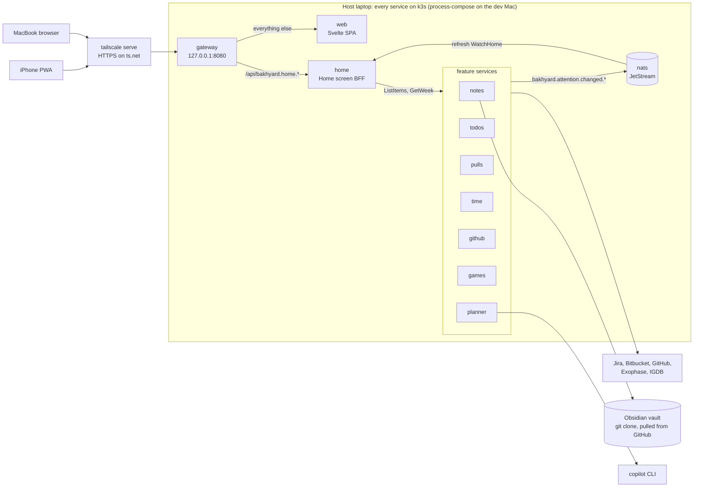

# Bakhyard work plan

Version 1.3, 2026-10-18. Replaces v1.2: the first attempt was archived and the build restarted in small, reviewed steps.

Bakhyard is a self-hosted dashboard for one person. It runs at home on an always-on laptop with k3s and brings together Obsidian notes, work (Jira todos, Bitbucket pull requests, hours logged on Jira, reviewer nudges), GitHub, games and a Copilot planner, used from a MacBook and an iPhone. The name is Bakh + backyard: personal, and it lives at home.

This document is the source of truth for scope and the work breakdown. How we work (rules, pipeline, quality gates) is canonical in [AGENTS.md](../AGENTS.md). Update the status markers as work lands.

**Contents**

0. [Status](#0-status)
1. [Goal and scope](#1-goal-and-scope)
2. [Feasibility](#2-feasibility)
3. [Product architecture](#3-product-architecture)
4. [System architecture: the microservices experiment](#4-system-architecture-the-microservices-experiment)
5. [Repo layout](#5-repo-layout)
6. [Toolchain and conventions](#6-toolchain-and-conventions)
7. [Visual identity](#7-visual-identity)
8. [Work breakdown](#8-work-breakdown)
9. [Decisions](#9-decisions)
10. [Risks](#10-risks)
11. [Estimate](#11-estimate)
12. [Open questions](#12-open-questions)
13. [Sources](#13-sources)

## 0. Status

**Restarted** on 2026-10-18. The first attempt was written in large batches by background agents and failed the clean-code bar: god packages, long files mixing unrelated concerns, and infrastructure built before anything needed it. It was archived outside the repo. The build restarts in small steps, each going through the pipeline in [AGENTS.md](../AGENTS.md) and a PR the user reviews.

The v1.2 design in §4 to §6 stays as reference. A piece of it is built only when a step needs it.

| Id | Step | Status |
| --- | --- | --- |
| `agents-md` | AGENTS.md, this status, the first attempt archived | Done (#1) |
| `agents` | A dedicated custom agent for each pipeline role | Done (#3), later dropped (decision 38) |
| `ci-baseline` | CI with mise, Renovate, SonarQube Cloud, jactionlint | Done (#2) |
| `go-toolchain` | Go module, golangci-lint with the gates, coverage gate, `mise run check`, and the smallest `home` service: `GET /healthz` | Done (#4) |
| `home-service` | `home` serves the demo data (§4.13) | Done (#5) |
| `gateway` | The gateway in front of `home` | Done (#6) |
| `chi-router` | Route with chi instead of `net/http.ServeMux` (decision 42) | Done (#7) |
| `openapi` | Generate the public JSON APIs from OpenAPI specs | Dropped (#8 closed, decision 43) |
| `code-first` | Record decision 43: the public JSON APIs stay hand-written | Done (#9) |
| `web-scaffold` | The Svelte app in `apps/web`, its toolchain and the web gates (decision 44) | Done (#10) |
| `visual-identity` | Replace §7 with the new visual identity (decision 45) | Done (#11) |
| `time-worklogs` | Record how time is logged on Jira and what the Time module does (decision 46) | Done (#15) |
| `renovate-age` | Renovate waits a day for npm releases, as pnpm does (decision 47) | Done (#16) |
| `web-service` | A Go `web` service serves the built app; the gateway sends every path outside `/api` to it (decision 48) | Done (#17) |
| `home-style` | The page style per §7: the tokens for both themes, the fonts, the paper grain and the base styles | Done (#18) |
| `home-header` | The top bar's time and city, the header with the wordmark and the nav, and the focus outline | Done (#19) |
| `home-name` | `home` serves `name` from `BAKHYARD_NAME`, falling back to "there" (§4.11) | Done (#20) |
| `home-hero` | The hero (date, greeting and summary) and the top bar's Online or Offline (decision 49) | Done (#21) |
| `home-feed` | The "Needs you today" card, from `/api/home`, with rows that link to their app (decision 50) | Done (#22) |
| `home-apps` | The "Your apps" grid: a card per app that links to its page, with its count of items | Done (#23) |
| `home-week` | The "This week" card with the weekly hours bar, and the section head's text link to Time | Done (#24) |
| `home-phone` | The phone and tablet frame per §7: the bottom tab bar and safe areas (decision 52) | Done (#25) |
| `app-pages` | Each path shows its page in place, through the Navigation API: the Home, a "Coming soon" page per app, More at `/more`, and "Page not found" elsewhere (decision 53) | Done (#26) |
| `cockpit-manifest` | `services.toml` lists the services; `cockpit list` checks it and prints them in start order (decision 54) | Done (#27), later dropped (decision 61) |
| `cockpit-up` | `mise run up` builds the services and runs them in start order, each in its own process group, with each line of output marked with its service; Ctrl-C stops them in reverse order, with SIGTERM and then SIGKILL after 10 s (decision 55) | Done (#28), later dropped (decision 61) |
| `service-env` | The services take their address and peers from `BAKHYARD_LISTEN` and `BAKHYARD_PEERS` (§4.7), their shared server setup moves to the root `internal/`, and they shut down gracefully on SIGTERM (decision 56) | Done (#29) |
| `cockpit-control` | The supervisor starts, stops, kills and restarts each service on its own and reports each one's state; `cockpit up` runs on it (decision 57) | Done (#30), later dropped (decision 61) |
| `cockpit-tui` | `cockpit` opens a table of the services, with keys to start, stop, kill and restart each one; quitting stops them all (decision 58) | Done (#32), later dropped (decision 61) |
| `cockpit-usage` | The table shows each running service's CPU and memory, measured every 2 s with one `ps` call (decision 59) | Done (#33), later dropped (decision 61) |
| `cockpit-health` | Every service answers `GET /healthz`, the gateway included; the cockpit checks them every 2 s and the table shows each one's health (decision 60) | Done (#34); the cockpit part later dropped (decision 61) |
| `cockpit-wait` | The cockpit starts a service only once the services it depends on are healthy | Dropped (#35 closed, decision 61) |
| `cockpit-logs` | Each service's log in the TUI | Dropped: process-compose has it (decision 61) |
| `cockpit-restart` | A service that crashes restarts with backoff | Dropped: process-compose has it (decision 61) |
| `process-compose` | process-compose runs the services in place of the cockpit, which is removed (decision 61) | Done (#36) |
| `spike-https-push` | The Phase 0 spike (§8.2): HTTPS through `tailscale serve`, the identity headers, Web Push and Google sign-in, tested on the iPhone and the Mac; the findings are in §2, §3 and §10 (decisions 62 to 65) | Done (#38) |
| `spike-games-access` | The Phase 0 spike (§8.2): which HTTP client reads Exophase's JSON, IGDB's token, search and covers, and the Backloggd reviews RSS; the findings are in §2, §3 and §10 (decisions 66 to 68) | Done (#39) |
| `spike-vault-sync` | The Phase 0 spike (§8.2): how the host reads the vault in place from iCloud, notices changes and reads notes macOS has offloaded; the findings are in §2, §3 and §10 (decisions 69 to 71) | Done (#40) |
| `spike-copilot-sdk` | The Phase 0 spike (§8.2): how the planner service signs in to Copilot, runs plan mode with only the tools it needs and receives the plan; the findings are in §2, §3 and §10 (decisions 72 to 75) | Done (#43) |
| `biome-lockfile` | Biome leaves `pnpm-lock.yaml` alone: Biome 2.6 formats YAML, and the lockfile is pnpm's to write | Done (#44) |
| `auth-tailscale` | The gateway lets in only the user's Tailscale login, on the ts.net name that `tailscale serve` publishes; every other request but `/healthz` gets a 403 (decisions 76 and 77) | Done (#45) |
| `signin-google` | The gateway signs the user in with Google and lets through only their own verified email, with the client secret from the Keychain; it keeps no session yet (decisions 78 to 80) | Done (#46) |
| `signin-session` | Each sign-in starts a session in the gateway's own Postgres database and gives the browser its cookie; nothing checks it yet (decisions 81 and 82) | Done (#47) |
| `host-laptop` | The host moves from a Mac to an old laptop at home, always on, with single-node k3s; the vault reaches it through git, and its secrets are Kubernetes Secrets (decisions 83 to 85) | Done (#48) |
| `signin-lock` | Every request but `/healthz` and the sign-in routes needs a live session, which each use renews; a page load without one goes to Google, any other request gets a 401, on which the app reloads, and no service receives the session cookie (decision 86) | Done (#49) |
| `signin-screen` | Only `/api` needs a session: the app's files load with the Tailscale identity alone, and on a 401 the app shows a sign-in screen, whose button starts the Google sign-in; still no service receives the session cookie (decision 86) | Done (#50) |
| `signin-pin` | The first sign-in with the allowed email pins its Google account, by its `sub`, and every later sign-in needs that account too; another account with the same email gets a 403 (decision 87) | Done (#51) |
| `signout` | The header's Sign out ends the session on this device only, drops its cookie and shows the sign-in screen; the gateway refuses every request but GET, HEAD and OPTIONS from another origin (decision 88) | Done (#52) |
| `app-icon` | The app gets an icon of its own, a geometric mark: the favicon, the iPhone Home Screen icon and a web app manifest's, so Chrome can install the app; a `theme-color` per scheme matches the top bar (decision 89) | Done (#53) |
| `theme-toggle` | A header toggle, System → Light → Dark, overrides the OS's colour scheme on this device; the page, the browser's controls and `theme-color` follow it at once, and a script in `<head>` applies the saved choice before the first paint (decision 90) | Done (#54) |
| `readme` | A README at the root says what Bakhyard is and how to run it, and `mise.local.example.toml` lists the local settings to start from | Done (#55) |
| `notes-list` | A `notes` service lists the vault's files, and the gateway forwards `/api/notes` to it; the first of `vault-index`'s three steps (decision 91) | Done (#56) |
| `notes-read` | Notes returns one listed file on `GET /api/notes/files/<path>`, with headers that keep it from running a script in the app's origin, and the gateway forwards the paths under `/api/<svc>/` (decision 92) | Done (#58) |
| `notes-sync` | `POST /api/notes/sync` scans the vault again and swaps in the new list whole; a failed scan keeps the old one. The last of `vault-index`'s three steps (decision 93) | Done (#59) |
| `notes-browse` | The Notes page lists the vault's notes as a folder tree, with a filter and a Sync button, and each note links to its own page; the first of `vault-render`'s five steps (decisions 94, 97) | Done (#60) |
| `security-headers` | Every response from the gateway carries a Content-Security-Policy, `X-Content-Type-Options: nosniff` and `Referrer-Policy: same-origin`, unless it sets its own (decision 95) | Done (#61) |
| `notes-view` | A note's page at `/notes/<path>` shows the note: its folder and name in the head, its frontmatter as a Properties block, and its Markdown as Obsidian's reading view shows it, but for links, embeds, callouts and math; the second of `vault-render`'s five steps (decision 96) | Done (#62) |
| `notes-links` | A note's wikilinks, in its text and its Properties block, link to the notes they name, found as Obsidian finds them, in the linking note's folder first; one that leads nowhere shows its text dimmed; the third of `vault-render`'s five steps (decision 97) | Done (#64) |
| `notes-embeds` | An image embed, `![[x.png]]`, shows the image where it stands, never wider than the note; the fourth of `vault-render`'s five steps (decision 98) | Done (#65) |
| `notes-math` | A note's LaTeX shows as math, rendered with KaTeX: `$…$` in line with the text and `$$…$$` as a block; callouts wait until the vault has one. The last of `vault-render`'s five steps (decision 99) | Done (#66) |
| `biome-yaml` | The web app runs Biome 2.6.3, which formats YAML, and its YAML keeps single quotes, like its TypeScript (decision 100) | Done (#68) |
| `renovate-dedupe` | Renovate runs `pnpm dedupe` after it updates the web app's lockfile, so an update keeps no older copy of a package where the newer one can serve (decision 101) | Done (#69) |
| `shared-database` | The Keychain reader and the database code move from the gateway to the root `internal/`, for the `todos` service, and each service embeds its own migrations. The first of `todos-jira`'s twenty-seven steps (decisions 102 and 104) | Done (#70) |
| `todos-service` | A new `todos` service, with a database and a role of its own, lists the todos on `GET /api/todos`, newest first, and the gateway forwards to it. The second of `todos-jira`'s twenty-seven steps (decisions 104 and 105) | Done (#71) |
| `todos-add` | `POST /api/todos` adds a todo and answers with it; the title is trimmed and must have 1 to 500 characters, counted in code points, and no control character. The third of `todos-jira`'s twenty-seven steps (decision 106) | Done (#72) |
| `e2e-gateway` | `mise run build:e2e` builds a gateway for the end-to-end tests: the real one's routes and headers, but no lock, so it needs no Tailscale identity, session, Google client, Keychain or database. The first of the two end-to-end steps (decision 107) | Done (#73) |
| `e2e-playwright` | Playwright end-to-end tests drive the built app through that gateway, in a desktop Chromium and a phone WebKit, answering its API calls in the browser; `mise run check` runs them after its other gates, and so does CI. The second of the two end-to-end steps (decision 107) | Done (#74) |
| `todos-page` | The Todos page lists the todos, newest first, and loads them each time it shows; adding one moves to a new step, `todos-form`. The fourth of `todos-jira`'s twenty-seven steps (decision 108) | Done (#75) |
| `todos-form` | A form on the Todos page adds a todo, which lands on top of the list; the service alone checks the title, and a refused or failed add keeps the text in the field. The fifth of `todos-jira`'s twenty-seven steps (decision 109) | Done (#76) |
| `todos-edit` | `PATCH /api/todos/{id}` ticks a todo done or not, renames it or both, and `DELETE /api/todos/{id}` deletes it for good; each todo now has a done mark. The page's controls for them move to three new steps, `todos-tick`, `todos-rename` and `todos-delete`. The sixth of `todos-jira`'s twenty-seven steps (decision 110) | Done (#77) |
| `todos-tick` | Each row of the Todos page has a checkbox that ticks the todo done or not at once, then saves it; a failed save puts the box back and says so in the row. The seventh of `todos-jira`'s twenty-seven steps (decision 111) | Done (#78) |
| `form-styles` | The Notes page's tools and the Todos page's form take their field, button and status line from one shared stylesheet, which `todos-rename`'s editor will use too; nothing changes on screen (decision 112) | Done (#79) |
| `todos-rename` | Each row of the Todos page ends with an Edit button that opens an editor in the row; Enter or Save renames the todo, and a refused or failed save keeps the editor open and says why. The eighth of `todos-jira`'s twenty-seven steps (decision 113) | Done (#80) |
| `todos-editor` | The Todos page's row editor, `Rename`, becomes `Editor`, ahead of `todos-delete`, which adds Delete to it; nothing changes on screen or in behaviour | Done (#81) |
| `todos-delete` | The row's editor gains a Delete button, which asks in a dialog first, then deletes the todo for good; the focus moves on to the next row. The ninth of `todos-jira`'s twenty-seven steps (decision 114) | Done (#83) |
| `todos-priority` | Each todo has a priority, High, Normal or Low, which the `todos` service lists and `PATCH /api/todos/{id}` changes; the todos stored before it are Normal, as a new one is. The page's groups and its way to set a priority move to two new steps, `todos-groups` and `todos-prioritise`. The tenth of `todos-jira`'s twenty-seven steps (decision 115) | Done (#84) |
| `shell-section` | Home's section head, `Section`, and its arrow move to the app's shared `shell` folder, ahead of `todos-groups`, which gives each group a section head; the Notes tree takes the arrow from there too. Nothing changes on screen or in behaviour | Done (#85) |
| `todos-groups` | The Todos page shows the todos in a section per priority, High, Normal, then Low, each with a section head and its count, and leaves out a priority without todos; a new todo lands on top of the Normal group. The eleventh of `todos-jira`'s twenty-seven steps (decision 116) | Done (#86) |
| `todos-focus` | The Todos page's focus handling, which gives the focus back to a row's Edit button or the Add field, moves out of the row editor into a class of its own, `Focus`, ahead of `todos-prioritise`, which adds a control to the editor; nothing changes on screen or in behaviour | Done (#87) |
| `todos-prioritise` | The Todos page's row editor sets a todo's priority with three radios, High, Normal and Low, between the title field and the buttons. Save sends the new title and priority in one request, and the todo moves to its new group, with the focus on its Edit button there. The twelfth of `todos-jira`'s twenty-seven steps (decision 117) | Done (#88) |
| `todos-position` | The `todos` service keeps one order of all the todos, which the list follows: a new todo goes on top, and `PATCH /api/todos/{id}` moves a todo right before or right after another with `before` or `after`. The page's ways to move a todo go to two new steps, `todos-move` and `todos-drag`. The thirteenth of `todos-jira`'s twenty-seven steps (decision 118) | Done (#89) |
| `todos-move` | The Todos page's row editor moves a todo a place up or down in its group with Move up and Move down, the way without a drag, from the keyboard too; each press sends one `PATCH` with `before` or `after` at once, and the editor stays open with the title and priority unsaved. The fourteenth of `todos-jira`'s twenty-seven steps (decision 119) | Done (#90) |
| `todos-drag` | Each row of the Todos page ends with a grip that drags the todo, with a mouse, a pen or a finger, to another place in its group, or into another group, whose priority it then takes. The row moves at once, one `PATCH` saves the place and the priority, and a failed save puts the todo back. The fifteenth of `todos-jira`'s twenty-seven steps (decision 120) | Done (#91) |
| `jira-search` | The `todos` service searches Jira for my open tickets, those assigned to me whose status isn't in the Done category, each time `GET /api/todos/tickets` asks, and answers each one's key, summary, status, status category and link. It reads the site, the API's URL and the email from three settings, and the scoped token from the Keychain, and runs without Jira when none is set. Polling and the page's list move to two new steps, `jira-poll` and `jira-list`. The sixteenth of `todos-jira`'s twenty-seven steps (decision 121) | Done (#92) |
| `jira-poll` | The `todos` service searches Jira for my open tickets as it starts and every 5 minutes after, and `GET /api/todos/tickets` answers the latest list without a search of its own, with when that search began and why the latest search failed, if it did; a request that comes before the first search has ended waits for it. Every service's routes now get a context that ends as the service stops. The seventeenth of `todos-jira`'s twenty-seven steps (decision 122) | Done (#93) |
| `list-rows` | Home's "Needs you" rows and §7's chips, the Late chip and a note's Properties chips, take their styles from two shared stylesheets, which `jira-list`'s ticket rows will use too; nothing changes on screen but the Late chip's letter-spacing, now a hair narrower, as a note's chips have it (decision 123) | Done (#94) |
| `jira-list` | The Todos page lists my open Jira tickets in a section of their own after the priority groups, once the todos have loaded: each ticket a row that links to it in Jira, with its key, its summary and its status in a chip, filled for the In Progress category. The section says when the last search failed and how old its tickets are, or that the tickets couldn't load, and isn't there without Jira. The eighteenth of `todos-jira`'s twenty-seven steps (decision 124) | Done (#95) |
| `todos-ticket` | Each todo can name a Jira ticket by its key, such as `ABC-123`, which `GET /api/todos` lists and `PATCH /api/todos/{id}` sets, changes or clears; a ticket that isn't a Jira key gets a 400. The row's badge and the editor's picker move to two new steps, `todos-badge` and `todos-link`. The nineteenth of `todos-jira`'s twenty-seven steps (decision 125) | Done (#96) |
| `todos-badge` | A todo that names a Jira ticket shows it under its title: the key, then the ticket's status in the Jira section's chip when my open tickets include it, or the key alone. The badge is part of the box's label, so a tap on it ticks the todo, and a done todo's title alone is struck through. The twentieth of `todos-jira`'s twenty-seven steps (decision 126) | Done (#97) |
| `todos-draft` | The Todos page's row editor keeps its draft, the title as typed and the priority as picked, in a class of its own, `Draft`, which also says what the draft changes in its todo, ahead of `todos-link`, which adds the ticket to it; nothing changes on screen or in behaviour | Done (#98) |
| `todos-link` | The row's editor links a todo to one of my open Jira tickets, or unlinks it: a select after the priority offers "No ticket", the todo's own ticket and my open tickets by key and summary, and Save sends the pick with the title and the priority. The twenty-first of `todos-jira`'s twenty-seven steps (decision 127) | Done (#99) |
| `todos-from-ticket` | `POST /api/todos` adds a todo that names a Jira ticket too, `{"title":"…","ticket":"ABC-123"}`, for the Todos page's inbox; an empty, `null` or missing ticket adds a todo without one, and a ticket that isn't a Jira key gets a 400. The planned `jira-inbox` splits in four: this step, `jira-inbox`, `jira-dismiss` and `inbox-dismiss`. The twenty-second of `todos-jira`'s twenty-seven steps (decision 128) | Done (#100) |
| `jira-inbox` | The Todos page's "Jira inbox", between the form and the priority groups, lists my open tickets that no todo names, each with an Add button that makes it a todo titled with its summary, on top of Normal; the row then leaves the inbox. The todos, the form and the inbox show once my open tickets have loaded too, so the inbox never pushes the todos down. The twenty-third of `todos-jira`'s twenty-seven steps (decision 129) | Done (#101) |
| `jira-dismiss` | The `todos` service keeps the Jira tickets I dismiss from the Todos page's inbox, by key and for good, in a `dismissals` table of its own (migration 00006): `PUT /api/todos/dismissals/{key}` dismisses one and answers 201, or 204 when it was dismissed already, and `GET /api/todos/dismissals` lists them in byte order, `{"dismissals":["ABC-123"]}`. A key that isn't a Jira key gets a 400. The twenty-fourth of `todos-jira`'s twenty-seven steps (decision 130) | Done (#103) |
| `inbox-dismiss` | Each row of the Todos page's Jira inbox gets a Dismiss button after Add, which dismisses its ticket for good: once the service has answered, the row leaves the inbox, and the ticket stays out of it on every device, while the Jira section still lists it. The todos, the form, the inbox and the Jira section wait for the dismissed tickets too; when they fail to load, there's no inbox. On a phone, the buttons get a line of their own under the summary. The twenty-fifth of `todos-jira`'s twenty-seven steps (decision 131) | Done (#104) |
| `sonar-on-demand` | SonarQube Cloud checks `main` on demand rather than every PR and push: started by hand, the CI workflow runs its SonarQube Cloud job alone, once 20 PRs have been merged since the last run and after each §8.2 feature's last step, and `main` requires only the `check` job (decision 132) | Done (#105) |
| `jira-done` | Each Jira poll of the `todos` service also fetches the tickets that its todos left to do name and that aren't among my open tickets, with Jira's bulk fetch, and `GET /api/todos/tickets` answers those that are done as `done`, beside my open tickets. A poll whose fetch fails fails whole, as a failed search does, and the answer keeps what the last poll to succeed found. The twenty-sixth of `todos-jira`'s twenty-seven steps (decision 133) | Done (#106) |
| `tick-offer` | On the Todos page, a todo left to do whose Jira ticket is done shows the ticket's status in its badge, then "Done in Jira", which offers to tick it: a tap on the offer ticks the todo, as a tap on its title does, and the offer goes. The inbox, the Jira section and the editor's choices still list my open tickets alone. The twenty-seventh of `todos-jira`'s twenty-seven steps (decision 134) | Done (#108) |
| `shared-poller` | The loop of the `todos` service's Jira poller moves to the root `internal/` as a generic poller, `poll.Poller`, with which the `pulls` service will poll Bitbucket too; the `jira` package keeps the search, the todos' keys and the bulk fetch, the five minutes and the log's `poll Jira`. Nothing changes in behaviour, and `GET /api/todos/tickets` answers the same bytes. The first of `bitbucket-prs`'s eight steps (decision 135) | Done (#109) |
| `deploy-plan` | The plan records how Bakhyard will run on the laptop's k3s, whose cluster the GitOps session builds and runs from the user's private homelab repo: the gateway behind Tailscale's Kubernetes operator, with default-deny NetworkPolicies for every service; images built by the homelab's Gitea and pulled from its registry; the shared CloudNativePG cluster; Secrets mounted as files; notes later, once the vault syncs through Gitea; and the laptop's alerts later, through Bakhyard. `deploy-k3s` becomes three steps, `deploy-images`, `secrets-files` and `deploy-apps`, and `homelab-alerts` joins Phase 7 (decisions 136 to 142) | Done (#111) |
| `bitbucket-client` | The `pulls` service gets its Bitbucket client: it finds me through `GET /2.0/user`, then lists my open pull requests in each workspace it's given, page by page through Bitbucket's `next` links, on the API's own host only, and answers them in one list, the latest updated first. The second of `bitbucket-prs`'s eight steps (decision 143) | Done (#112) |
| `shared-secure-url` | Todos' check that a token's URL is https, or http to a loopback IP address for a stand-in in tests, moves to the root `internal/env` as `env.SecureURL`, for the `pulls` service's Bitbucket API, its second user. The third of `bitbucket-prs`'s ten steps (decision 144) | Done (#113) |
| `shared-poll-handler` | A poller answers what it has found over HTTP itself: once its first poll has ended, it answers the snapshot as JSON, and a client that leaves before then gets nothing. Todos' `GET /api/todos/tickets` keeps its own 404 for a Jira that isn't set up and answers the same bytes, and the `pulls` service's `GET /pulls/mine` will answer through the same code. The fourth of `bitbucket-prs`'s eleven steps (decision 145) | Done (#114) |
| `pulls-service` | A new `pulls` service polls my open pull requests on Bitbucket as it starts and every 5 minutes after, and answers them at `GET /pulls/mine`, with when the latest poll to succeed began and why the latest poll failed, if it did. Its settings name Bitbucket's API, an https URL, the account's email and the workspaces' slugs, and its token is in the Keychain; without any of the settings it runs without Bitbucket and answers 404, and with only some it doesn't start. `mise run up` runs it on port 8085; the gateway reaches it in the next step. The fifth of `bitbucket-prs`'s eleven steps (decision 146) | Done (#115) |
| `pulls-gateway` | The gateway forwards `/api/pulls` to the `pulls` service, behind both of its locks, so the app reaches my open pull requests at `GET /api/pulls/mine`. `pulls` is one of the gateway's peers, each of which `BAKHYARD_PEERS` must name, and `mise run up` starts the gateway once pulls is ready. The sixth of `bitbucket-prs`'s eleven steps (decision 144) | Done (#116) |
| `shared-snapshot` | The app's loader of a poller's snapshot moves from the Todos page's Jira tickets to the shell, with the label that says when the latest poll to succeed began, for the PRs page, its second user. A 404 still means that the source isn't set up, and a snapshot with neither `searched` nor `failure` still counts as a failed load: `searched` stands in for `tickets`, since a poll that succeeds sets both. The seventh of `bitbucket-prs`'s twelve steps (decision 147) | Done (#117) |
| `own-deepmerge` | vite-plugin-svelte merges its options with a merge of our own, in `apps/web/overrides/deepmerge`, rather than with deepmerge 4.3.1, which has GHSA-gcqx-w48m-w2h4 and no fix, so `pnpm audit` passes again without ignoring an advisory. A pnpm override links the plugin's `deepmerge` to it, and the built app stays byte for byte the same (decision 148) | Done (#118) |
| `pulls-page` | The PRs page lists my open pull requests on Bitbucket, from `GET /api/pulls/mine`, each time it shows: a row per PR with its number, title and repository, linked to the PR on Bitbucket, and a Draft chip on a draft. It says when the last search failed, when I have no open PR, and when Bitbucket isn't set up. The eighth of `bitbucket-prs`'s twelve steps (decision 149) | Done (#119) |
| `deploy-now` | The plan records the user's choices for a product to use: the laptop gets the features that are done before any new one, through `deploy-k3s`'s steps, notes included, whose vault comes from Gitea's mirror through a git-sync sidecar that tells notes to scan again after each sync; Flux rolls out each new image by itself; and the agent may run read-only `kubectl` and `flux` commands against the laptop's cluster. `deploy-k3s` gains `notes-reopen`, and `home-feed` comes right after it (decisions 150 to 152) | Done (#120) |
| `deploy-images` | Each service gets a multi-stage Dockerfile, built from the repo's root, and the repo a `.dockerignore`. A workflow in `.gitea/workflows/`, which only the homelab's Gitea runs, builds the six images with the cluster's BuildKit on each push to `main` that the mirror brings, and pushes them to Gitea's registry as `codedogapp/bakhyard/<service>`, tagged `main` and `main-<commit time>-<sha>`. `lint:actions` lints that workflow too, and Renovate keeps the Dockerfiles' and the workflow's pinned versions current. The first of `deploy-k3s`'s four steps (decision 153) | Done (#121) |
| `secrets-files` | The gateway, todos and pulls read their secrets through a new reader, `internal/secrets`: from the files in the folder that `BAKHYARD_SECRETS` names, where the laptop mounts its Kubernetes Secrets, each file named as the secret's Keychain account; or, with the setting unset, as on the Mac, from the login Keychain as before. A file is read exactly, through `os.Root`, so Kubernetes' links to the Secret's current version read and nothing outside the folder does; a missing, empty or unreadable file stops the service with an error that names it. The second of `deploy-k3s`'s four steps (decision 154) | Done (#122) |
| `notes-reopen` | Each scan of the vault opens the vault's folder again, the first scan included, so a scan after git-sync has swapped the vault's link to a new checkout reads that checkout. A file is read through the folder of the scan that listed it, so a list and its files always come from one checkout, and a Sync closes the folder of the list it replaces. A scan that fails, the folder's included, keeps the list. The third of `deploy-k3s`'s four steps (decision 155) | Done (#123) |
| `images-registry` | The images workflow reads the registry's host from Gitea's organisation variable `REGISTRY`, since in a Gitea job the server's URL is the runner's in-cluster address, and stops with a message when the variable is missing. Each image gets one tag, `main`, whose digest Flux follows, since the homelab's Gitea removes every other tag each night. A fix to `deploy-images` (decision 156) | Done (#124) |
| `attention-contract` | The first contract between services, `bakhyard.attention.v1` in `proto/`, whose `AttentionService.ListItems` lists what a service has that needs me, for the Home's "Needs you today". buf lints and formats it and generates its Go code into `internal/gen`, which `mise run gen:check` keeps in step with it. Every service now answers gRPC over HTTP/2 without TLS (h2c) as well as HTTP/1.1, and pulls answers `ListItems` with my open pull requests. The first of `home-feed`'s five steps (decision 158) | Done (#126) |
| `todos-attention` | todos answers the attention contract with the todos left to do that need me: each High todo, and each todo whose Jira ticket the latest poll to succeed found done, the one the Todos page offers to tick. Each item's detail says why, after the ticket's key when it names one, and its source is Jira with a ticket and unset without one. The second of `home-feed`'s steps (decision 159) | Done (#128) |
| `inbox-attention` | todos also lists the Jira inbox's tickets over the attention contract, by the Todos page's rule: my open tickets from the latest poll to succeed that no todo names and that I haven't dismissed. Each item is the ticket's key and summary, the detail "In the Jira inbox" after the key, and Jira as its source; they come before the todos. The third of `home-feed`'s steps (decision 160) | Done (#130) |
| `home-week-optional` | The Home leaves out "This week", its head, its "Day report" link and its card, when home's answer has no week, as the answer won't have one once `home-fanout` drops the demo week and until the time service logs hours; the page then ends with "Your apps". A later answer with a week brings the section back. The fourth of `home-feed`'s steps (decision 161) | Done (#131) |
| `home-fanout` | The Home lists what needs me for real: home asks each peer in its own `BAKHYARD_PEERS`, todos and pulls, for its items over the attention contract, all at once and each with 1.5 s to answer, and sorts them. A peer without the contract lists nothing; one that fails or is late is left out and logged, while the rest still show. An item without an outside source gets "Bakhyard" as its source. The demo items and the demo week are gone, and every entry of `BAKHYARD_PEERS` is now checked. The fifth of `home-feed`'s steps (decision 167) | Done (#133) |
| `sonar-fixes` | Clears the eleven issues that SonarQube Cloud's run after `home-fanout` found, one of which turned its gate red: home builds its peers' addresses as the gateway and nudge build theirs; the nudge service's doors and the `nudge` tool's reporter take the context they stop with as an argument, or a `Close`, rather than in a field; the Bitbucket client's nested structs get names; notify's one-method interface becomes `Adder`; nudge's end-to-end tests assert what they check; and the app's push code reads the key's bytes as code points. Nothing changes on screen or on the wire (decision 168) | Done (#134) |
| `home-sources` | The Home says when some of its items are missing: home's answer lists how asking each of its peers went, `ok` or `unavailable`, in `BAKHYARD_PEERS`' order, and while online the top bar reads "Online · 1 source unavailable" or "Online · 2 sources unavailable". A peer that fails or doesn't answer within 1.5 s is unavailable; one that doesn't serve the contract is ok. The sixth and last of `home-feed`'s steps (decision 169) | Done (#135) |
| `deploy-facts` | The plan records how Bakhyard runs on the laptop now that `deploy-apps` is in, in the homelab repo: the pods' security settings and the Secrets' mode, the databases and their TLS, git-sync's settings, the registry credential that stays, the image automation's timing, Jira and Bitbucket there, and what the laptop started with. `deploy-apps`, and with it `deploy-k3s`, is done (decision 170) | Done (#136) |
| `bitbucket-reviews` | The `pulls` service finds the open pull requests that wait for my review, every 15 minutes: it lists each workspace's repositories, the latest updated first, and asks each of the 100 latest updated across the workspaces for its open pull requests with me among the reviewers. It answers them at `GET /api/pulls/reviews`, as it answers mine at `GET /api/pulls/mine`. The ninth of `bitbucket-prs`'s twelve steps (decision 171) | Done (#137) |
| `reviews-page` | The PRs page lists the open pull requests that wait for my review, from `GET /api/pulls/reviews`, in a section of their own under mine, "Review requests": the same rows and count, and its own words when there's none and when they couldn't load. Both lists load at once, and each shows once it's there. "Bitbucket isn't set up." shows only when both answer 404. The tenth of `bitbucket-prs`'s twelve steps (decision 172) | Done (#138) |
| `bitbucket-approvals` | The `pulls` service reads who reviews each of my open pull requests, and where each stands: approved, changes requested or pending. Bitbucket's list gives each PR's participants when it's asked with `fields=+values.participants`, so this costs no request more. The reviewers are the PR's reviewers and anyone else who has approved it or requested changes, but not its author, me. `GET /api/pulls/mine` answers them with each PR, for the next step to show. The last reviewer action from `/activity` is dropped. The eleventh of `bitbucket-prs`'s twelve steps (decision 173) | Done (#140) |
| `approvals-page` | The PRs page says where each of my open pull requests stands with its reviewers, in a line under the repository in the row's detail style: "Changes requested by Cy · Waiting for Ben and Dee · Approved by Ana", the most urgent first, or "No reviewers". The rows of the review requests don't change. The last of `bitbucket-prs`'s twelve steps (decision 174) | Done (#141) |
| `shared-notifier` | The client that asks the notify service to push a notification moves from nudge to the root `internal/notifier`, for the `pulls` service's PR reminders, its second user; nothing changes in behaviour. The first of `pr-reminders`' three steps (decision 175) | Done (#142) |
| `bitbucket-mergeability` | The Bitbucket client reads how many approvals one of my pull requests has and how many it needs, from its merge checks: the `minimum_approvals` check of the restriction on its target branch that requires the most. Without one, the PR needs one approval and has those of its reviewers who approved. Nothing calls it yet. The second of `pr-reminders`' three steps (decision 176) | Done (#143) |
| `pulls-reminders` | At 10:00 and 15:00 on weekdays, in its time zone, the `pulls` service pushes one notification through notify, "Remind your reviewers", that lists my open pull requests that aren't drafts, were opened more than a day before and have fewer approvals than they need, a line each, such as "Fix the login (acme/web #1): 1 of 2 approvals"; a tap opens the PRs page. Without notify among its peers, pulls reminds no one. The last of `pr-reminders`' three steps (decision 177) | Done (#144) |
| `icon-button` | The theme toggle's look, an icon with the header's hover underline under it, moves to a shared stylesheet as a class, `.icon-button`, which `notify-header`'s notifications bell will use too; nothing changes on screen. The first of the two steps that finish `notifications` (decision 178) | Done (#145) |
| `notify-header` | The control that turns notifications on moves from the Nudge page to a bell in the header, before the theme toggle: its name and look say how this device's notifications stand, and its panel says it in words and turns them on. The last step of `notifications` (decision 179) | Done (#146) |
| `shared-jira` | todos' Jira client moves to the root `internal/jira`, with the code that reads its settings and token, for the `time` service; todos' poller of my tickets moves to a package of its own, `tickets`. Nothing changes in behaviour. The first of `time-tracking`'s eleven steps (decision 180) | Done (#147) |
| `jira-worklogs` | The shared Jira client reads my worklogs in a span of time: my account from `/myself`, the tickets I logged work on from a `worklogAuthor` search, then each ticket's worklogs, keeping mine that start in the span, the earliest first. The second of `time-tracking`'s eleven steps (decision 180) | Done (#148) |
| `time-report` | A package of the new `time` service, `report`, works out the time report from my worklogs: the hours I logged on each of the last 7 days, the weekdays before today with nothing logged marked as missing, and this week's hours against its 40-hour target. The third of `time-tracking`'s twelve steps (decision 181) | Done (#149) |
| `time-service` | A new `time` service polls Jira for my worklogs of the last 7 days as it starts and every 5 minutes after, and answers the time report at `GET /time/report`, with when the latest poll to succeed began and why the latest poll failed, if it did. It reads todos' Jira settings and token: without them it answers 404, and with only some it doesn't start. `mise run up` runs it on port 8088 and the Gitea workflow builds its image; the gateway reaches it with `time-gateway`. The fourth of `time-tracking`'s twelve steps (decision 182) | Done (#150) |
| `time-gateway` | The gateway forwards `/api/time` to the `time` service, behind both of its locks, so the app reaches my time report at `GET /api/time/report`. `time` is one of the gateway's peers, each of which `BAKHYARD_PEERS` must name, and `mise run up` starts the gateway once time is ready. The sixth of `time-tracking`'s twelve steps (decision 181) | Done (#151) |
| `week-card` | The Home's "This week" card, the hours logged against the target over a bar, moves with its formatting and the week's type to the Time app's own folder, `src/time`, as a component of its own, `WeekCard`, ahead of `time-page`, which shows it too; nothing changes on screen or in behaviour. The seventh of `time-tracking`'s thirteen steps (decision 183) | Done (#152) |
| `time-page` | The Time page, at `/time`, shows the time report: this week's hours against the target on the Home's week card, then the last 7 days, a row each with the date, the weekday or "Today" and the hours logged, a Missing chip on each weekday before today without hours, and the missing days' count as the section's note. It loads the report each time it shows, says why the last search failed and when its hours are from, and says when Jira isn't set up or the report couldn't load. The eighth of `time-tracking`'s thirteen steps (decision 184) | Done (#153) |
| `time-week` | The second contract between services, `bakhyard.time.v1`, whose `TimeService.GetWeek` answers this week's hours against the week's target, for the Home's "This week". The time service answers it from the latest read of my worklogs to succeed: with no week when Jira isn't set up, and with `UNAVAILABLE` while no read has succeeded. The ninth of `time-tracking`'s thirteen steps (decision 185) | Done (#154) |
| `home-time-week` | The Home's "This week" shows my real week: home asks the time service for it over the time contract, at the same time as it asks its peers for their items and with the same 1.5 s, and answers it as the Home's `week`, beside a new `weekState` that says how asking went, `ok` or `unavailable`. A week that time couldn't give still leaves "This week" out, until `week-unavailable` shows "Hours unavailable". The tenth of `time-tracking`'s fourteen steps (decision 186) | Done (#155) |
| `week-unavailable` | The Home's "This week" says "Hours unavailable" when home couldn't get the week from the time service, its `weekState` being `unavailable`: the head and its "Day report" link stay, and the card says so in place of the hours, in their type and in `--ink-muted`, without the "Logged on Jira" label and the bar. With `ok` and no week, as without Jira, or with neither member, the section stays out (decision 161). The eleventh of `time-tracking`'s fourteen steps (decision 187) | Done (#156) |
| `time-attention` | The time service answers the attention contract, so the Home's "Needs you" lists the hours to log on Jira: a row for each weekday of the last 7 days with nothing logged, today's included until anything is logged, each due at 17:00 on its day, so the days before today show as late. The twelfth of `time-tracking`'s fourteen steps (decision 188) | Done (#157) |
| `jira-add-worklog` | The shared Jira client adds a worklog to one of my tickets, for the `time` service to take one: the work's start, with its own offset, and the time spent in whole seconds, keeping Jira's defaults; a key that isn't a Jira key fails before anything is sent, and decision 125's key rule moves from todos to the client. The thirteenth of `time-tracking`'s sixteen steps (decision 189) | Done (#158) |
| `poll-now` | The shared poller polls on request, between its timed polls: `PollNow` polls at once, or once the poll that runs has ended, and returns when its own poll is over, so `time` can read a new worklog before it answers. The fourteenth of `time-tracking`'s sixteen steps (decision 189) | Done (#159) |
| `shared-json-body` | The reader of a request's JSON body, a copy each in todos and notify, moves to a package of its own, `internal/jsonbody`, for `time` to read worklogs with; nothing changes in behaviour. The fifteenth of `time-tracking`'s eighteen steps (decision 190) | Done (#160) |
| `jira-own-writes` | The shared Jira client reads its own worklogs at once, though Jira's search finds them only seconds or minutes later: it remembers each ticket it adds a worklog to, with the latest start it added there, and each worklog read also reads the remembered tickets that the search didn't return, until that start leaves the span read. The sixteenth of `time-tracking`'s eighteen steps (decision 191) | Done (#161) |
| `worklog-add` | Time adds a worklog at `POST /time/worklogs`: a ticket, a date among the report's 7 days and whole minutes, starting at 09:00 in its zone, through the client that its poller reads with, then polls before it answers 201, so the report shows the worklog. The seventeenth of `time-tracking`'s eighteen steps (decision 192) | Done (#162) |
| `dialog-select-styles` | The Todos page's delete dialog, its primary button and the editor's ticket select take their looks from the shared stylesheets, as classes, which `fill-day`'s form and its dialog on the Time page will use too: `.dialog`, `.dialog-title` and `.dialog-text` in a new `dialog.css`, `.form-button-primary` and `.form-select` in `form.css`; nothing changes on screen. The eighteenth of `time-tracking`'s twenty steps (decision 193) | Done (#163) |
| `shared-tickets` | The types of my open Jira tickets and their loader, `loadTickets`, move from the Todos app's folder to `src/jira/tickets.ts`, so `fill-day`'s form on the Time page can load the same tickets from `GET /api/todos/tickets` without importing the Todos app's files; the Todos page's rules on them, `openTickets`, `doneTickets` and `inboxTickets`, stay in its folder; nothing changes on screen. The nineteenth of `time-tracking`'s twenty steps (decision 193) | Done (#164) |
| `fill-day` | The Time page fills a day: a form under the head picks one of the report's 7 days, the earliest missing one first, one of my open Jira tickets and the hours, and its Log asks in a dialog before the worklog goes to Jira through `POST /api/time/worklogs`; the page then shows the report again. The last of `time-tracking`'s twenty steps (decision 194) | Done (#165) |
| `nudge-merge` | Nudge, the user's phone-questions tool for agents (`codedogapp/nudge`), moves into Bakhyard: one app, not two (decision 157). The nudge session does the work, one small PR per step, from its plan, [`bakhyard-merge.md`](https://github.com/codedogapp/nudge/blob/main/docs/bakhyard-merge.md); this session doesn't stop its own steps for it | In review |
| `parallel-sessions` | Several sessions work at once, each on its own feature in a worktree of its own, with this session as the orchestrator: AGENTS.md says who works where, plan §0 and §9 give each session places of its own, the end-to-end tests take their ports from `BAKHYARD_E2E_PORT`, golangci-lint runs wait for each other, and the tests' time limits allow for the other sessions' load (decision 195) | Done (#166) |
| `github-widgets` | The GitHub widgets (§8.2 Phase 4), by a session of their own in `../bakhyard-github/`, which adds its steps' rows under this one (decision 195) | In progress |
| `shared-web-link` | The Bitbucket client's check that a PR's page is an https URL moves to a package of its own, `internal/weblink`, for the GitHub client, its second user; nothing changes in behaviour. The first of `github-widgets`' seven steps (decisions 200 and 201) | Done (#171) |
| `github-client` | A client of GitHub's search, in the new `github` service's folder, finds my open PRs, the PRs that wait for my review or one of my teams', and the open issues assigned to me, across every owner, in repositories that aren't archived, the latest updated first. It reads up to ten pages of 100, lists each item once, and fails the whole search on a bad answer or one that GitHub marks incomplete. Nothing calls it yet. The second of `github-widgets`' seven steps (decision 200) | In progress |
| `github-service` | A new `github` service polls the three searches as it starts and every 5 minutes after, and answers them at `GET /github/mine`, `GET /github/reviews` and `GET /github/issues`; without GitHub's settings it answers 404. `mise run up` runs it on port 8089 and the Gitea workflow builds its image. The third of `github-widgets`' seven steps (decision 200) | Pending |
| `homelab-github` | The homelab repo runs the `github` service on the laptop, with the token in a Secret, and names it among the gateway's and home's peers, before `github-gateway` makes the gateway require it. The fourth of `github-widgets`' seven steps (decision 200) | Pending |
| `github-gateway` | The gateway forwards `/api/github` to the `github` service, behind both of its locks. The fifth of `github-widgets`' seven steps (decision 200) | Pending |
| `github-page` | The app shows the three lists, on a page of their own at `/github` or beside Bitbucket's on the PRs page, as the user chooses. The sixth of `github-widgets`' seven steps (decision 200) | Pending |
| `github-attention` | The `github` service answers the attention contract, so the Home's "Needs you" lists what the user chooses of the review requests, the issues assigned to me and my PRs. The last of `github-widgets`' seven steps (decision 200) | Pending |
| `games-exophase` | The games widgets from Exophase (§8.2 Phase 5), by a session of their own in `../bakhyard-games/`, which adds its steps' rows under this one (decision 195) | In progress |
| `games-plan` | `games-exophase` splits in eleven steps: the Exophase client, the cache, the service, the Twitch token, the IGDB search, the covers, the laptop, the gateway, the page and its covers; the games list, the covers' matches and the Twitch token stay in memory. The first of `games-exophase`'s eleven steps (decision 300) | Done (#168) |
| `vault-edit-sync` | Editing the vault from Bakhyard (§8.2 Phase 6), by the vault session in `../bakhyard-vault/`, which adds its steps' rows under this one and then does `copilot-planner` (decision 195) | In progress |
| `vault-plan` | The vault session's first steps: where a save goes waits on the user's answer to §12's question on how edits get back to the Mac, so the version that a save checks and the editor come first; a note's version is the SHA-256 of its bytes, sent as its `ETag`, and a save is a `PUT` that sends it back in `If-Match` (decision 400) | Done (#167) |
| `note-etag` | notes answers each note with its version as a strong `ETag`, the SHA-256 of its bytes, and a matching `If-None-Match` with a 304 (decision 400) | Done (#169) |
| `note-editor` | A note's page shows an Edit button once `GET /api/notes` says saving is set up; Edit shows the note's Markdown in a CodeMirror 6 editor, and Cancel shows the note again and drops the edits, which nothing saves yet (decisions 400, 401) | Planned |
| `note-save` | The editor's Save sends the note with `PUT /api/notes/files/<path>` and `If-Match`, the version from the note's `ETag`; a saved note shows at once, and a note changed since gets a 412, which keeps the user's text and says so (decisions 400, 401) | Planned |

After these: the product phases (§8.2), each split into steps.

**Deferred until a step needs it**: TypeScript code from the contracts and `buf breaking` (decision 158), NATS and events, OpenTelemetry, Prometheus metrics, streaming, unix sockets, a shared kit, per-service Go modules and `go.work`, the git hook, most mise tasks, and process-compose's detached mode and API server (§4.9).

**Ideas**: `sonar-issues` could page past 200 issues, or warn when it cuts them off. Longer task scripts could move into files that `check` shellchecks; today only the workflow's `run:` scripts are checked. A gate self-test could lint known-bad fixtures and expect every gate to fire, so a config typo can't switch one off silently (§10). pnpm's `savePrefix` setting could be empty, so `pnpm add` pins exact versions without `-E`. `//apps/web:check` could run `pnpm dedupe --check`, so a lockfile that a `pnpm add` by hand leaves with an older copy of a package fails too; Renovate's updates are deduped already (decision 101). The Home's components each style their own big numbers and mono labels (the app counts, the week's hours, the section head's note); shared type styles could replace the copies. The header's nav marks an app's link `aria-current="page"` on the app's deeper pages too (`/notes/x`); ARIA and GOV.UK's service navigation keep "page" for the link's own page and use "true" for a section the page is in, as the tab bar's More does (decision 52). Screen readers aren't told when a page changes in place; a polite live region that reads out the new title after each navigation could tell them, as SvelteKit's route announcer does. Each service's port is written twice in `process-compose.yaml`, in its `BAKHYARD_LISTEN` and its probe, and the gateway's `BAKHYARD_PEERS` repeats the other services'; a check could keep them in step. Nothing checks that every address is on the loopback, though nothing should listen on the LAN (§3). Pushover could join Web Push as a second notification channel, for alerts that repeat until acknowledged (§2, decision 64). After signing out, Back may bring back the signed-in page from the browser's back-forward cache, data included; the app could check its session again when a page is restored (`pageshow` with `persisted`). The web app's dev server (`//apps/web:dev`) proxies `/api` to the gateway on the loopback, which has answered 403 there since `auth-tailscale` (decision 77), so it shows the app without data; local development needs a way through the lock. The Notes filter matches the notes' paths only; a full-text search could look inside them too. A note with a dot in its name gets the web service's 404 when its page is reloaded (decision 94); the service could serve the app for every missing path under `/notes/`. Back and Forward can't put a note's page where it was left: the browser restores the scroll position once the page shows, before the note has loaded; the page could restore it itself once the note is in (the Navigation API's `scroll: 'manual'` and `event.scroll()`). Footnote links in a note go nowhere: rehype-sanitize prefixes the footnotes' ids but not the links to them, which GitHub fixes with a script (the vault has no footnotes yet). A task's checkbox has no accessible name, as on GitHub; it could take its item's text. These link forms wait until the vault uses them (decision 97): a note shown inline, where `![[Note]]` is a link today; heading and block links into other notes, which open the note at its top; links in a list property; links to files that aren't notes; relative paths (`../`); and links that match a note's name in another case. An image embed's size waits the same way (decision 98): `![[x.png|300]]` and `![[x.png|300x200]]` show the image at its own size today. So do embeds of other files, such as audio, video and PDFs, Markdown images of the vault's files (``), and a way to see an image larger. Callouts, `> [!note]`, wait until the vault has one (decision 99). KaTeX's red for a formula that doesn't parse, `#cc0000`, has about 3.2:1 contrast on the dark paper, under WCAG AA's 4.5:1; a colour of our own could replace it. Every note's page loads KaTeX with the renderer, though one note in the vault has math; KaTeX could load only for a note that has some. The build also ships KaTeX's woff and ttf fonts, which a browser loads only when it can't read woff2, the first format KaTeX's stylesheet lists. Svelte's docs advise against the `class:` directive since 5.16, when the `class` attribute began to take an object or an array; `todos-groups` uses the attribute, while `AppCards` and the Notes `Tree` still use the directive. No test runs a migration's Down; a test could take each service's database down a migration and up again, so a Down that doesn't undo its Up fails. A todo dragged near the screen's top or bottom edge could scroll the page, so a todo on a long list can go further than the screen shows; today the user scrolls first, or uses the editor's moves (decision 120). Escape could cancel a drag. A dragged todo's row could follow the pointer while the other rows slide aside to make room, as iOS lists do, rather than a line marking the place; across groups, the cards would have to grow and shrink as it passes (decision 120). A todo could be dropped into a priority that has no todos, which has no section to drop it in; the editor's priority does that (decision 117). Thirteen components copy the card's style, a 1 px `--rule` border on the `--surface` with the offset shadow, from the Home's "Needs you" to the Time page's days; a shared class could replace the copies, as `list.css` did for the rows (decision 124). The end-to-end tests keep no trace of a failed test, so a flaky one can't be looked into afterwards; `trace: 'retain-on-failure'` would keep one. In `todos-ticket`, the Move test's five-second wait for the second move ran out twice in `mise run check`, on battery in Low Power Mode, though the move did land just after; it passed in 660 runs alone or in the whole suite. A linked todo's badge could link to its ticket in Jira; it sits in the box's label, where a tap ticks the todo, so the link needs a target of its own, at least 24 px and apart from the label (WCAG 2.2 SC 2.5.8, decision 126). The Jira inbox keeps a dismissal for good, so a dismissed ticket that leaves my open tickets and comes back later, reassigned to me or reopened, stays out of the inbox; the service could forget a dismissal once a search that succeeds no longer finds its ticket (decision 128). An inbox row could link to its ticket in Jira, as the Jira section's rows do; the row isn't a link, since it holds an Add button, so the link needs a target of its own, as the badge's does (decision 129). The Notes page's Sync could also make Gitea mirror the vault at once, through Gitea's `POST /repos/{owner}/{repo}/mirror-sync`, so a note that the Mac pushes shows on the laptop within a minute rather than up to ten (decision 151). The images workflow builds and tags all six images on every change, so Flux restarts every service each time (decision 152); it could build only the images that a change touches. GitHub's CI could build the images on each PR too, without pushing them, so a Dockerfile that no longer builds fails before the merge rather than in Gitea after it. The five Go services' Dockerfiles differ only in the service's name; one Dockerfile with the name as a build argument could replace them (decision 153). The Jira inbox's rule lives in two places, the Todos page's `inboxTickets` and todos' attention lister (decision 160); the page could take the inbox from todos through a JSON route, so the rule lives in one. The services talk in plaintext inside the cluster, gRPC over h2c and HTTP/1.1, behind the NetworkPolicies (decisions 137 and 158); mutual TLS between them, from a service mesh or from cert-manager's certificates, would encrypt that traffic. SonarQube Cloud's rule for clear-text protocols, S5332, looks for an `http://` literal, so it doesn't see these calls (decision 168). The services' connections to Postgres are encrypted but don't check the server's certificate (`sslmode=require`); with CloudNativePG's CA mounted and `sslmode=verify-full`, they would (decision 170). pulls could find my Bitbucket workspaces itself, through `GET /2.0/user/workspaces`, which needs the scope `read:workspace:bitbucket` that today's token lacks, and drop `BAKHYARD_BITBUCKET_WORKSPACES`. The time report's target is 8 hours each weekday, so a public holiday or a day off shows as a missing day (decision 180); a setting could list the days without a target. JSON can't encode a due time outside the years 0 to 9999, so an item that a peer sends with one makes home cut the whole Home's answer short, as hours that aren't finite would (decision 186); home could count that peer as unavailable instead. time's tests run in the process's zone, and CI's is UTC, so they can't tell a report or a due time in UTC from one in the local zone there (decision 188); `routes` could take the zone, so a test could pin one far from UTC. When Jira refuses a worklog, the error gives only Jira's status, such as `400 Bad Request`; Jira's answer says why, in `errorMessages` and `errors`, which the client could read into the error (decision 189).

## 1. Goal and scope

One user. The host is an old **laptop** at home, always on, with Linux and single-node k3s (decision 83). Clients are a **MacBook**, which is also the dev machine, and an **iPhone** (browser and Home Screen PWA). Repo: `codedogapp/bakhyard` (public).

Modules:

1. **Notes**: the Obsidian vault, rendered read-only on the MacBook and the iPhone, with a Sync button that picks up changes. Editing comes later (decision 69).
2. **Work**: custom todos linked to Jira tickets; Bitbucket PRs (mine and review requests); time tracking on the Jira tickets; "nudge reviewers" reminders.
3. **GitHub**: my open PRs, review requests and assigned issues, across all owners and orgs.
4. **Games**: what I'm playing (the games played in the last 14 days) and their stats, from Exophase, with IGDB covers. No Backloggd (decision 66).
5. **Copilot planner**: plan-mode chat with Copilot; the result is saved as a note in the vault.

Inputs from the user:

- Devices: iPhone and MacBook; the host is an old Linux laptop, which is also the TV PC.
- No paid Obsidian Sync; the vault syncs through iCloud (Desktop & Documents), and obsidian-git on the Mac pushes it to a private GitHub repo, which the host's Gitea mirrors and notes syncs from (decisions 84 and 151). Notes must render wikilinks, embeds and LaTeX; callouts wait until the vault has one (decision 99). Viewing them is enough for now; editing comes later (decision 69).
- Jira Cloud and Bitbucket Cloud are reachable without a VPN. Work tokens on the personal Mac and on the laptop are OK (decision 170). Time is logged on the Jira tickets as standard Jira worklogs; Clockwork writes them too (decision 46).
- Notifications go to the phone (push), the Mac and the browser.
- Reminder rule: a PR open for more than 24 h without the required approvals → remind at 10:00 and 15:00 on workdays, with snooze.
- Copilot Business sits on a separate work GitHub account, on a `*.ghe.com` host (GitHub Enterprise Cloud with data residency). The employer has agreed to its use for the planner (decision 72).
- Backend in Go or Java. Remote access outside home is not required.
- Backloggd and Exophase accounts exist; Exophase links Nintendo and PSN. Usernames and player IDs live in local config, not in git.

## 2. Feasibility

Verified 2026-10-17 unless marked.

| Feature | Verdict | How / evidence | Caveats |
|---|---|---|---|
| Vault render + edit | ✅ | Server reads and writes `.md`; the frontend renders with unified/remark: `@flowershow/remark-wiki-link` 4.0.0, `rehype-callouts` 2.2.0, `remark-math` + KaTeX/MathJax, `@quartz-community/remark-obsidian` 1.1.0 | `![[note]]` embeds need our own resolver. Go's `goldmark-obsidian` lacks callouts and highlights → render in the TS frontend. Wikilinks: our own resolver, on `mdast-util-find-and-replace`, without a wikilink library (decision 97). Math: remark-math 6.0.0 and rehype-katex 7.0.1, on KaTeX 0.19.1 through a pnpm override (decision 99) |
| Vault sync, tested 2026-10-22 | ✅ read-only (decisions 69 to 71); the host now reads a git clone instead (decision 84) | **iCloud Drive, in place**: the vault stays in `~/Documents`, which Desktop & Documents syncs, and the host Mac, on the same Apple ID, reads it there; the iPhone views notes through Bakhyard. Tested on a MacBook (macOS 26.4.1, Optimize Mac Storage on): two files uploaded on icloud.com had arrived by the time the user reported the upload, so within seconds, as placeholders (dataless), with their original birth time and mtime. *Keep Downloaded* on the folder (Finder) downloaded a placeholder within about 1 s, and a later arrival by itself about 2 s after it came. Go's `os.ReadFile` on an offloaded 20 KB note blocked 0.9–1.2 s, downloaded it and returned it whole, with no setup; `stat` and `WalkDir` don't download, and show the full size. Offloading and downloading leave size and mtime unchanged. A `WalkDir` with a stat of each file takes 3 ms for the user's vault and about 20 ms for 5,000 files. fsnotify v1.10.1 (kqueue) and `fsnotify/fsevents` v0.2.0 (FSEvents) both saw local saves within milliseconds | Obsidian's iOS app needs the vault in `iCloud Drive/Obsidian` ("If your vault is in a different location, you may experience syncing issues"), so the iPhone can't open this one. After a reboot nothing syncs until someone logs in, and FileVault turns auto-login off (§3). kqueue holds every watched file open, so iCloud can't offload it ("currently in use by an application"), and doesn't watch recursively. FSEvents needs cgo and macOS, while CI runs on Linux; its Go library is marked unstable (last release 2024), and its flags mislead: an append showed Created, Modified and Xattr at once, a file iCloud delivers shows as Renamed, and a folder rename names only the folder. iCloud touches a written file's metadata 1–1.5 s later. Reading while offline is untested. iCloud isn't a backup (Obsidian: "Syncing is not a backup"). With edits (Phase 6), the same note edited offline on two devices → one silently wins (recoverable via TextEdit "Keep Both"). The ways compared on 2026-10-17 to sync the vault to Obsidian on the iPhone (`iCloud Drive/Obsidian`, git with the GitSync app, LiveSync, Headless Sync) no longer apply |
| Jira Cloud, token verified 2026-10-25 | ✅ | An API token with scopes, which Atlassian recommends (one without scopes still works): Basic `email:api_token` at `https://api.atlassian.com/ex/jira/{cloudId}`, where `https://<site>.atlassian.net/_edge/tenant_info` gives the cloud ID. Scopes: `read:jira-work` (search, worklogs), `read:jira-user` (`/myself`), `write:jira-work` (add a worklog). `GET/POST /rest/api/3/search/jql` (the old `/search` is removed); request `fields` explicitly; `nextPageToken` paging. `POST /rest/api/3/issue/bulkfetch` fetches tickets by key, 100 a request with any fields, under `read:jira-work`; it leaves out a key that doesn't exist or that the token can't see, and answers a moved ticket under its new key (Atlassian's spec, checked 2026-10-27; decision 133) | Token expiry 1 to 365 d → rotate; webhooks are admin-only → poll; an employer IP allowlist would block |
| Bitbucket Cloud, token verified 2026-10-25 | ✅ | Scoped Atlassian API token (app passwords died 2026-07-28), host `api.bitbucket.org`. The token must have scopes, and "Create API token with scopes" asks for one app, so Bitbucket gets a token of its own, with `read:pullrequest:bitbucket` (the PR lists, a PR's detail and activity), `read:repository:bitbucket` (a workspace's repos) and `read:user:bitbucket` (`/2.0/user`); Basic with the account's email and the token. Mine: `GET /2.0/workspaces/{ws}/pullrequests/{uuid}?state=OPEN&fields=+values.participants`, with my `{uuid}` from `GET /2.0/user`, in pages of 10 to 100 (`pagelen`) that are followed through their `next` link, which clients mustn't build (decision 143). Reviewing: per repo `pullrequests?q=reviewers.uuid="{uuid}" AND state="OPEN"`. Approvals: each PR's `participants[]`, which the lists give only when `fields=+values.participants` asks for them (checked 2026-10-29), so mine come at no request more; no `/activity` (decision 173) | No cross-repo "reviewing" endpoint; 1,000 req/h → only the 100 latest updated repos are asked (decision 171); webhooks need repo admin → poll |
| Time tracking, verified 2026-10-20 | ✅ | Standard Jira worklogs over REST v3 with the Jira token, as the user's own tool does. Read: my `accountId` from `GET /rest/api/3/myself`; the issues from `search/jql` with `worklogAuthor = currentUser() AND worklogDate >= "<from>" AND worklogDate < "<to>"`; then per issue `GET /rest/api/3/issue/{key}/worklog` with `startedAfter` and `startedBefore` (UNIX ms) and `startAt` paging, keeping my own. Write: `POST /rest/api/3/issue/{key}/worklog` with `started` and `timeSpentSeconds`. None of these is deprecated. Clockwork's worklogs are standard Jira worklogs, so Bakhyard and Clockwork see the same hours | Time tracking must be enabled; writing needs the Browse projects and Work on issues permissions. `worklogAuthor` is in Atlassian's Data Center field reference but not the Cloud one, though it works on Jira Cloud today; the documented fallback, `GET /rest/api/3/worklog/updated` + `POST /rest/api/3/worklog/list`, scans every worklog the token can see. JQL searches only an issue's 1,000 most recent worklogs. By default a new worklog emails the issue's watchers (`notifyUsers`) and reduces the remaining estimate (`adjustEstimate=auto`). Tempo is not used (decision 40) |
| PR reminders | ✅ | A scheduler in pulls. The required approvals come from the PR's merge checks, `GET /2.0/repositories/{workspace}/{repo_slug}/pullrequests/{id}/mergeability/checks`, which needs only `read:pullrequest:bitbucket` (checked in the API spec on 2026-10-29, decision 175) | The branch restrictions API needs `admin:repository:bitbucket`. Not yet tried on the work workspaces (§12) |
| Push (iPhone / Mac / browser), tested on the devices 2026-10-21 | ✅ | **Web Push** (VAPID) through `tailscale serve` (free, valid cert, no inbound ports), sent by the spike's throwaway server. iPhone (iOS 27.0.1) Home Screen PWA, through `web.push.apple.com`: the push service answers 201 in 140–730 ms, usually about 170, and the notification shows 0.4–1 s after the send (three times about 2 s) with the app open, in the background or swiped away. A tap brings the app to the front, or launches it in standalone mode if it was closed. Mac Safari 26.4, also through `web.push.apple.com`, within 0.75 s, with the tab open or closed; a tap opens a window. Brave on the Mac, through Google's `fcm.googleapis.com`, within 0.3 s. FCM answers 410 "push subscription has unsubscribed or expired." once a subscription is revoked. Alternative: Pushover ($4.99 once per platform, 10k msg/month, `priority=2` repeats until acknowledged, no HTTPS needed), now an idea (decision 64) | On the iPhone only the Home Screen app can subscribe: a Safari tab has neither `PushManager` nor the Notification API. Brave needs two switches: "Use Google services for push messaging" (brave://settings/privacy), off by default, without which `subscribe()` fails with "AbortError: Registration failed - push service error"; and Brave's notification permission in macOS, without which `showNotification` succeeds and nothing shows. Chromium's push goes through Google's FCM, which sees the metadata; the payload is end-to-end encrypted. `webpush-go` v1.4.0 ignores `VapidExpiration` (its JWT always expires after 12 h), prepends `mailto:` unless the subscriber starts with `https:`, pads payloads to 4,096 bytes, and requires `golang-jwt/jwt/v5` v5.2.1 (GO-2025-3553) and `x/crypto` v0.31.0. The Notification API needs a secure context (LAN `http://192.168…` fails). `osascript`/terminal-notifier only notify the host Mac, not the MacBook. ntfy: self-hosting is Docker-only on macOS and the iPhone shows "New message" off-LAN; public ntfy.sh = topic-as-password, 250 msg/day, iOS app "a little buggy" |
| GitHub | ✅ | `GET /search/issues`: `is:pr is:open author:@me`, `is:pr is:open review-requested:@me`, `is:issue is:open assignee:@me`; 30 req/min | A fine-grained PAT covers one owner; the Notifications API needs a classic PAT |
| Sign-in (one email), verified 2026-10-18, tested on the devices 2026-10-21 | ✅ Google · ❌ Apple (cost) | Google redirect URIs need HTTPS and a host on the public suffix list. `ts.net` is a PSL private suffix, and there is no reachability rule (the browser delivers the callback). Testing mode with `openid email profile`: no 7-day expiry, no warning screen. Google accepted the `ts.net` redirect URI for an External app in Testing mode and asked for no authorized domain or verification. From the iPhone Home Screen app (iOS 27.0.1), Google's pages open inside the app and the callback lands in standalone mode, in the app's own cookie jar; a popup (`window.open`) works too. The session survives closing and reopening the app. The callback is a cross-site top-level GET, so `SameSite=Lax` cookies arrive with it. Tailscale Serve identity headers: `Tailscale-User-Login` and `Tailscale-User-Name` arrive, and copies sent by the client are replaced; Tailscale login providers include Google and Apple | Google lets ANY account finish sign-in → the app pins `sub`. Apple needs a $99/yr developer account; `ts.net` acceptance unknown; its form_post callback breaks Lax cookies. A later iOS may hand the login off to Safari, whose cookie jar is separate (§10) |
| Copilot planner, tested 2026-10-22 | ✅ | Copilot SDK **GA 2026-06-02**; tested with Go `github.com/github/copilot-sdk/go` v1.0.25 and the `copilot` CLI 1.0.102 (Java is official too: `com.github:copilot-sdk-java`, Java 17+). The SDK runs the CLI as a child process and talks JSON-RPC over its stdio. It starts the binary at the path it's given, or a runtime its bundler embeds in the Go binary with `embed` (a 79 MiB archive for macOS arm64); it doesn't search `PATH`. Each SDK release names the CLI version it's built for (`copilotCliVersion`), and the SDK checks the CLI's protocol version (3) when it connects. `GitHubToken` reaches the CLI in a variable of its own, with auto-login off; `BaseDirectory` sets the CLI's `COPILOT_HOME`, which keeps its sessions, logs and config out of `~/.copilot`. A fine-grained PAT owned by the work account, with the Copilot Requests permission, signed in once `COPILOT_GH_HOST` named the account's `*.ghe.com` host (it overrides `GH_HOST` for Copilot alone). Plan mode: `AgentMode: plan` on the message, with `AvailableTools` limited to `ask_user`, `view`, `glob`, `grep`, `create`, `edit` and plan mode's `exit_plan_mode` (the 19 default tools include `bash`, `web_fetch` and sub-agents). The CLI writes the session's own `plan.md` without asking; any other write goes to the permission handler, and a denial reaches the agent as "The user rejected this tool call". The agent's questions arrive through `OnUserInputRequest`. `OnExitPlanModeRequest` brings `PlanContent`, the same text as `Plan.Read`; answering `exit_only` ends the turn. A short plan took 8–15 s and cost 3.8 AI credits on the default model, claude-sonnet-5.5, and 8.8 (about $0.09) on claude-opus-5.5 | Without `create` and `edit` the agent can't write its `plan.md`, and `PlanContent` comes back empty. `GetAuthStatus` returns no login for a token, so it can't confirm whose token it is (the host's `GET /user` can). Classic `ghp_` PATs aren't supported. The CLI takes a token from `COPILOT_GITHUB_TOKEN`, `GH_TOKEN`, `GITHUB_TOKEN`, its Keychain login or `gh auth token`, in that order, so the personal token must stay out of its environment. `SessionLimits` and `Usage.GetMetrics` are experimental. Business: 1,900 AI credits per user per month, pooled across the organisation, then paid usage, on by default; 1 credit = $0.01. The seat needs the organisation's Copilot CLI policy, which lets the CLI run, and the employer's OK, which was given (decision 72); the GitHub Customer Agreement licenses seats "only for Customer's internal business purposes". GitHub Models retired 2026-07-30 |
| Backloggd, re-checked 2026-10-21 | ⚠️ partial, not used (decision 66) | **No public API** (request open since 2023, no developer reply; no export). ✅ Official **reviews RSS** `https://backloggd.com/u/{user}/reviews/rss/` (the last 20 reviews): 200 `application/rss+xml`, no bot check; 404 for an unknown user. Per public code that parses it, an item has the title "Name (Year) - ★★★★½", the review's link, `pubDate`, the review text, `backloggd:user_rating` (0–10) and the IGDB cover, but no game slug; the cover's id leads back to the IGDB game through `/v4/covers`. Game pages use IGDB's slugs (9 of 10 checked) | Playing, backlog and wishlist pages: an **Anubis proof-of-work challenge** for every client tried (Go's default, a browser's and an honest user agent). ToS: "You agree to access the Website through the interface we provide" → solving the challenge (Playwright, PoW solvers) conflicts. The RSS carries reviews only, and the user writes none |
| Exophase, tested 2026-10-21 | ✅ undocumented | **No documented API.** Internal JSON, no login: `api.exophase.com/public/player/{playerProfileId}/games?page=N&environment=&sort=1&showHidden=0`, 50 games a page, last played first; past the last page `{"success":false}`. Per game: `meta.title`, `meta.environment_slug` (`psn`, `nintendo`), `meta.platforms`, `playtime`, `earned_awards`, `total_awards`, `percent`, `lastplayed_utc` (Unix seconds), and banners on `m.exophase.com` (127×70 and smaller). `/public/player/{master_playerid}/game/{master_id}/earned?last=0`, from each game's per-platform ids, lists a PSN game's trophies with icons and unlock times, but no names. Go's `net/http` with a browser's or an honest user agent (`bakhyard/0.1 (+https://github.com/codedogapp/bakhyard)`) gets the JSON in 200–900 ms, and so does `bogdanfinn/tls-client` v1.16.0 (Chrome 152, Safari iOS 26) | **Cloudflare challenges** (403, `cf-mitigated: challenge`) Go's default user agent, a bare `Mozilla/5.0` and curl (on macOS, with any headers). The rule may change at any time, and how long the honest user agent keeps working is unmeasured (decision 67). Nintendo games carry playtime only: no trophies, and `/earned` answers `{"success":false}`. robots.txt only disallows `/search`; the ToS has no scraping clause. Images on `m.exophase.com` and `card.exophase.com` aren't challenged, but the card's URL isn't built from the profile id (`card.exophase.com/2/0/{playerProfileId}.png` is a 1×1 GIF). ⚠️ The public profile HTML contains personal data → never fetch or store the raw page |
| IGDB, tested 2026-10-21 | ✅ | Twitch client credentials: `POST https://id.twitch.tv/oauth2/token` with a form body → an app token that lasts about 58 days. Search: `POST https://api.igdb.com/v4/games` with `Client-ID` and `Authorization: Bearer`, and an Apicalypse body; results by relevance, in 200–800 ms. `where game_type = (0,2,4,8,9,10,11) & version_parent = null` keeps main games, expansions, remakes, remasters, expanded games and ports, and drops editions, DLC and packs (`game_type` replaces the deprecated `category`). Of 15 recent Exophase titles, whose case, subtitles and numerals often differ from IGDB's, the filtered search's top result was right for 14; an unfiltered exact-name search found the 15th, a game typed Update (14). Covers: `https://images.igdb.com/igdb/image/upload/t_cover_big/{image_id}.jpg`, a 264×374 JPEG of about 24 KB; IGDB prefers apps to store and serve its data | Free for non-commercial use, under the Twitch Developer Service Agreement; 4 req/s and 8 open requests. A re-release can match its original. Slugs carry collision suffixes (`hades--1`), and a record merged into another leaves its old slug and cover dead. Twitch asks apps that keep an OAuth session to validate their token at start and hourly; whether that covers app tokens is unclear |
| Host sleep and wake, tested 2026-10-23 | ✅ works, not used (decision 83) | **Wake-on-WLAN by magic packet**: the laptop's Intel Wi-Fi lists "wake up on magic packet" (`iw list`), and NetworkManager leaves a device with wake-on-WLAN armed connected through suspend. Armed with `iw phy <phy> wowlan enable magic-packet`, the laptop suspended to RAM (`deep`); a magic packet that the Mac broadcast on the LAN woke it, and the first ping answered 10.2 s after the packet | The packet has to come from inside the LAN, so waking the laptop from the iPhone needs an always-on device at home to send it on request: the router runs its ISP's locked firmware, and there's no other. `iw`'s setting is lost at a reboot; NetworkManager's `802-11-wireless.wake-on-wlan magic` keeps it. One wake only: a sleep of hours wasn't tried |

## 3. Product architecture

```
iPhone PWA ─┐                              ┌── Jira / Bitbucket / GitHub (poll); Exophase / IGDB (on request)
MacBook ────┼── HTTPS (tailnet) ──▶ Bakhyard on the host laptop (services on single-node k3s)
            │                              ├── Postgres (todos, caches, push subscriptions, sessions)
            │                              ├── vault, read only ◀── git-sync ◀── Gitea mirror ◀── GitHub ◀── obsidian-git (MacBook)
            │                              ├── copilot CLI (child process, JSON-RPC over stdio)
            └◀── Web Push ◀── APNs/FCM ◀── notify
```

- **Host** (decision 83):
  - An old laptop at home (6 cores, 16 GB of RAM, an SSD) with CachyOS and KDE; it's also the TV PC. It stays on: on AC power KDE never suspends it, and closing the lid does nothing.
  - Single-node k3s runs every service. The cluster comes from the user's private homelab repo, which Flux applies, and a session of its own builds it; Bakhyard's part is `deploy-k3s` (§8.2, decision 136). The user runs the commands on the laptop; agents don't log in to it, and the agent runs only read-only `kubectl` and `flux` commands against its cluster, from the Mac (decision 150).
  - The vault comes from Gitea's mirror of its private GitHub repo, through a git-sync sidecar in notes' pod, which tells notes to scan again after each sync (decision 151). Secrets are Kubernetes Secrets, mounted as files (decisions 85 and 140).
  - The Mac is the dev machine: process-compose runs the services there (§4.9), with the dev Postgres and the Keychain.
- **Network**: Tailscale on the host, the MacBook and the iPhone. On the Mac, `tailscale serve` publishes `https://<host>.<tailnet>.ts.net` → the gateway on `127.0.0.1:8080` (`tailscale serve --bg 8080`). Nothing listens on the LAN. On the laptop, Tailscale's Kubernetes operator publishes `https://bakhyard.<tailnet>.ts.net` → the gateway, through an Ingress, and NetworkPolicies let only its proxy pods reach the gateway (decision 137).
  - On the Mac, Tailscale is the Homebrew formula: the open-source `tailscaled` as a root LaunchDaemon, up at boot before any login, with no GUI and no auto-update (decision 62).
  - Funnel works on the formula (not on the two apps), so `tailscale serve status` must show the tailnet only.
  - Serve's certificate comes from Let's Encrypt and lasts 90 days. Tailscale's docs say a certificate that isn't installed as files, as with Serve, renews by itself; no renewal has been watched yet.
  - On the formula, MagicDNS answers through `/etc/resolver/` files: check a name with `dscacheutil -q host -a name …`, not `dig`, which skips them.
- **Backend**: Go services (§4). Secrets live in the Keychain on the Mac and in Kubernetes Secrets, mounted as files, on the laptop (decisions 85, 140 and 154). Each integration service owns its adapters: poll → cache a snapshot in its own tables → diff → publish change events and feed the notification rules.
- **Frontend**:
  - Svelte 5 + Vite + TypeScript SPA, installed as a PWA (manifest, service worker, Web Push).
  - Notes render with a unified/remark pipeline plus our own resolver for wikilinks and embeds, backed by the notes service's file list (decisions 91, 97), and math with KaTeX (decision 99). A Sync button rescans the vault (decision 71). The CodeMirror 6 editor comes with `vault-edit-sync` (decision 69).
  - Live updates by polling `/api/home` (decision 49); SSE when a step needs faster ones.
  - Look and feel per §7. Home = greeting + "Needs you today" feed (attention items from every app) + "Your apps" grid + weekly hours bar.
- **Copilot** (planner service, decisions 72 to 75):
  - The work account's Copilot Business seat, on its `*.ghe.com` host. The host's name reaches the CLI as `COPILOT_GH_HOST`; it's a local setting, never in git.
  - The SDK client gets the token as `GitHubToken`: a fine-grained PAT with the Copilot Requests permission, read from the Keychain, or from a Kubernetes Secret on the laptop (decision 85). The CLI's environment drops `COPILOT_GITHUB_TOKEN`, `GH_TOKEN` and `GITHUB_TOKEN`, and its `BaseDirectory` is the service's own, so the personal token and the user's own `~/.copilot` stay out of it.
  - The `copilot` CLI comes from mise, pinned at the version the SDK names; the service passes its path to the SDK.
  - One session per plan, on claude-opus-5.5, with `AgentMode: plan`. The allowed tools are `ask_user`, `view`, `glob`, `grep`, `create`, `edit` and `exit_plan_mode`. The working directory is empty, and the permission handler denies every request, so the agent writes only the session's `plan.md`, which the CLI allows by itself.
  - The agent's questions reach `OnUserInputRequest`; the service relays them to the chat and waits for the answer.
  - The plan arrives with `OnExitPlanModeRequest`; the service keeps `PlanContent` and answers `exit_only`.
  - The service, not the agent, writes the plan to `Plans/YYYY-MM-DD-<slug>.md` with frontmatter.
  - No per-session credit cap: the organisation's budget is the only limit.
- **Notifications** (notify service): Web Push only (decision 64), to the iPhone Home Screen PWA and to Safari on the MacBook, or Brave with Google's push service switched on (§2). A device is forgotten when its push service answers 404 or 410. No in-app notification centre: the Home and each app's page list what needs me (decision 175). Later, the laptop's monitoring alerts too (decision 142).
- **Games** (games service), from Exophase alone (decision 66):
  - "Playing" is the games last played in the last 14 days, from Exophase's games list, which also gives each game's playtime, trophies and percentage (Nintendo: playtime only). `/earned` isn't used.
  - Fetched on request, not polled (decision 67): the service answers from its cache, and refetches the list in the background once the cache is more than an hour old (stale-while-revalidate).
  - The HTTP client is Go's `net/http` with an honest user agent that names Bakhyard and links its repo; Cloudflare challenges Go's default one (§2). If challenges start, `bogdanfinn/tls-client` is the plan B. On a 403, a challenge or a 429: exponential backoff, keep the last good data, show a "stale" badge.
  - Covers come from IGDB (decision 68): each title is matched once, with a filtered search and an exact-name fallback, and the match is cached.
  - Never fetch or store profile HTML (it contains PII).
- **Vault reads** (notes service, decisions 71 and 151): the service reads the vault from a directory: in place on the Mac, in development, and on the laptop the checkout that git-sync keeps of Gitea's mirror. There's no file watcher and no polling: the service scans the vault when it starts, when the user presses Sync and, on the laptop, when git-sync has synced a new commit. A scan is a `WalkDir` through an `os.Root`, skipping every folder and file whose name starts with a dot, such as `.git/`, `.obsidian/` and `.DS_Store`, or isn't valid UTF-8, which JSON can't carry and macOS never makes. The index it makes is the list of the vault's regular files, notes and attachments alike; it reads nothing from the notes, so a scan just lists the files again (decision 91). Each scan opens the root again, and the service reads every file it serves through the root of the scan that listed it, which it keeps open until a newer scan replaces that list (decisions 92, 151 and 155). A Sync swaps in the new list whole, and one that fails keeps the old (decision 93).
- **Vault writes** (notes service, from `vault-edit-sync` in Phase 6, conflict-safe): new notes get unique names; edit only if its hash is unchanged since the read (decision 400); temp file + atomic rename; skip notes modified elsewhere in the last few minutes; never touch `.obsidian/`.
- **Auth** (enforced at the gateway; one person, two locks):
  1. **Tailscale identity**, as built in `auth-tailscale` (decision 77):
     - The gateway listens on `127.0.0.1` only; `tailscale serve` adds `Tailscale-User-Login` and replaces copies sent by the client (tested 2026-10-21). It keeps `Host` as the ts.net name, and also sets `X-Forwarded-For` (the client's tailnet IP), `X-Forwarded-Host` and `X-Forwarded-Proto: https`.
     - On the laptop, the operator's proxy runs the same Serve code, and the gateway listens on its pod's address, which NetworkPolicies let only the proxy reach (decision 137).
     - Every request but `/healthz` needs a `Tailscale-User-Login` equal to `BAKHYARD_TAILSCALE_LOGIN` and a `Host` equal to `BAKHYARD_HOST`, the ts.net name, in any case. Any other request gets a plain-text 403 and reaches no service, and the gateway logs the login and host it came with.
     - Requests through Funnel and from tagged devices carry no identity headers, and a user who accepted a share of the host gets their own login, so all of them get the 403.
     - `/healthz` stays open, because process-compose's probe calls the gateway directly.
     - The two variables are personal, so they live in `mise.local.toml`. The gateway doesn't start without them.
     - No bypass: a browser reaches the app only through `https://<host>.<tailnet>.ts.net`, even on the host, where `127.0.0.1:8080` answers 403.
  2. **Google sign-in (OIDC)**, in six steps (decisions 78, 86, 87 and 88). `signin-google` built the flow, `signin-session` starts a session at each sign-in, `signin-lock` makes it a lock, `signin-screen` adds the app's sign-in screen, `signin-pin` pins the user's Google account, and `signout` signs the user out on one device.
     - `go-oidc/v3` 3.21.0 + `x/oauth2` 0.37.0, auth-code flow with PKCE. Google's endpoints are fixed in code, from its discovery document, so the gateway starts without reaching Google. Every call to Google gets a 10 s timeout.
     - `GET /auth/google/login` keeps a new `state`, nonce and PKCE verifier in the gateway's memory for 10 minutes, and redirects to Google with the scopes `openid email` and `prompt=select_account`.
     - `GET /auth/google/callback` takes the login for its `state` once, exchanges the code with the verifier, verifies the ID token (signature, issuer, audience, expiry) and compares its nonce, which go-oidc leaves to us. It lets through only `email_verified` true with an `email` equal to `BAKHYARD_GOOGLE_EMAIL`, exactly, as with the Tailscale login, and a `sub`, which go-oidc doesn't check either. Then the account must be the one pinned to the email (below): it starts a session, logs `signed in` and redirects to `/`. Anything else, Google's `error` and another account included, gets a plain-text 403 and a logged reason, and no session. The code, the tokens and the secret are never logged.
     - Both routes sit behind the Tailscale lock, and need no session. Nothing goes to Google by itself: without a session the app shows its sign-in screen, whose button loads `/auth/google/login` (decision 86).
     - The client ID comes from `BAKHYARD_GOOGLE_CLIENT_ID`, and the client secret from the login Keychain, read once when the gateway starts (decision 79). `docs/setup.md` has the setup.
     - The consent screen app stays in "Testing" (no 7-day expiry for basic scopes).
     - The pin (`signin-pin`, decision 87): Google lets any account finish its sign-in, test user or not, and an email address can move to another Google account, while `sub` never changes and is never reused. So the first sign-in with the allowed email pins its account's `sub` to the email, in the gateway's database, and every later sign-in needs both. Another account with the email gets the 403, with the reason `another account with the email <email>`; a database error gets a plain-text 500 and a logged reason. Each email has its own pin, so a new `BAKHYARD_GOOGLE_EMAIL` is pinned at its first sign-in. `docs/setup.md` says how to let another account in.
     - Callback `https://<host>.<tailnet>.ts.net/auth/google/callback`; Google never needs to reach it.
     - The callback is a cross-site top-level GET: the `SameSite=Lax` cookies arrive with it, and `CrossOriginProtection` always allows GET. It creates a session, so `state`, PKCE and the nonce are what protect it.
  3. **Session**:
     - Each sign-in starts a session: a random token of at least 128 bits from `crypto/rand`, which the browser keeps in the cookie `__Host-session` (Secure, HttpOnly, SameSite=Lax, Path=/) for 7 days. The gateway's database keeps only the token's SHA-256 and its expiry, and deletes the expired sessions whenever it starts one. If storing fails, the callback answers 500 and sets no cookie (decision 82).
     - The lock (`signin-lock`, narrowed by `signin-screen`, decision 86): behind the Tailscale lock, `/api` and every path under it need a live session, known or not. The app's files, which hold no data, and the two sign-in routes need the Tailscale identity alone. Without a session, a plain-text 401, on which the app shows its sign-in screen; a database error gets a plain-text 500 and a logged reason.
     - Sliding: each `/api` request renews the session for 7 days, in the database and in the cookie. The app polls `/api/home` every minute while it's visible.
     - The session cookie stops at the gateway: it's removed from every request the gateway passes on, behind the session lock or not, so no service sees the token.
     - Signing out (`signout`, decision 88): the header's Sign out posts to `POST /auth/logout`, which deletes the session in the request's cookie, makes the browser drop the cookie and redirects to `/`, where the app shows its sign-in screen. Other devices stay signed in. The route needs the Tailscale identity alone, so signing out without a live session still drops the cookie; a database error gets a plain-text 500 and keeps the cookie, so that trying again can end the session.
     - CSRF protection: Go's `http.CrossOriginProtection` wraps the whole gateway, so every request but GET, HEAD and OPTIONS must come from the app's own origin; anything else gets a plain-text 403 (decision 88).

**Polling defaults**: Jira 5 min; Bitbucket mine 5 min, review scan 15 min (the 100 latest updated repositories, listed on each scan; decision 171); GitHub 5 min; logged time 5 min, and again after each worklog Bakhyard adds (decisions 180 and 182). Not polled: Exophase (on request, cached for an hour) and IGDB (on demand, cached).

**Default reminder rule**: PR `OPEN`, not a draft, age > 24 h, approvals < required (from the PR's merge checks, else 1) → notify at 10:00 and 15:00 Mon–Fri (local time zone). Each slot sends at most one push, which lists every such PR and opens the PRs page; a slot missed while pulls is down isn't made up (decisions 175 and 177). Later, from the PRs page: snooze (2 h / tomorrow / until the PR is updated) and mark as nudged; a snoozed or nudged PR is left out.

**Data**: Postgres (decision 80): PostgreSQL 18, with goose for the migrations. On the Mac it's the user's own, in Docker; on the laptop, the shared CloudNativePG cluster, backed up to the homelab's Garage S3 (decision 139). Each service owns its tables, and no service reads another's: each has a database and a role of its own, and runs its migrations, embedded in its binary, when it starts (decision 81). The tests run against a real Postgres (decision 82).

| Service | Tables (planned) |
| --- | --- |
| todos | `todos` (+ `jira_key`), `dismissals` (`jira_key`) |
| time | none of its own: the worklogs stay in Jira |
| pulls | `pr_state` (PR id, snooze, nudged at), with the snoozes (decision 175) |
| notify | `push_subscriptions` |
| planner | `copilot_sessions` (id, title, status, note_path) |
| games | none: the games list, the covers' matches and the Twitch token stay in memory (decision 300) |
| gateway | `sessions` (sign-in) |
| every integration service | `integration_cache` (source, key, json, fetched_at), `settings` |

## 4. System architecture: the microservices experiment

> **v1.3:** the v1.2 design, kept as reference. §0 sets the build order and what is deferred; [AGENTS.md](../AGENTS.md) overrides this section where they differ (for example, one Go module instead of one per service).

### 4.1 Intent

The user's brief (2026-10-18):

- every feature is its own service, behind a proxy gateway;
- one SPA, no micro-frontends;
- a TUI "cockpit" to start, stop and kill single services, and to monitor them;
- monitoring wherever it helps;
- microservice best practices;
- shared code that is safe to share.

Choices taken (all recommended options):

- **Cockpit**: process-compose, which supervises the services and has a TUI (decision 61). The v1.2 choice was our own supervisor daemon plus a TUI client.
- **Contracts**: Protobuf + Connect RPC via buf, with generated Go and TypeScript. Built with `attention-contract`: Go only, with gRPC on the wire (decision 158).
- **Events**: NATS, with JetStream enabled, running as its own service.
- **Monitoring**: built in (health, readiness and Prometheus metrics), plus OpenTelemetry traces, off by default.

### 4.2 Overview



### 4.3 Services

| Service | Role | Listens on | Peers | Grows into (§8.2) |
| --- | --- | --- | --- | --- |
| nats | Event bus; JetStream on for later durable flows | `tcp://127.0.0.1:4222`, monitoring `:8222` | | reminders → notify |
| gateway | The only way in: `/api` to the services, everything else to web | `tcp://127.0.0.1:8080`; ops on an admin unix socket | web, home, notes, notify, nudge, pulls, time, todos | auth-signin |
| web | Serves the embedded Svelte build | unix socket | | frontend-shell (PWA parts) |
| home | Builds the Home screen from every app | unix socket | nats, time, notes, todos, pulls, github, games, planner | home-feed |
| notes | Obsidian vault | unix socket | nats | vault-index, vault-render, vault-edit-sync |
| todos | Todos linked to Jira | unix socket | nats | todos-jira |
| pulls | Bitbucket pull requests and reviewer nudges | unix socket | nats | bitbucket-prs, pr-reminders |
| time | Time tracking on the Jira tickets | unix socket | nats | time-tracking |
| github | GitHub pull requests, reviews and issues | unix socket | nats | github-widgets |
| games | Recent games and stats from Exophase, with IGDB covers | unix socket | nats | games-exophase |
| planner | Copilot plans saved to the vault | unix socket | nats | copilot-planner |
| notify (later) | Web Push and the notification centre | unix socket | nats | notifications |

- Internal services listen on unix sockets in `$BAKHYARD_HOME/run/svc/` (directory mode 0700). Only the gateway has a TCP port.
- Each service owns its data directory and its tables (§3 Data).
- In the first slice the feature services return demo data (§4.13).

### 4.4 Gateway

- Listens on `127.0.0.1:8080`, behind `tailscale serve`. Its own ops endpoints sit on the admin unix socket.
- Routing:
  - `/api/bakhyard.<svc>.v<N>.<Service>/<Method>`: strip `/api`, take `<svc>` from the proto package, and proxy only if `<svc>` is one of the gateway's peers.
  - Internal packages (`bakhyard.attention.*`) and the services' ops paths are therefore never reachable from outside (404).
  - Publishing a new API means a new proto package plus adding the service to the gateway's peers.
  - Everything else goes to `web`.
- `httputil.ReverseProxy` (Rewrite + SetXForwarded) over the kit's unix-socket transport. Streaming responses flush immediately.
- An upstream that is down gets a 503 with a Connect-style JSON error on `/api`.
- Sets or forwards `X-Request-Id`.
- Security headers on every response, since `security-headers` (decision 95): CSP `default-src 'self'; style-src 'self' 'unsafe-inline'; img-src 'self' data: https:; font-src 'self' data:; connect-src 'self'; form-action 'self'; frame-ancestors 'none'; base-uri 'none'`, `X-Content-Type-Options: nosniff` and `Referrer-Policy: same-origin`. `data:` covers the images and fonts Vite inlines (§4.12). A response that sets one of them itself keeps its own, as the vault files do (decision 92).
- CSRF protection via `http.NewCrossOriginProtection()`, around every route since `signout` (decision 88).
- Sign-in (§3 Auth) is enforced here: the Tailscale identity since `auth-tailscale`, and a Google sign-in's session since `signin-lock`, for `/api` only since `signin-screen` (decision 86). `signin-google` built the flow, under `/auth/google/` (decision 78), `signin-session` its sessions, `signin-pin` the pin of the user's Google account (decision 87), and `signout` signing out (decision 88). The session cookie never reaches a service.
- The end-to-end tests run a gateway built with the `e2e` tag, since `e2e-gateway` (decision 107): the same routes and headers, but no lock and no sign-in routes. It reads `BAKHYARD_PEERS` alone and logs a warning when it starts.

### 4.5 Contracts

> **v1.3:** for service-to-service calls and NATS payloads only (decision 43). The public APIs stay hand-written JSON. `attention-contract` built the first contract, `bakhyard.attention.v1`, as decision 158 describes, and pulls, todos and time answer it (decisions 158 to 160 and 188); `time-week` built the second, `bakhyard.time.v1`, which the time service answers (decision 185); the rest of this section is the v1.2 design.

Schema-first protobuf in `proto/`, a buf v2 module (lint STANDARD, breaking FILE).

| Package | RPCs | Exposure |
| --- | --- | --- |
| `bakhyard.attention.v1` | `AttentionService/ListItems` (NO_SIDE_EFFECTS) → `Item{id, title, detail, source, due}`, with no `url`, since each row links to its app (decision 158). Event message `ItemsChanged{app, reason}`, with NATS | Internal: every feature service implements it; never routed by the gateway |
| `bakhyard.home.v1` | `HomeService/GetHome` (NO_SIDE_EFFECTS, so the client uses HTTP GET) and `WatchHome` (server stream) → `Home{name, items, week, sources, generated_at}` | Public, via the gateway |
| `bakhyard.time.v1` | `TimeService/GetWeek` (NO_SIDE_EFFECTS) → `Week{logged_hours, target_hours}` in hours, unset without Jira; `UNAVAILABLE` until a read of the worklogs succeeds (decision 185) | Internal: the time service implements it and home calls it; never routed by the gateway |

`home.v1` messages:

- `Item{id "<app>/<id>", app, title, detail, source, url, due, late}`.
- `Week{logged_hours, target_hours}`, unset when the time service is down.
- `SourceStatus{app, state (OK / UNAVAILABLE), message}`.

Code generation:

- Go goes to `internal/gen` (protoc-gen-go + protoc-gen-connect-go v2, Go tools in `go.mod`, managed `go_package_prefix`), since `attention-contract` (decision 158).
- TypeScript goes to `apps/web/src/gen` (protoc-gen-es, `target=ts`), once the app calls an RPC; it calls none yet (decision 158).
- Both are committed and read-only. `mise run gen:check` fails on drift.

Other rules:

- NATS subject names live next to the generated code, in `libs/go/contracts/subjects`.
- A breaking change gets a new `v2` package, served side by side. `mise run proto:breaking` checks against `main`, from the first change to a contract in use (decision 158).

### 4.6 Events

- Subject `bakhyard.attention.changed.<app>`, payload `ItemsChanged` (protobuf), on core NATS.
- Feature services publish on start and again after a graceful stop. A SIGKILL publishes nothing, so the UI catches up on its next poll. Stop versus kill is a demo point.
- home subscribes to `bakhyard.attention.changed.*`, debounces for 250 ms and pushes a fresh Home to every WatchHome stream.
- JetStream is enabled for later durable flows (reminders → notify).
- Hardening later: a NATS auth token read from a 0600 config file.

### 4.7 Service runtime contract

> **v1.3:** as built in `service-env` (decision 56):
>
> - Each service inherits process-compose's whole environment, with two variables from `process-compose.yaml` on top (§4.9): `BAKHYARD_LISTEN`, the address it listens on, and `BAKHYARD_PEERS`, `name=tcp://host:port,…` for the services it calls, which the gateway, home and nudge have: the gateway's names every service it forwards to, home's the services it asks what needs me (decision 167), and nudge's notify (decision 162). So home's `BAKHYARD_NAME` comes from the shell or `mise.local.toml`, not from `process-compose.yaml` (decision 56).
> - Addresses are `tcp://host:port` only, with a host and a port from 1 to 65535. The root `internal/env` reads both variables. Every entry of `BAKHYARD_PEERS` is checked, not only the ones a service looks up: each needs a name, and no name may come twice (decision 167). A service that lacks one it needs, or can't read it, exits 1 and says which, such as `BAKHYARD_PEERS has no peer "home"`.
> - The gateway also needs `BAKHYARD_TAILSCALE_LOGIN`, `BAKHYARD_HOST`, `BAKHYARD_GOOGLE_CLIENT_ID` and `BAKHYARD_GOOGLE_EMAIL` (§3 Auth). They're personal, so they come from `mise.local.toml`, like home's `BAKHYARD_NAME`, and the gateway exits 1 with `<variable> is not set` without any of them. It also reads the Google client secret from the login Keychain when it starts, and exits 1 with `read the Google client secret: …` when the item is missing or empty, or `security` fails (decision 79). `docs/setup.md` lists every local setting.
> - The gateway's database comes from a third variable in `process-compose.yaml`, `BAKHYARD_DATABASE`: its URL without the password, which the gateway reads from the login Keychain (decision 81). The gateway exits 1 with `BAKHYARD_DATABASE is not set` or `read the database password: …` without them, and with `reach the database: …` or `migrate the database: …` when Postgres doesn't answer within 10 s or a migration fails.
> - Every service starts through the root `internal/service`: it reads the address, builds the service's routes, and serves them with the root `internal/server`, with a 5 s `ReadHeaderTimeout`. On SIGTERM or Ctrl-C the server stops accepting connections and gives the requests in flight 8 s to finish; the service then exits 0 if they all did, and 1 if not. The routes get a context that ends then, or when the service stops otherwise, so the work they start in the background, such as todos' Jira poll, stops with the service (decision 122). A service's `main.go` holds only its routes, and logs the error that ends it.
> - Every service answers its health check, `GET /healthz`, on its `listen`, through the root `internal/health`: 200 with `{"status":"ok"}` as `application/json`. HEAD gets the same headers, and any other method a 405 with `Allow: GET`. The gateway answers its own rather than pass it to web, so no service's `/healthz` is reachable from outside (decision 60).
> - The other variables, unix sockets, the other ops endpoints (`/readyz`, `/metrics`), and every shutdown step below other than `http.Server.Shutdown`, wait for the steps that need them.

Services never read `process-compose.yaml`; it sets their environment:

| Variable | Meaning |
| --- | --- |
| `BAKHYARD_SERVICE` | Service name |
| `BAKHYARD_LISTEN` | `unix:///abs/path.sock` or `tcp://host:port` |
| `BAKHYARD_ADMIN_LISTEN` | Optional separate listener for the ops endpoints |
| `BAKHYARD_DATA_DIR` | The service's own data directory |
| `BAKHYARD_PEERS` | `name=url,...` for declared peers only. A peer's url is its `url` if set, else its `listen` (nats → `nats://127.0.0.1:4222`) |
| `BAKHYARD_LOG_FORMAT`, `BAKHYARD_LOG_LEVEL` | Logging; JSON by default |
| `OTEL_SERVICE_NAME`, `OTEL_*` | Tracing; `OTEL_*` inherited |
| A process's `environment` | Per-service values; personal ones, such as home's `BAKHYARD_NAME`, come from `mise.local.toml` (decision 56) |
| `PATH`, `HOME`, `TMPDIR`, `LANG`, `USER` | Passed through |

Ops endpoints. These are not instrumented, so process-compose's probes don't skew request metrics.

- `GET /healthz` → `{"status":"ok"}`: the process is alive.
- `GET /readyz` → `{"status":"ok|degraded|fail","checks":[{"name","status","critical","error","duration_ms"}]}`.
  - 503 on `fail` and during shutdown.
  - A failing non-critical check (NATS, external APIs) gives `degraded`, not `fail`.
- `GET /metrics` (Prometheus):
  - `http_server_requests_total{route,method,code}`. The route is `r.Pattern`, which stays bounded because connect-go v2 mounts one pattern per procedure.
  - `http_server_request_duration_seconds{route,method}` (histogram).
  - `http_server_requests_in_flight`.
  - `http_client_*{peer}`: request totals and durations per peer.
  - `bakhyard_build_info{service,version,revision,go_version}`.
  - Go runtime and process collectors.

process-compose's readiness probes (§4.9) go to each service's `listen`; once a service has an `admin_listen`, they move there.

Shutdown on SIGTERM:

1. Readiness goes to 503.
2. `http.Server.Shutdown`, with an 8 s budget inside the 10 s process-compose waits before SIGKILL (§4.9).
3. OnShutdown hooks run.
4. The bus closes.
5. Traces are flushed.

Streaming handlers watch an app-lifetime context, so open streams end promptly.

### 4.8 Shared code

**`libs/go/kit`** holds infrastructure only. It may not import services or contracts (enforced by depguard).

- **Bootstrap**: `service.Main(name, setup)` covers env config, listeners (main plus optional admin) and an `App` with Config, Logger, Mux, Peers, readiness checks and OnShutdown hooks.
- **Logging**: slog JSON with service and version, plus `request_id` and `trace_id` taken from the context.
- **HTTP server**: ReadHeaderTimeout 5 s, IdleTimeout 2 min, no WriteTimeout (streams). HTTP/1 plus unencrypted HTTP/2 via `http.Protocols`.
- **Middleware order**:
  1. recover
  2. request ID (`X-Request-Id`, or `uuid.NewV7()` from the stdlib `uuid` package)
  3. otelhttp
  4. metrics and access log, wrapping the mux directly. A middleware that calls `r.WithContext` copies the request, and the mux sets `r.Pattern` on the copy it receives.
- **Connect**:
  - `connect.NewServer(interceptors...)` + `connecthttp.Mount(mux, srv)`.
  - Panic recovery and error mapping are interceptors; connect-go v2 has no built-in recovery.
  - Errors are `*connect.Error` with causes. Remote errors returned from a handler are scrubbed to Internal.
- **Peer client**:
  - A unix-socket dialer with base URL `http://<peer>`.
  - Timeouts. Retries on dial errors only, and only when the request has no body or has `GetBody`.
  - otelhttp transport, request-ID propagation, client metrics.
  - Connect clients come from `connect.NewClient(connecthttp.NewTransport(hc, base, connecthttp.WithGRPC()))`, over an `http.Transport` that speaks h2c alone (decision 158).
- **Tracing**: an OTLP/HTTP exporter only when `OTEL_EXPORTER_OTLP_ENDPOINT` is set. Otherwise a noop provider that still propagates W3C trace context.
- **Bus**: nats.go with `RetryOnFailedConnect` and unlimited reconnects; a non-critical readiness check; generic protobuf publish and subscribe with trace headers. Tests use an embedded nats-server.
- **Tests**: `connectinprocess.New(srv)`, `httptest`, `t.Context()`, `slog.DiscardHandler`.

**`libs/go/contracts`** holds the generated code and the NATS subjects. It may not import services or kit. Built as `internal/gen`, for the generated code alone (decision 158).

**Sharing policy**

- Share infrastructure (kit) and contracts only, never domain logic. A service that needs another's data calls its API or listens to its events.
- Contracts:
  - schema-first;
  - `buf lint`, and `buf breaking` against `main`;
  - a breaking change gets a new `v2` package side by side;
  - generated code is committed, with a drift check.
- Libraries:
  - their own tests;
  - doc comments with stability notes;
  - a CHANGELOG;
  - semver tags such as `libs/go/kit/vX.Y.Z`;
  - planned: an `apidiff` check (`golang.org/x/exp/cmd/apidiff`) against the last tag.
- Inside the monorepo:
  - Services pin the libraries with a `replace` to the local path.
  - The root `go.work` lists every module.
  - `GOWORK=off` builds and `go mod tidy` (which ignores go.work) still work.
- Layering, enforced by depguard:
  - kit ↛ services or contracts;
  - contracts ↛ services or kit.

### 4.9 process-compose

[process-compose](https://github.com/F1bonacc1/process-compose) runs the services, in place of the cockpit we had built (decision 61). It's a mise tool at `latest`, and `process-compose.yaml` at the repo root lists the services:

- Each service has a `description`, a `command` (`bin/<name>`, run with `bash -c` from the repo root) and an `environment` with its `BAKHYARD_LISTEN` and, for the gateway, `BAKHYARD_PEERS` (§4.7).
- A readiness probe checks each service's `GET /healthz` (§4.7), first 1 s after the start, then every 2 s. A check gets 1 s to answer, and 3 failures in a row fail the probe.
- The gateway `depends_on` home, notes, notify, nudge, pulls, time, todos and web with `condition: process_healthy`, so it starts once their probes pass.
- What every service shares sits in an `x-service` YAML anchor, merged into each with `<<: *service`:
  - `availability.restart: always`: a service that exits, or fails its probe, restarts after 1 s, however often it needs to. A service stopped by hand stays stopped.
  - `shutdown.timeout_seconds: 10`: a stop sends SIGTERM to the service's process group, then SIGKILL if it's still running 10 s later. Without the timeout, process-compose never sends SIGKILL, and a hung service never stops.
- `ordered_shutdown: true` stops the services in reverse dependency order, the gateway first.
- `is_strict: true` makes an unknown key an error at the top level and in a process, except for keys that start with `x-`, such as the anchor's. `mise run lint:compose` checks the file with `process-compose up --dry-run`, and is part of `check`.
- process-compose's API server would listen on `localhost:8080`, the gateway's address, so `PC_NO_SERVER` in mise's `[env]` turns it off; nothing uses it yet. `process-compose` run in a shell where mise isn't active would start it.

`mise run up` builds, then runs `process-compose up`, which opens its TUI: a table of the services, with each one's status, age, health, memory, CPU, restarts and exit code, over the selected service's output. F7 starts the selected service, F9 stops it and Ctrl-R restarts it. F10 and Ctrl-C ask before quitting, and quitting stops every service, as SIGINT, SIGTERM and SIGHUP do.

process-compose runs the services on the Mac only, for development; the laptop runs them on k3s (decision 83), so its detached mode isn't planned. `BAKHYARD_HOME`, the services' data directories, unix sockets and log files wait for the steps that need them.

### 4.10 Monitoring

- **Golden signals**: rate, errors and duration per route and per peer, plus saturation (in-flight, CPU, RSS). process-compose's TUI shows each service's CPU and memory.
- **Health vs readiness**: `healthz` = alive, `readyz` = able to serve. An outage of an external API makes a service degraded, not failed.
- **Logs**: JSON with `request_id` and `trace_id`; a file per service, plus process-compose's TUI.
- **Traces**: W3C propagation always on; export is opt-in via `OTEL_EXPORTER_OTLP_ENDPOINT` (e.g. otel-tui or Jaeger).
- **Supervisor**: restarts, last exit, uptime, crash loops.
- **Planned integration metrics**:
  - `integration_last_success_timestamp_seconds{source}`
  - rate-limit remaining
  - `token_expiry_timestamp_seconds`
  - notifications sent
- **Optional**: an external dead-man's switch (e.g. healthchecks.io) for the host itself.

### 4.11 Home logic

> **v1.3:** as built in `home-fanout` (decision 167): home still answers `GET /home` with JSON rather than `GetHome`, and asks the peers in its own `BAKHYARD_PEERS` (§4.7), todos, pulls and time, rather than every service. Each call is gRPC over h2c with 1.5 s to answer. A failure other than `Unimplemented`, the timeout included, leaves that peer's items out and logs `list the items` with the peer's name, unless the request has ended. Since `home-sources` (decision 169), the answer's `sources` says how asking each peer went, `{"app","state"}` in `BAKHYARD_PEERS`' order, with the states in lower case, `ok` and `unavailable`, and no `message` yet. An item's app is its peer's name, and an item without an outside source has "Bakhyard" as its source. `late` is worked out once every peer has answered. Since `home-time-week` (decision 186), home also asks the peer named `time` for `GetWeek`, at the same time as the items and with the same 1.5 s, and answers the week with `weekState`. Since `time-attention` (decision 188), time lists items too, the weekdays with nothing logged, where it answered `Unimplemented` before.

- `GetHome` fans out `ListItems` to every peer except nats, concurrently (`wg.Go`), with a 1.5 s timeout each.
  - `Unimplemented` means that app has no items (OK).
  - Any other failure marks the source `UNAVAILABLE` with a message, is logged, and the rest still renders. Never a blank screen.
- Item ids are `<app>/<id>`; `late = due is set && due < now`.
- Sort order (`cmp.Or`): late first, then earliest due (no due date last), then title, then id.
- The week comes from `TimeService.GetWeek` on peer `time` (decision 186). It's unset when time has no week, as without Jira; when time fails, doesn't answer in 1.5 s, or answers hours that aren't finite, which JSON can't encode, each logged as `get the week` unless the request has ended; and when home has no peer named `time`. `weekState` tells the first, `ok`, from the second, `unavailable`, and is left out in the third. Without a week, the Home leaves out "This week" (decision 161), unless `weekState` is `unavailable`: then the section stays, and its card says "Hours unavailable" (decision 187).
- The name comes from `BAKHYARD_NAME`, without surrounding whitespace and with invalid UTF-8 replaced by U+FFFD; unset or blank, it falls back to "there". A name is personal, so it's set in the shell or in the gitignored `mise.local.toml` (`[env]`), never in git.
- `WatchHome` sends immediately, again after each `bakhyard.attention.changed.*` event (250 ms debounce), and every 60 s.

### 4.12 Web service and UI

**Web service** (built in `web-service`, decision 48):

- Listens on its `BAKHYARD_LISTEN` from `process-compose.yaml` (§4.7), `127.0.0.1:8082`. It answers `GET /healthz` (§4.7) even before the app is built, but the gateway answers its own `/healthz`, so only process-compose's probe uses web's.
- `main.go` embeds `dist` with `//go:embed all:dist`; `all:` keeps the files whose names start with `.` or `_`. A committed `dist/.gitkeep` keeps the embed valid before the first build, so a fresh clone (CI) builds.
- Vite builds into `services/web/dist/app` (gitignored), with `emptyOutDir` because the directory lies outside the app's root.
- Vite inlines every asset under 4 KiB as a `data:` URI (its default `assetsInlineLimit`): today the grain tile and JetBrains Mono's Cyrillic Extended subset, both in the CSS.
- Vite copies `apps/web/public/` to the build's root as it is (`app-icon`, decision 89): the app icon `icon.svg`, which is the favicon; `apple-touch-icon.png` (180 px), the iPhone's Home Screen icon; and `manifest.json`, which names the app, opens it standalone and lists `icon-192.png` and `icon-512.png`. The manifest ends in `.json` rather than `.webmanifest` because Go's MIME table doesn't know `.webmanifest` and the images have no `/etc/mime.types`, so it's served as `application/json`. The app's files need no cookie (decision 86), so the manifest's link needs no `crossorigin`.
- `public/theme.js` (`theme-toggle`, decision 90) is a classic script that `index.html`'s `<head>` loads with no `async` or `defer`, so it runs before the body is parsed and the first paint already has the saved scheme. It's a file and not inline, so the CSP (§4.4) needs no `'unsafe-inline'` for scripts. Vite leaves the tag in place and only rewrites its path.
- `internal/spa` serves the app for GET and HEAD. Paths are cleaned first, as a browser cleans them, so `..` can't leave the app.
  - A path that names a file gets it, through `http.FileServerFS`. Directories are never listed, and `/index.html` redirects to `/`.
  - Caching: Vite fingerprints the names in `assets/`, so those files are `public, max-age=31536000, immutable`; every other file, `index.html` included, is `no-cache`. Embedded files have no modification time, so there is no `Last-Modified`, and no ETag either.
  - Any other path without an extension gets `index.html`, so the app routes its own pages. A missing file with an extension gets a 404, so a page path has no dot in its last segment (`/notes/2026.10` is a 404).
- Before the first build every request gets a 503 that says how to build the app.

**UI client** (built in `home-hero`, decision 49):

- `fetch('/api/home')`, with hand-written types (decision 43) that declare only the fields the app reads.
- It loads the Home at once, then every 60 s while the page is visible and again whenever it becomes visible, as TanStack Query does by default. Only the latest request's answer applies, so a slow answer never overwrites a newer one.
- A failed load (the gateway's 503, or no network) keeps the last Home on screen, and the top bar says "Offline · as of 01:10" (§7). The client sets no timeout of its own: a hung upstream is for the gateway's timeouts (decision 41). A 401, when there's no session, shows the sign-in screen instead (§7), and drops the Home. Polling goes on, so a sign-in in another tab brings the Home back at the next load (decision 86).
- **Pages** (built in `app-pages`, decision 53): the app shows each page in place, through the Navigation API. It intercepts the browser's own navigations (the `navigate` event) and shows the page at the new path: the Home at `/`, the Notes page at `/notes`, a note's page under it (`/notes/Daily/To%20do`, decision 96), the Todos page at `/todos` and under it (decision 108), an app's page at its path and under it, More at `/more`, and "Page not found" anywhere else, a path under `/notes/` with an empty name or an escape that doesn't decode included. The document's title follows the page: "Bakhyard" on the Home, "Time · Bakhyard" on an app's page, "To do · Bakhyard" on a note's.
  - The browser handles the rest itself: navigations the API can't intercept (to another origin, or through the history to another document), jumps to an anchor, downloads, form submissions, reloads, and the paths under `/auth/`, which the gateway serves. A modified click still opens a new tab.
  - The browser updates the URL and the history. Once the new page is in the DOM, it resets focus, so the next Tab starts at the top of the page, and it scrolls to the top, or back to where the page was left on back and forward: the API's defaults.
  - The top bar, the header and the tab bar stay, and so do the poll and the clock: the Home shows its data at once when you come back to it, and More's counts come from the same poll.
  - Without the Navigation API, each link loads its page in full, which works too.
- **Notes** (built in `notes-browse`, decision 94): the Notes page loads `GET /api/notes` the first time it shows; after that, only Sync, a `POST /api/notes/sync`, loads the list again. One request runs at a time. App keeps the list, the filter and the open folders while it runs, so the page is as it was left when the user comes back to it. A failed first load tries again when the page shows again; a failed Sync keeps the list.
- **A note's page** (built in `notes-view`, decision 96): its head shows at once, from the URL. The note's file loads from `GET /api/notes/files/<path>` each time the page shows, a 304 when it hasn't changed (decision 92), and the renderer, a chunk of its own, loads with it the first time. Going straight from one note to another shows the latest only; a late answer for the first is dropped. The page needs the vault's list too, for the note's links: it takes the list that App keeps for the Notes pages, and loads it when it hasn't loaded, or waits for the load or Sync that runs (decision 97). The renderer (`notes/render.ts`) is a unified pipeline: remark-parse, remark-frontmatter, remark-gfm, remark-math, remark-breaks, our transform (the frontmatter out as the Properties block, parsed with `yaml`, where a value that is one wikilink alone becomes a link; the title's H1 dropped; the headings moved down when an H1 is left; the wikilinks replaced, found with `mdast-util-find-and-replace` and resolved by `notes/links.ts` against the list, an image embed by an image whose source is the file's URL (`notes/embeds.ts`, decision 98); an ID for each heading), remark-rehype without raw HTML, rehype-sanitize with its default schema, which is GitHub's, plus the `unresolved` class on a `span`, rehype-katex, which renders the math with KaTeX after the sanitizer (decision 99), and rehype-stringify. KaTeX's stylesheet comes with the renderer's chunk. The page shows the HTML with `{@html}`.
- **Todos** (built in `todos-page`, decision 108): the Todos page loads `GET /api/todos` each time it shows, into a `TodosState` of its own, and keeps nothing between visits, so it shows the todos added on other devices since. A failed load says so, and the next visit tries again. Its form (built in `todos-form`, decision 109) adds a todo with `POST /api/todos`, one at a time, and puts the service's answer on top of the list, with no reload. A row's checkbox (built in `todos-tick`, decision 111) ticks the todo at once, then saves the tick with `PATCH /api/todos/{id}`, one tick per todo at a time, and puts the box back if the save fails. A row's Edit button (built in `todos-rename`, decision 113) opens an editor in the row, one at a time, which saves a new title with `PATCH /api/todos/{id}` and stays open if the save fails. A tick's answer changes only the row's done mark, and a rename's only its title, so a tick and a rename that cross don't undo each other. The editor's Delete button (built in `todos-delete`, decision 114) asks in a dialog first, then deletes the todo for good with `DELETE /api/todos/{id}`, and takes it off the list once the service has answered; a todo that another device has deleted already counts as deleted. The list keeps the service's order, newest first until todos move (decision 118). The editor's Move up and Move down (built in `todos-move`, decision 119) send `PATCH /api/todos/{id}` with `before` or `after`, the todo it passes in its group, and move the row once the service has answered. A row's grip (built in `todos-drag`, decision 120) drags the todo with Pointer Events; a drop moves the row at once, then sends `PATCH /api/todos/{id}` with `before` or `after`, and the new priority when the drop is in another group, one drop at a time, and puts the todo back if the save fails. The Jira inbox (built in `jira-inbox`, decision 129) lists my open tickets that no todo names, which the page works out from the todos and the tickets (decision 128); a row's Add sends `POST /api/todos` with the ticket's summary as the title and its key as the ticket, one add per ticket at a time, and puts the answer on top of the list, which takes the ticket out of the inbox. A row's Dismiss (built in `inbox-dismiss`, decision 131) sends `PUT /api/todos/dismissals/{key}` and takes the ticket out of the inbox for good once the service has answered 201 or 204; a row runs one add or dismiss at a time. The page loads `GET /api/todos/dismissals` with the todos and the tickets, each time it shows, and leaves the dismissed tickets out of the inbox, so a ticket dismissed on one device stays out on the others; when they fail to load, there's no inbox. The page shows the todos only once my open tickets and the dismissed tickets have loaded or failed to, so the inbox above them never pushes them down.
- **Pull requests** (built in `pulls-page` and `reviews-page`, decisions 149 and 172): the PRs page loads `GET /api/pulls/mine` and `GET /api/pulls/reviews` at once each time it shows, through the shell's loader of a poller's snapshot (decision 147), and keeps nothing between visits, so it shows the PRs that changed on Bitbucket since. A 404 from both means that Bitbucket isn't set up; a 404 from one alone, as from a `pulls` service older than `bitbucket-reviews`, leaves that list out. Any other failure to load says so in that list's section, and the next visit tries again. My PRs' rows say where each stands with its reviewers, from the `reviewers` that come with each (built in `approvals-page`, decision 174).

**Dev loop**: `mise run dev` runs Vite on `:5173` with `/api` proxied to the gateway on `:8080`.

### 4.13 Demo data (first slice)

> **v1.3:** home has served no demo data since `home-fanout` (decision 167). The end-to-end tests answer `/api/home` with demo data of their own, in `apps/web/e2e/demo.ts`.

| App | Item | Source | Due |
| --- | --- | --- | --- |
| pulls | Nudge reviewers on PAY-1423 | Bitbucket | 2 h ago (late) |
| todos | PAY-1398 Settlement report export, detail "Was due yesterday." | Jira | 24 h ago (late) |
| time | Log today's hours | Jira | in 3 h |
| time | Jira token expires in 5 days | Jira | in 5 days |
| github | Review requested: dotfiles#14 | GitHub | none |
| planner | Finish plan: home lab backups | Copilot | none |
| notes, games | no items | | |

Week: 31.5 of 40 h. Numbers are named constants (the mnd linter).

## 5. Repo layout

> **v1.3:** the v1.2 layout, kept as reference. The current layout rules are in [AGENTS.md](../AGENTS.md) (Architecture).

```
bakhyard/
├── apps/web/                  Svelte 5 SPA: a standalone pnpm project with its own mise.toml
│   └── src/gen/               generated TypeScript contracts (committed)
├── proto/bakhyard/<pkg>/v1/   protobuf contracts (buf module)
├── libs/go/contracts/         generated Go contracts (gen/) + NATS subjects
├── libs/go/kit/               shared service infrastructure
├── services/<name>/           one Go module per service
├── scripts/go-each.sh         runs a command in every Go module
├── .githooks/pre-commit
├── docs/                      this plan, the design reference, later architecture.md
├── process-compose.yaml       the services, as process-compose runs them
├── buf.yaml, buf.gen.yaml
├── .golangci.yml
├── go.work                    every Go module (to add)
├── mise.toml                  monorepo root: tools, env, tasks
└── deploy/                    k3s manifests and host setup notes (later)
```

- Module paths: `github.com/Bakhomious/bakhyard/{services/<name>,libs/go/kit,libs/go/contracts}`.
- Build outputs: `bin/<svc>`. The Vite build goes to `services/web/dist/app/`. Both are gitignored.
- Runtime state lives under `$BAKHYARD_HOME`: `run/` (sockets), `logs/` and `data/<service>/`.

## 6. Toolchain and conventions

> **v1.3:** the v1.2 toolchain, kept as reference. Each tool returns only with the step that needs it. [AGENTS.md](../AGENTS.md) holds the canonical rules and quality gates.

### 6.1 Versions

Policy: **the latest version of everything**, checked against the registries and never guessed. `mise run upgrade` moves everything forward; `mise run outdated` reports what's new.

Verified on 2026-10-18:

| Tool or package | Version |
| --- | --- |
| Go | 1.27.2 |
| golangci-lint | 2.15.0 |
| Node | 26.12.0 |
| pnpm | 12.14.0 |
| buf | 1.75.0 (verified on 2026-10-28) |
| protoc-gen-go, `google.golang.org/protobuf` | 1.36.12 (verified on 2026-10-28) |
| protoc-gen-connect-go, `connectrpc.com/connect/v2` | 2.0.2 (verified on 2026-10-28) |
| nats-server | 2.15.1 |
| TypeScript | 7.0.2 (as `@typescript/native`) + 6.0.3 (for svelte-check) |
| svelte, svelte-check | 5.57.2, 4.7.7 |
| vite, `@sveltejs/vite-plugin-svelte` | 8.3.4, 7.3.1 |
| `@biomejs/biome` | 2.5.15 |
| `@connectrpc/connect`, `@connectrpc/connect-web` | 2.2.0 |
| `@bufbuild/protobuf`, `@bufbuild/protoc-gen-es` | 2.16.0 |
| `@fontsource-variable/space-grotesk`, `@fontsource/instrument-serif`, `@fontsource-variable/jetbrains-mono` | 5.3.0 (verified on 2026-10-20) |
| `@tsconfig/svelte`, `@types/node` | 5.0.8, 26.6.5 |
| process-compose | 1.122.0 (verified on 2026-10-21) |
| `unified`, `remark-parse`, `remark-frontmatter`, `remark-gfm`, `remark-breaks`, `remark-rehype`, `rehype-sanitize`, `rehype-stringify` | 11.0.5, 11.0.0, 5.0.0, 4.0.1, 4.0.0, 11.1.2, 6.0.0, 10.0.1 (verified on 2026-10-25) |
| `yaml`, `mdast-util-to-string`, `@types/mdast` | 2.9.1, 4.0.0, 4.0.4 (verified on 2026-10-25) |
| `mdast-util-find-and-replace` | 3.0.3 (verified on 2026-10-25; 3.0.4 was under a day old) |
| `@playwright/test` | 1.64.1 (verified on 2026-10-26), with Chromium 156 and WebKit 27.2 |

Go libraries for the kit, added with `@latest` (latest on 2026-10-18):

- OpenTelemetry `otel`, `sdk`, `otlptracehttp` v1.47.0; `otelhttp` v0.72.0.
- Prometheus `client_golang` v1.25.0, `common` v0.72.1.
- `nats.go` v1.54.0; `nats-server/v2` v2.15.1 (tests).

Later phases: `go-oidc/v3` 3.21.0, `x/oauth2` 0.37.0, Copilot SDK for Go v1.0.25 with the `copilot` CLI 1.0.102 (on 2026-10-22), the remark plugins for math (§2). Re-check all of these when the work starts.

### 6.2 mise

- Monorepo mode, as in the user's reference frontend project: the root `mise.toml` has `monorepo_root = true` and `config_roots = ["apps/web"]`. Web tasks are named `//apps/web:<task>`, and tools are inherited from the root.
- `[env]` sets `PC_NO_SERVER` (§4.9), and later `BAKHYARD_HOME`. Personal settings go in `mise.local.toml` (gitignored), and the services' secrets in the login Keychain (decision 79); `docs/setup.md` lists both.
- A postinstall hook sets `core.hooksPath` to `.githooks`.
- Every task has a description.

Root tasks:

| Task | Does |
| --- | --- |
| `setup` | Installs tools and web dependencies, enables the git hooks |
| `gen` | `buf generate`: the contracts' Go code into `internal/gen` (decision 158) |
| `gen:check` | Generates into a temporary folder, then fails when `internal/gen` differs (decision 158) |
| `proto:breaking` | `buf breaking` against `main`, from the first change to a contract in use (decision 158) |
| `build` | Web build into the web service, then `bin/<svc>` |
| `build:e2e` | The gateway for the end-to-end tests, with no lock, into `bin/e2e/gateway` (decision 107) |
| `up` | Builds, then runs every service with process-compose (§4.9) |
| `lint:compose` | Checks `process-compose.yaml` with `process-compose up --dry-run` |
| `dev` | `up` + the Vite dev server |
| `test` | `go test -race` in every module + web type-check |
| `lint` | golangci-lint in every module, `buf lint`, Biome |
| `fmt`, `fmt:check` | gofumpt + golines, `buf format`, Biome |
| `check` | `gen:check`, then `fmt:check`, `lint` and `test` in parallel, then the end-to-end tests (`//apps/web:e2e`, decision 107) |
| `tidy` | `go mod tidy` in every module |
| `upgrade`, `outdated` | Everything to latest (mise tools, Go modules, web) / report only, including majors (gomajor) |
| `vuln`, `sec`, `audit` | govulncheck, gosec, plus `pnpm audit` |
| `install-hooks` | Sets `core.hooksPath` |

Web tasks (`//apps/web:`), as built in `web-scaffold`: `install`, `dev`, `build`, `fmt`, `lint`, `typecheck`, `test`, `unused`, `audit`, and `check`, which runs every gate and is part of the root `check`. `app-icon` added `icons`, which renders the app icon's PNGs from `public/icon.svg` with resvg. resvg is in the task's own `tools`, so mise installs it for that task alone and CI never does; the PNGs are committed, and the task is rerun by hand when the SVG changes. `e2e-playwright` added `browsers`, which installs the browsers the end-to-end tests run in, and `e2e`, which builds the app, the services and the open gateway, installs the browsers and runs the tests (decision 107).

### 6.3 Go

- Go 1.27, written to the `/use-modern-go` guidelines: run the tool's `list` before editing Go code, and `explain` for any guideline that may apply. Examples:
  - `encoding/json/v2`; the stdlib `uuid` package (`uuid.NewV7`);
  - `wg.Go`, `errors.AsType`, `new(expr)`, `t.Context()`, `omitzero`, `cmp.Or`;
  - `slices`/`maps` iterators, `r.PathValue` (chi sets it; decision 42);
  - `context.AfterFunc`, `context.WithTimeoutCause`, typed atomics;
  - promoted-field literals, `strings.CutLast`.
- Lint config: the labrys `.golangci.yml`, copied verbatim.
  - Linters: errorlint, nilerr, unconvert, unparam, misspell, gocyclo, modernize, gocritic, perfsprint, exhaustive, usestdlibvars, mnd, varnamelen, recvcheck, revive, wsl_v5, depguard.
  - Formatters: gofumpt, and golines at 100 columns.
  - Bakhyard changes: (1) depguard layering rules (§4.8); (2) the labrys-specific mnd `ignored-functions` removed; (3) varnamelen allows `w http.ResponseWriter` and `r *http.Request`.
- One module per service, library and tool, plus a root `go.work`.
- `scripts/go-each.sh` runs a command in every module. It's needed because `./...` does not cross modules, and it lives in a script because mise's templating breaks `{{.Dir}}` inside task strings.
- Numbers are named constants (mnd). `main` calls `run()`, which avoids gocritic's exitAfterDefer.

### 6.4 Web

- **TypeScript 7 does the type-checking.**
  - svelte-check 4.7.7 accepts only TypeScript ^5 or ^6 as a peer, and TypeScript 7 ships no classic JS API.
  - The official arrangement (sveltejs/language-tools#3063) is `typescript@~6` plus `@typescript/native@npm:typescript@7`, with `svelte-check --tsgo`. `tsc` in `node_modules/.bin` is TypeScript 7.
  - A package rule in `renovate.json` keeps `typescript` below 7; the `@typescript/native` alias still moves with each release.
  - Known `--tsgo` issues: sveltejs/language-tools#3145 (tsconfig `files` entries are not checked, so use `include`), sveltejs/language-tools#3120, sveltejs/language-tools#3142.
  - `--tsgo` writes each component's generated TypeScript to `.svelte-check/` and, without `--incremental`, never removes the output of a deleted component, or of one whose script stops being TypeScript; the stale file keeps being checked. The `typecheck` script therefore deletes `.svelte-check/` first, which costs nothing because every run regenerates all of it anyway.
- **Runes mode is forced** for our components in `vite.config.ts`, as the official `sv` template does, so Svelte's deprecated legacy syntax (`export let`, `$:`, `on:click`, `<slot>`) fails svelte-check, the build and the tests. Libraries in `node_modules` keep their own mode. Vite, Vitest and svelte-check all read the plugin's options there, so there is no `svelte.config.js`.
- **Biome**, following the reference frontend project's `biome.json`:
  - Kept:
    - VCS integration with `.gitignore`;
    - formatter: spaces, indent 2, 120 columns, LF;
    - JS style: single quotes, semicolons, ES5 trailing commas, arrow parentheses, bracket spacing;
    - the recommended preset with `noImportantStyles` and `noNonNullAssertion` off.
  - Adapted:
    - `files.includes` leaves out only `pnpm-lock.yaml`, which is pnpm's to write: the `.gitignore` already keeps out `node_modules`, coverage and `.svelte-check`, and the build goes into the web service (§4.12);
    - YAML in single quotes, like the JS (`yaml.formatter.quoteStyle`, decision 100): Biome 2.6 formats YAML, with double quotes by default, and the reference project's Biome checks no YAML;
    - full support for `.svelte` and HTML (`html.experimentalFullSupportEnabled`, with the HTML formatter on). Biome has no Svelte linter domain;
    - import groups: svelte → packages → paths;
    - the limits from AGENTS.md: cognitive complexity, function and file length, parameters.
  - Dropped: the React domain, the MUI import restrictions, the GritQL plugin, Tailwind directives, `jsxQuoteStyle`.
- **tsconfig split**, as in the reference frontend project: `tsconfig.base.json`, `tsconfig.app.json` (extends `@tsconfig/svelte` + base), `tsconfig.node.json`, `tsconfig.e2e.json` (the Playwright config and the end-to-end specs, with the DOM library for the code they run in the page), and a `tsconfig.json` with references only. The base targets ES2025, whose library declares `Intl.DurationFormat` (§7 "This week"); browsers have had it since Safari 16.4, Chrome 129 and Firefox 136.
- **pnpm 12**:
  - Pins exact versions. pnpm's default prefix is `^`, so dependencies are added with `pnpm add -E` (`--save-exact`).
  - Refuses releases younger than its minimum release age (1,440 minutes, a day, by default), even in a lockfile it is asked to install. We keep that default, as with mise (decision 44): a release younger than a day waits. Renovate waits as long before it proposes an npm update (decision 47).
  - Renovate runs `pnpm dedupe` after it updates the lockfile, so an update keeps no older copy of a package where the newer one can serve (decision 101).
  - `pnpm-workspace.yaml` holds the app's one override, which points every KaTeX in the graph to the version in its catalog (decision 99).
- **CSS**: plain CSS custom properties from §7. Tailwind is not used (the user left it optional).
- **Tests run in the `Asia/Tokyo` time zone** (`test.env` in `vite.config.ts`): a fixed zone that isn't UTC and has no daylight saving, so a test that mixes up local and UTC time fails on every machine, CI's UTC runners included. The end-to-end tests run in the same zone (Playwright's `timezoneId`).
- **Icons**: no icon library. The few icons are inline SVGs of our own (§7).

### 6.5 Protobuf

> **v1.3:** for service-to-service calls and NATS payloads only (decision 43).

- `buf.yaml`: v2, module `proto/`, lint STANDARD, breaking FILE.
- `buf.gen.yaml` generates Go, with protoc-gen-go and protoc-gen-connect-go run as Go tools from `go.mod` (`go tool`), so each is the version of the library that its code uses (decision 158).
- `apps/web/buf.gen.yaml` generates TypeScript (`local: node_modules/.bin/protoc-gen-es`), run from `apps/web` as `buf generate ../..`, once the app calls an RPC (decision 158).
- Generated code is committed and read-only; `gen:check` runs inside `check`. Coverage and SonarQube Cloud skip it.

### 6.6 Git hook

`.githooks/pre-commit`, in the reference frontend project's style; it re-stages what it reformats:

- staged `proto/**` → `buf format -w`, `mise run gen`, then re-stage the generated code (new files included);
- staged Go outside the generated code → `golangci-lint fmt`, re-stage, then `golangci-lint run` in every module;
- staged `apps/web/src` outside `src/gen` → `biome check --write`, re-stage, then `pnpm check`.

### 6.7 House rules

- Comments only where they're needed. No heavy commenting.
- Mirror the user's own repos: labrys (Go lint, mise task style) and the reference frontend project (mise monorepo, Biome, hooks, tsconfigs).
- Nothing is committed or pushed without asking.

### 6.8 Known quirks

- mise `"latest"` resolves to the newest *installed* version. `mise upgrade --local` refreshes project tools only; plain `mise upgrade` also upgrades global tools.
- `mise -C <dir> exec -- <cmd>` runs the command in `<dir>`. Use `$(mise which go)` or `cd` instead.
- macOS caps unix socket paths at 104 bytes. Keep `BAKHYARD_HOME` short.
- Signals and mise tasks (mise 2026.10.13): mise passes SIGINT, SIGTERM and SIGHUP on to a plain task and waits for it to exit, and a terminal's Ctrl-C reaches the task directly, because it runs in mise's process group. A `raw` or `interactive` task gets neither: SIGINT sent to mise alone doesn't reach it, and on SIGTERM mise exits at once and leaves the task running. So `up` is a plain task. In process-compose's TUI, though, the terminal's Ctrl-C is a key rather than a signal, and asks before quitting, as F10 does. After SIGINT mise exits 130, even when the task exits 0.
- A task's terminal (mise 2026.10.13): mise interleaves the tasks' output by default when they run one at a time, and the task then gets the terminal. Once tasks run in parallel, it prefixes each line with the task's name and runs the tasks without a controlling terminal, so process-compose's TUI fails with `open /dev/tty: device not configured`. `up` sets `output = "interleave"`, which keeps the terminal for it even then. A prefix style set for the whole run, with `--output prefix` or `task.output`, still wins over the task's own.
- `process-compose up --dry-run` (1.122.0) writes two JSON debug lines, `Path not found for process compose config home`, to stderr when process-compose's config directory doesn't exist, as on CI. They're harmless; the TUI creates the directory on its first run.
- On macOS, a SIGTERM sent to a Go service that SIGSTOP has paused is lost: once SIGCONT resumes it, the service keeps running. So SIGSTOP can't stand in for a hung service when testing the SIGKILL after 10 s (§4.9).
- Svelte 5.57's `bind:open` on a `<details>` writes the bound value back to the element whenever anything the value reads changes. Bound to a shared `SvelteSet`'s `has()`, every change to the set rewrites every closed folder and closes one whose `toggle` event is still on its way: the browser, and jsdom too, fires it in a later task. The notes tree sets `open={…}` and listens to `ontoggle` instead, and its tests await the `toggle` event.
- WebKit, Safari's engine, doesn't focus a button on a click, by design (MDN, "Clicking and focus"). So a modal `<dialog>` opened by a click on a button has no element to give the focus back to as it closes, and leaves the focus on the closed dialog's button, out of sight. Playwright's WebKit does the same. The Todos page's dialog gives the focus back itself (decision 114).
- WebKit moves Tab only between text fields, past radios, buttons and links, as Safari does unless its "Press Tab to highlight each item" setting is on; Playwright's WebKit does the same. So the end-to-end specs check the Tab order in Chromium only.
- Playwright's touchscreen only taps, in every engine; a finger that moves needs Chromium's DevTools protocol, `Input.dispatchTouchEvent`. So the end-to-end specs drag with a finger in Chromium only, and nothing checks a finger's drag in Safari (decision 120). Playwright's mouse presses wherever its point is, with no scroll and no check of what's on top, so the drag specs scroll the row to the screen's middle first, clear of the phone's tab bar.
- WebKit selects text when a mouse drag starts on an element that `user-select: none` keeps unselectable: the selection takes in whatever the pointer passes. Cancelling the `pointerdown` stops it, and also leaves the focus where it was; Chromium selects nothing either way (decision 120).
- Svelte 5.57 compiles a quoted attribute that mixes text and an expression, such as `aria-label="Add {ticket.key}"`, with a fallback to `''` for a `null` or `undefined` value, a branch that a value that is always a string never takes, so it counts against the file's branch coverage. A template literal, ``aria-label={`Add ${ticket.key}`}``, compiles without it.

## 7. Visual identity

Chosen on 2026-10-20 (decision 45). The user picked three third-party sites as references. Their screenshots and stylesheets stay out of git; only values derived from them are recorded here. A value marked **(ref)** comes from a reference's stylesheet. Every other value is our own choice, to be tuned by eye when the Home steps build it.

**Style**: soft neo-brutalism with editorial type.

- **Neo-brutalism, toned down**: square corners, visible 1 px borders, everything in cards, flat fills, and hard offset shadows with no blur. The loud original has thick borders and bright colours ([NN/g](https://www.nngroup.com/articles/neobrutalism/)); ours keeps thin borders and greys.
- **Editorial type**: a grotesk for text, a serif for the odd accent word, and a mono for small uppercase labels.
- **Paper grain**: a faint noise texture on the page, behind the cards.
- **Monochrome**: ink on paper. Emphasis comes from size, weight, the serif and ink fills, never from colour.
- **Light and dark** themes from the start.

**Type**

All three fonts are OFL-1.1 and self-hosted from Fontsource 5.3.0 (verified on 2026-10-20).

| Role | Font | Package | CSS family |
| --- | --- | --- | --- |
| Text, headings, big numbers | Space Grotesk, weights 300–700 | `@fontsource-variable/space-grotesk` | `Space Grotesk Variable` |
| Accent words | Instrument Serif, 400 italic (`400-italic.css` only) | `@fontsource/instrument-serif` | `Instrument Serif` |
| Labels, nav, chips, buttons, times | JetBrains Mono, weights 100–800 | `@fontsource-variable/jetbrains-mono` | `JetBrains Mono Variable` |

None of the subsets Fontsource ships for these fonts has → (U+2192) or ↗ (U+2197), and only JetBrains Mono's Cyrillic subset has № (U+2116). So arrows are inline SVGs (see Icons), and numbers read "01", not "№ 01".

Scale, in px / weight / letter-spacing:

- Greeting: `clamp(38px, 4.5vw, 74px)` / 500 / −0.045em, line-height 1.04 (ref).
- Section title and big numbers (item counts, hours): 28 / 500 / −0.03em; 24 on phones.
- Card title: 19 / 500 / −0.025em; 16 on phones (ref).
- Body: 16 / 400, line-height 1.5. Summaries: 16, line-height 1.65 (ref).
- Secondary text: 14 / 400. Card descriptions: 13, line-height 1.6 (ref).
- Mono label: 11, uppercase, 0.045em, line-height 1.6 (ref). The top bar: 10 (ref). Chips: 10. Mono text is always uppercase.
- Nav: mono 11.5, uppercase, 0.035em (ref).
- Wordmark: "bakhyard" in Space Grotesk, 25 / 600 / −0.07em; 17 on phones (ref).
- Accent: Instrument Serif italic at the size of the heading around it, letter-spacing 0. At most one word per heading.

**Tokens**

```css
:root {
  color-scheme: light dark;  /* the OS's scheme, unless the theme toggle sets data-theme */

  /* light-dark(light, dark) */
  --paper: light-dark(#FAFAF8, #131312);          /* page, under the grain */
  --surface: light-dark(#FFFFFF, #1B1B1A);        /* cards, the bottom tab bar */
  --fill: light-dark(#F2F2F0, #252523);           /* bar tracks, row hover (ref #F1F1EF to #F4F4F2) */
  --ink: light-dark(#111111, #EDEDEA);            /* text, ink fills, hover borders (ref) */
  --ink-muted: light-dark(#5C5C5C, #A3A3A0);      /* secondary text and labels (ref #555555 to #707070) */
  --rule: light-dark(#D9D9D6, #343432);           /* 1 px card borders and dividers (ref) */
  /* The offset shadows; dark's are lighter than the page, so the offset shows. */
  --shadow: light-dark(#EBEBE8, #262624);         /* resting (ref #F0F0F0) */
  --shadow-strong: light-dark(#CCCCC9, #3A3A38);  /* hover (ref #CCCCCC) */

  --font-sans: "Space Grotesk Variable", system-ui, sans-serif;
  --font-serif: "Instrument Serif", Georgia, serif;
  --font-mono: "JetBrains Mono Variable", ui-monospace, monospace;

  --max: 1440px;             /* content width (ref) */
  --gutter: 40px;            /* 30px on tablets, 20px on phones (ref) */
  --offset: 6px;             /* resting shadow offset (ref) */
  --offset-hover: 8px;       /* (ref) */
}

:root[data-theme="light"] {
  color-scheme: light;
}

:root[data-theme="dark"] {
  color-scheme: dark;
}
```

- Text on an ink fill (chips, the primary button, the current tab) uses `--paper`.
- `--ink` and `--ink-muted` reach at least 5.9:1 on `--paper`, `--surface` and `--fill` in both themes; WCAG AA asks for 4.5:1.
- Corners are square everywhere, so there is no radius token.

**Grain**: one 200 px SVG tile of fractal noise (`feTurbulence`), repeated as the page's background image under all content. Its specks are a single mid-grey, so the same tile darkens light paper and lightens dark paper.

- About a sixth of the page has a speck.
- Light: the specks read as black at under 7% opacity on 99% of the page, and 13% at the darkest.
- Dark: they read as white at under 4.5%, and 8% at the brightest.
- `--ink-muted` keeps at least 4.7:1 on the darkest speck in light and 5.9:1 in dark (WCAG AA asks for 4.5:1).

Cards are solid `--surface`, so they sit on the grain like paper on a desk. These values are ours: no reference's live page has a CSS grain.

**Page frame**

- Content up to `--max` wide, centred, with `--gutter` on both sides. Full-width bands (the top bar, the header, the hero) pad their sides with `--page-padding`, `max(var(--gutter) + var(--inset-x), (100% - var(--max)) / 2)`, so their background spans the page while their content lines up within `--max`. `--inset-x` is the larger of the side safe areas (see Phone and tablet), so content clears a notch and stays centred.
- Breakpoints (ref): a tablet layout at `max-width: 1100px` and a phone layout at `max-width: 700px`. At `max-width: 980px` the header nav gives way to the bottom tab bar (ref).
- Every page has the top bar, the header and, on phones and tablets, the tab bar. Below the header comes the page's head, then its content. The Home's head is the hero, followed by "Needs you today", "Your apps" and "This week".

**Top bar**: full width, an `--ink` background with `--paper` text in mono 10 px, padding 8 px by the gutter, and one item at each end (ref).

- Left: whether the data is current. It stays blank until the first load of `/api/home` ends, then reads "Online", "Signed out" without a session, or "Offline · as of 01:10" when the last load failed, with the time of the last good one ("Offline" if none has worked yet). It is a polite live region (`role="status"`), so screen readers announce each change once. While online, it also says how many of home's sources (§4.11) are unavailable, if any: "Online · 1 source unavailable", "Online · 2 sources unavailable". Offline, it doesn't count them, since "as of" already says the whole Home is old (decision 169).
- Right: the local time, 24-hour, and the time zone's city: "01:12 · Tokyo". Built with `Intl` (en-GB); the city is the last part of the IANA time zone, with spaces for underscores ("America/Argentina/Buenos_Aires" gives "Buenos Aires"). It changes at the start of each minute, without a live region, so screen readers don't announce every minute.

**Header**: a `1fr auto 1fr` grid with padding 24 px by the gutter (ref), and a 1 px `--rule` bottom border. The padding is 18 px top and bottom at `max-width: 980px`, and 16 px on phones (ref).

- Left: the wordmark, a link to Home.
- Centre: the app nav in mono: Home, Notes, Todos, PRs, Time, GitHub, Games, Planner. Each app's path is its service's name: `/`, `/notes`, `/todos`, `/pulls`, `/time`, `/github`, `/games` and `/planner`, with the app's own pages under it. The current page's item (`aria-current="page"`) has a 1 px `--ink` underline, 2 px below the link's 4 px padding (ref); on the others it grows from the left on hover, over 250 ms (ref), and at once under `prefers-reduced-motion`.
- Right: the notifications bell, the theme toggle, then Sign out, 24 px apart, on every screen size (decisions 88, 90 and 179). The bell and the toggle are icon buttons (Icons), each named for its state. The bell is "Notifications" until the page knows, then "Notifications: On", "Notifications: Off", "Notifications: Blocked", "Notifications: Unavailable" or "Notifications: Failed"; the toggle is "Theme: System", "Theme: Light" or "Theme: Dark". Sign out is a form's button that looks like the nav's items. All three get the nav's hover underline, and their padding widens the tap target but doesn't make the header taller.
- The bell's panel: a popover, which Escape or a tap outside closes. A `--surface` card with a 1 px `--rule` border, the hard offset shadow and 20 px of padding, hung 12 px under the header's rule with its right edge on the page padding's, as wide as its text up to 360 px. Its status line, a polite live region, says how this device's notifications stand: "Checking notifications…", "Notifications on", "Notifications are blocked in the browser settings", "Notifications need the Home Screen app" or "Notifications failed: <reason>". While they're off, it holds only a "Turn on notifications" button (Button, secondary).

**Page head**: every page starts with one. Two columns, 1.4fr and 1fr with a 10% gap, aligned to the bottom, with 58 px of padding above and 50 px below (ref); one column on phones (ref), and one column at every width when there's no summary (decision 96).

- Left: an optional mono eyebrow in `--ink-muted`, 16 px above the page's `h1`, which has the greeting's size. A long word breaks rather than widen the page (decision 96).
- Right: an optional summary in `--ink-muted`, at most 390 px wide (ref). On phones it sits 20 px under the `h1`.

**Hero**: the Home's page head.

- Left: the date as the eyebrow ("Monday 20 October"), then the greeting, "Good evening, *Bakh*.", with the name (`name`, §4.11) in Instrument Serif italic. The name starts 0.06em further right, because the italic capital leans into the comma.
- The greeting follows the hour on the device's clock, checked each minute: before 05:00 evening, before 12:00 morning, before 18:00 afternoon, otherwise evening.
- Right: the summary: "6 things need you today. 2 are late." With no items: "All clear today."
- Until the first load succeeds, the greeting has no name ("Good evening.") and there is no summary.

**Other pages**, built in `app-pages` (decision 53), each under its page head:

- An app's page, until the app is built: the eyebrow "Coming soon", the app's name, and its description as the summary.
- Notes, built in `notes-browse` (decision 94): "Notes", with "236 notes in the vault." as the summary once the list loads ("1 note in the vault.", "No notes in the vault."). Under the head, a filter box and a Sync button side by side, both at least 44 px tall, and Sync's status on a mono line under them once it has one: "Syncing…", "Synced at 14:02" or "Sync failed". The box has a 1 px `--rule` border that turns `--ink` on hover, and 16 px text, so iOS doesn't zoom in on it. Sync has mono capitals and an `--ink` border, and turns `--ink-muted` while a request runs. The box, Sync and the status line take their looks from the app's shared form styles (`form-styles`, decision 112), as the Todos page's form does.
  - The tree sits in a card with no padding: a row per folder, then a row per note, each at least 48 px tall, split by 1 px `--rule` lines and filled with `--fill` on hover. A folder's row has the → arrow, which points down while the folder is open, the folder's name (500) and, on the right, its count in mono ("12 notes"). A folder's rows are indented 28 px per level, so they start under its name. A note's row links to its page.
  - With a filter, the card holds the matching notes instead, each with its folder under its title in 14 px `--ink-muted`; with none, "No notes match “x”.". If the first load fails: "Couldn't load the notes." in `--ink-muted`.
- A note's page, built in `notes-view` (decision 96): the note's folder as the eyebrow ("Work/Plans"; none at the vault's top) and its name as the `h1`. The head and everything under it share one column in the middle of the page, at most 700 px wide (Obsidian's readable line length) plus the gutters; on narrower screens it fills the page between the gutters. Under the head, ending 64 px above the page's end (48 on phones):
  - The Properties block, when the frontmatter has any: a row per key, the key in a 120 px column in the mono label style, its value beside it as text, or a list's values as chips, 10 px mono capitals in a 1 px `--ink` outline with no fill. A value that is a wikilink shows as the note's wikilinks do (decision 97). A 1 px `--rule` line under the block, 24 px below its last row and 32 px above the note.
  - The note in body text: h2 as a section title (28 / 500 / −0.03em, 24 on phones), h3 as a card title (19 / 500 / −0.025em, 16 on phones), h4 to h6 16 / 600. Code is mono on `--fill`, in its own case: the one mono text not in capitals, since a chord such as "Em" must read as written. A code block scrolls sideways on its own and never wraps; a table has 1 px `--rule` borders and scrolls sideways on its own, as GitHub's do; the page never scrolls sideways, down to 320 px wide. A task has no bullet, and its read-only checkbox is a 14 px square outlined in `--ink`, with an `--ink` square inside when done. A quote has a 2 px `--ink` rule on its left and `--ink-muted` text; a rule is 1 px `--rule`; links are `--ink` and underlined, wikilinks included; a wikilink that leads nowhere shows its text in `--ink-muted`, and isn't a link (decision 97). An image is never wider than the note, or than its cell in a table, and keeps its shape (decision 98). Math is KaTeX's, in `--ink`: inline math sits in its line, and a block is centred, with the note's block spacing, and scrolls sideways on its own when it's wider than the note. A formula that KaTeX can't parse shows its source in KaTeX's red, with the error as its title (decision 99).
  - Nothing under the head while the note loads. On a 404, "There's no note at Work/Plans/Q3.", and on any other failure "Couldn't load the note.", in `--ink-muted`.
- Todos, built in `todos-page` (decision 108): "Todos", with "3 todos on the list." as the summary once the list, my open Jira tickets and the dismissed tickets have loaded ("1 todo on the list.", "No todos on the list."). Under the head, the todos sit in a section per priority (built in `todos-groups`, decision 116), High, Normal, then Low, each with a section head: "High *priority*", with "priority" as the serif accent, and the group's count as the note, "1 todo" or "3 todos". A priority without todos has no section, so with no todos there's none. In each section, a card with no padding holds a row per todo, in the service's order, newest first until todos move (decision 118), each at least 48 px tall, split by 1 px `--rule` lines, with the title in body text; a long word breaks rather than widen the page. Nothing shows under the head until the list has loaded and my open tickets and the dismissed tickets have loaded or failed to (decisions 129, 131); if the list fails: "Couldn't load the todos." in `--ink-muted`, without waiting for the tickets. The last section ends 64 px above the page's end (48 on phones), as a section does; with no todos, the page ends that far below the 30 px (24 on phones) under the form.
  - Once the list loads, a form sits between the head and the first section, styled as the Notes page's tools (built in `todos-form`, decision 109): a field with the placeholder "New todo" and an Add button side by side, both at least 44 px tall, and the add's status on a mono line under them once it has one: "Adding…", "Added", the service's reason for refusing the title, or "Add failed". While a todo is being added, the field is read-only and Add turns `--ink-muted`. The first section's rule sits 30 px under the form (24 on phones).
  - My open Jira tickets that no todo names and I haven't dismissed wait in a section of their own between the form and the priority groups, when there's at least one (built in `jira-inbox`, decision 129): "Jira *inbox*", with the count as the note, "1 ticket" or "3 tickets". Its card holds a row per ticket, in the Jira section's order, styled as that section's rows (below) but not a link, so it doesn't fill under the pointer: the key as the row's mono label, the summary as its title, and at its end the status chip, then, 20 px after it, an Add and a Dismiss button styled as the form's, 10 px apart (Dismiss built in `inbox-dismiss`, decision 131). Under the summary, a mono status line in `--ink-muted`, 4 px under it once it has something to say: "Adding…", the service's reason for refusing the todo, "Add failed", "Dismissing…" or "Dismiss failed". While a ticket is being added or dismissed, both its buttons turn `--ink-muted`. An added or dismissed ticket's row leaves, and the section with its last row. On a phone, the key and the chip share the row's first line, the summary takes the next, and the buttons a line of their own under it, from the row's left.
  - A row starts with a checkbox (built in `todos-tick`, decision 111), drawn as a note's task box at 18 px: a square outlined in `--ink`, with an `--ink` square inside when the todo is done, 14 px left of the title and centred on its first line. The title is the box's label, so a click or a tap on it ticks too. A done todo's title is struck through, in `--ink-muted`, and the todo keeps its place. On devices that hover, a row fills with `--fill` under the pointer. When a tick fails, the row's right end says "Tick failed" or "Untick failed" in the mono status style, until the row's next tick.
  - A todo that names a Jira ticket (built in `todos-badge`, decision 126) shows a badge 4 px under its title, inside the box's label: the key as typed, in the mono label style on a 20 px line, `--ink-muted`, then, 10 px after it, the ticket's status in the Jira section's chip (below) when my open tickets include the key, or the done tickets that the todos name do (built in `tick-offer`, decision 134). When the ticket is done and the todo isn't, "Done in Jira" follows the chip, 10 px after it, in the mono label style but in `--ink` and in capitals: the offer to tick the todo. The badge's line is as tall as a chip with or without one, so a key without a status takes the same room; the statuses show with the todos, which wait for my open tickets (decision 129). A chip that won't fit beside the key takes the next line, 4 px under it, and so does an offer that won't fit beside the chip, from the key's left; a status longer than the chip's 160 px wraps inside it and makes the line taller, with the key centred on it. A tap on the badge ticks the todo, as a tap on the title does, so a tap on the offer accepts it. A done todo's title alone is struck through; its badge keeps the key and the status, since the ticket's state is its own, and loses the offer.
  - Before the row's grip (below) comes an Edit button (built in `todos-rename`, decision 113) in the mono status style, `--ink-muted`, turning `--ink` under the pointer, and 48 px tall. Its tap target takes in the 20 px gap before its text, and its focus ring sits inside the target, as a tab's does, so the ring neither crosses the card's edge nor sits off-centre. It swaps the box and the title for an editor, styled as the page's form: a field with the title and the caret at its end, then the priority (built in `todos-prioritise`, decision 117), then the ticket (built in `todos-link`, decision 127), then Save, Cancel and Delete (built in `todos-delete`, decision 114), then Move up and Move down (built in `todos-move`, decision 119), 12 px from the row's top and bottom and 20 px from its sides. The priority is three radios, High, Normal and Low, with the todo's own checked: each an 18 px circle outlined in its label's colour, with a 10 px dot inside when checked, 8 px from its text, the options 16 px apart and at least 44 px tall. The ticket is a select styled as the field, with a chevron of our own (Icons) 14 px in from its right edge, and shows only when there's a choice: my open tickets, or a ticket the todo names. It reads "No ticket", the todo's own ticket by its key alone when my open tickets don't include it, or "WEB-9 · Fix the date picker in Safari", cut with an ellipsis where it doesn't fit; it's at least 14 em wide and takes the rest of its line. On a wide desktop, the field, the priority, the ticket and the buttons share a line. As the screen narrows, they wrap under the field from the end: first the two moves, from 1280 px wide down when the ticket shows and from 1024 px when it doesn't, then the other buttons, then the ticket, which takes the line's whole width once it's alone on it; on a phone, the priority wraps too, so each has a line of its own, 12 px apart, the moves last; and on the narrowest screens, such as 320 px wide, Delete wraps under Save. The editor's status sits on a mono line under them once it has one: "Saving…", the service's reason for refusing the title, "Save failed", "Deleting…", "Delete failed", "Moving…", "Moved up", "Moved down" or "Move failed". While a save, a delete or a move runs, the field is read-only, and the priority, the ticket and the buttons turn `--ink-muted`. Move up turns `--ink-muted` for the group's first todo, and Move down for its last.
  - Delete opens a modal dialog (built in `todos-delete`, decision 114), centred on the screen: a card, at most 400 px wide and a gutter from the screen's sides, with "Delete this todo?" as a card title, then "“Book the car in for its winter tyres” will be deleted. This can't be undone." in body text, 8 px under it, and 20 px under that Cancel, then Delete, 12 px apart. Cancel is a secondary button and Delete the primary one. The title wraps, breaking a long word rather than widen the card. A veil of `--paper` at 75% covers the page behind it.
  - A row whose editor isn't open ends with a grip, after Edit (built in `todos-drag`, decision 120): six dots on the 16-unit icon grid, in `--ink-muted`, turning `--ink` under the pointer on devices that hover, with the grab cursor. It's 44 px wide and as tall as the row, with the dots centred on the title's first line. Dragging it lifts the row where it is, as a link card lifts on hover: its border turns `--ink` and its shadow grows to `--offset-hover` in `--shadow-strong`, with the grabbing cursor and no hover fill. No row moves during a drag; a 2 px `--ink` line follows the pointer, across the top of the row the todo would land before, or across the bottom of a group's last row, to land after it, and no line shows where the todo would stay. While a drop or the editor waits for the service, the grips show the progress cursor. When a drop fails, the row's right end says "Move failed" in the mono status style, until the next drop.
  - My open Jira tickets have a section of their own after the priority groups, or after "Couldn't load the todos.", once the todos show or fail to load (built in `jira-list`, decision 124): "Jira *tickets*", with the count as the note, "1 ticket" or "3 tickets". Its card holds a list row per ticket, in the service's order, that links to the ticket in Jira: the key as the row's mono label, the summary as its title, and the status at its end in a chip, filled for the In Progress category and outlined for the others, at most 160 px wide and wrapping inside. With no ticket, the card says "No open tickets." in `--ink-muted` and the note is left out. When the last search failed, a muted line 20 px above the card says "The last search failed: <failure>.", then "These tickets are from 21 October at 09:38." when it has tickets from an earlier search. Any other failure to load: "Couldn't load the tickets." under the head. Without Jira, no section.
- Pull requests, built in `pulls-page` (decision 149): "Pull requests", with no summary. Under the head, my open PRs sit in a section, "Your *PRs*", with the count as the note, "1 PR" or "3 PRs". Its card holds a list row per PR, in the service's order, the latest updated first, that links to the PR on Bitbucket: the number as the row's mono label ("#128"), the title as its title, the repository's full name ("acme/web") under it as its detail, and, on a draft, a Draft chip at its end, outlined as the Jira section's chips that aren't In Progress. Under the repository, built in `approvals-page` (decision 174), a second detail line says where the PR stands with its reviewers, a group for each verdict that someone has given, the most urgent first, split by " · ": "Changes requested by Noor Aziz · Waiting for Tom Berg and Leo Hart · Approved by Mia Chen"; with no reviewers, "No reviewers". A PR without a link shows in a row that isn't a link. With no PR, the card says "No open pull requests." in `--ink-muted` and the note is left out. When the last search failed, a muted line 20 px above the card says "The last search failed: <failure>.", then "These PRs are from 21 October at 09:38." when it has PRs from an earlier search. Any other failure to load: "Couldn't load the pull requests." under the section's head. Under it, built in `reviews-page` (decision 172), the PRs that wait for my review sit in a section of their own, "Review *requests*", 64 px below my PRs' card (48 px on a phone), with the same rows, without the review line, and the same note and failed-search lines. With none, its card says "No pull requests to review."; any other failure to load: "Couldn't load the review requests." under its head. Each section shows once its own list loads, so neither waits for the other, and nothing shows for a list while it loads. Without Bitbucket, when both lists answer 404, "Bitbucket isn't set up." in `--ink-muted` under the page head, with no section; when only one does, the page leaves its section out.
- Time, built in `time-page` (decision 184) and `fill-day` (decision 194): "Time", with no summary. Under the head, a form fills a day (below). Under it, this week's hours sit in a section, "This *week*", on the card that the Home's "This week" shows (below), without its link. Under it, 64 px below the card (48 px on a phone), the last 7 days sit in a section, "Last 7 *days*", with the missing days' count as the note, "1 day missing" or "3 days missing", left out when none is. Its card holds a list row per day, in the report's order, the earliest first, and none is a link: the date as the row's mono label ("15 Oct"), the weekday as its title ("Thursday"), or "Today" for the last day, and at its end the hours logged ("7h 30m", "0h"), in the end's mono capitals, in `--ink` when any are logged and `--ink-muted` when none are. A weekday before today with no hours has a Missing chip before them, filled as a late item's chip. Nothing shows under the head while the report loads, which it does each time the page shows. When the last search failed, a muted line under the head says "The last search failed: <failure>.", then "These hours are from 21 October at 09:38." when it has days from an earlier search, 30 px above the form or the first section (24 px on a phone), as the Todos page's form; with no days yet, the line alone. Without Jira, "Jira isn't set up." in `--ink-muted` under the head, with no section; any other failure to load: "Couldn't load the time report.". The form shows once the report's days and my open tickets have loaded, 30 px above the first section (24 px on a phone): three selects in the ticket select's look, with our chevron, Day ("Friday 16 Oct", or "Today"), Ticket ("Pick a ticket", then "WEB-9 · Fix the date picker in Safari") and Hours ("8h"), then a Log button, in a row that wraps with its lines 12 px apart, and the status line under it ("Logging…", "Logged", the service's reason, "Log failed"). The day select is as wide as its longest day, the ticket select takes most of the room to spare, and the hours and Log wrap together: one line from about 720 px wide, Day and Ticket over Hours and Log down to about 500 px, a line each for Day and Ticket below that; the page never scrolls sideways, down to 320 px wide. Log opens a modal dialog in the delete dialog's look: "Log these hours?", then "8h on WEB-9 · Fix the date picker in Safari, from 09:00 on Friday 16 Oct.", with Cancel and the primary Log. In the form's place, in `--ink-muted`: "Couldn't load your Jira tickets." or "No open Jira tickets to log hours on.".
- More: "More", with the summary "The apps without a tab of their own.", then the cards of Time, GitHub, Games and Planner as in "Your apps", with their numbers (04 to 07) and counts. The cards' names are `h2`s, under the page's `h1`. The grid ends 64 px above the page's end (48 on phones), as a section does.
- Any other path: "Page not found", with "There's no page at /elsewhere." as the summary.

**Sign-in screen**, built in `signin-screen` (decision 86): without a session, every path shows the top bar alone over a page head, "Signed out", with "Sign in with your Google account to see your day." as the summary, and under it a primary button, "Sign in", which links to `/auth/google/login`. No header and no tab bar. The document's title is "Signed out · Bakhyard".

**Section head**: a 1 px `--ink` rule on top with 13 px of space under it (ref), then the title on the left and a mono note or a text link on the right, aligned to the bottom, with 30 px below (24 on phones) (ref). A note that doesn't fit beside the title wraps under it. Each section has 64 px of space below it (48 on phones).

- One word of the title is the serif accent: "Needs you *today*", "Your *apps*", "This *week*".
- **Text link**: 14 px with a line height of 1.5, kept on one line (ref). A 1 px `--ink-muted` underline sits 5 px below the text (ref) and turns `--ink` on hover, with no transition, like the nav. A → arrow, the same as the app cards', follows 22 px after the text (ref), and the underline runs under it too.

**Card**: `--surface`, a 1 px `--rule` border, 20 px of padding, and a hard shadow: `box-shadow: var(--offset) var(--offset) 0 var(--shadow)` (ref).

- A card that is a link, on hover: the border turns `--ink`, and the shadow grows to `--offset-hover` in `--shadow-strong` while the card lifts 2 px (ref).
- Pressed: the card moves 2 px down and to the right, and its shadow, in `--shadow-strong`, shrinks by as much, to 4 px, like a key going down.
- Transitions: 150 ms on transform, shadow and border colour, and none under `prefers-reduced-motion` (ref). On touch screens (`hover: none`) cards don't lift.

**"Needs you today"**: the section head's note reads "6 items · most urgent first" ("1 item" for one), and there is no note without items. Below it, one card with no padding holds a row per item, in the server's order (§4.11), split by 1 px `--rule` lines.

- A row is at least 64 px tall, with padding of 10 by 20 px: a mono source label ("Bitbucket") in a 120 px left column; the title (16 / 500) over the detail (14, `--ink-muted`); on the right, a late item's Late chip, then the due time in mono. On phones the source label shares the first line with the chip and the due time, and the title and detail sit under them. A long word in the title or detail breaks rather than widen the page.
- The due time is relative, built with `Intl.RelativeTimeFormat` (en-GB, `numeric: 'always'`, so a day ago reads "1 day ago", never a "yesterday" that may not match the calendar): "now" within half a minute, then minutes under an hour, hours under a day and days beyond, each rounded to the nearest with halves away from zero: "in 3 hours", "2 hours ago", "in 5 days". It moves on at each minute with the page's one clock, which the top bar and the greeting share. Whether an item is late comes only from the server's `late`, refreshed by each poll (decision 49).
- The whole row links to its app's page, such as `/pulls` (decision 50); on hover it fills with `--fill`.
- With no items: "Nothing needs you today." in `--ink-muted`.
- Until the first load succeeds there is no feed; offline, the last items stay.

**Chip**: mono 10 px uppercase, padding 3 by 6 px, a 1 px `--ink` border. Late is an ink fill with `--paper` text. Colour is never used.

**"Your apps"**: a grid of 4 columns on desktop, 3 on tablets and 2 on phones (ref), with a 24 px gap (12 px on phones). The cards in a row share its height.

- Each app is one card, all of it a link to the app's page, the same path as in the nav. A mono number ("01") at the top left in `--ink-muted` and a → arrow at the top right, both hidden from screen readers. Then, 32 px down, how many of the app's items are in "Needs you today": a big number with a mono label, "item" for one and "items" otherwise; a zero shows in `--ink-muted`. Then the name as a card title (an `h3`, under the section's `h2`), and a one-line description in `--ink-muted`, which wraps on phones.
- The grid is how you reach the apps, so it shows before the first load succeeds too, without counts; the counts appear with the first load.

**"This week"**: the section head's text link, "Day report", goes to the Time page. Below it, a card holds the hours logged against the target as a big number, "31h 30m / 40h" (decision 51), with a mono "Logged on Jira" label beside it, which wraps under it when it doesn't fit. 16 px below them is a bar 8 px tall with square ends: an `--ink` fill on an `--fill` track, filled to the share of the target logged, full once the target is met and empty without a target. The bar is hidden from screen readers, since the hours say the same.

- Until the first load succeeds there is no week; offline, the last week stays, or the last "Hours unavailable".
- Without a week, as without Jira or without a time service to ask (§4.11), the Home leaves out "This week" whole, its head, its link and its card, and ends with "Your apps" (decision 161). When home couldn't get the week from the time service, its `weekState` being `unavailable` (§4.11), the section keeps its head and its link, and the card says "Hours unavailable" in place of the hours, in their type and in `--ink-muted`, with no label and no bar, since an empty bar would read as nothing logged (decision 187). Each later Home decides afresh, so the hours come back with the next week home gets.

**Button**: mono 12 px with padding 14 by 22 px (ref), at least 44 px tall, and a 1 px `--ink` border. Primary: an ink fill with `--paper` text, inverted on hover. Secondary: `--surface` with `--ink` text, `--fill` on hover.

**Focus**: every focusable element gets a 2 px `--ink` outline, 3 px outside it (ref: 2 px wide, 5 px out). It uses `:focus-visible`, so keyboard focus always shows it and a click on a link doesn't. The tab bar's cells draw it inside instead (Phone and tablet).

**Icons**: no icon library. The few icons (arrows, menu, close, the ticket select's chevron, the theme toggle's half-filled circle for System, sun for Light and moon for Dark, and the notifications bell, slashed when notifications don't reach the device, with a gap cut around the slash so it reads at 16 px) are inline SVGs of our own on a 16-unit grid, with 1.5 px strokes and square caps, in `currentColor`. Apps have no icons; their number and name identify them.

**App icon**, built in `app-icon` (decision 89): a card with a hard offset shadow, the style's own shape, in ink on paper. It's our own geometry, with no letters, on a 16-unit grid, so it stays crisp as a 16 px favicon. One artwork serves every size and both themes: a full-bleed square with no transparency, whose mark stays inside the central 80%, so the Home Screen's rounded corners never cut it.

**Phone and tablet** (`max-width: 980px`), built in `home-phone`:

- The header nav gives way to a bottom tab bar: Home, Notes, Todos, PRs, More. It's a `--surface` bar fixed to the bottom, with a 1 px `--ink` top border, five equal cells split by 1 px `--rule` lines, and mono 10 px labels with no icons.
  - The cells are 48 px tall, so the bar is 49 px with its border, plus the bottom safe area below the cells. The page gets the same as bottom padding, so the bar never covers its end.
  - The current tab's cell is an ink fill with `--paper` text; the others fill with `--fill` on hover.
  - More links to `/more`, the page that lists the other apps (see Other pages). It's current there, and also on the pages of the apps it lists, as iOS marks its More tab (decision 52).
  - Focus: the bar touches the screen's edges, so the ring sits 3 px inside the cell, in the cell's text colour, rather than outside it.
- Safe-area insets are respected, for phones with a notch or a home indicator. The viewport has `viewport-fit=cover`, so the page reaches the screen's edges and each band handles its insets (`env(safe-area-inset-*)`):
  - The top bar's ink fills the top inset, and its text sits below it.
  - Full-width bands add the larger side inset to the gutter (`--page-padding`).
  - The tab bar's background reaches every edge, while its cells sit above the bottom inset and inside the side insets.
- The header keeps the wordmark and its right slot.

**Themes**: the OS setting picks light or dark, unless the header's theme toggle overrides it on this device (decisions 89 and 90). Each colour token is defined once as `light-dark(light, dark)`, which follows the used `color-scheme`: `light dark` on `:root` follows the OS, and the toggle's `data-theme="light"` or `"dark"` on `<html>` forces one. The browser draws its own controls and scrollbars to match. The choice is kept in `localStorage` under `theme`, and System keeps nothing, so each browser on each device has its own; `public/theme.js` applies it in `<head>`, so the first paint has it. The page sets a `theme-color` for each scheme, the top bar's `--ink` (#111111 and #ededea), so the browser's own bar runs into the top bar; with an override, the app points both at the chosen scheme's colour. The manifest has room for one, so it takes the light scheme's, with `--paper` as its `background_color`.

**Mapping to our modules**

"Needs you today" pulls from:

- PRs due a nudge
- review requests
- Jira tickets due or overdue
- hours not logged yet today
- assigned GitHub issues
- tokens about to expire

"Your apps", in this order:

| No. | App | Description |
| --- | --- | --- |
| 01 | Notes | The Obsidian vault, rendered |
| 02 | Todos | Todos linked to Jira tickets |
| 03 | Pull requests | Bitbucket PRs and reviewer nudges |
| 04 | Time | Hours logged on the Jira tickets |
| 05 | GitHub | PRs, reviews and issues across owners |
| 06 | Games | Recent games and stats from Exophase |
| 07 | Planner | Copilot plans saved to the vault |

"This week" shows the time logged on Jira against the weekly target: 31h 30m of 40h in the demo data.

## 8. Work breakdown

Ids match the task tracker used in the Copilot sessions. "Needs" lists the dependencies.

### 8.1 First slice: Home on the microservices stack

Superseded by the steps in §0 (v1.3). The v1.2 first-slice tasks went to the archive with their code.

### 8.2 Product phases

Every item is pending unless it says done. The service an item lands in is in brackets.

**Phase 0: spikes (prove the risky parts first)**

- `spike-copilot-sdk` [planner]: done (#43). The findings are in §2 (Copilot planner), §3 (Copilot) and §10; decisions 72 to 75.
  - Write a throwaway Go program with the Copilot SDK (`github.com/github/copilot-sdk/go` v1.0.x) and the copilot CLI. Done with v1.0.25 and the CLI 1.0.102.
  - Authenticate the chosen account via an explicit `GitHubToken` or a device-code login (SSO orgs; `--host` for a `*.ghe.com` tenant). Keep the personal `GH_TOKEN`/`GITHUB_TOKEN` out of the process. A fine-grained PAT as `GitHubToken` signed in once `COPILOT_GH_HOST` named the work account's `*.ghe.com` host; the program dropped `COPILOT_GITHUB_TOKEN`, `GH_TOKEN` and `GITHUB_TOKEN` from the CLI's environment.
  - Verify plan mode (`AgentMode: plan` + `OnExitPlanModeRequest`) with the built-in tools restricted. It works when the allowed tools include `create` and `edit`, which the agent needs to write its `plan.md`; writes anywhere else ask the permission handler, which denied them.
  - Capture the plan markdown and write it to a test vault folder. Check the credit usage. The plan arrived in `PlanContent` and went to a test folder with frontmatter. A short plan cost 3.8 credits on claude-sonnet-5.5 and 8.8 on claude-opus-5.5.
  - Confirm the org's Copilot CLI policy. The CLI runs on the work seat, and the employer agreed to its use (decision 72).
- `spike-vault-sync` [notes]: done (#40). The findings are in §2 (Vault sync), §3 (Host Mac, Vault reads) and §10; decisions 69 to 71.
  - Set up iCloud on the host Mac: vault in `iCloud Drive/Obsidian/<vault>`, same Apple ID, *Keep Downloaded*, obsidian-git removed from the devices. Changed: the vault stays in `~/Documents` with obsidian-git, and the iPhone views notes through Bakhyard only (decisions 69 and 70). The same Apple ID and *Keep Downloaded* still apply.
  - Test that a server write reaches the iPhone and the MacBook, and the latency. Writes wait for edits (decision 69); files uploaded on icloud.com reached the host within seconds.
  - Test an offline double-edit conflict, dataless files and the FSEvents watcher. The conflict test waits for edits. Offloaded notes read fine, about 1 s late. FSEvents and kqueue both see local saves at once, but neither is used: a Sync button rescans the vault (decision 71).
  - Test a host reboot with auto-login. Not run: auto-login is off while FileVault is on, as on the MacBook that stood in for the host, and iCloud and the LaunchAgent wait for a login (§3).
- `spike-https-push` [gateway, notify]: done (#38). The findings are in §2 (Push, Sign-in), §3 (Network, Notifications, Auth) and §10; decisions 62 to 65.
  - `tailscale serve` with a valid ts.net certificate, and a minimal PWA on the iPhone Home Screen.
  - Web Push (VAPID) to the iPhone and the Mac browser, also with the app closed.
  - Test the Google OIDC redirect from inside the Home Screen app: does it stay in the app or hand off to Safari, and which cookie jar gets the session? It stays in the app, and the app's own jar gets the session.
  - Check that `Tailscale-User-Login` is present.
- `spike-games-access` [games]: done (#39). The findings are in §2 (Backloggd, Exophase, IGDB), §3 (Games) and §10; decisions 66 to 68.
  - Find a Go HTTP approach that reliably gets Exophase JSON from the host: std `net/http` with browser headers first, then TLS-fingerprint clients such as `bogdanfinn/tls-client` or curl-impersonate. Std `net/http` gets it with any browser's or an honest user agent; only Go's default one is challenged. `tls-client` gets it too.
  - Run it hourly for a few days; if it's unreliable, fall back to the card image plus manual stats. Skipped by the user's choice: Exophase is fetched on request instead, with `tls-client` as the plan B, and the card image is dropped (decision 67).
  - Validate IGDB auth (Twitch client credentials) and search. Both work, and a title search finds the cover (decision 68).
  - Parse the Backloggd reviews RSS (`https://backloggd.com/u/{user}/reviews/rss/`). It parses, but Backloggd is dropped (decision 66).

**Phase 1: foundation**

- `scaffold-repo`: done (#55).
  - Repo, Go modules, web app, lint and test setup, README skeleton, config example.
  - The first slice covered most of it, and `readme` (#55) added the README and the config example, `mise.local.example.toml`. The repo has been on GitHub since decision 28.
- `backend-foundation`: split (decision 76). Each piece comes with the first step that needs it, and the steps that waited for it no longer do:
  - Postgres, with goose for the migrations (decision 80): done in `signin-session` (#47), for the gateway's sessions, with a database per service (decision 81). Shared by the services since `shared-database` (#70).
  - Secrets from the Keychain: done in `signin-google` (#46), for the OAuth client secret (decision 79). Shared by the services since `shared-database` (#70).
  - Configuration: environment variables (§4.7), each with its first user.
  - A scheduler: the first service that polls, `todos`, searches Jira on a ticker of its own in `jira-poll` (decision 122); a shared one waits for a second service that polls.
  - The integration cache: the first service that caches what it fetches.
  - Live updates beyond polling: the step that needs them (decision 49).
- `auth-signin` [gateway]: done (#52). Needs `spike-https-push`. Implements §3 Auth in seven steps (decisions 77, 78 and 86):
  - `auth-tailscale`: done (#45). The Tailscale lock.
  - `signin-google`: done (#46). The Google sign-in flow, which checks who the user is but keeps no session; the client secret from the Keychain (decision 79); the setup notes in `docs/setup.md`.
  - `signin-session`: done (#47). Postgres and goose (decisions 80 and 81), and a session with its `__Host-` cookie at each sign-in (decision 82).
  - `signin-lock`: done (#49). The lock over everything but `/healthz` and `/auth/`, which renews the session on use. A page load without a session goes to Google; any other request gets a 401, on which the app reloads.
  - `signin-screen`: done (#50). The lock narrows to `/api`, so the app's files load with the Tailscale identity alone. On a 401 the app shows a sign-in screen in the §7 style, with a button that starts the sign-in, in place of the redirect and the reload (decision 86).
  - `signin-pin`: done (#51). The first sign-in with the allowed email pins its Google account's `sub`, and every later sign-in needs that account too (decision 87).
  - `signout`: done (#52). `POST /auth/logout` ends the session on this device, the header gets a Sign out button, and `http.CrossOriginProtection` wraps the whole gateway (decision 88).
- `frontend-shell` [web]: done (#54). Needs `scaffold-repo`. The Home steps in §0 built most of it, and two steps finished it (decision 89).
  - SPA shell per §7: tokens for both themes, self-hosted fonts, the paper grain, our own inline SVG icons.
  - Components: top bar, header nav, hero, section head, card, list rows, chips, app cards, hours bar, buttons.
  - Responsive: bottom tab bar below the nav breakpoint, safe areas.
  - Live-update client: polling (decision 49).
  - Check against §7 in both themes.
  - `app-icon`: done (#53). The app's own icon as the favicon and the Home Screen icon, and a web app manifest, with a `theme-color` per scheme.
  - `theme-toggle`: done (#54). A header toggle, System → Light → Dark, that overrides the OS's scheme on this device; `theme-color` follows it (decision 90).
  - The service worker moved to `notifications` (decision 89).
- `deploy-k3s`: done (codedogapp/homelab#18). Replaces `deploy-launchd` (decision 83). The laptop's cluster is the homelab repo's (decision 136), so Bakhyard's part is five steps, which come before any new feature (decision 150):
  - `deploy-images`: done (#121). A multi-stage Dockerfile for each service, a `.dockerignore`, and a workflow in `.gitea/workflows/` that builds the images with the cluster's BuildKit and pushes them to Gitea's registry as `codedogapp/bakhyard/<service>` (decisions 138 and 153), each tagged `main` and `main-<commit time>-<sha>`, a tag that Flux can sort (decision 152); `images-registry` keeps only `main` (decision 156).
  - `secrets-files`: done (#122). A reader in the root `internal/`, `internal/secrets`, beside `internal/keychain`, for Secrets mounted as files, through which each service reads on the laptop what it reads from the Keychain on the Mac (decisions 140 and 154).
  - `notes-reopen`: done (#123). Each scan of the vault opens its root again, so a scan after git-sync has swapped its link reads the new checkout, and a file is read through the root of the scan that listed it (decisions 141, 151 and 155).
  - `images-registry`: done (#124). The images workflow reads the registry's host from Gitea's organisation variable `REGISTRY` and pushes each image with one tag, `main`, whose digest Flux follows (decision 156).
  - `deploy-apps`: done (codedogapp/homelab#16, then codedogapp/homelab#17 and codedogapp/homelab#18). In the homelab repo: a Deployment for each service, notes' with a git-sync sidecar that syncs the vault from Gitea's mirror and has notes scan again after each sync (decision 151); the gateway's Tailscale Ingress, `bakhyard.<tailnet>.ts.net`, and default-deny NetworkPolicies (decision 137); the database and role of each service that keeps data, in the shared CloudNativePG cluster (decision 139); the Secrets, from the homelab's secrets tool (decision 140), each service's mounted in the folder that its `BAKHYARD_SECRETS` names, as files with the names that decision 154 lists; the Google OAuth client's callback on the new name; and Flux's image automation, which rolls out each new image: an ImagePolicy per image that follows the digest of its `main` tag, and an ImageUpdateAutomation that commits each new digest to the homelab repo with a deploy key of its own that can write, since Flux's own key only reads (decisions 152 and 156). Decision 170 records how it turned out.
- `home-feed` [home, pulls, todos, web]. Needs `auth-signin`, `frontend-shell`. Comes right after `deploy-k3s` (decision 150). The Home's "Needs you today" lists what the services have that needs me, through the attention contract, in six steps and a change in the homelab repo (decisions 158 and 167). Each later service answers the contract as it lands; live updates wait, so the app polls (decision 49).
  - `attention-contract`: done (#126). The contract `bakhyard.attention.v1`, its generated Go code and its gates; gRPC over h2c in every service's server; pulls answers `ListItems` with my open pull requests.
  - `todos-attention`: done (#128). todos answers `ListItems` with its todos left to do that are High or whose Jira ticket is done, with Jira as the source of those that name a ticket and no source for the rest (decision 159).
  - `inbox-attention`: done (#130). todos also lists the Jira inbox's tickets: my open tickets that no todo names and that I haven't dismissed (decision 128), each with its key as the ID and Jira as the source, before the todos (decision 160).
  - `home-week-optional`: done (#131). The Home leaves out "This week" when its answer has no week, as it will until the time service logs hours (decision 161).
  - `homelab-home-peers`: done (codedogapp/homelab#20). In the homelab repo, home's `BAKHYARD_PEERS` names todos and pulls, and a NetworkPolicy lets home reach them, live before `home-fanout` merged, since Flux rolls out each image as soon as it's built.
  - `home-fanout`: done (#133). home calls `ListItems` on the peers in its own `BAKHYARD_PEERS` at once, each with 1.5 s to answer, and sorts the items as §4.11 says; a peer that doesn't implement it lists nothing, and one that fails is logged while the rest still show. An item without an outside source, such as a todo that names no ticket, has "Bakhyard" as its source. The demo items and the demo week are gone, and `mise run up` gives home its peers; the end-to-end tests run no home, since they answer `/api/home` themselves (decision 167).
  - `home-sources`: done (#135). home's answer lists `sources`, how asking each peer went, `ok` or `unavailable` (§4.11), and while online the top bar counts the unavailable ones (§7), so a Home that misses a peer's items no longer looks whole (decision 169).

**Phase 2: notes, read-only (decision 69)**

- `vault-index` [notes]: done (#59). Needs `spike-vault-sync`. Three steps (decision 91):
  - `notes-list`: the `notes` service scans the vault when it starts and lists its files on `GET /api/notes`. Done (#56).
  - `notes-read`: `GET /api/notes/files/<path>` returns one of the listed files, through the `os.Root`. Done (#58).
  - `notes-sync`: `POST /api/notes/sync` scans the vault again and answers the new list. Done (#59).
- `vault-render` [web, notes]: done (#66). Needs `frontend-shell`, `vault-index`. Five steps (decisions 94, 97):
  - `notes-browse`: the Notes page lists the notes as a folder tree, with a filter and a Sync button, on every device, that rescans the vault; the Notes card's description becomes §7's. Done (#60).
  - `notes-view`: a note's page at `/notes/<path>` renders its Markdown through a unified/remark pipeline, with its frontmatter as a Properties block, and its tasks. Done (#62).
  - `notes-links`: a note's wikilinks, in its text and its Properties block, lead to the notes they name, found as Obsidian finds them, through our own resolver; one that leads nowhere shows its text dimmed (decision 97). Done (#64).
  - `notes-embeds`: an image embed, `![[x.png]]`, shows the image, never wider than the note; the sizes an embed can give (`![[x.png|300]]`) wait until the vault uses them (decision 98). Done (#65).
  - `notes-math`: a note's LaTeX math, `$…$` in line and `$$…$$` as a block, rendered with KaTeX; callouts wait until the vault has one (decision 99). Done (#66).

**Phase 3: work**

- `todos-jira` [todos]: done (#108). Needs `frontend-shell`. Twenty-seven steps (decisions 102 to 106, 108 to 111, 113 to 122, 124 to 131, 133 and 134):
  - `shared-database`: the Keychain reader and the database code move from the gateway to the root `internal/`, for the `todos` service; each service embeds its own migrations. Done (#70).
  - `todos-service`: a new `todos` service, with a database and a role of its own, lists the todos, newest first. Done (#71).
  - `todos-add`: add a todo, whose title is trimmed and 1 to 500 characters long, counted in code points, with no control character (decision 106). Done (#72).
  - `todos-page`: the Todos page lists the todos, newest first (decision 108). Done (#75).
  - `todos-form`: a form on the Todos page adds a todo, which lands on top (decision 109). Done (#76).
  - `todos-edit`: the service ticks a todo done or not, renames it and deletes it for good (decision 110). Done (#77).
  - `todos-tick`: a checkbox on each row of the Todos page ticks the todo done or not (decision 111). Done (#78).
  - `todos-rename`: rename a todo in its row (decision 113). Done (#80).
  - `todos-delete`: delete a todo from its row, after a confirmation (decision 114). Done (#83).
  - `todos-priority`: each todo has a priority, High, Normal or Low, which the service lists and changes (decision 115). Done (#84).
  - `todos-groups`: the Todos page shows a group per priority, High first (decision 116). Done (#86).
  - `todos-prioritise`: the row's editor sets a todo's priority, which moves it to another group without a drag (decision 117). Done (#88).
  - `todos-position`: the service keeps one order of all the todos, which the list follows, and moves a todo right before or right after another (decision 118). Done (#89).
  - `todos-move`: the row's editor moves a todo up or down in its group, without a drag (WCAG 2.2's 2.5.7) and from the keyboard (decision 119). Done (#90).
  - `todos-drag`: drag a todo to another place, with a mouse or a finger; dropping it in another group changes its priority too (decision 120). Done (#91).
  - `jira-search`: the `todos` service's Jira client searches `/rest/api/3/search/jql` for my open tickets (assigned to me, not done), with explicit fields, each time `GET /api/todos/tickets` asks (decision 121). Done (#92).
  - `jira-poll`: the client searches every 5 minutes instead, and the endpoint answers the latest list, with when it was searched and why the last search failed, if it did (decision 122). Done (#93).
  - `jira-list`: the Todos page lists my open tickets, with status badges (decision 124). Done (#95).
  - `todos-ticket`: each todo can name a Jira ticket by its key, which the service lists and changes (decision 125). Done (#96).
  - `todos-badge`: a linked todo's row shows the ticket's key, and its status when my open tickets include it (decision 126). Done (#97).
  - `todos-link`: the row's editor links a todo to one of my open tickets, or unlinks it (decision 127). Done (#99).
  - `todos-from-ticket`: the service adds a todo that names a ticket, for the inbox (decision 128). Done (#100).
  - `jira-inbox`: a Jira inbox on the Todos page lists my open tickets that no todo names, each to add as a todo (decisions 128 and 129). Done (#101).
  - `jira-dismiss`: the service keeps the tickets I dismiss from the inbox (decisions 128 and 130). Done (#103).
  - `inbox-dismiss`: each inbox row dismisses its ticket, which then stays out of the inbox (decisions 128 and 131). Done (#104).
  - `jira-done`: the service's Jira poll also fetches the tickets that the todos left to do name, and the endpoint answers those that are done (decision 133). Done (#106).
  - `tick-offer`: when a linked ticket is done, the page offers to tick its todo (decisions 133 and 134). Done (#108).
- `bitbucket-prs` [pulls]. Needs `frontend-shell`. Twelve steps (decisions 135, 144, 145 and 147):
  - `shared-poller`: the Jira poller's loop moves to the root `internal/` as a generic poller, for the `pulls` service. Done (#109).
  - `bitbucket-client`: the `pulls` service's Bitbucket client lists my open PRs in each workspace I name, with a scoped API token on `api.bitbucket.org` (decision 143). Done (#112).
  - `shared-secure-url`: todos' check that a token's URL is https moves to the root `internal/env`, for the `pulls` service's Bitbucket API (decision 144). Done (#113).
  - `shared-poll-handler`: a poller answers what it has found over HTTP, as JSON, so that todos' tickets and the `pulls` service's PRs share the handler (decision 145). Done (#114).
  - `pulls-service`: a new `pulls` service polls my open PRs every 5 minutes and answers them at `GET /pulls/mine`. Its settings take only Bitbucket's workspace slugs, since the client would join an empty slug, `.` or `..` into another path, and an `https` API, as the todos service's Jira settings do (decision 146). Done (#115).
  - `pulls-gateway`: the gateway forwards `/api/pulls` to the `pulls` service, so the app reaches my open PRs at `GET /api/pulls/mine`. Done (#116).
  - `shared-snapshot`: the app's loader of a poller's snapshot moves from the Todos page's tickets to the shell, so that the tickets and the PRs page share it (decision 147). Done (#117).
  - `pulls-page`: the PRs page lists my open PRs (decision 149). Done (#119).
  - `bitbucket-reviews`: the service finds the open PRs that wait for my review, through the per-repo `reviewers.uuid` query, every 15 minutes, in the workspaces' 100 latest updated repositories, listed on each poll (1,000 req/h), and answers them at `GET /api/pulls/reviews` (decision 171). Done (#137).
  - `reviews-page`: the PRs page lists the PRs that wait for my review, in a section of their own under mine (decision 172). Done (#138).
  - `bitbucket-approvals`: the service reads who reviews each of my open PRs and where each stands, from the participants that the list gives with `fields=+values.participants`; no `/activity` (decision 173). Done (#140).
  - `approvals-page`: the PRs page says where each of my PRs stands with its reviewers (decision 174). Done (#141).
- `notifications` [notify]. Needs `frontend-shell`, `spike-https-push`. Done: nudge's move brought most of it (decisions 157, 162, 165 and 175), and `notify-header` the bell (decision 179).
  - The service worker, which Web Push needs (decision 89). No offline mode.
  - Web Push only (VAPID; decision 64): to the iPhone Home Screen PWA and to Safari on the MacBook, or Brave with Google's push service on (§2); HTTPS via `tailscale serve`.
  - Forget a device when its push service answers 404 or 410.
  - The Go sender: `webpush-go` v1.4.0, with the caveats in §2.
  - Deep links: each push carries the app path that a tap opens. No in-app notification centre.
  - Never put tokens in payloads.
  - `icon-button`: the theme toggle's look moves to a global class, `.icon-button`, for the header's bell to share; nothing changes on screen (decision 178). Done (#145).
  - `notify-header`: the control that turns notifications on moves from the Nudge page to a bell in the header, before the theme toggle (§7, decision 179). Done (#146).
- `pr-reminders` [pulls → notify over HTTP]. Needs `bitbucket-prs`, `notifications`. The §3 reminder rule, in three steps (decision 175):
  - `shared-notifier`: nudge's client of notify moves to the root `internal/notifier`, for pulls. Done (#142).
  - `bitbucket-mergeability`: the Bitbucket client reads a PR's required approvals and the approvals it has from its merge checks (decision 176). Done (#143).
  - `pulls-reminders`: at 10:00 and 15:00 on weekdays, pulls pushes one reminder that lists my PRs under their required approvals (decision 177). Done (#144).
  - `homelab-pulls-notify`: done (codedogapp/homelab#40). In the homelab repo, pulls' `BAKHYARD_PEERS` names notify, `TZ` gives it the user's zone, and a NetworkPolicy lets pulls reach notify.
  - Later, with a database for pulls: snooze (2 h / tomorrow / until updated) and mark as nudged, from the PRs page.
- `time-tracking` [time]: done (#165). Needs `todos-jira`. Reads and writes standard Jira worklogs (§2, decision 46), with no timers: Clockwork already has them inside Jira. Twenty steps (decisions 180, 181, 183, 186, 187, 188, 189, 190, 191, 192 and 193):
  - `shared-jira`: todos' Jira client moves to the root `internal/jira`, with the code that reads its settings and token, for the `time` service; todos' poller of my tickets moves to a package of its own, `tickets`. Nothing changes in behaviour. Done (#147).
  - `jira-worklogs`: the client reads my worklogs in a span of days: my account from `/myself`, the tickets I logged on from a `worklogAuthor` search, and each ticket's worklogs. Done (#148).
  - `time-report`: a package of the `time` service, `report`, works out the time report from my worklogs: the hours I logged on each of the last 7 days, with every weekday before today that has none marked as missing, plus this week's total against the target. Done (#149).
  - `time-service`: a new `time` service polls the last 7 days' worklogs every 5 minutes and answers the time report at `GET /time/report` (decision 182). Done (#150).
  - `homelab-time`: done (codedogapp/homelab#42). In the homelab repo, `time` runs on the laptop with todos' Jira settings and token, and the gateway's and home's peers name it.
  - `time-gateway`: the gateway forwards `/api/time` to `time`. Done (#151).
  - `week-card`: the Home's week card, its formatting and the week's type move to `src/time`, for the Time page to share; nothing changes on screen (decision 183). Done (#152).
  - `time-page`: the Time page shows the time report: this week's card, then the last 7 days with the missing ones marked (decision 184). Done (#153).
  - `time-week`: `time` answers `TimeService/GetWeek` (§4.5) with this week's hours against the target, from the latest read of the worklogs to succeed: no week when Jira isn't set up, and `UNAVAILABLE` until a read succeeds (decision 185). Done (#154).
  - `home-time-week`: home asks `time` for the week, and answers it with how asking went, `weekState`, so the Home's "This week" shows my real week (decision 186). Done (#155).
  - `week-unavailable`: the Home's "This week" says "Hours unavailable" when home couldn't get the week from `time` (§7, decision 187). Done (#156).
  - `time-attention`: `time` answers the attention contract with an item for each weekday with nothing logged, today's included until anything is logged, due at 17:00 on its day (decision 188). Done (#157).
  - `jira-add-worklog`: the shared Jira client adds a worklog to one of my tickets (decision 189). Done (#158).
  - `poll-now`: the shared poller polls on request, between its timed polls, and says when that poll is over (decision 189). Done (#159).
  - `shared-json-body`: todos' and notify's reader of a request's JSON body moves to the root `internal/jsonbody`, for `time` to share; nothing changes in behaviour (decision 190). Done (#160).
  - `jira-own-writes`: the shared Jira client reads its own worklogs at once, though Jira's search finds them only seconds or minutes later: it remembers the ticket of each worklog it adds and reads that ticket's worklogs whenever the search misses it, until the worklog's start leaves the span read (decisions 190 and 191). Done (#161).
  - `worklog-add`: `time` takes a worklog at `POST /time/worklogs`, adds it to Jira, and polls again before it answers (decisions 189 and 192). Done (#162).
  - `dialog-select-styles`: the delete dialog's look, its primary button's and the ticket select's move to the global stylesheets as classes, for `fill-day` to share; nothing changes on screen (decision 193). Done (#163).
  - `shared-tickets`: the types of my open Jira tickets and their loader move from the Todos app's folder to `src/jira`, for the Time page to load the tickets too; nothing changes on screen (decision 193). Done (#164).
  - `fill-day`: the Time page fills a day, the earliest missing one first: pick one of my open tickets (assigned to me, not done) and the hours; Bakhyard shows the worklog it will add, starting at 09:00 local time, and writes it only after I confirm (decision 194). Done (#165).

**Phase 4: GitHub**

- `github-widgets` [github]. Needs `frontend-shell`. Seven steps (decisions 200 and 201):
  - `shared-web-link`: the Bitbucket client's check that a PR's page is an https URL moves to the root `internal/weblink`, for the GitHub client; nothing changes in behaviour (decision 201). Done (#171).
  - `github-client`: a client of GitHub's search finds my open PRs, the PRs that wait for my review or my teams', and the open issues assigned to me, across every owner.
  - `github-service`: the `github` service polls the three searches every 5 minutes, within search's 30 requests a minute, and answers them at `GET /github/mine`, `/github/reviews` and `/github/issues`.
  - `homelab-github`: the laptop runs the service, with its token in a Secret, before the gateway requires it.
  - `github-gateway`: the gateway forwards `/api/github` to the service.
  - `github-page`: the lists in the app, where the user chooses: a page of their own at `/github`, or beside Bitbucket's on the PRs page.
  - `github-attention`: what the user chooses of the lists reaches the Home's "Needs you", over the attention contract.

**Phase 5: games**

- `games-exophase` [games]. Needs `frontend-shell`, `spike-games-access`. The games I played in the last 14 days, with playtime, trophies and the percentage (Nintendo: playtime only), from Exophase's games list on request (decision 67), with IGDB's covers (decision 68). Eleven steps (decision 300):
  - `games-plan`: the split, and the choices that span the steps (decision 300). Done (#168).
  - `exophase-client`: the `games` service's Exophase client reads the games I last played since a given time from the games list's JSON, with an honest user agent; it never fetches or stores a profile's HTML. `tls-client` only if challenges start.
  - `games-cache`: the service fetches on request: the first request waits for the first fetch, later ones get the latest list at once and start a fetch in the background once it's an hour old; after a failure, the last good list stays and the next fetch backs off.
  - `games-service`: a new `games` service answers the games I played in the last 14 days at `GET /games/recent`.
  - `twitch-token`: the service gets a Twitch app token for IGDB, keeps it and renews it before it expires.
  - `igdb-search`: the service's IGDB client finds a title's cover with a filtered search and an exact-name fallback (decision 68), within IGDB's 4 requests a second.
  - `games-covers`: each game in the answer carries its IGDB cover; each title is matched once and the match kept.
  - `homelab-games`: in the homelab repo, `games` runs on the laptop with its settings and secret, and the gateway's peers name it.
  - `games-gateway`: the gateway forwards `/api/games` to `games`.
  - `games-page`: the Games page lists the games, and marks them stale when the latest fetch failed (decision 67); the Games card's description in the app becomes §7's.
  - `games-page-covers`: the Games page shows each game's cover.

**Phase 6: vault edits and Copilot**

- `vault-edit-sync` [notes, web]. Needs `vault-render`. Moved from Phase 2 (decision 69). The steps so far (decisions 400, 401); the rest follow the user's answer to §12's question on how edits get back to the Mac:
  - `vault-plan`: this split, a note's version, the SHA-256 of its bytes, and the save, a `PUT` that sends the version back in `If-Match` (decision 400). Done (#167).
  - `note-etag`: notes answers each note with its version as a strong `ETag`, and a matching `If-None-Match` with a 304 (decision 400). Done (#169).
  - `note-editor`: a note's page edits it in a CodeMirror 6 editor, once `GET /api/notes` says saving is set up, with no save yet (decisions 400, 401).
  - `note-save`: the editor's Save, a `PUT` with `If-Match`, which keeps the user's text on a 412 (decisions 400, 401).
  - After the answer: the store behind the save, with the §3 conflict rules; new notes get unique names; history and rollback; and the way edits get back to the Mac, now that the laptop syncs from Gitea's read-only mirror (decision 151, §12).
- `copilot-planner` [planner, web]. Needs `spike-copilot-sdk`, `vault-edit-sync`.
  - Chat UI with streaming, plan-mode sessions, resume, and plan preview.
  - The agent's questions shown in the chat, with their choices, and the answers sent back (§3).
  - "Save to Obsidian" writes `Plans/YYYY-MM-DD-<slug>.md` with frontmatter, written by the service.
  - The tool allowlist and a deny-by-default permission handler (§3). No credit cap (decision 75).
  - `copilot` pinned in mise.toml at the CLI version the SDK names; Renovate must update the two together (decision 74). The work host's name as a local setting, and the token from the Keychain, or a Kubernetes Secret on the laptop (decisions 72, 73 and 85).
  - Each plan's credits could show from `Usage.GetMetrics`, which is experimental (§10).

**Phase 7: hardening**

- `homelab-alerts` [notify]. Needs `notifications`, `deploy-k3s`.
  - The laptop's monitoring alerts reach the iPhone through Bakhyard, most likely through its Web Push: the GitOps session adds alert rules and a webhook to Bakhyard (decision 142). How the webhook gets past the gateway's two locks is open (§12).
- `hardening-docs`. Needs `auth-signin`, `copilot-planner`, `deploy-k3s`, `games-exophase`, `github-widgets`, `home-feed`, `pr-reminders`, `time-tracking`.
  - Vault snapshots and Postgres backups. On the laptop, CloudNativePG backs Postgres up to the homelab's Garage S3 (decision 139).
  - Token-expiry reminders (Jira ≤ 365 d, the Copilot PAT).
  - Structured logs and per-widget error states.
  - NATS auth token.
  - The host's setup, in the README and `docs/setup.md`. The laptop's own is the homelab repo's docs (decision 136).

## 9. Decisions

Made on 2026-10-17:

1. **Vault sync**: iCloud Drive + server-side git snapshots (`--git-dir` outside iCloud); obsidian-git removed from the devices.
2. **HTTPS and push**: Tailscale (`tailscale serve`) + a Web Push PWA.
3. **Languages**: backend in Go, frontend a TypeScript SPA.
4. **Copilot account**: decided later. The module is built last; personal Free/Pro is preferred; the work seat only with the employer's OK.
5. **Backloggd**: a manual list + IGDB metadata and covers + the official reviews RSS. No automated page fetching.
6. **Exophase**: hourly server polling of the internal JSON. The user accepts the risk: it's undocumented, it gets round Cloudflare's bot check, and it may break or be blocked at any time.
7. **Extra game sources**: IGDB only.

Made on 2026-10-18:

8. **Sign-in**: Google OIDC + Tailscale identity (§3 Auth). Apple skipped ($99/yr, and `ts.net` acceptance unknown).
9. **GitHub token** (default, change any time): a classic PAT (`repo`, `read:org`, `notifications`) in the Keychain; the alternative is per-owner fine-grained PATs.
10. **Name**: Bakhyard. Repo `Bakhomious/bakhyard`, PWA title "Bakhyard".
11. **Frontend**: Svelte 5 + Vite + TypeScript. React was considered: bigger ecosystem, but more boilerplate.
12. **Architecture experiment**: microservices behind a gateway, one SPA, no micro-frontends (§4).
13. **Cockpit**: our own supervisor daemon plus a TUI client, rather than process-compose or overmind. Services survive the TUI; launchd keeps the daemon up.
14. **Contracts**: Protobuf + Connect via buf. Generated Go and TypeScript are committed and checked with buf lint, buf breaking and a drift check.
15. **Events**: NATS (JetStream enabled) as its own service.
16. **Monitoring**: built in (health, readiness, metrics, cockpit), plus opt-in OpenTelemetry traces.
17. **Versions**: the latest of everything, verified live, including TypeScript 7.
18. **Lint and format**: Go uses the labrys golangci-lint config; the web app uses Biome as in the reference frontend project.
19. **Monorepo**: mise monorepo mode as in the reference frontend project; `apps/web` is a standalone pnpm project with its own `mise.toml`.
20. **Go style**: the `/use-modern-go` guidelines for Go 1.27.
21. **CSS**: plain CSS custom properties; no Tailwind.
22. **Comments**: minimal, only where needed.

Made on 2026-10-18 at the restart (v1.3). The rules themselves live in [AGENTS.md](../AGENTS.md):

23. **Restart**: the first attempt is archived; the build restarts in small steps.
24. **Pipeline**: every step goes lead → senior Go engineer → QA → code and architecture reviewer → user.
25. **Quality gates**: lightweight static tools locally (`mise run check`), SonarQube Cloud in CI.
26. **Lean microservices**: the gateway and one service first; the rest of §4 only when a step needs it.
27. **One Go module** for the whole repo, replacing one module per service.
28. **Repo**: `codedogapp/bakhyard`, public, replacing `Bakhomious/bakhyard` (decision 10). One PR per step, squash-merged after the user's OK.
29. **Commits**: Conventional Commits, with no AI co-author trailers.
30. **Dependencies and analysis**: the Renovate and SonarQube Cloud GitHub Apps, set up like jirascrap.
31. **Privacy**: no personal identifiers, work-project names or third-party material in tracked files. The reference screenshot stays local.
32. **Pipeline agents**: each sub-agent role has a dedicated custom agent in `.github/agents/`; the reviewer's tools are read-only.
33. **Workflow linter**: jactionlint rather than actionlint. mise deprecated actionlint in its favour; it is a young fork by the mise author that adds security and policy rules.
34. **Tool versions**: mise tools use `latest` in `mise.toml`, like the user's other repos. Latest means the newest release at least 24 h old: mise and mise-action keep their default supply-chain delay (`minimum_release_age`). CI installs mise and the tools afresh on every run. mise-action's cache is off, because a cache hit would keep old versions for up to 30 days. Tools the OS already ships (curl, jq) aren't listed and run at the OS's version. GitHub Actions stay pinned by commit SHA, and Renovate bumps them.
35. **Nothing deprecated**: no deprecated tool, API, parameter, field or flag. `sonar-issues` therefore lists issues by their Clean Code impacts, not the legacy severity, and doesn't list security hotspots.
36. **CI jobs**: `check` and SonarQube Cloud run in parallel; both must pass.
37. **First Go code**: `go test` and golangci-lint fail on a module with no Go code, so `go-toolchain` also adds the smallest `home` service, which serves only `GET /healthz`. It listens on TCP `127.0.0.1:8081` until unix sockets and the environment config arrive. `home-service` adds the demo data.
38. **No sub-agents**: running each role in its own sub-agent was slow and hid the work from the user. The main session now plays every role in turn, in the open, and `.github/agents/` is removed. QA and review run once per step; a small fix needs only a green `mise run check`. Replaces 32; the order of roles in 24 stays.
39. **Plain JSON until the contracts**: until a step needs the protobuf contracts (§4.5), services speak plain JSON over HTTP, encoded with `encoding/json/v2`. `home` serves its screen on `GET /home`, with the field names the contracts will use.
40. **Time tracking on Jira**: time is logged on the Jira tickets, probably through Clockwork, not in Tempo as §2 first assumed. The user will share a repo that shows how; until then the design of `time-tracking` stays open. The demo data names Jira as the source of the time items.
41. **Gateway routes until the contracts**: the gateway forwards `/api/<svc>` to the service as `/<svc>`, whatever the method, so `/api/home` reaches home's `GET /home`. Each service is registered by name; every other path gets a 404 until `web` exists, so the services' ops paths stay unreachable. An upstream that can't be reached gets a 503 with a Connect-style JSON error, `{"code":"unavailable","message":"<svc> is unavailable"}`, so clients keep their error handling when the contracts arrive. The client's `Forwarded` and `X-Forwarded-*` headers never reach the services. Security headers, CSRF protection, `X-Request-Id`, new `X-Forwarded-*` headers and upstream timeouts wait for the steps that need them (§4.4).
42. **Router: chi**: every service routes with `github.com/go-chi/chi/v5`, which the user knows better than `net/http.ServeMux`. The user's choice overrides AGENTS.md's preference for the standard library here. Registration functions take a `chi.Router`, and a service that serves GET adds `middleware.GetHead`, because chi answers HEAD only through it. chi matches the path as sent, so it is stricter than ServeMux: an uncleaned path (`/api//home`) gets a 404 instead of a redirect, and an escaped spelling (`/api/ho%6De`) gets a 404 instead of a match. A 405 lists only the registered methods (`Allow: GET`) and has an empty body. A method chi doesn't know, such as `PURGE`, gets a 405 at the gateway instead of reaching the service. chi still sets `r.PathValue` and `r.Pattern`.
43. **Code-first APIs**: public clients get JSON, and services will call each other with gRPC. The public JSON APIs stay hand-written in Go, encoded with `encoding/json/v2` (decision 39), with no OpenAPI spec: generating the server from a spec (#8, closed) complicated things more than it helped. Service-to-service calls will use gRPC and protobuf, and NATS payloads stay protobuf; grpc-go or connect-go is chosen with the first such call. So the contracts that decisions 39 and 41 wait for are only the service-to-service ones, and the gateway's 503 body keeps its shape. Live updates (§4.11's `WatchHome`) will need SSE or polling instead of a Connect stream, decided in the step that needs them. Replaces 14 for public APIs.
44. **Web toolchain and gates**: the Svelte app lives in `apps/web`, a standalone pnpm project in mise's monorepo mode, with node and pnpm at `latest` among the root tools and the go.mod `ignore` directive keeping the Go tools out of it. TypeScript 7 does the type-checking through svelte-check's `--tsgo`, with TypeScript 6 beside it for svelte-check itself. The gates (AGENTS.md) mirror the Go ones where a web tool can measure them: Biome (formatting, the recommended rules, and the cognitive complexity, function length, file length and parameter limits), svelte-check with warnings failing, Vitest coverage (≥ 80% total, ≥ 70% per file), knip for unused code and `pnpm audit`. Nothing measures cyclomatic complexity, nesting or duplication in `.svelte` files, and SonarQube Cloud can't read them, so logic goes into `.ts` files and components stay thin. Runes mode is forced, so Svelte's deprecated legacy syntax fails (decision 35). pnpm's 24 h minimum release age stays on, like mise's (decision 34), so a release younger than a day waits rather than being let through with `minimumReleaseAgeExclude`.

Made on 2026-10-20:

45. **Visual identity**: §7 replaces the first look, which was measured from a screenshot of a third-party dashboard. The user picked three other third-party sites as references, and the style is now soft neo-brutalism with editorial type: square cards with 1 px borders and hard offset shadows; Space Grotesk, Instrument Serif and JetBrains Mono; a paper grain; monochrome ink with no accent colour; and light and dark themes from the start, following the OS. The first look's fonts and icon library are dropped, and the few icons are our own inline SVGs. Plain CSS custom properties stay (decision 21).
46. **Time tracking with Jira worklogs**: time is logged as standard Jira worklogs, through Jira's REST API v3 (§2), as the user's own tool does. Clockwork writes standard worklogs too, so Bakhyard and Clockwork see the same hours. The Time module shows a day report and fills missing days after a preview, as the user's tool does. It has no timers, which Clockwork already provides. The `time` service keeps no table of its own, because the worklogs stay in Jira. Settles the open part of 40.
47. **Renovate waits for npm releases**: a package rule gives the npm datasource a `minimumReleaseAge` of 1 day, the same as pnpm's default of 1,440 minutes (decision 44). With Renovate's default `internalChecksFilter` of `strict`, a release younger than that gets no PR and shows as pending on the Dependency Dashboard, so CI no longer fails on an update pnpm would refuse. Go modules and GitHub Actions still update at once: their tools have no such gate.
48. **Web service**: a Go `web` service on `127.0.0.1:8082` serves the Vite build, embedded in its binary (§4.12). The gateway forwards every path outside `/api` to it unchanged, whatever the method, and an unreachable web gets the same 503 JSON error as home. `/api`, `/api/` and every `/api` path that no service claims keep their 404 and reach no service, so a mistyped API path never gets the app's page. Web has no ops endpoints yet, so no service's ops paths are reachable from outside. A page path has no dot in its last segment: web reads one as a file extension and answers a missing file with a 404. Replaces the 404 that 41 gives every path outside `/api`.
49. **Polling for live updates**: the app polls `GET /api/home` every 60 s while the page is visible, and again when it becomes visible (§4.12), as TanStack Query does by default. SSE waits for a step that needs faster updates, which settles 43's open "SSE or polling" for now. A failed poll keeps the last Home and marks it offline, and the client sets no timeout of its own: a hung upstream is the gateway's to time out (41).
50. **Feed rows link to their app**: until items carry their own url (§4.5's `url`), a row in "Needs you today" links to its app's page, such as `/pulls` or `/todos`, the same paths as the nav. The user's choice. When the urls arrive, only where a row links changes.
51. **Durations in hours and minutes**: the app shows a duration in hours and minutes, the way Jira and Clockwork write them ("31h 30m", "40h", "0h 30m"), not in decimal hours ("31.5 h"). It rounds to the nearest minute and formats with `Intl.DurationFormat` (en-GB, narrow, with the hours always shown, so zero reads "0h" rather than nothing). The user's choice.
52. **The More tab**: the user's choices. On phones and tablets the bottom tab bar's More links to `/more`, a page that lists the apps without a tab of their own (Time, GitHub, Games and Planner); the page comes with `app-pages`. More is the current tab on `/more` and also on those apps' pages, as iOS marks its More tab. Its link has `aria-current="page"` on `/more` only; on the apps' pages it has `aria-current="true"`, because the link isn't the page itself, as in GOV.UK's service navigation.
53. **Pages through the Navigation API**: the user's choices. Each path shows its page without loading a new document, through the Navigation API rather than the pushState router §4.12 planned. The browser then keeps the URL, the history, the scroll position and focus, which a pushState router has to manage by hand. The API is Baseline since 13 January 2026 (Chrome 102, Safari 26.2, Firefox 147); without it, each link loads its page in full, which still works. A path that matches no page shows "Page not found", and `/more` shows the apps without a tab of their own as the same cards as "Your apps", with their counts.
54. **The cockpit before the product phases**: the user's choice, once the Home steps were done. The cockpit is built lean, in seven steps (§0): the manifest; `mise run up`, which runs every service in the foreground and stops them all on Ctrl-C; the services' environment (§4.7); a TUI to start, stop, kill and restart each service; health, readiness, CPU and memory; logs; and restarts with backoff. The daemon and its control API (§4.9) wait until a step needs them, such as `deploy-launchd`. The manifest's `command` is an array run without a shell, so no quoting or shell expansion can surprise, and an unknown key is an error.
55. **A service that exits stops `up`**: the user's choice. When a service exits on its own while `cockpit up` runs, whatever its status, the cockpit stops the others in reverse order and exits 1, naming the service and how it exited, as foreman does. A service that can't start stops the ones already started the same way. Restarts come with `cockpit-restart`.
56. **The services' environment**: the user's choices. A service inherits the cockpit's whole environment, with `BAKHYARD_LISTEN` and `BAKHYARD_PEERS` on top, rather than the few variables §4.7 passes through. A personal value such as home's `BAKHYARD_NAME` then comes from the shell or `mise.local.toml` and stays out of the tracked `services.toml`. `BAKHYARD_PEERS` lists the services in the service's `depends_on`; a separate `peers` field (§4.9) waits until a service's peers and the services it waits for differ.
57. **The TUI in two steps**: the user's choices. `cockpit-control` first gives the supervisor its per-service control and states (§4.9), with no UI; `cockpit-tui` then puts the Bubble Tea table on top. Until the daemon (decision 54), `cockpit` runs the services itself: it starts them all when it opens, and quitting stops them all. In the TUI, a service that exits on its own is marked exited and the others keep running, unlike `up` (decision 55), which stays as it is. The TUI discards the services' output until `cockpit-logs`.
58. **The TUI as built**: `cockpit` with no arguments opens the table (§4.9), and `list` and `up` stay. Each action runs in the background, so the table keeps refreshing through a stop that takes up to 10 s, and the action's error shows under the table until the next action ends. `K` asks first, and any answer but `y` drops the kill. Quitting, with `q`, Ctrl-C, SIGTERM or SIGHUP, stops every service before the TUI exits. Once that stop has begun the supervisor starts nothing, so a start still in flight can't leave a service running after the cockpit has gone. The cockpit turns the signals into a quit itself, with Bubble Tea's signal handling off. `mise run cockpit` is a plain task, so mise passes the signals on, and it sets `output = "interleave"`, so the TUI keeps the terminal when tasks run in parallel (§6.8).
59. **Health in three steps**: the user's choices. Decision 54's step for health, readiness, CPU and memory becomes three: `cockpit-usage` (CPU and memory), `cockpit-health` (`/healthz` on every service) and `cockpit-wait` (start a service only once its dependencies are healthy). Readiness (`/readyz`) and a READY column wait until a service has something to check. The gateway will answer `/healthz` itself, on its main listener, rather than pass it to `web`; that is revisited with `auth-signin`. Home's health handler then moves to the root `internal/`, as every service needs one. The cockpit measures every 2 s, not every 5 s as §4.9 planned. CPU and memory come from one `ps -p <pids>` call, which costs about a ninth of the CPU time of listing every process with `ps -A`; the PIDs in its arguments trip gosec's G204, which is suppressed with a reason. ps is called by its absolute path, `/bin/ps`, so that no directory on `PATH` can stand in for it, as SonarQube Cloud's rule S4036 asks; on CI's Ubuntu, `/bin` links to `/usr/bin`. ps runs under the C locale, because macOS's ps writes `0,5` for `0.5` in locales such as `de_DE`. The table may grow past 80 columns: the test that it fits a terminal allows 120, and a narrower terminal cuts the columns on the right.
60. **Health checks**: the user's choices. The table's HEALTH column says `up` or `down`, and why the selected service is down shows under the table. A service is up when its `GET /healthz` answers 200 OK within 1 s. The body isn't read and no redirect is followed, so any other answer, or none, is down; a check that times out says `no answer within 1s`. Each check goes straight to the service, with no proxy, on a new connection, so a service that stops taking connections fails its next check. The checks run all at once, and the next round starts 2 s after the last one is back, as the measuring does (decision 59). The cockpit checks a service's `listen`, as there is no `admin_listen` or `probe` yet (§4.9). The gateway now answers HEAD through `middleware.GetHead`, as web does, and sends the paths it has no route for to web from chi's NotFound handler rather than a `/*` route. chi would pick a `/*` route for a method that one of the gateway's own routes doesn't serve, so `POST /healthz` would reach web instead of getting a 405. Every other path outside `/api` still reaches web unchanged, whatever the method (decision 48).

Made on 2026-10-21:

61. **process-compose instead of the cockpit**: the user's choice, to keep things simple. [process-compose](https://github.com/F1bonacc1/process-compose) runs the services from `process-compose.yaml` (§4.9), and `tools/cockpit` and `services.toml` are removed, with the Go modules only the cockpit used (Bubble Tea, Lip Gloss, Bubbles and go-toml). It already has what the cockpit's last three steps were to build: the gateway starts once home's and web's health checks pass, the TUI shows each service's output, and a service that exits or fails its checks restarts. Its TUI starts, stops and restarts each service and shows its status, health, CPU and memory, as the cockpit's did. Every service restarts after 1 s with no limit: process-compose counts a service's restarts from its own start, with no time window, until a restart by hand resets the count, so any limit would one day leave a long-running service down. A service stopped by hand stays stopped, and a service that exits no longer stops the others, which replaces 55. A stop is SIGTERM, then SIGKILL after 10 s; that needs `shutdown.timeout_seconds`, since without it process-compose never sends SIGKILL. Its API server stays off, because its default address is the gateway's. The services' environment is unchanged (56), now written in `process-compose.yaml`, and `internal/env` only reads it. Replaces 13, and the cockpit parts of 54 to 60.

62. **Tailscale on the host: the Homebrew formula**: the user's choice. The host runs the open-source `tailscaled` from the `tailscale` formula, as a root LaunchDaemon (`sudo brew services start tailscale`), so it is up at boot before any login, which neither Tailscale app can be. It has no GUI and doesn't update itself: updates are `brew upgrade tailscale`, then `sudo brew services restart tailscale`, by hand, as Renovate can't see them. Unlike the apps it can run Funnel, so `tailscale serve status` must show the tailnet only; Funnel's requests carry no identity headers, so the gateway would reject them anyway (§3). The spike ran on it.
63. **No sign-in fallback on the iPhone**: the user's choice. On iOS 27 Google's sign-in stays inside the Home Screen app, and the session lands in the app's own cookie jar (§2), so the fallback to the Tailscale identity alone is dropped from §3 and `auth-signin`. §10 keeps the risk that a later iOS changes this.
64. **Web Push only**: the user's choice. The notify service sends Web Push alone, with no channel abstraction and no Pushover adapter: Web Push reached the iPhone and the Mac in every state the spike tried (§2). Pushover, whose alerts can repeat until acknowledged, is now an idea (§0).
65. **Spikes live outside the repo**: the user's choice, an exception to AGENTS.md's "Stay in the repo". A spike's code is throwaway: it lives in `../bakhyard-spikes/<name>/`, next to the repo, and is never committed. Its findings reach the repo through a docs PR on the spike's `step/<id>` branch. AGENTS.md has the rule.
66. **Games from Exophase alone**: the user's choices. Bakhyard doesn't integrate Backloggd: no list kept in the dashboard, no reviews RSS (the user writes no reviews) and no capture from the browser. Its playing page sits behind a bot check for every client the spike tried, and its terms ask for access "through the interface we provide" (§2). "Playing" now means the games last played in the last 14 days, from Exophase's games list, which also gives each game's playtime, trophies and percentage. So `/earned`, whose trophies have icons but no names, isn't used. The Games card's description becomes "Recent games and stats from Exophase" (§7), in the app with `games-exophase`. Replaces 5.
67. **Exophase on request**: the user's choices. No timer polls Exophase: the games service answers from its cache, and refetches the games list in the background once the cache is more than an hour old (stale-while-revalidate). It uses Go's `net/http` with an honest user agent, which Cloudflare let through where it challenged Go's default one (§2). The spike's three days of hourly polling were skipped, so how long that holds is unknown; if challenges start, `bogdanfinn/tls-client`, which also got through, is the plan B. On a block the page keeps the last good data with a "stale" badge. The card-image fallback is dropped, as the card's URL couldn't be found. Replaces 6, whose risk the user still accepts.
68. **IGDB covers**: the user's choice. The games show IGDB's covers (264×374) rather than Exophase's banners (127×70). The service matches each title once, with a search filtered to main games, expansions, remakes, remasters, expanded games and ports, and an unfiltered exact-name search as the fallback, and caches the match. In the spike, the filtered search's top result was right for 14 of 15 recent titles, and the fallback found the 15th (§2).

Made on 2026-10-22:

69. **Notes are read-only for now**: the user's choice. Bakhyard renders the vault and doesn't edit it; edits come later. The iPhone views notes through Bakhyard only, never in Obsidian, so the vault no longer has to live where Obsidian's iOS app needs it (§2). `vault-edit-sync`, with the editor, the write rules (§3) and the server-side git snapshots, moves from Phase 2 to Phase 6, before `copilot-planner`, whose "Save to Obsidian" writes to the vault and so needs it. The Notes card's description becomes "The Obsidian vault, rendered" (§7), in the app with `vault-render`.
70. **The vault stays where it is**: the user's choice. The vault stays in iCloud, in `~/Documents`, which Desktop & Documents syncs, and the notes service reads it in place. It doesn't move into `iCloud Drive/Obsidian`, and obsidian-git, which the user runs on it, is no longer Bakhyard's concern. The host is on the same Apple ID, and its vault folder is set to *Keep Downloaded*, or Optimize Mac Storage is off, so notes are on disk when read; an offloaded note still reads, about 1 s late (§2). iCloud does the syncing, so `vault-edit-sync` needs no sync adapter; its git snapshots keep their `--git-dir` outside iCloud. Replaces 1.
71. **A Sync button, no file watcher**: the user's choice. The notes service neither watches nor polls the vault: it scans it when it starts and when the user presses Sync, on any device, and re-reads only the notes whose size or mtime differs from its index (§3). A scan took 3 ms for the user's vault and about 20 ms for 5,000 files. Neither watcher the spike tried fits (§2): fsnotify's kqueue backend holds every watched file open, which stops iCloud from offloading it, and doesn't watch recursively; FSEvents needs cgo and macOS, while CI runs on Linux, its Go library is marked unstable, and its flags can't be trusted, so it would need a scan as well. `vault-index-watch` becomes `vault-index`.
72. **Copilot on the work seat**: the user's choice, with the employer's OK. The planner uses the work account's Copilot Business seat rather than a personal plan. The account lives on GitHub Enterprise Cloud with data residency, on a `*.ghe.com` host, so the CLI needs the host's name in `COPILOT_GH_HOST`; the name is a local setting and stays out of git. The organisation's settings apply: its Copilot CLI policy, the models it allows and its budgets (§10). Replaces 4.
73. **A fine-grained PAT in the Keychain**: the user's choice. The planner signs in with a fine-grained PAT owned by the work account, with the Copilot Requests permission and read-only access to public repositories, kept in the macOS Keychain and passed to the SDK as `GitHubToken`. The CLI's environment drops `COPILOT_GITHUB_TOKEN`, `GH_TOKEN` and `GITHUB_TOKEN`, so the personal token never reaches it, and its `BaseDirectory` keeps its state apart from the user's own `~/.copilot` (§3). The PAT expires, so the token-expiry reminders cover it (§8.2 `hardening-docs`).
74. **The CLI pinned with the SDK**: the user's choice. mise installs `copilot`, pinned exactly in mise.toml at the CLI version the SDK release names (1.0.102 for v1.0.25), and the service passes its path to the SDK. It's the one mise tool pinned exactly; the others follow `latest` (§10). The SDK's bundler, which embeds the CLI in the Go binary, isn't used, nor is Homebrew's cask, which updates itself. The SDK checks the CLI's protocol version when it connects, so a mismatch fails at start; Renovate must update the two together.
75. **Plans on claude-opus-5.5, with no credit cap**: the user's choices. The planner asks for claude-opus-5.5, which cost about 8.8 credits (about $0.09) for a short plan, where the default, claude-sonnet-5.5, cost 3.8 (§2). There's no per-session cap: `SessionLimits`, which is experimental, isn't used, and the organisation's budget is the only limit.
76. **Foundation with its first user**: the user's choice. `backend-foundation` is no longer a step of its own. Building SQLite, the Keychain, a scheduler and a cache before anything used them would break AGENTS.md's rule that infrastructure arrives only when a step needs it. Each piece comes with the first step that needs it (§8.2), inside that service, and moves to the root `internal/` once a second service needs it. Configuration stays environment variables (§4.7). The first step after the split is `auth-tailscale`, the first slice of `auth-signin`, which needs none of the pieces.
77. **The Tailscale lock**: the user's choices. The gateway lets in only the login in `BAKHYARD_TAILSCALE_LOGIN`, on the ts.net name in `BAKHYARD_HOST`. Both are personal, so they live in `mise.local.toml`, and the gateway doesn't start without them. Every other request but `/healthz` gets a plain-text 403 and reaches no service (§3 Auth). There's no bypass for local use: the browser goes through `tailscale serve`, even on the host. A process on the host can still forge both headers by calling `127.0.0.1:8080` directly; Google sign-in, the second lock, covers that (§10).
78. **Google sign-in in five steps, with no sign-in page**: the user's choices. The rest of `auth-signin` lands as `signin-google`, `signin-session`, `signin-lock`, `signin-pin` and `signout` (§8.2); `signin-session` was split in two to keep each step small. The lock that `signin-lock` adds covers everything but `/healthz` and `/auth/`: a page load without a session goes straight to Google, so Bakhyard has no sign-in page of its own, and §8.2's "sign-in page in the §7 style" is dropped. The one Google account let in is in `BAKHYARD_GOOGLE_EMAIL`, a local setting; it's the account behind the Tailscale login. The OAuth client from `spike-https-push` is reused, as it already has the callback URL, with a new secret: Google shows a secret only when it's made.
79. **Secrets through macOS's `security` tool**: the user's choice. The gateway reads the Google client secret from the login Keychain (service `bakhyard`, account `google-client-secret`) by running `/usr/bin/security find-generic-password -w` itself, once, when it starts. A library such as go-keyring runs the same tool on macOS, and adds Windows and D-Bus code that Bakhyard doesn't need. By default an item trusts the program that created it, so `security` reads an item that `security add-generic-password` made without a prompt. The read has no timeout: if macOS does ask, the gateway waits for the answer. The reader lives in the gateway, and moves to the root `internal/` when the planner needs it for its token (decision 73). gosec flags running a program with arguments that aren't constants (G204), and Google's token URL in a field called `TokenURL` (G101); each has a `//nolint` with its reason, which the user approved.
80. **Postgres instead of SQLite**: the user's choice. The services keep their data in the user's own PostgreSQL 18, which runs in Docker on the host, rather than in a SQLite file each, and goose runs the migrations. Each service still owns its tables, and no service reads another's (§3 Data). `signin-session`, the first step that stores anything, settles how the gateway connects, how each service keeps to its own data, and how CI tests against Postgres.
81. **A database and a role per service**: the user's choice. Each service gets a database of its own on the user's Postgres, owned by a role of its own, so no service can read another's data (§3 Data); a schema per service in one database was the other option. The gateway's are both `bakhyard_gateway`. Its URL, without the password, is in `BAKHYARD_DATABASE`, set in `process-compose.yaml`, and the password is in the login Keychain (service `bakhyard`, account `postgres-gateway`), read with decision 79's reader. At start the gateway connects with a pgx v5 pool, waiting at most 10 s, and runs its goose migrations, embedded in its binary. The database code lives in the gateway, and moves to the root `internal/` when a second service needs it (decision 76).
82. **Sessions of 7 days, and tests on a real Postgres**: the user's choices. A session lasts 7 days, renewed on use from `signin-lock` on, in place of the ~30 days first planned (§3 Auth). The database keeps only each token's SHA-256, and starting a session deletes the expired ones, so there's no cleanup job. The tests run against a real Postgres rather than a fake: locally a test role and database on the user's Postgres, with the URL in `BAKHYARD_TEST_DATABASE` in `mise.local.toml`; in CI a `postgres:18-alpine` service container, pinned by digest for Renovate to update. Each test gets an empty schema of its own, dropped when it ends, so tests run side by side. Without the variable the tests fail and say how to set it up; they don't skip.

Made on 2026-10-23:

83. **The host is an old laptop, always on, with k3s**: the user's choices. The host is no longer an always-on Mac, which the MacBook only stood in for, but an old laptop at home (6 cores, 16 GB of RAM, an SSD) with CachyOS and KDE, which stays the TV PC as well. Single-node k3s runs the services, so `deploy-k3s` replaces `deploy-launchd` (§8.2); the Mac stays the dev machine, with process-compose. The laptop never sleeps. Wake-on-WLAN works, and a magic packet woke it in about 10 s (§2), but waking it on request needs a device at home that is always on to send the packet, and there's none: the router runs its ISP's locked firmware, and the user won't add one. So on AC power KDE never suspends it, and closing the lid does nothing. The user runs the commands on the laptop; agents don't log in to it. Decision 62 now covers only the Mac.
84. **The vault reaches the host through git**: the user's choice. obsidian-git on the Mac commits the vault and pushes it to its private GitHub repo by itself, and the laptop keeps a clone, read with a read-only deploy key. Sync (decision 71) pulls, then scans; a pull gives a new mtime only to the files it changes, so the scan's equality check still finds them. A note reaches the laptop once the Mac has pushed it and someone presses Sync. iCloud still syncs the vault between the user's Apple devices, but the host no longer needs it: no Apple ID, no *Keep Downloaded* and no login after a reboot. How edits (Phase 6) get back to the Mac is open (§12). Replaces the host's part of 70.
85. **Kubernetes Secrets on the host**: the user's choice. On the laptop, the services' secrets are Kubernetes Secrets, which the user creates by hand; they never go into git. Kubernetes stores Secrets unencrypted by default, so k3s is installed with `--secrets-encryption`. The Keychain stays on the Mac, for development (decisions 73, 79 and 81). How a service reads a Secret on the laptop, as a file or an environment variable, is settled in `deploy-k3s`, which may give decision 79's reader a second source.
86. **The session lock, then a sign-in screen in the app**: the user's choice. `signin-lock` built the lock as decision 78 has it. Every request but `/healthz` and the sign-in routes needs a live session. A page load without one gets a 302 to `/auth/google/login`, and any other request a plain-text 401, on which the app reloads, as with the Tailscale lock's 403 (decision 77). The 401 carries no `WWW-Authenticate`, as no standard scheme fits a cookie. Each use renews the session with one `UPDATE` and sets the cookie again, and the gateway removes the cookie from every request it passes on. Tried live, the redirect works on the Mac and in the iPhone Home Screen app, but the user wants a sign-in screen. So `signin-screen` narrows the lock to `/api`, and the app's files, which hold no data, load with the Tailscale identity alone; on a 401 the app shows the screen, with a button that starts the sign-in. Replaces decision 78's "no sign-in page". In `signin-screen`, the session cookie leaves a copy of each request the gateway passes on, behind either lock, and the original stays as it came, as `net/http` asks of handlers. The button says "Sign in", with no Google logo: Google's branding guidelines require its "G" logo on a "Sign in with Google" button, and its assets would be third-party material in this public repo, so the summary names Google instead.
87. **The Google account pinned to the email**: the user's choice. Google lets any Google account finish its sign-in to a Testing app, test user or not, and an email address can move to another Google account. Google's OpenID Connect docs say `sub` is unique, never reused and never changed, while the `email` claim may change and isn't a unique identifier (checked 2026-10-23). So the first sign-in with the allowed, verified email pins its account's `sub` to the email, in the gateway's own database, and every later sign-in needs both; the first sign-in wins. One atomic upsert pins and checks, so concurrent first sign-ins agree on one account. The pin is per email: a new `BAKHYARD_GOOGLE_EMAIL` is pinned at its first sign-in, and the old pin stays. Letting another account in means deleting the email's pin by hand (`docs/setup.md`). Google advises matching on `sub` alone, which would survive a change of address but needs more code; the user chose the email and `sub` together, which keeps today's email check as it is. go-oidc 3.21.0 doesn't check that `sub` is there, so an ID token without one is refused. Not done: a log line for the first pin, deleting unused pins, and matching emails in any case.
88. **Signing out on one device, and no cross-origin writes**: the user's choices. Sign out sits at the header's right end, on every page and screen size, with no confirmation. It's a plain HTML form that posts to `POST /auth/logout`, which deletes the session in the request's cookie, makes the browser drop the cookie (`Max-Age=0`, with the `__Host-` prefix's attributes, without which the browser ignores it) and redirects to `/` with a 303; the app then gets a 401 and shows its sign-in screen. Only this device signs out: the other devices' sessions stay, and the app offers no "everywhere" (`docs/setup.md` does it by hand). The route needs the Tailscale identity but no session, so signing out twice or after the session expired still drops the cookie. A database error gets a plain-text 500 and keeps the cookie, so that trying again can end the session. The route takes POST alone, so a link or a prefetch can't sign the user out; chi answers GET and HEAD with a 405 before the Tailscale lock runs, and no handler runs for them. Go's `http.CrossOriginProtection` wraps the whole gateway rather than this route alone: every request but GET, HEAD and OPTIONS needs `Sec-Fetch-Site: same-origin` (or `none`), or else an `Origin` whose host is the request's; a request with neither passes, as from curl, and anything else gets Go's plain-text 403. `SameSite=Lax` alone isn't enough: `ts.net` is on the Public Suffix List, so the tailnet's other machines count as the same site, but not the same origin. Not done: `Clear-Site-Data`, and the back-forward cache after a sign-out (§0 ideas).
89. **The rest of `frontend-shell`**: the user's choices. The app's icon is a geometric mark of our own, with no letters: `app-icon` drew three drafts, a card with a hard offset shadow, a grid of plots and a fence, and the user picked the card (§7). Chrome no longer needs a service worker to install an app (web.dev's install criteria), so the service worker moves to `notifications`, its first user, for Web Push, and the app gets no offline mode. The manual theme override is a toggle in the header, System → Light → Dark, kept on each device by the browser, with no settings page; it's the next step, `theme-toggle`. This replaces the settings page that §7 and §8.2 planned.
90. **The theme toggle**: an icon alone, the user's choice (2026-10-24): a half-filled circle for System, a sun for Light and a moon for Dark, our own SVGs (§7 Icons). Its accessible name says the current choice, such as "Theme: Dark". Each colour token is defined once with `light-dark()`, which Chrome has had since 123 and Safari since 17.5 (MDN's compatibility data), and `data-theme` on `<html>` switches `color-scheme`, so the page, the browser's controls and its scrollbars switch together. A classic script in `<head>`, `public/theme.js`, applies the saved choice before the first paint, so an override never flashes the OS's scheme; it's a file, not inline, so the CSP in §4.4 needs no `'unsafe-inline'` for scripts. The `theme-color` metas follow the choice once the app's JS runs. Other open tabs keep their scheme until they reload.
91. **The vault index is the file list**: the user's choices (2026-10-24). `vault-index` splits into `notes-list`, `notes-read` and `notes-sync` (§8.2). The index lists the vault's regular files outside dot folders, notes and attachments alike, so that `![[image.png]]` embeds resolve; the app takes a note's title from its file name. It keeps no aliases: none of the vault's 236 notes has any, so they wait until the vault does. With nothing in the index read from the notes, a scan just lists the files again: nothing is re-read, and no size or mtime is kept, which replaces the re-reading in decisions 71 and 84. The API: `GET /api/notes` lists the files as `{"files":[…]}`, `GET /api/notes/files/<path>` returns one of them, and `POST /api/notes/sync` scans again. Only listed files are served, so the dot folders stay private, `.obsidian/` included, where plugins keep their settings and sometimes their tokens. The service opens the vault, from `BAKHYARD_VAULT`, as an `os.Root`, so no path or symlink leads out of it.
92. **Reading a vault file**: `GET /api/notes/files/<path>` takes `<path>` from the list, escaped as a URL path, and returns that file through the vault's `os.Root`, which notes keeps open while it runs. Any other path gets a 404, the same as a listed file that's gone or is no longer a regular file, so a 404 never tells a dot file from a missing one. Notes get `text/markdown; charset=utf-8` on every host; other files get Go's type for their extension, else a sniffed one, with `Last-Modified`, `Range` and 304s from `http.ServeContent`. Vault files share the app's origin, so every one carries `Content-Security-Policy: default-src 'none'; style-src 'unsafe-inline'; sandbox` and `X-Content-Type-Options: nosniff`, the headers raw.githubusercontent.com sends: a clipped HTML or SVG file opened directly can't run a script there. `Cache-Control: private, no-cache` makes the browser ask every time, so a file is fresh after a Sync, and `Last-Modified` keeps that to a 304. The gateway now forwards every path under `/api/<svc>/` as well as `/api/<svc>`, which amends 41; the services' ops paths stay at their roots, and a service's router matches paths as they come, so a dot segment doesn't reach them.
93. **A Sync swaps the list whole**: the lead's call. `POST /api/notes/sync` scans the vault again, through the root that notes opened when it started, and answers the new list, the same body as `GET /api/notes`. The new list and the set of paths that may be read replace the old ones in one swap, so a request sees one scan or the other, never a mix, and syncs run one at a time, so the list kept is always the newest. A scan that fails answers 500, with the cause logged and not sent, and the previous list stays. Sync follows every change inside the vault folder; a vault folder that's replaced needs notes restarted. The pull before the scan on the laptop (decision 84) comes with `deploy-k3s`.
94. **Browsing the notes**: the user's choices (2026-10-24). `vault-render` splits into `notes-browse`, `notes-view`, `notes-links` and `notes-math` (§8.2). A note's page is `/notes/` plus its path without `.md`, each segment escaped (`/notes/Daily/To%20do`); a note with a dot in its name loads in the app but gets the web service's 404 on a reload (§4.12), which waits until the vault has one. The list shows the notes alone, the `.md` files; images show through embeds. Folders start collapsed, and a filter replaces the tree with a flat list of the notes that match, each with its folder. The open folders and the filter stay while the app runs, so coming back from a note finds the list as it was left. The list and a note are separate pages on every screen size. The lead's calls: the list loads the first time the Notes page shows, and after that only Sync loads it again (decision 71); one request runs at a time, so Sync does nothing while one runs, and says so with `aria-disabled`, which keeps the focus on it; a note matches when its path without `.md` contains every word of the filter, in any case; folders come before notes, and each group is sorted by name, numbers in numeric order.
95. **Security headers on every response**: the user's call to build §4.4's headers before `notes-view` (2026-10-24); the rest is the lead's. The gateway's first middleware, `secure.Headers`, gives every response §4.4's Content-Security-Policy, `X-Content-Type-Options: nosniff` and `Referrer-Policy: same-origin`: the app, the API, and the gateway's own redirects and refusals. The policy adds `form-action 'self'` to §4.4's, since `form-action` doesn't fall back to `default-src`; Sign out's form posts to the gateway itself, and Sign in is a link. A response that sets one of the headers keeps its own value, alone, so the vault files keep their sandbox (decision 92). The middleware adds the headers just before they're sent, not before the handler runs: ReverseProxy appends a service's headers to those already set, which would send two policies. `same-origin` keeps the app's address from every other site, through the links in notes for one; `no-referrer` would also make the browser send `Origin: null` on the app's own POSTs. Other headers, such as HSTS, COOP, CORP and Trusted Types, wait until a step needs them.
96. **A note's page**: the user's choices (2026-10-24); the rest is the lead's. A note's page shows its folder and name in the page head, its frontmatter as a Properties block under the head, every key but `title`, with lists as chips, and its Markdown as Obsidian's reading view shows it, but for links, embeds, callouts and math, which `notes-links` and `notes-math` add. The note's first block is dropped when it's an H1 whose text is the note's name, since the head shows the name; wide code blocks and tables scroll sideways on their own; there's no back link, since the nav's Notes item and the Notes tab lead back to the list. The lead's calls: the app renders the note (§4.12) with a renderer in a chunk of its own, so the other pages don't load it; a single newline is a line break, as in Obsidian with `strictLineBreaks` off, the vault's setting; raw HTML is dropped and rehype-sanitize keeps to GitHub's schema, so nothing in a note runs a script; when an H1 is left, every heading moves one level down, so the head's h1 is the page's only one, and when none is, the levels stay, so none is skipped; wikilinks stay plain text until `notes-links`. Properties keep the file's order; a string shows as written, and a number or a boolean as JavaScript writes it (`4.50` reads "4.5"; the vault has neither); a null, an empty value, a map and a list's maps are left out; frontmatter that doesn't parse, or isn't a map, gives no block, and the note still shows. The note loads each time its page shows, a 304 when the file hasn't changed (decision 92), so the page never shows an old copy. The styles keep to §7 (Other pages), with one exception: code keeps its case. On a wide screen, the user's choice (2026-10-25): the head, the Properties block and the note share one centred column, so the title starts where the text does; a page head without a summary gives the eyebrow and the `h1` its whole width, which only the note's page uses, since every other page has a summary once it has loaded. The app draws a task's checkbox itself, since Chrome greys a disabled checkbox whatever its `accent-color`. Footnote links don't work yet (§0's ideas); the vault has no footnotes.
97. **Links between notes**: the user's choices (2026-10-25); the rest is the lead's. The app builds the link forms the vault uses, and leaves the others until it uses them (§0's ideas): wikilinks to notes, with or without display text, links to a heading of the note itself, and property values that are one wikilink alone (459 links in the text, 2 of them to a heading, and 192 `album` values). A link to a note the vault doesn't have shows its text dimmed, in `--ink-muted`, and isn't a link, so the focus never stops on it. The lead's calls: image embeds move to a step of their own, `notes-embeds` (§8.2), so `vault-render` has five steps, which amends 94; until then an image embed shows its name, dimmed, and `![[Note]]` is a link. No wikilink library: `@flowershow/remark-wiki-link` 4.0.0 resolves a name to the shortest path in the vault, not to the linking note's folder first, which 58 of the vault's links need, and `@quartz-community/remark-obsidian` 1.1.0 is a 294 KB bundle of other features. `mdast-util-find-and-replace`, which remark-gfm and remark-breaks already bring, finds the wikilinks in the text, so those in code and in a Markdown link's text stay as written. The resolver follows Obsidian's `getFirstLinkpathDest`: the path with `.md`, then as written; in the linking note's folder, then from the vault's top, then in any folder whose path ends with it, the shortest such path first, then the first by name; in the file's case. A link with a path leads to the note's page; its heading or block is left out, so the note opens at its top. `[[#H]]` leads to the note's own heading, by an ID that each heading gets from its text, in lower case with each run of whitespace a `-`; only the first heading of a kind gets it, since Obsidian links to the first. The browser jumps to the heading itself, since the app doesn't take over a jump within the page (§4.12). A note's page waits for the vault's list, which App keeps, and loads it when it hasn't loaded; `NotesState.load()` now waits for a load or a Sync that runs, so the list is asked for once. Wikilinks no longer stay plain text, which amends 96.
98. **Images in notes**: the user's choice (2026-10-25); the rest is the lead's. An image embed, `![[x.png]]`, shows the image where it stands: in a paragraph, a list item or a table cell. The sizes an embed can give, `![[x.png|300]]` or `![[x.png|300x200]]`, wait until the vault uses them (§0's ideas); its 5 image embeds give none, so an embed with a size shows the image at its own size for now. The lead's calls: an image is a file with one of the extensions that Obsidian's help lists for images, `.avif`, `.bmp`, `.gif`, `.jpeg`, `.jpg`, `.png`, `.svg` and `.webp`, in any case. The embed finds its file as a link does (decision 97); the image's source is the file's URL, `/api/notes/files/<path>` with each name escaped, and its alt text is the path as the embed writes it. What follows the path's `|` or `#` is left out. Every other embed shows as before: `![[Note]]` is a link, and an embed of a missing image or of another kind of file shows its text dimmed, as does a plain link to an image, `[[x.png]]`. An image is never wider than the note, or than its cell in a table, and keeps its shape, so two wide images in a table row shrink to share it. It sits on the line's baseline, as in Obsidian's reading view, which leaves the line's descent, 7 px, below an image on a line of its own. An image that fails to load shows the browser's broken-image icon and its alt text. No `loading="lazy"`: rehype-sanitize's GitHub schema drops it. An SVG in an `img` runs no script, and the vault's files keep their sandbox (decision 92). Image embeds no longer show their name dimmed, which amends 97.
99. **Math in notes**: the user's choices (2026-10-25, through nudge); the rest is the lead's. A note's LaTeX shows as math, rendered with KaTeX: `$…$` in line with the text, and `$$…$$` on lines of its own as a block, the two forms that Obsidian's help names; the vault has 5 inline formulas, all in one note, and no block. Callouts wait until the vault has one (§0's ideas), so `notes-math` brings math alone, which amends 96. remark-math 6.0.0 parses the math and rehype-katex 7.0.1 renders it. Both ask for KaTeX 0.16, remark-math through micromark-extension-math, and KaTeX before 0.18.2 has GHSA-238p-pmpm-9mq7, so an override in `pnpm-workspace.yaml` points every KaTeX in the graph to the catalog's 0.19.1, the newest, until both accept a fixed one (§10). Vite warns about a chunk over 600 kB instead of 500 kB: the renderer's chunk, which holds KaTeX, is about 540 kB (164 kB gzipped), and loads only with a note's page. The lead's calls: KaTeX's defaults, so it writes HTML plus MathML, which screen readers read, and keeps `trust` off, so a formula can't add a link, an image or HTML attributes of its own. rehype-katex runs after rehype-sanitize, since GitHub's schema would drop KaTeX's styles and MathML. A formula that KaTeX can't parse shows its source in KaTeX's red, `#cc0000`, with the error as its title, and the rest of the note renders. A ```` ```math ```` fence shows as a block, as rehype-katex makes it; the vault has none. KaTeX's stylesheet comes with the renderer's chunk. A block has the note's block spacing, and scrolls sideways on its own when it's wider than the note, as KaTeX's docs show, but never up and down. 2 px of padding above and below keep that scroll box from cutting the tips of tall glyphs, which reach a little past KaTeX's box: of 36 tall formulas, 13 lost a tip at a 2× pixel ratio and 14 at 3× without the padding, and 2 and 3 with 1 px; none did with 2 px.
100. **Quotes in YAML**: the user's choice (2026-10-25, through nudge); the rest is the lead's. Biome 2.6 formats YAML, with double quotes by default, so the update to 2.6.3 that Renovate proposes in #42 fails on `katex: 'catalog:'` in `pnpm-workspace.yaml` (decision 99). The app's YAML keeps single quotes, like its TypeScript: `apps/web/biome.json` sets `yaml.formatter.quoteStyle` to `single`. The reference frontend project has no rule to copy: its Biome checks no YAML. A value that holds a single quote keeps its double quotes. Biome 2.5 refuses the `yaml` key, so the setting can't land before the update, as `biome-lockfile`'s exclusion did: the step `biome-yaml` brings both, with the same `package.json` and lockfile as #42, which Renovate then closes.
101. **Renovate dedupes the web app's lockfile**: the user's choice (2026-10-25, through nudge); the rest is the lead's. Renovate's #67 moves mdast-util-find-and-replace to 3.0.4, which needs `unist-util-visit-parents` `^6.1.0`. pnpm adds 6.1.0 for it but keeps 6.0.2 for `unist-util-visit` 5.1.0 and `rehype-katex` 7.0.1, though 6.1.0 can serve them too, so the renderer's chunk would carry both copies, 842 bytes more. `renovate.json` therefore sets `postUpdateOptions` to `["pnpmDedupe"]`: after it updates `pnpm-lock.yaml`, Renovate runs `pnpm dedupe`, which removes an older version from the lockfile wherever a newer one can be used. The reference frontend project does the same by hand: its upgrade task runs `pnpm dedupe` after `pnpm up`. The setting sits at the top level, since only Renovate's pnpm step reads it; a package rule would add a matcher and change nothing. Renovate merges the option with what presets set, and `config:recommended` sets none. A check that also fails on a copy left by a `pnpm add` by hand waits in §0's ideas.
102. **Todos in ten steps**: the user's choices (2026-10-25); the rest is the lead's. `todos-jira` becomes ten steps (§8.2), each small enough for one PR: the todos first, then the Jira tickets, then the links between them. A todo has a title, a done mark, a priority and a place in a manual order, and can name a Jira ticket; it has no due date and no notes. The priority is High, Normal or Low, and a new todo is Normal. The page shows a group per priority, High first: dragging a todo moves it within its group, and dropping it in another group changes its priority. Each column arrives with the step that needs it. The `todos` service is the second with a database, so `shared-database` moves the gateway's Keychain reader (`keychain`) and its database code (`database`, `databasetest`) to the root `internal/`, as decisions 76 and 81 planned. `database.Open` takes the service's migrations as an `fs.FS`, and each service embeds its own in a `migrations` package. The gateway's two migrations moved unchanged, and goose knows a migration by its number, so a database that has them runs nothing new. With the user's OK, the lead created the role and the database `bakhyard_todos` on the dev Postgres, with its password in the login Keychain (service `bakhyard`, account `postgres-todos`); `todos-service` documents the setup.
103. **One scoped Jira token**: the user's choices (2026-10-25); the rest is the lead's. Todos and time share one Jira API token, created with scopes, as Atlassian recommends: `read:jira-work` to search the tickets and read the worklogs, `read:jira-user` for `/rest/api/3/myself`, and `write:jira-work` to add a worklog (§2). A scoped token goes to `https://api.atlassian.com/ex/jira/<cloudId>`, Atlassian's URL for scoped tokens, with Basic auth: the account's email and the token. The site's `/_edge/tenant_info` gives the cloud ID. The token expires after at most 365 days (§10, Token expiry). Bitbucket needs a token of its own (§2). `jira-tickets`, the first step that calls Jira, names the token's Keychain item.
104. **Todos in eleven steps, newest first**: the user's choices (2026-10-25); the rest is the lead's. `todos-service` as planned, the list and the adding of a todo, came to about 320 hand-written lines, twice a step's, so it splits in two, which amends decision 102: `todos-service` brings the service, its database and the list, and `todos-add` adds a todo. `todos-jira` now has eleven steps (§8.2). The list is newest first: a new todo lands on top, and from `todos-order` on, at the top of its group. In `todos-add`, a title is trimmed and must be 1 to 500 characters long; that step settles how the characters are counted. The service is `todos`, on `127.0.0.1:8084`, with the role and the database `bakhyard_todos` (decision 81) and its password in the login Keychain (service `bakhyard`, account `postgres-todos`). A todo's ID is a `bigint` identity, a number in JSON, and the list is ordered by it. `GET /api/todos` answers `{"todos":[{"id":2,"title":"…"},…]}`, and `{"todos":[]}` without todos; a database error gets a plain-text 500 and a log line, as notes' sync does. The gateway forwards `/api/todos` and the paths under it to todos (decisions 41 and 92), and doesn't start without a `todos` peer.
105. **Sonar's TODO rule skips the todos folders**: the user's choice (2026-10-25). Sonar's rule S1135 takes "todo" in a comment, in any case and with no letter or digit beside it, for a TODO tag. So it flags a package `todo`, a type `Todo` and "every todo", though not "todos", and the todos code names its subject in most comments. `sonar-project.properties` ignores S1135, in every language, in the files under a folder named `todos` (`**/todos/**/*`), with the reason beside it; elsewhere the rule still runs. golangci-lint's `godox` can't take its place in those folders, because it too matches its keywords in any case. Ideas go into this plan, not into TODO comments (AGENTS.md).
106. **A todo's title**: the user's choices (2026-10-26); the rest is the lead's. `POST /api/todos` adds a todo. Its body is `{"title":"…"}`, read with `encoding/json/v2`, which refuses unknown and duplicate members, trailing data and invalid UTF-8. The title loses its leading and trailing white space, as Go's `strings.TrimSpace` trims it, and must then have 1 to 500 characters, counted in Unicode code points, as Go's `utf8.RuneCountInString` and Postgres's `char_length` count them: 👍 counts 1. Every browser's `maxlength`, WebKit's included, counts UTF-16 code units, in which 👍 counts 2, so the page's field (`todos-page`) can't hold a title too long for the service. A title with a control character (Unicode's Cc: tab, newline, NUL and the rest) is refused: a title is one line, and Postgres can't store NUL. The rule lives in the `todo` package, so no caller can store a title that breaks it, and the database doesn't check it again. The answer is a 201 with the new todo, `{"id":7,"title":"…"}`, and no `Location`, since a todo has no URL of its own yet. A body that isn't a JSON object with just a string `title` gets a plain-text 400, as does a title that breaks the rule, with the reason; a body over 64 KiB gets a 413, and a database error a plain-text 500 and a log line.
107. **End-to-end tests**: the user asked (2026-10-26) for Playwright end-to-end tests, to make QA faster, with authentication off and mock servers; the design is the lead's. The tests drive the built app in real browsers through the real `web` service and a gateway built for them, so every page loads under the gateway's security headers (decision 95). That gateway comes from `go build -tags e2e` (`mise run build:e2e`, into `bin/e2e/`): it has the real gateway's routes, headers and cross-origin refusal, but no lock. No request needs the Tailscale identity, the published host name or a session, and no route signs the user in or out, so it reads `BAKHYARD_PEERS` alone, with no Google client, Keychain or database, and runs in CI. It is a build tag rather than a setting, so that no setting can open the real gateway, and it logs a warning when it starts. The tests answer the app's API calls in the browser, with Playwright's `page.route`, each with its own data, and a call no test answers fails the test; a real service, or a mock server for an outside API such as Jira's, joins when a test needs one. Two steps: `e2e-gateway` builds the gateway, and `e2e-playwright` the tests, their mise task in `check`, and CI. The harness, as `e2e-playwright` built it: `@playwright/test` in `apps/web`, with its specs in `apps/web/e2e/`. Two projects, `desktop` (Playwright's "Desktop Chrome") and `phone` (its "iPhone 17", in WebKit), so every spec runs in both engines and at both sizes. Playwright starts `bin/web` and `bin/e2e/gateway` on loopback ports of their own (8182 and 8180, or from `BAKHYARD_E2E_PORT`: decision 195), apart from `mise run up`'s, and points the gateway's other peers at a port where nothing listens. Every test runs in the `Asia/Tokyo` time zone with the clock fixed at a Wednesday morning, and fails on an API call it didn't answer, a console error, an uncaught page error or a Content Security Policy violation. The browser's own error about an API call, such as the 401 a test answers with, doesn't count, since every API call is the test's to answer; a missing file's 404 does. Playwright's clock runs the page's timers itself and logs an error thrown in one to the console, so it fails the test as a console error. `e2e/harness.spec.ts` makes each of these problems happen and checks that it's caught. `//apps/web:browsers` installs Chromium's headless shell and WebKit into Playwright's own cache (`~/Library/Caches/ms-playwright` on macOS), with their system libraries on Linux, so CI needs no step of its own. The root `check` runs `//apps/web:e2e` after its other gates rather than beside them, because the e2e build rewrites the web app that the Go gates read while they run (the web service embeds it). The specs, their fixtures and the config count as tests for SonarQube Cloud.
108. **The Todos page**: the lead's choices (2026-10-26), for the user to review. The planned `todos-page`, which listed the todos and added one, comes to about 250 hand-written lines, so it splits in two, which amends decision 104: `todos-page` lists the todos, and `todos-form` adds one; `todos-jira` now has twelve steps (§8.2). The page shows at `/todos` and at the paths under it, as More does, since the nav marks Todos current there. It keeps nothing between visits: the Notes list loads once while the app runs, because the vault changes only on Sync (decision 71), but todos change from any device, so the Todos page loads the list each time it shows. A row is the todo's title, as text: not a link and with no hover fill, since a row has nothing to click until `todos-edit`. The page has no eyebrow, as the Notes page has none (§7).
109. **Adding a todo**: the lead's choices (2026-10-26), for the user to review. A form between the Todos page's head and its list adds a todo. It shows once the list has loaded, so nothing is added to a list the page doesn't have. The service alone decides what a title is (decision 106): the page sends the text as typed, untrimmed, since JavaScript's `trim()` and Go's `strings.TrimSpace` disagree on U+0085 and U+FEFF, and its one check is that a text JavaScript finds blank sends nothing. The field has no `maxlength`, which amends decision 106: `maxlength` cuts pasted text short without a word, and counts UTF-16 code units, not the service's code points. A title over 500 characters reaches the service, which refuses it, and the text stays in the field to shorten, as GOV.UK's character count lets users paste their text and then edit it down. The new todo goes on top of the list from the service's answer, with no reload. One todo is added at a time: while the request runs, the field is read-only and Add is `aria-disabled`, not disabled, so it keeps the focus, and another Enter or click does nothing. The status line says "Adding…", then "Added", the service's reason for refusing the title as it gives it, or "Add failed"; a refused or failed add keeps the text in the field. The status line is in the page from the start, empty, since a live region must be there before its first change for screen readers to announce it. The page doesn't move the focus after an add, so after Enter it stays in the field, ready for the next todo. The form looks like the Notes page's tools (§7).
110. **Editing a todo**: the lead's choices (2026-10-26), for the user to review. The planned `todos-edit`, which ticked, renamed and deleted a todo in the service and on the page, is far more than one step's 150 hand-written lines, so it splits in four, which amends decision 108: `todos-edit` brings the three to the service, and `todos-tick`, `todos-rename` and `todos-delete` each bring one to the page; `todos-jira` now has fifteen steps (§8.2). A todo gains its done mark (decision 102), a `boolean` column that is `false` for the todos stored before it, and the list and `POST`'s answer carry it: `{"id":7,"title":"…","done":false}`. `PATCH /api/todos/{id}` changes a todo and answers 200 with it. Its body is a JSON object with a `title`, a `done` mark or both, read as `POST`'s is (decision 106); a member that is missing or `null` keeps its value, so `{}` changes nothing, nor does a body of just `null`, and a new title follows decision 106's rule. One `UPDATE` changes only what the body names and keeps the rest as stored when it runs, so a tick on the phone and a rename on the Mac don't undo each other. `DELETE /api/todos/{id}` deletes a todo for good, with no undo or bin, and answers 204 with no body. A path whose ID isn't a number or names no todo gets a plain-text 404, "no such todo"; a body that isn't such an object, or a title that breaks the rule, a 400 with the reason; a body over 64 KiB a 413; and a database error a plain-text 500 and a log line. Other methods on a todo's path get a 405 that allows `DELETE` and `PATCH`. A done todo stays on the list, in its place; `todos-tick` decides how the page shows it. `POST` still answers without a `Location`: the service doesn't know the gateway's `/api` prefix, and the page takes the ID from the body.
111. **Ticking a todo**: the lead's choices (2026-10-26), for the user to review. Each row of the Todos page starts with a checkbox whose label is the todo's title, so a tap anywhere on the title ticks it, as GOV.UK's checkboxes work. A tick shows at once, then saves with `PATCH /api/todos/{id}` and `{"done":true}`, or `{"done":false}` for an untick: the service answers in milliseconds, and waiting for it would make every tick lag behind the finger. The row then shows the todo as the service answered it. A failed save, whether the gateway can't be reached or answers anything but a 200, puts the box back as it was, and the row says "Tick failed" or "Untick failed" until its next tick. Each row has a status line of its own, so a failure shows where it happened on a list longer than the screen; it is in the page from the start, empty, so screen readers announce it (decision 109). A todo has one tick running at a time: two `PATCH`es could land in either order, so while one runs, the box is `aria-disabled`, not disabled, so it keeps the focus, and a click or Space on it changes nothing, as with the Add button (decision 109). The other todos can be ticked meanwhile. The box has no busy look, since a tick takes milliseconds and a muted box would only flicker. The box is drawn as a note's task box (§7), at 18 px. A done todo keeps its place on the list, struck through; moving done todos down, hiding or clearing them, and counting them in the summary wait for the user. A row fills with `--fill` on hover, as decision 108 foresaw, but only on devices that hover, since iOS keeps a tapped element's `:hover`. A todo that another device has deleted gets a 404, so its tick fails like any other until the page loads again; `todos-delete` can tell that case apart.
112. **Shared form styles**: the lead's choices (2026-10-26), for the user to review. The Notes page's tools and the Todos page's form drew a field, a button and a status line from two copies of the same rules, and `todos-rename`'s editor would have made a third, so one global stylesheet, `src/styles/form.css`, now holds them; `main.ts` loads it after the tokens and the base styles. It has four classes: `.form-row`, a flex row that wraps, with 12 px between its controls; `.form-field`, a field that grows to fill the row; `.form-button`, a button that keeps its width; and `.form-status`, the mono status line, which takes the row's full width under the controls and sits 12 px below them once it has text. Each page keeps the space under its row, since the rename editor won't have it. They are global classes, not components: Svelte scopes a component's styles to its own markup, so a page couldn't lay out a `Field` component's input without `:global`, and such a component would have to pass on `bind:value`, attachments and every attribute. The `form-` prefix keeps them apart from the components' own classes, such as the sign-in screen's `button` and a todo row's `status`, and from the classes in a note's HTML. Nothing changes on screen: QA compared every computed style, box and screenshot of both pages' controls with main's, in each state, theme and screen size. The sign-in screen's solid button and the header's Sign out look different and keep their own styles.
113. **Renaming a todo**: the lead's choices (2026-10-26), for the user to review. Each row of the Todos page ends with an Edit button, always shown, since phones don't hover; its tap target takes in the gap between the title and its text, so a tap that just misses Edit opens the editor rather than ticking the todo. Its text is "Edit" and its accessible name "Edit" and the title, which contains the text, as WCAG's label in name asks. Edit swaps the row's box and title for an editor: a form with the title in a field, then Save and Cancel. A form can't sit in the box's label, so the editor takes the label's place; the row's tick status line stays. One editor is open at a time: Edit on another row closes the first and drops its draft. The field takes the focus, with the caret after the title, during the click itself, since iOS shows the keyboard for a focus only while it handles the user's tap (WebKit's `_elementDidFocus:userIsInteracting:`); the editor opens with Svelte's `flushSync` for that. Enter or Save sends `PATCH /api/todos/{id}` with `{"title":"…"}`, as typed, and the service alone trims and checks it (decisions 106 and 109). A title left exactly as it was closes the editor with no request, and a blank one does nothing, as a blank add does. A 400 keeps the editor and the draft and shows the service's reason; any other failure, the gateway out of reach included, shows "Save failed"; either way the next Save tries again. While a save runs, the field is read-only, Save, Cancel and the other rows' Edit buttons are `aria-disabled` and do nothing, Escape does nothing, and the status line says "Saving…", as with the Add button (decision 109). Cancel or Escape, but not an Escape that an input method uses while it composes text, closes the editor and puts the focus back on the row's Edit button. A save does the same once it lands, with no "Saved": the row then shows the new title, and its Edit button names it. This amends decision 111: a tick's answer now changes only the row's done mark and a rename's answer only its title, so when a tick and a rename of one todo cross, neither answer undoes the other. A todo that another device has deleted gets a 404, so its save fails like any other; `todos-delete` can tell that case apart. On a phone, Save and Cancel wrap together under the field, which keeps at least 12em, 192 px, to edit a title in; on a desktop all three share a line.
114. **Deleting a todo**: the lead's choices (2026-10-26), for the user to review. The row's editor gains a Delete button after Save and Cancel, so a row keeps a single Edit button and a delete takes deliberate steps. Delete asks first, in one modal `<dialog>` for the page with the `alertdialog` role, named by its heading, "Delete this todo?", and described by its text, "“<title>” will be deleted. This can't be undone.", which quotes the todo's title as stored, not the draft. The page behind it is inert, under a veil of the page's own colour at 75%. Cancel comes first and takes the focus, since a delete can't be undone, and Delete is the primary button. Without `autofocus`, the focus would start on Cancel anyway, as the dialog's first button, by the HTML standard's dialog focusing steps, which Chromium and WebKit follow; `autofocus` keeps it there if the dialog ever gains a link or a field, as the standard advises. Cancel or Escape closes the dialog without a request, and the editor keeps its draft. As the dialog closes, the browser gives the focus back to where it was when the dialog opened, the editor's Delete button; WebKit, which doesn't focus a button on a click (§6.8), has nothing to give back and leaves the focus on the closed dialog, so the editor then gives it to its Delete button itself. Delete in the dialog closes it and sends `DELETE /api/todos/{id}`. While it runs, the editor says "Deleting…", its field is read-only, its buttons and every row's Edit button are `aria-disabled` and do nothing, and Escape does nothing, as during a save (decision 113). A 204 or a 404 takes the todo off the list and closes the editor: a 404 means another device deleted it already, so it's gone either way. Unlike a tick (decision 111), the todo stays until the service answers, since the editor, which shows a failure, needs its row, and a todo that came back after a failed delete would land where the user no longer looks. The focus then goes to the next row's Edit button, else the previous row's, else the Add field, so the keyboard keeps its place on the list. Any other answer, or none, keeps the editor open with its draft and says "Delete failed"; the next try can delete. This amends decision 113: closing the editor, with Cancel, Escape or a save, gives the focus to its Edit button only if the focus went with the editor or stayed on the closed dialog, so a user who moved on while a save ran keeps their place; a delete does the same. On a phone, Delete wraps with Save and Cancel under the field, and under Save on the narrowest screens. A double click on Edit opens the dialog, since the second click lands on the editor's Delete, which has taken Edit's place; the focus starts on Cancel, so it does no harm. Rejected: `window.confirm`, which the page can't style; taking the todo off the list before the service answers; a dialog per row; and `<form method="dialog">`, since the buttons call the editor anyway. Left out: an undo and a bulk "clear done todos" (decision 111); telling a 404 apart on a tick or a rename, which still fails like any other; saying "Deleted" beyond the focus move and the summary's count; and closing the dialog with a tap outside it (`closedby`).
115. **A priority per todo**: the lead's choices (2026-10-26), for the user to review. The planned `todos-priority`, a priority per todo in the service and a group per priority on the page, is more than one step's 150 hand-written lines, so it splits in three, as `todos-edit` did (decision 110): `todos-priority` brings the priority to the service, `todos-groups` shows a group per priority on the Todos page, High first, and `todos-prioritise` lets the row's editor set a todo's priority. The last moves a todo to another group without a drag, which WCAG 2.2's 2.5.7, Dragging Movements (AA), asks of `todos-order` anyway; `todos-order` still needs a way to move a todo within its group without a drag. `todos-jira` now has seventeen steps (§8.2). The priority is a `text` column, not null, with the default `'normal'` and a `CHECK` that allows only `'high'`, `'normal'` and `'low'`, so the todos stored before it are Normal, as a new todo is (decision 102); a Postgres enum type would add a type of its own for no gain, since the page groups the todos and the service doesn't sort by priority. The list, `POST`'s answer and `PATCH`'s answer carry it: `{"id":7,"title":"…","done":false,"priority":"normal"}`. `PATCH /api/todos/{id}` takes a `priority` member, as it takes a title and a done mark (decision 110): one that is missing or `null` keeps the priority, and the one `UPDATE` keeps the rest as stored when it runs, so a change of priority on one device and a tick or a rename on another don't undo each other. A priority other than the three strings, `"High"` included, gets a 400 with "invalid priority: not high, normal or low", and nothing changes; a title that breaks its rule is checked first, so its reason wins. A priority that isn't a string gets the 400 for a body that isn't such an object, whose text now names the priority too. `POST /api/todos` doesn't change: a new todo is Normal, and a body with a priority gets that 400 for an unknown member. The list stays newest first, by ID (decision 104). The web app's `Todo` type gains the priority in `todos-groups`; until then the page ignores it.
116. **A section per priority**: the lead's choices (2026-10-26), for the user to review. The Todos page shows its todos in a section per priority, High, Normal, then Low (decision 102), each with §7's section head: the title "High *priority*", with "priority" as the serif accent, and the group's count as the mono note, "1 todo" or "3 todos". Under each head, a card holds the group's todos, as the one card did, in the list's order, newest first. A priority without todos has no section, so until `todos-prioritise` lets a todo change its priority, the page shows Normal alone. Rejected: the three sections always, each with a line such as "No todos", which would fill the page with heads that say nothing; one card with a sub-head per priority, for which §7 has no style; and a chip per row in one list, which isn't a group. The form keeps its place under the page head, 30 px (24 on phones) above the first section's rule, as it was above the card; with no todos, the form ends the page with a section's space under it, so the empty page keeps its length. The page's summary still counts every todo. A new todo, which the service makes Normal, lands on top of the Normal group, which appears if it wasn't there. After a delete, the focus moves to the next row on the page, now across the groups, else the one before it (decision 114). The grouping lives in `groups.ts`, and `TodosState` derives the groups from the list, so the page stays thin. A todo with a priority other than the three would show in no group; the service's `CHECK` allows only those (decision 115). For `todos-prioritise`: a todo whose priority changes moves to another group's list, so Svelte makes its row anew, and the editor must place the focus itself.
117. **The priority in the row's editor**: the lead's choices (2026-10-26), for the user to review. The row's editor (decision 113) sets the todo's priority with three radios, High, Normal and Low, in the page's order, with the todo's own checked as it opens. Radios, because GOV.UK's design system keeps a select as a last resort, since some users find one very hard to use, and points to radios; three short options fit on the editor's line. Rejected: a select, and a control on the row outside the editor, which would be a second way in beside Edit. The group's accessible name is "Priority", with no legend in sight, as the field has no label in sight; the section heads name the priorities. A radio is drawn like the row's tick box (decision 111), but round: an 18 px circle outlined in its label's colour, with a 10 px dot when checked, 8 px from its text; the options sit 16 px apart, and each label, at least 44 px tall, takes the tap. The priority sits between the field and the buttons, so the editor reads in the order it saves: on a desktop they share a line; on a narrower screen the buttons wrap under the field, and on a phone the priority does too, each on a line of its own, 12 px apart; the page never scrolls sideways, down to 320 px wide. Save sends what changed, the title, the priority or both, in one `PATCH` (decision 115); with neither changed, it closes the editor with no request, and a blank title still sends nothing (decision 113). The answer's title and priority go into the list, never its done mark, so a tick on another device during the save isn't undone; this amends decision 113, under which a rename's answer changed only the title. A todo whose priority changes moves to another group's list, so Svelte makes its row anew as the editor closes, and the editor gives the focus to the todo's Edit button in its new group (decision 116), which the browser scrolls into view. While a save or a delete runs, the radios wait as the buttons do: they turn `--ink-muted` and carry `aria-disabled`, and a click on one is cancelled, an arrow key's included, so the priority stays as picked; they aren't `disabled`, so the focus stays on a radio. Cancel and Escape drop the priority picked, as they drop the title typed; Escape still works only in the field. The radios live in `PriorityPicker.svelte` and the picked priority in the `Editor`; `editTodo` replaces `renameTodo`. Out of scope: the order within a group (`todos-order`), a priority on the Add form, where a new todo is Normal (decision 116), and an announcement of the move, since the focus lands on the moved todo's Edit button, which a screen reader names by its title.
118. **A place per todo**: the lead's choices (2026-10-26), for the user to review. The planned `todos-order`, an order that the user sets, with a drag and a way without one to set it, is more than one step's 150 hand-written lines, so it splits in three, as `todos-priority` did (decision 115): `todos-position` brings the order to the service; `todos-move` lets the row's editor move a todo up or down in its group, which needs no drag (WCAG 2.2's 2.5.7, Dragging Movements, AA) and works from the keyboard; and `todos-drag` lets a mouse or a finger drag a todo, into another group too, which changes its priority. `todos-jira` now has nineteen steps (§8.2). The order is one order of all the todos, not one per group: the page shows each group's todos in it, so a todo whose priority changes keeps its place in the order and shows among the new group's todos where the order puts it, which is by age until todos move (decision 117). Each todo has a `position`, a `bigint` identity column `GENERATED BY DEFAULT` (migration 00004). The list shows the highest position first, then the highest ID. Adding the column gave each stored todo its ID as its position, so the list kept its order, newest first, and set the column's sequence past the highest ID. A new todo takes the sequence's next number, so it lands on top, even when two are added at once. `PATCH /api/todos/{id}` takes `before` or `after`: the ID of the todo to go right before, that is above, or right after, below, in the list. One `UPDATE` puts the todo there and lowers the position of every todo below that place by one, so the others keep their order and no position ever rises past the sequence. The move and the rest of the change run in one transaction, so both happen or neither. A `null` or missing member keeps the place. Both members together get a 400, "invalid move: before and after together"; a todo named that doesn't exist a 400, "invalid before: no such todo" or "invalid after: no such todo"; a todo in the path that doesn't exist the 404, which wins; and a member that isn't a whole number the 400 for a body that isn't such an object, whose text now names the two members. A todo named next to itself keeps its place. The answer doesn't change: the position stays inside the service, with `before` and `after` the only way in and the list's order the only way out. Positions fall below zero as todos move down; a `bigint` has room for that. Rejected: raising the positions above the new place instead, which would make a new todo take the highest position plus one, so two adds at once could share a place; fractional positions or a linked list, more code for no gain at a todo list's size; a move endpoint of its own, since a drop in another group sends the priority and the place in one request; and a lock on the whole table for each move, which would make adds, ticks and renames wait for it too. Moves take turns: a move's transaction first waits for a transaction-level advisory lock, `pg_advisory_xact_lock(1)`, and holds it until it ends. QA found that without it two moves at once deadlocked in 297 of 300 tries, as each held its own todo's row and waited for the other's; a turn taken after the change deadlocks the same way. Adds, ticks, renames and deletes don't take turns: each locks at most one row, in its only statement, so it never waits for a move while holding a row that the move needs. As moves take turns, no two todos share a position; the ID only breaks a tie made by hand. The page needs no change in this step: it shows the service's order and puts a new todo on top already.
119. **Moving a todo a place**: the lead's choices (2026-10-26), for the user to review. The row's editor gains Move up and Move down after Delete, which move the todo one place within its group: the way without a drag that WCAG 2.2's 2.5.7, Dragging Movements (AA), asks for (decision 118), and one that works from the keyboard. Each press moves the todo at once, without Save, with one `PATCH /api/todos/{id}` that names the todo it passes in its group: `{"before":3}` with the ID of the todo above it for Move up, `{"after":3}` with the ID of the todo below it for Move down. The todos of other groups between the two don't count, since the service keeps one order of all the todos and the page shows each group's in it (decision 118). The row moves once the service answers with a 200, not before, and the answer's body is ignored, since an answer changes only what its request changed (decisions 111, 113 and 117). The editor stays open with the title typed and the priority picked, still unsaved, so Save and Cancel still decide them, and its status line says "Moved up" or "Moved down". Any other answer, or none, leaves the list as it was and says "Move failed", a 400 for a neighbour that another device has deleted and a 404 for the todo itself included; the next press tries again. While a move runs, the status line says "Moving…" and the editor waits as during a save or a delete (decisions 113 and 114): the field is read-only, the priority and the buttons turn `--ink-muted` and carry `aria-disabled`, and closing, Escape, Save, Delete, the moves and the other rows' Edit buttons do nothing. Move up for the group's first todo and Move down for its last are `--ink-muted` and `aria-disabled` and do nothing, so a todo alone in its group has both muted. They aren't `disabled`, so the focus stays on a button that has taken the todo to its group's end, or whose move runs. The focus stays on the button pressed: Svelte may move the row's element to put it in its new place, which drops the focus, and the editor then gives it back to the button, but only if it was lost, as after a delete (decision 114), so a user who moved on while the move ran keeps their place. The moves sit in a group of their own after Save, Cancel and Delete, so they wrap first: on a wide desktop the field, the priority and both groups share a line; at 1024 px the moves wrap under the field; on a phone each group has a line of its own; and at 320 px Move down still fits beside Move up. `stepPlace` in `groups.ts` finds the todo passed, `TodosState.move` puts the todo in its new place, and `moveTodo` sends the move. Rejected: moving on Save, which would need the row to show the new place before it saves and to go back on Cancel. Out of scope: Move to top and Move to bottom; shortcuts such as Alt+Arrow; moves across groups, which a new priority makes (decision 117); an announcement of the new place, such as "2 of 3", beyond "Moved up"; moves outside the editor; and moves that show before the service answers or try again by themselves. The editor's file has 194 of its 200 lines, so the next feature in it, such as `todos-link`, splits it first.
120. **Dragging a todo**: the lead's choices (2026-10-26), for the user to review. Each row whose editor isn't open ends with a grip, after Edit, that drags the todo with a mouse, a pen or a finger to another place in its group, or into another group, which gives it that group's priority, in the same request (decision 118). A grip rather than the whole row, since a click on the row's title ticks it (decision 111) and Edit's target takes in the gap before it (decision 113), and a finger on a row must still scroll the page: the grip alone takes `touch-action: none`, so a finger on it drags and anywhere else scrolls, and `user-select: none`, with Safari's `-webkit-` form, so a drag selects no text. The grip is hidden from assistive tech and isn't focusable: the editor's moves and priority do the same from the keyboard (decisions 117 and 119), the way without a drag that WCAG 2.2's 2.5.7 asks for. The drag uses Pointer Events, with the pointer captured by the grip, so the drag follows the pointer beyond it; only the primary pointer's main button drags, and a pointer that the browser cancels, or a grip that goes, ends the drag with nothing sent. The press that starts a drag is cancelled, since WebKit's mouse would otherwise select the text of the rows it passes, though the grip can't be selected (§6.8); so a mouse press on a grip leaves the focus where it was. As the drag begins, it measures the rows once, in page coordinates, so a scroll during the drag doesn't upset them, since no row moves during a drag: the dragged row is lifted where it is (§7), and the others don't slide aside. The first design moved the dragged row with the pointer, over the others; QA found that it hid the line, which is always within about half a row of the pointer, and the rows it passed, so only the line follows the pointer now. The drop's place is the group whose rows are nearest the pointer, then right before the first row whose middle is below it, else right after the group's last row; a 2 px line marks it while the pointer moves, and none shows where the todo would stay. A drop there, or a press without a move, sends nothing. Any other drop moves the row at once, unlike the editor's moves (decision 119), which wait for the answer: the row was already where the user let go of it, so a jump back to its old place until the answer would read as a failed drop. It then sends one `PATCH /api/todos/{id}` with `{"before":<id>}`, the row right under the drop, or `{"after":<id>}`, the group's last row, plus `"priority"` when the drop is in another group, whose count follows. Any answer but a 200, or none, puts the todo back in its old place in the whole list, before the todo that came after it, or after the one before it when it came last, with its old priority, and the row's status line says "Move failed" until the next drop; a failed tick's text wins, as the line holds one. One drop at a time: no drag starts while a drop's request runs, or while the editor saves, deletes or moves, and the grips show the progress cursor meanwhile, with no other busy look, as with ticks (decision 111). Two drops sent at once could reach the service in the other order, which would leave the page's order and the service's apart; a queue of drops would need a rollback for each. The editor doesn't wait for a drop, so a move from the editor while a drop's request runs could still reach the service first, until the next visit shows the service's order; accepted, since each request usually takes a moment, and the page waits for its drops. `target.ts` holds the drop's place, `drag.svelte.ts` the `Drag` class with the grip's and the row's attachments, `TodosState.drop` the drop and its way back, and `moveTodo` takes the priority too. Rejected: dragging the whole row, for the tick, Edit and the scroll above; HTML's drag and drop, `draggable`, which drags a picture of the row that the browser takes as the drag begins, rather than the row; a library, for about a hundred lines; and a dragged row that follows the pointer, as above, even with the line drawn over it, which would strike through its title, or made see-through, which would muddle its text with that of the rows it passes. Out of scope, in §0's ideas: a scroll near the screen's edges, so on a phone a todo goes no further than the screen shows; Escape to cancel a drag; a dragged row that follows the pointer while the others slide aside to make room; and a drop into a priority without todos, which has no section. Not checked: a finger's drag on an iPhone, since Playwright's WebKit drags with a mouse only (§6.8).

121. **Jira's open tickets**: the lead's choices (2026-10-26), for the user to review. The planned `jira-tickets` is more than one step's 150 hand-written lines, so it splits in three: `jira-search` gives the `todos` service a Jira client and `GET /api/todos/tickets`, which searches Jira each time it's asked; `jira-poll` searches every 5 minutes instead, and the endpoint answers the latest list; and `jira-list` lists the tickets on the Todos page, with status badges. `todos-jira` now has twenty-one steps (§8.2). The client sends `GET /rest/api/3/search/jql` with the JQL `assignee = currentUser() AND statusCategory != Done ORDER BY updated DESC`, the one the user's own tool runs, the fields `summary` and `status` only, and 100 tickets a page, and follows `nextPageToken` until `isLast` or a page without a token. It gives up after 10 pages, a thousand tickets, rather than show part of the list. It sends Basic auth with the email and the token (decision 103), reads at most 4 MiB of each answer and waits at most 10 s for each request. Each ticket has its key, its summary, its status's name, as its workflow names it, a category, and a link to its page, `<site>/browse/<key>`, with the key escaped. The category comes from the key of the status's category, which Jira fixes whatever the workflow: `new` is `to-do`, `indeterminate` `in-progress`, `done` `done`, and anything else, Jira's own `undefined` too, `unknown`. Three settings, `BAKHYARD_JIRA_SITE`, `BAKHYARD_JIRA_API` and `BAKHYARD_JIRA_EMAIL`, and the Keychain item `bakhyard`/`jira-token` set it up (`docs/setup.md`). With none of the settings, Jira is off; with only some, todos exits and names the first missing one. Both URLs must be https, so the token never travels in the clear, but for http to a loopback IP address, for a stand-in Jira in tests; `localhost` isn't let through, since a name can point elsewhere. The endpoint is always there, so that chi doesn't take `tickets` for a todo's ID: without Jira it answers a plain 404, "Jira is not set up"; with Jira, a 200 with `{"tickets":[…]}` in Jira's order, or, when Jira fails or refuses the token, a plain 502, while todos logs `list the tickets` and the cause, which never holds the token. Rejected: polling in this step, which would take it well past its size; and a Jira library, for one request. Not checked: the JQL against the work site, until the user's token is in (§12).
122. **Polling Jira**: the lead's choices (2026-10-26), for the user to review. The `todos` service searches Jira as it starts and every 5 minutes after (§3's polling defaults), rather than each time `GET /api/todos/tickets` asks, which amends decision 121. A `Poller` in the `jira` package runs the searches on a `time.Tick` until the service stops, and keeps the latest of what they found in memory, behind an atomic pointer, as the notes index does (decision 93). The endpoint answers with it, `{"tickets":[…],"searched":"2026-10-26T00:41:00Z"}`: the tickets of the latest search that succeeded, in Jira's order, and when that search began, in UTC to the second. A search that fails keeps the tickets and adds `"failure"`, why it failed, such as `"search Jira: 401 Unauthorized"`, until a search succeeds again; todos logs `poll Jira` and the cause, which never holds the token. So the endpoint no longer answers 502, and the page can show the last list with a note while Jira is down or the token has expired; a first search that fails gives `{"failure":"…"}` alone. The failure's text is made valid UTF-8, since an HTTP/1.1 status line may hold any byte and JSON can't carry one that isn't. A request that comes before the first search has ended waits for it, rather than get an empty answer, so the page needn't ask again as the service starts; a client that leaves meanwhile gets nothing, and only a service that stops during its first search answers `{}`. A search that the service's stop cuts short counts for nothing and isn't logged. Without Jira, the endpoint still answers 404, `Jira is not set up`, and HEAD now waits as GET does rather than search. The poll needs a context that ends as the service stops, so `service.Routes` gets one, and every service's routes take it; it lands with its first user rather than in a step of its own (decision 76). Kept for later: the snapshot in a table of the service's own (§3), which `jira-inbox` needs to tell a new ticket from one it has seen; a scheduler shared by the services, until a second one polls (`bitbucket-prs`); a search on demand, such as a Refresh button; and backing off while Jira fails. Rejected: answering an empty snapshot before the first search has ended, which the page would have to ask for again; and a search per request behind a 5-minute cache, which would make a request wait for Jira every 5 minutes.
123. **Shared list rows and chips**: the lead's choices (2026-10-26), for the user to review. `jira-list` shows the Jira tickets as §7's list rows, which only Home's "Needs you" section drew, with §7's chips, which that section and a note's Properties block each drew from a copy of their own; so two global stylesheets now hold them, `src/styles/list.css` and `src/styles/chip.css`, which `main.ts` loads after the form styles (decision 112). `list.css` has `.list`, a list without bullets and with a 1 px `--rule` line between its items, and `.list-row`, the row's grid: a label in a 120 px column, the text, and an end, at least 64 px tall, with 10 by 20 px of padding and the `--fill` on hover; on phones the label shares the first line with the end, and the text sits under them. The row's parts are `.list-label`, `.list-text`, with `.list-title` over `.list-detail`, and `.list-end`. `chip.css` has `.chip`, mono 10 px capitals with 3 by 6 px of padding in a 1 px `--ink` outline, and `.chip-filled`, an ink fill with `--paper` text, as Late is. They are global classes, not components, for decision 112's reasons, and their names clash with no component's classes and no class in a note's HTML, KaTeX's included. The cards stay in their components. Nothing changes on screen but the Late chip's letter-spacing: it took 0.045em of the row's 11 px label, 0.495 px, and now takes 0.045em of its own 10 px, 0.45 px, as a note's chips always have. QA compared every computed style, box and screenshot of the rows and the chips with main's, in both themes and on both screen sizes, at rest and on hover, and found no other difference.
124. **Listing the Jira tickets**: the lead's choices (2026-10-26), for the user to review. The Todos page shows my open Jira tickets in a section of their own, "Jira *tickets*", after the priority groups, or after "Couldn't load the todos." when the todos fail to load. The page asks for them, `GET /api/todos/tickets`, as it asks for the todos, each time it shows (decision 108), but shows the section only once the todos have loaded or failed to, so the groups never push it down. Its note counts the tickets, "1 ticket" or "3 tickets". Each ticket, in the service's order, is a `list.css` row (decision 123) that links to the ticket in Jira: the key as the label, the summary as the title, and the status, as its workflow names it, in a `chip.css` chip at the end, filled for the In Progress category and outlined for the others. A long status wraps inside its chip, at most 160 px wide, rather than squeeze the summary; a long key wraps after its hyphen. An outlined chip's text is `--ink`, as its outline and a note's Properties chips are: `chip.css` now sets it, since a chip in a row's end took the end's `--ink-muted`, which only the filled Late chip had hidden (decision 123); nothing else changes on screen. The links open in the same tab, as every link in the app does, a note's links to other sites included. With no ticket, the card says "No open tickets." and the note is left out. When the last search failed, a muted line above the card says "The last search failed: <failure>.", in the service's words, followed by "These tickets are from 21 October at 09:38." when it has tickets from an earlier search; the date and the time have a format each, as the Home's date and the clock's, since Chromium and WebKit join `dateStyle` and `timeStyle` differently. Without Jira, the service's 404, there's no section at all. Any other failure to load shows the section with "Couldn't load the tickets.", and so does `{}`, which only a service that stops during its first search answers (decision 122). Nothing shows while the tickets load. The rows aren't keyed: a ticket updated while the search pages through its results, newest first, can turn up on two pages, and Svelte throws on a duplicate key. `TodosPage.test.ts` was at Biome's 200 lines, so its tests of the rows' tick, rename and delete moved to `TodosPage.edits.test.ts`; each file's fetch stub answers the tickets' call apart from the todos', so the existing assertions stay as they were. The end-to-end specs gain `e2e/jira.ts`: `jiraOff`, the service's answer without Jira, which every todos spec now gives, and `aTodo`, a todo's URL, since the glob `/api/todos/*` matches the tickets' URL too. `App.test.ts`, at 199 lines, is left as it is: its stub answers the tickets' call with Home's JSON, which the page takes for a failed load, and its Todos test checks only the todos. Kept for later: a Refresh button, and loading the tickets again while the page shows (decision 122); a shared card class (§0 ideas). Rejected: opening the tickets in a new tab, which leaves the choice to the user's middle click.
125. **A todo's ticket**: the lead's choices (2026-10-26), for the user to review. The planned `todos-link` is more than one step's 150 hand-written lines, so it splits in three: `todos-ticket` gives the `todos` service a ticket per todo, `todos-badge` shows a linked todo's ticket in its row, and `todos-link` brings the editor's picker. Before `todos-link`, a pure refactor, `todos-draft`, moves the editor's draft into a class of its own, since `editor.svelte.ts` has 194 of its 200 lines. `todos-jira` now has twenty-three steps (§8.2). A todo names at most one ticket, by its key: a nullable `text` column, `jira_key` as §3 planned, added by migration 00005, where NULL means none, so the todos stored before it name none. The JSON calls it `ticket`, after `priority`, and leaves it out for a todo without one, so the answers for those stay as they were. `PATCH /api/todos/{id}` links a todo with `"ticket":"ABC-123"`, unlinks it with `"ticket":""`, and keeps its ticket when the member is `null` or missing, as for the other members (decision 110). A key is what Atlassian's docs describe: the project's key, an upper-case letter then at least one more upper-case letter, digit or underscore (Jira Cloud's keys have at least two characters), a hyphen, and the issue's number, which has no leading zero: `^[A-Z][A-Z0-9_]+-[1-9][0-9]*$`. Any other ticket gets a plain 400, "invalid ticket: not a Jira key such as ABC-123", and the reasons come in this order: the title's, the priority's, the ticket's, then the move's, all before the service looks for the todo. The key isn't trimmed, upper-cased or capped, since the page will send only keys that Jira gave it, and the rule lives only in the `todo` package, as the title's does (decision 106), not in a database `CHECK`. The service doesn't check that the ticket exists or is mine: Jira can be off or failing, and a ticket can leave my open tickets once it's done (`jira-done`). Two todos may name the same ticket. `POST /api/todos` still takes a title alone until `jira-inbox` adds a todo from a ticket. Rejected: a table of links, which one key per todo doesn't need; keeping the ticket's summary or status in the database, which the tickets' snapshot already has (decision 122); and `null` to unlink, which would break decision 110's rule that `null` keeps a member's value and would need a decoder that tells `null` from a missing member.
126. **A linked todo's badge**: the lead's choices (2026-10-26), for the user to review. A todo that names a ticket (decision 125) shows a badge under its title, inside the box's label: the key in the list rows' mono label style (decision 123) on a 20 px line, without its capitals' transform, since a key is in capitals already, then the ticket's status in the Jira section's chip, filled for the In Progress category, when my open tickets include the key (decision 124). Otherwise the key shows alone: for a ticket that isn't open or isn't mine, without Jira, when the tickets fail to load or no search has succeeded, and while they load. When the last search failed, the tickets of an earlier one still give the statuses, as the Jira section still lists them. The line is 20 px tall, a chip's height, with or without the chip, so a status that arrives after the todos moves nothing. The badge sits 4 px under the title and the chip 10 px after the key, as a row end's items are spaced; a chip that won't fit beside the key takes the next line, 4 px under it, and a status longer than the chip's 160 px wraps inside it and makes the line taller, with the key centred on it. The badge is part of the box's label, so a tap on it ticks the todo, and the box's accessible name becomes the title, the key and the status, while Edit's stays "Edit <title>". A done todo's title alone is struck through, since the ticket's state is its own and its chip says it; the rule's selector is now `.done .title`, where `.done span` also struck through the grip's empty span, which showed nothing. The status chip becomes a component, `TicketStatus`, which the Jira section's rows use too, so its rule lives once, and `openTickets` gives the rows my open tickets by key. Chrome's accessibility tree takes a chip's text with its CSS capitals, so the box's name there ends "WEB-9 IN PROGRESS", as every chip's text in the app reads; Playwright's names, which the tests check, take the DOM's text. Rejected: the key in a chip of its own, which would read as a second status; the ticket's summary in the row, which the Jira section shows; and the badge at the row's end, beside Edit, where a phone has no room. Kept for later: a link from the badge to the ticket, which needs a target of its own, at least 24 px and apart from the label, where a tap ticks (WCAG 2.2 SC 2.5.8; §0 ideas).
127. **Linking a todo to a ticket**: the lead's choices (2026-10-26), for the user to review. The row's editor gains a native select named "Ticket", after the priority and before the buttons, styled as the field (decision 112), whose `appearance: none` takes the browser's arrow away, so a chevron of our own, the Arrow's head turned down, marks it as a select (§7 Icons). Its options are "No ticket", which unlinks; then the todo's own ticket by its key alone when my open tickets don't include it, as for a ticket that's done, isn't mine, or can't be checked without Jira or before the tickets load, so the select shows what the todo has and a save keeps it; then my open tickets as "WEB-9 · Fix the date picker in Safari", in the Jira section's order (decision 124). A todo with no ticket and no open ticket to pick has no choice, so its editor has no select and is as it was before this step. The pick is part of the editor's draft, `Draft.ticket`, with `""` for none (`todos-draft`), so Save sends it with the title and the priority in one `PATCH /api/todos/{id}`, and only when it changed: `{"ticket":"WEB-9"}` links, `{"ticket":""}` unlinks (decision 125). Cancel and Escape drop the pick, and a pick put back to the todo's own ticket sends nothing. The answer's ticket replaces the list's, and an answer without one takes it off, so `applyEdit` now takes the title, the priority and the ticket, never done, which amends decision 117. Tickets that load while the editor is open join the options and keep the pick. While a save, a delete or a move runs, the select is `disabled` and turns `--ink-muted` with its chevron, where the radios and buttons use `aria-disabled` (decisions 117 and 119): a select has no read-only state, and its picker would still open. A wait starts only from Save, Enter in the field, a move or the delete dialog, so the select never holds the focus when it's disabled. The select is at least 14 em wide, enough for a key and the start of its summary, grows into the rest of its line, and cuts a summary that doesn't fit with an ellipsis, which Chrome and Safari both draw. So on a desktop, whenever the select shows, the moves wrap under the field from 1280 px wide, where they wrapped from 1024 px before. Rejected: a combobox that searches the tickets, which a handful of open ones doesn't need and which would need a listbox of our own; `aria-disabled` on a select that would still open; a chevron drawn with CSS borders, where §7 asks for our own SVGs; and the key alone in the options, harder to pick by. Out of scope: typing a key that isn't one of my open tickets; linking from the Jira section's rows, where `jira-inbox` adds a todo from a ticket; and a link to the ticket from the editor or the badge (§0 ideas).
128. **The Jira inbox**: the lead's choices (2026-10-27), for the user to review. §8.2 planned an inbox where "a ticket newly assigned to me waits … to add as a todo or to dismiss". The inbox lists my open tickets, those of the latest search (decision 122), that no todo names, a done todo included, and that I haven't dismissed, in the Jira section's order (decision 124). The page works it out from the todos, the tickets and the dismissed keys, which it loads each time it shows, so the inbox keeps no state but the dismissals: no table of the tickets seen, and no baseline taken at the first search. So the first visit lists every open ticket that no todo names yet, a triage done once, and a ticket assigned to me later turns up after the next search. Jira could tell when a ticket became mine, through JQL's `WAS` and `CHANGED` operators, which take the assignee, or a ticket's changelog; but every open ticket of mine that no todo names needs the same decision, to add it or to dismiss it, however long it has been mine. A todo that's deleted, or unlinked from its ticket, gives the ticket back to the inbox while it's still open and mine, since no todo names it any more; a todo ticked done keeps it out. Dismissals are kept by key, for good, by the service, so they hold on every device. The section, "Inbox", sits at the top of the page, under the form and above the priority groups, since it asks for a decision; the Jira section still lists every open ticket. Add makes a todo titled with the ticket's summary and naming the ticket, at Normal priority, on top of its group as the form's todos land (decisions 109 and 116), in one request, so a failure can't leave a todo without its ticket. So `POST /api/todos` now takes a ticket beside the title, `{"title":"Fix the date picker","ticket":"WEB-9"}`, which amends decisions 106 and 125, and answers the todo with it. The ticket follows decision 125's key rule and is stored as `PATCH` stores it; an empty, `null` or missing ticket adds a todo without one, since a new todo has no ticket to keep. The title's reason comes before the ticket's, and a body with any other member, a priority included (decision 115), gets "the body isn't a JSON object with just a title and a ticket". As with `PATCH`, the service doesn't check that the ticket exists or is mine, and two todos may name the same ticket. The inbox doesn't need the tickets' snapshot in a table, which decision 122 kept for later for it; the snapshot stays in memory. The planned `jira-inbox` is more than one step's 150 hand-written lines, so it splits in four: `todos-from-ticket` lets `POST /api/todos` take the ticket; `jira-inbox` brings the Inbox section with Add; `jira-dismiss` gives the service the dismissed tickets, in a table of its own; and `inbox-dismiss` brings each row's Dismiss. `todos-jira` now has twenty-six steps (§8.2). Rejected: a table of the tickets seen, or a baseline, so that only tickets assigned after it reach the inbox, which adds state and leaves the older tickets untriaged; marks on the Jira section's rows rather than an inbox of its own, which would mix what needs a decision with what doesn't; dismissals in the browser's storage, which the phone wouldn't share; and an inbox worked out by the service, which the page would have to load again after each add, delete or link, since it changes its todos in place. Kept for later: forgetting a dismissal once its ticket leaves my open tickets, so a ticket that comes back to me returns to the inbox (§0 ideas).
129. **The Jira inbox's rows and Add**: the lead's choices (2026-10-27), for the user to review. The inbox (decision 128) is a §7 section headed "Jira *inbox*", which says where its tickets come from, as "Jira *tickets*" does, rather than decision 128's "Inbox", with the count as the note in the Jira section's words, "1 ticket" or "3 tickets". It shows only when it has a ticket, between the form and the first priority group, so the form's 30 px (24 on phones) sit above its rule. Its rows are decision 123's list rows, in the Jira section's order: the key as the label, the summary as the title, and at the end the shared status chip (decision 126), then Add, the form's button (decision 112), at least 44 px tall and named "Add WEB-9", since every row's visible text says "Add". The rows hold a button, so they aren't links, and only a row that is a link now fills under the pointer, `a.list-row:hover`; Home's "Needs you" rows and the Jira section's, which are links, fill as before. Under the summary, each row has a status line, a live region there from the start and empty until an add has something to say: "Adding…", the service's reason for a 400, or "Add failed" for any other failure, the form's words (decision 109); there's no "Added", since the row leaves. One add per ticket at a time: while it runs, the row's Add has `aria-disabled` and turns `--ink-muted`, and a press does nothing; adds of different tickets may run together, and each answer's todo goes on top of Normal as it arrives (decision 116). The todo comes from the service's answer, with no reload, and takes its ticket out of the inbox, its row first and the section with its last row, while the Jira section keeps listing it. The focus then goes to the next row's Add, else the previous row's, else the Add field, but only if it was lost with the row, as after a delete (decision 114). The todos, the form and the inbox show only once my open tickets have loaded, failed to, or turned out to be off, so the inbox, which sits above the todos, never pushes them down under a finger about to tap; this amends decision 126, whose badge showed the key alone while the tickets loaded. The wait is short: the service answers from memory (decision 122), except while it waits for its first search after it starts. Rejected: showing the todos at once and letting the inbox push them down when it arrives; the status line at the row's end, where a phone has no room beside the chip and Add; and an "Added" message. Out of scope: adding every ticket at once, picking a priority on Add, which the editor sets after, and a link to the ticket from the row (§0 ideas).
130. **Dismissed tickets**: the lead's choices (2026-10-27), for the user to review. The `todos` service keeps the tickets I dismiss from the inbox (decision 128) in a table of its own, `dismissals`, whose one column, the ticket's key `jira_key`, is its primary key; migration 00006 adds it (§3). `PUT /api/todos/dismissals/{key}` dismisses a ticket: dismissing twice is dismissing once, and the path names what the request makes, so it's a PUT. It answers 201 when the key is new, as RFC 9110 §9.3.4 asks of a PUT that creates, and 204 when the ticket was dismissed already, each without a body; it takes no body, and ignores one. Of 50 PUTs of one key at once, exactly one gets 201. The page will count either answer as dismissed (`inbox-dismiss`). `GET /api/todos/dismissals` answers `{"dismissals":["ABC-123","WEB-9"]}`, or `{"dismissals":[]}` when there's none, in byte order whatever the database's collation (`COLLATE "C"`), so the answer doesn't change with the host's Postgres image; the test that checks it sets the column to ICU's root collation, since the test database, on Alpine's musl, already sorts byte by byte. A key that doesn't follow decision 125's rule gets a plain 400, "invalid ticket: not a Jira key such as ABC-123", and nothing is stored. The key is taken from the path as sent, so an escaped character, such as `%2D` for the hyphen, makes it no key; the page's keys come from Jira and never need escaping. As for a todo's ticket, the service checks only the key's shape, not that the ticket exists, is open or is mine, so dismissals work whether Jira is set up, off or failing. A dismissal is for good: no `DELETE`, no undo, and no time of dismissal, which nothing would read; forgetting a dismissal once its ticket leaves my open tickets stays a §0 idea (decision 128). The dismissals are methods of the `todo` package's `Store`, beside the key rule they share with a todo's ticket, so `Store` now keeps two tables: a package of their own would need the rule moved to a package both use, and `api.Register` a fifth parameter, over revive's limit of four. `dupl` found the two lists' handlers clones, so `GET /api/todos` and `GET /api/todos/dismissals` now share a generic handler, `serveRead`. As on `/api/todos/tickets`, chi lets `/api/todos/{id}` take PATCH and DELETE on `/api/todos/dismissals`, where they answer 404 "no such todo", and its 405 there names them in `Allow`. Rejected: `POST /api/todos/dismissals` with the key in a JSON body, which needs a body to check and isn't idempotent; a 204 for every PUT, which RFC 9110 doesn't allow for one that creates; and a 200 with the whole list after each PUT, which the page doesn't need.
131. **Dismissing from the Jira inbox**: the lead's choices (2026-10-27), for the user to review. Each inbox row (decision 129) gains a Dismiss button after Add, the form's button too (decision 112), named "Dismiss WEB-9". A press sends `PUT /api/todos/dismissals/{key}` (decision 130) with no body, and the row waits for the answer, as a delete does (decision 114), since a dismissal is for good and has no undo: a 201, or a 204 for a ticket dismissed already, from another device say, takes the ticket out of the inbox, and the section with its last row, while the Jira section keeps listing it and the editor can still link a todo to it (decision 127). Any other answer, or none, keeps the row and says "Dismiss failed" in its status line, and the next press tries again; while it runs, the line says "Dismissing…". This amends decision 129's one add per ticket: a row runs one add or dismiss at a time, and while one runs, both its buttons have `aria-disabled`, turn `--ink-muted` and do nothing when pressed; different rows' adds and dismisses may run together. After a dismiss, as after an add, the focus goes to the same button of the next row, else of the previous row, else to the Add field, but only if it was lost with the row. The buttons sit together in a grid area of their own, 10 px apart: on a desktop after the chip, the grid's 20 px after it rather than the 10 px Add had inside the row's end; on a phone, on a line of their own under the summary, from the row's left. This amends decision 129's phone layout, which put the key, the chip and Add on the first line: at 320 px the chip, Add and Dismiss don't fit there beside the key. The page loads `GET /api/todos/dismissals` each time it shows, beside the todos and the tickets, and the todos, the form, the inbox and the Jira section wait for it, so the inbox's rows don't change once shown; the service answers from its database, so the wait is short. It loads them even without Jira, since the route is always there (decision 130), which keeps the page simple. When they fail to load, the page shows no inbox and says nothing, since the Jira section still lists every ticket; the next visit tries again. The Jira section now waits for the todos to show, not just to load, so it never shows alone for a moment above where the todos then appear. A ticket dismissed on another device stays in an open page's inbox until the next visit; dismissing it there gets a 204, which counts as dismissed. Rejected: taking the row out before the service answers and putting it back on a failure, which suits a tick (decision 111) but makes a row jump back after a press that can't be undone; asking first in a dialog, since a dismissal only hides the ticket from the inbox; and keeping the dismissed tickets in the browser's storage (decision 128). Out of scope: an undo, a list of the dismissed tickets, dismissing every ticket at once, and dismissing from the Jira section's rows.
132. **SonarQube Cloud on demand**: the user's choice (2026-10-27), for faster iterations: Sonar runs every 20 PRs or after each major feature rather than on every PR. The user chose to start it by hand and OK'd that `main`'s ruleset require only the `check` job, no longer `SonarQube Cloud` or `SonarCloud Code Analysis`. The details are the lead's, for the user to review. The CI workflow gains `workflow_dispatch`: started by hand, it runs the SonarQube Cloud job alone, which analyses the branch it was started on, `main`, and fails on a red gate, while `check`, which the push that merged the last PR has run already, is skipped. A PR or a push runs `check` alone. The concurrency group now names the event, so a run started by hand and a push to `main` don't cancel each other. The lead starts it once 20 PRs have been merged since the last run, whoever merged them, and after the last step of each §8.2 feature, such as `jira-done` for `todos-jira`; a red gate or an open issue then gets a fix PR before the next step (AGENTS.md). So an issue that a PR brings shows up to 20 PRs later, when the code around it may have moved on, and PRs no longer get Sonar's comments. The job stays in `ci.yml`, rather than a workflow of its own, which would copy the Postgres service and the settings it shares with `check`. Amends 36.
133. **Done tickets**: the lead's choices (2026-10-27), for the user to review. §8.2 planned `jira-done`: "when a linked ticket is done, the page offers to tick its todo". The search finds only my open tickets (decision 121), so a ticket that's done drops out of them, and the page can't tell it from a ticket that's no longer mine or that's gone. So each poll (decision 122), after the search, the `todos` service reads the keys that its todos left to do name, without repeats and in byte order, leaves out those that the search found open, and fetches the rest with Jira's bulk fetch, `POST /rest/api/3/issue/bulkfetch`, with the fields `summary` and `status`, which the token's classic scope `read:jira-work` covers (decision 103). It asks for 100 keys a request, the most that Jira takes from any request, one request after another, and makes no request when there's no key, which Jira would refuse. Of the tickets fetched, those whose status is in Jira's Done category are the answer's `done`, beside its `tickets`: `{"tickets":[…],"done":[{"key":"WEB-3",…}],"searched":"…"}`, with `done` left out when there's none; the others, open but no longer mine, say, are left out. A ticked todo doesn't count, since there's nothing to offer for it. Jira leaves out a key that names no ticket I can see, and answers for a moved ticket under its new key, which no todo names, so neither offers anything; its `issueErrors`, the tickets that it couldn't fetch this time, are ignored, and the next poll asks again. A poll is now the search, the todos' keys and the fetch together: when any of them fails, the poll fails whole, and the answer keeps both lists of the last poll to succeed, with the reason as its `failure`, such as `fetch Jira tickets: 401 Unauthorized`, and todos logs `poll Jira`, as for a failed search (decision 122); an answer that mixed one poll's open tickets with an older poll's done tickets would date them both with one `searched`. `searched`, now when the poll began, keeps its name, so the page needn't change. The poller takes the client as a `Finder` interface, with `Search` and `Fetch`, as a test seam: its tests run in a synctest bubble, whose clock stands still while a goroutine waits on a real network connection. The search and the fetch share the client's request code: the token, the status check and the 4 MiB cap. The planned step is more than one step's 150 hand-written lines, so it splits in two: `jira-done` brings the service's half, and `tick-offer` the page's offer. `todos-jira` now has twenty-seven steps (§8.2), so its last step, after which Sonar runs (decision 132), is `tick-offer`. Rejected: a search for the keys with JQL's `key in (…)`, since the bulk fetch's documentation says what becomes of a key that names no ticket, and it takes the keys as a JSON list rather than a query to build; a request per ticket, `GET /rest/api/3/issue/{key}`, which makes a request for each linked todo every 5 minutes; and keeping the half of a poll that succeeded. Amends 122.
134. **The offer to tick**: the lead's choices (2026-10-27), for the user to review. A todo left to do whose ticket is done (decision 133) shows it in its badge (decision 126): the ticket's status in the Jira section's chip, outlined, as for any category but In Progress (decision 124), then "Done in Jira", 10 px after the chip, the badge's gap, in the badge's mono label style but in `--ink` rather than the key's `--ink-muted`, and in capitals, as mono text is (§7). The offer sits in the box's label, so a tap on it ticks the todo, as a tap on the title or the badge does (decisions 111 and 126), and the box's accessible name ends with it: "Send the release notes WEB-3 Closed Done in Jira". Once the todo is ticked, the offer goes and the status stays; a tick that fails brings the offer back, as it puts the box back (decision 111), and so does unticking. The page keeps the answer's `done` by key, as it keeps my open tickets, and looks for a badge's ticket among my open tickets first, then the done ones. The offer shows for a ticket in Jira's Done category, whichever list it came from; my open tickets never are, since the search leaves that category out (decision 121). A ticked todo whose ticket is done shows the status alone, when the service has fetched the ticket for a todo left to do that names it too, since there's nothing to offer. The inbox, the Jira section and the editor's choices still list my open tickets alone, so a done ticket shows only in the badges of the todos that name it. Rejected: a Tick button, which would sit inside the box's label, where a button doesn't belong, beside a box that already ticks; ticking the todo by itself, behind my back, say for a ticket that's reopened later; a section of done tickets, which would repeat the todos; a filled chip for the offer, since a filled chip means In Progress (decision 124); and longer wording such as "Done in Jira: tick it?", which repeats what the box beside it is for. Amends 126.
135. **Pull requests in eight steps**: the lead's choices (2026-10-27), for the user to review. `bitbucket-prs` is more than one step's 150 hand-written lines, so it splits in eight (§8.2), each service step before the page step that shows it, as `todos-jira`'s went: `shared-poller`, `bitbucket-client`, `pulls-service`, `pulls-page`, `bitbucket-reviews`, `reviews-page`, `bitbucket-approvals` and `approvals-page`; each may split again when its brief finds it too big. The Bitbucket client comes in a step of its own, before the service that polls with it, so that neither passes the 150 lines. My PRs and the PRs that wait for my review are polled apart, every 5 and every 15 minutes (§3's polling defaults), so each gets an endpoint of its own, `GET /api/pulls/mine` and `GET /api/pulls/reviews`, with its own `searched` and `failure`, and a slow first scan of the repositories doesn't hold up my PRs. The PRs stay in memory, as Jira's tickets do (decision 122), with no database until a step needs one, such as `pr-reminders` and its `pr_state`. `shared-poller` moves decision 122's poller to the root `internal/`, since `pulls` is the second service that polls, as that decision planned; it moves a step ahead of its second user, as the database code did in `shared-database` (#70). `poll.Poller` looks something up at once and then at the interval it's given; keeps the latest success behind an atomic pointer; on a failure, keeps it, adds why, as valid UTF-8, and logs `poll <source>`; counts a poll that the service's stop cuts short for nothing; and makes `Latest` wait for the first poll. Its `Snapshot` puts what a poll found at the JSON's top level, with json/v2's `embed` option, beside `searched` and `failure`, so `GET /api/todos/tickets` answers the same bytes. The `jira` package keeps what's Jira's own: the `Finder`; the search, the todos' keys and the bulk fetch, a failure of any of which fails the poll whole (decision 133); the five minutes; and the source's name, `Jira`. `jira.Poller` stays the name of its poller, as an alias of the generic one, so that the `api` package and `main` don't change. Rejected: a poller of its own in each service, which would copy the loop; and one scheduler that runs every service's polls, which nothing needs while each service polls its own source.
136. **Bakhyard's part of the laptop's k3s**: the user's choices (2026-10-27). The laptop's cluster belongs to the user's private homelab repo, which Flux applies, and to the GitOps session, a session of its own, which builds and runs it: k3s itself, Tailscale's Kubernetes operator, cert-manager, CloudNativePG, Gitea with its Actions runner and registry, BuildKit, k3s's upgrades, the monitoring and its alerts, and a tool that makes the Secrets. Bakhyard's own part is three steps, which replace `deploy-k3s`'s plan (§8.2): `deploy-images` and `secrets-files` in this repo, then `deploy-apps`, whose manifests go in the homelab repo, under that repo's own rules. Working there is an exception to AGENTS.md's "Stay in the repo" that the user OK'd, as for the spikes (decision 65). The laptop's setup notes, which `deploy-k3s` planned, are the homelab repo's docs.
137. **Traffic through Tailscale's operator**: the user's choices (2026-10-27). On the laptop the gateway sits behind an Ingress with `ingressClassName: tailscale`. For it, Tailscale's Kubernetes operator runs a proxy in its own namespace, `tailscale`, which joins the tailnet as a machine of its own, `bakhyard.<tailnet>.ts.net`, with a Let's Encrypt certificate, and serves the gateway through Tailscale Serve. That's the same Serve proxy as `tailscale serve` on the Mac (decision 77): it deletes the identity headers a client sends, sets `Tailscale-User-Login` for a tailnet user, and keeps the request's `Host` (`ipn/ipnlocal/serve.go`). So on the laptop `BAKHYARD_HOST` is that name, and Google's OAuth client needs its callback too. The gateway listens on its pod's address rather than the loopback, so the trust in the headers moves from the loopback to NetworkPolicies, which k3s enforces with its embedded controller, kube-router's. Every Bakhyard service denies ingress by default: the gateway lets in only the operator's proxy pods, and the other services only the gateway, their one caller today. Egress stays open, the lead's call, as the services call Postgres, Google and the integrations' APIs. Default-deny for every service, not the gateway alone, is the user's call, so that no other pod in the cluster, such as a CI job, can call a service directly. Kubernetes always lets a node reach its own pods, so the laptop's own processes can still forge the headers, as the Mac's can through the loopback; the session lock covers them (§10). This was open in §12. Amends 77.
138. **Images from the user's own Gitea**: the user's choices (2026-10-27). Each service gets a multi-stage Dockerfile, and the repo a `.dockerignore`. A golang stage builds the service with `CGO_ENABLED=0`, `-trimpath`, which leaves the build's file system paths out, and `-ldflags="-s -w"`, which leaves out the symbol table and the DWARF data, for `linux/amd64`, the laptop's architecture; the web service's image adds a node stage that builds the app it serves. The binary runs on `gcr.io/distroless/static-debian13:nonroot`. The GitOps session named `gcr.io/distroless/static:nonroot`, the same image today, with the same digest, but distroless's README lists only the `-debian13` names as supported and calls any other tag deprecated, so the user chose the listed name. The base images are pinned like the rest, for Renovate to keep current (AGENTS.md). The images don't go to GHCR; they stay on the user's own stack. Gitea pull-mirrors this repo every 10 minutes, and a sync that brings new commits counts as a push there, so a workflow in `.gitea/workflows/` builds the images with the cluster's BuildKit and pushes them to Gitea's registry as `git.<tailnet>.ts.net/codedogapp/<service>`. It pushes with the Gitea organisation's registry token, since a job's own token can't write packages there. Gitea runs the first of `.gitea/workflows/` and `.github/workflows/` that exists (`[actions] WORKFLOW_DIRS`), and GitHub ignores `.gitea/`, so neither forge runs the other's workflows; Actions is switched on for the mirror by hand. k3s pulls the images with a read-only token in its `registries.yaml`, so pods need no `imagePullSecrets`. This was open in §12.
139. **The shared CloudNativePG cluster**: the user's choice (2026-10-27). On the laptop the services' databases live in the CloudNativePG cluster that runs there already: `postgres`, in the namespace `postgres`, one instance of PostgreSQL 18, whose WAL and a daily base backup go to the homelab's Garage S3 and are kept for 30 days. Each service still gets a database and a role of its own (decision 81), made with CloudNativePG's `Database` and `DatabaseRole` resources, and reaches them at `postgres-rw.postgres.svc:5432`. This replaces an earlier proposal, a plain StatefulSet, made when CloudNativePG seemed too much for Bakhyard alone; the cluster runs it anyway now. On the Mac it stays the user's own Postgres, in Docker. This was open in §12. Amends 80.
140. **Secrets as files**: the user's choices (2026-10-27). On the laptop each service reads its secrets from Kubernetes Secrets mounted as files, which the CIS Kubernetes Benchmark prefers to environment variables (5.4.1, as kube-bench checks it for CIS 1.10 to 1.12). The reader, from `secrets-files`, sits in the root `internal/` beside `internal/keychain`, which stays the Mac's. The homelab's secrets tool, which the GitOps session is building, makes the Secrets from the Mac's Keychain, so they never go into git, and there's no SOPS. Settles decision 85's choice between a file and an environment variable. Amends 85.
141. **The vault's sync waits, and notes with it**: the user's choices (2026-10-27). On the laptop the vault will sync through Gitea, which will mirror its private repo. Then notes gets a git-sync sidecar, a rescan on Gitea's webhook, and `notes-reopen`, after which each scan opens the vault's root again: git-sync publishes each sync through a symlink that it swaps to a new checkout, and the root that notes keeps open would stay on the old one (decision 93). All of it waits for that setup, and until then, by the user's choice, notes isn't deployed on the laptop. The gateway needs all four of its peers in `BAKHYARD_PEERS` to start, so the lead's call is that it still names notes there, at an address with nothing behind it: `/api/notes` gets the gateway's 503, "notes is unavailable", and no code changes. On the Mac nothing changes. Decisions 84 and 93 stand for now, until that setup replaces them; the laptop's clone, and the pull before each scan that decision 93 puts in `deploy-k3s`, wait with notes.
142. **The laptop's alerts through Bakhyard, later**: the user's choice (2026-10-27). Alerts from the laptop's monitoring will reach the iPhone through Bakhyard, most likely through its own Web Push (decision 64), rather than a channel of the cluster's own. Today the laptop's vmalert, part of VictoriaMetrics' stack, sends no alerts: its notifier is a blackhole, and there's no Alertmanager. When Bakhyard can receive alerts, the GitOps session adds alert rules and a webhook to Bakhyard. vmalert sends alerts only through Alertmanager's API, to its `-notifier.url`, so how they reach Bakhyard, past the gateway's two locks, is open (§12). The lead's call: a step of its own, `homelab-alerts`, after `notifications` and `deploy-k3s` (§8.2).
143. **My open pull requests on Bitbucket**: the lead's choices (2026-10-27), for the user to review. The `pulls` service's client, in `services/pulls/internal/bitbucket`, asks `GET /2.0/user` who I am, then, in each workspace that its settings name, `GET /2.0/workspaces/{workspace}/pullrequests/{uuid}?state=OPEN&pagelen=50`: the workspace's open PRs that I opened, found by my uuid, in braces as Bitbucket gives it, one of the three forms the endpoint takes, so no username or account ID needs setting. It asks for 50 a page, since pages hold 10 to 100 and an endpoint may set its own default, and follows each page's `next` link, which clients mustn't build, but only on the API's scheme and host, so the token goes nowhere else. It gives up after 10 pages in a workspace, 500 PRs, rather than show part of the list. It sends Basic auth with the Atlassian email and the token (§2), reads at most 4 MiB of each answer and waits at most 10 s for each request, as the Jira client does (decision 121). Each PR has its number, its title, the full name of the repository it merges into, its draft flag, when it was opened and last updated, in UTC, and its page on Bitbucket, kept only when it's an `https` URL, so the app never links a `javascript:` URL. `Mine` answers the PRs of every workspace in one list, the latest updated first. A workspace that fails, an answer that isn't a 200 or isn't JSON, and an answer with no uuid each fail the whole list, with an error that says what failed, `find me on Bitbucket`, `list my Bitbucket pull requests` or `read Bitbucket's answer`, and never holds the token. The settings, the Keychain item and the poll come with `pulls-service`. Not checked: the work workspaces, until the user's token is in (§12).
144. **`pulls-service` in three steps**: the lead's choices (2026-10-27), for the user to review. `pulls-service` was more than one step's 150 hand-written lines: a new service with its Bitbucket settings, Keychain item, poller and route, then the gateway's peer. It splits in three, so `bitbucket-prs` has ten steps (§8.2). `shared-secure-url` moves todos' check that a token's URL is https, or http to a loopback IP address for a stand-in in tests, to the root `internal/env` as `env.SecureURL`, since the Bitbucket API setting is its second user; it moves a step ahead of that user, as the poller did in `shared-poller` (decision 135). `pulls-service` brings the `pulls` service, which polls my open PRs and answers them at `GET /pulls/mine`. `pulls-gateway` adds `pulls` to the gateway's peers, so the app reaches them at `GET /api/pulls/mine`. Rejected: a copy of the check in `pulls`, since code that two services need moves to the root `internal/` (AGENTS.md); one step for all three, at about 250 lines.
145. **A poller answers over HTTP**: the lead's choices (2026-10-27), for the user to review. The `pulls` service's `GET /pulls/mine` would copy todos' `GET /todos/tickets` handler, which waits for the poller's first poll, answers its snapshot as JSON and answers nothing to a client that leaves first. Code that two services need moves to the root `internal/` (AGENTS.md), so `shared-poll-handler` gives `poll.Poller` a `ServeHTTP` method that does all that, a step ahead of its second user, as `shared-secure-url` did (decision 144); `bitbucket-prs` has eleven steps (§8.2). Each service keeps its own 404 for a source that isn't set up, such as "Jira is not set up", since a poller that's nil has no source's name to give, and it registers its own route. What a look-up finds must encode as JSON, as Jira's tickets and Bitbucket's PRs, which come from JSON, do. Rejected: a copy of the handler in `pulls`; a generic handler function beside the poller, which would take the poller and its source's name only for the 404, when the method fits the type itself.
146. **The `pulls` service**: the lead's choices (2026-10-27), for the user to review. The `pulls` service, in `services/pulls`, polls my open PRs with the client of decision 143 as it starts and every 5 minutes after (§3's polling defaults), through `poll.Poller` (decision 135), and logs a poll that fails as `poll Bitbucket`. `GET /pulls/mine` answers what the polls found through the poller's own handler (decision 145), as todos' tickets do (decision 122): `{"pulls":[…],"searched":"…"}`, the PRs the latest updated first, with `failure` when the latest poll failed. Its settings are `BAKHYARD_BITBUCKET_API`, `BAKHYARD_BITBUCKET_EMAIL` and `BAKHYARD_BITBUCKET_WORKSPACES`, and its token is the login Keychain item `bakhyard`/`bitbucket-token` (decision 79), apart from Jira's, since a token with scopes is for one app (§2). The API is a setting, as Jira's is, so that a stand-in can take its place in tests; it must be https, or http to a loopback IP address (`env.SecureURL`, decision 144). The email is a setting of its own, rather than Jira's, so each service reads only its own settings. The workspaces are slugs separated by commas; the spaces around each don't count, and the list is sorted and keeps each slug once, since a workspace named twice would list each of its PRs twice. An empty slug, `.` or `..` stops the service, since the client's path would lose it: `url.JoinPath` drops empty elements and cleans dot segments. Nothing else is checked, since the API's spec gives the slug no pattern; a slug that names no workspace fails the poll with Bitbucket's 404. Without any of the three settings, pulls runs without Bitbucket and answers 404 `Bitbucket is not set up`; with only some, it exits 1 and says which, as todos does with Jira's. Every setting is checked before the token is read. `mise run up` runs it on port 8085; the gateway's peer comes with `pulls-gateway` (decision 144). Rejected: one email setting for Jira and Bitbucket; Bitbucket's address fixed in the code, which no stand-in could replace; and a check of the slugs' characters, which would guess a rule the API doesn't state.
147. **A poller's snapshot in the app**: the lead's choices (2026-10-27), for the user to review. The PRs page would copy the Todos page's loader of `GET /api/todos/tickets`: a 404 means that the source isn't set up; any other status than 200, a body that isn't a snapshot, and no network mean a failed load; and so does `{}`, which only a service that stops during its first poll answers (decision 124). Shared code needs two users (AGENTS.md), so `shared-snapshot` moves the loader to the shell a step ahead of its second user, as `shared-poll-handler` did (decision 145): `loadSnapshot(url)` in `apps/web/src/shell/snapshot.ts`, beside `searchedLabel`, which says when the latest poll to succeed began, as "26 October at 09:41". Each page keeps its URL and its snapshot's type, which extends `Polls`, the `searched` and `failure` that every poller's snapshot has; the Todos page's tickets are a `Polled<Snapshot>`. The loader takes a snapshot with neither `searched` nor `failure` for a failed load, where the tickets' loader looked for `tickets` rather than `searched`, so that it needn't know what a poll finds. Every answer of the services loads as before: a poll that succeeds sets what it found and when it began together, and each service answers an empty list as `[]`, never leaving it out. `bitbucket-prs` has twelve steps (§8.2). Rejected: a copy of the loader for the PRs page; a loader that takes the name of the field that holds what a poll found, only to check it.
148. **Our own merge for vite-plugin-svelte**: the user's choice (2026-10-28); the details are the lead's. `pnpm audit` fails every build on GHSA-gcqx-w48m-w2h4, published on 2026-09-18, which first failed our audit on 2026-10-28: deepmerge through 4.3.1, its newest release, can set the prototype of an object it returns from a `__proto__` key in what it merges. Only `@sveltejs/vite-plugin-svelte` uses it, to merge its own options as Vite starts, and none of it reaches the browser. No fix exists: deepmerge's maintainer closed the reports without one, and the plugin's PR that drops deepmerge, sveltejs/vite-plugin-svelte#1415, is open. So an override in `apps/web/pnpm-workspace.yaml` links the plugin's `deepmerge`, and only the plugin's, to `apps/web/overrides/deepmerge`, a private package of our own that does only what the plugin asks. `deepmerge(target, source, { arrayMerge })` merges plain objects key by key into new ones, hands arrays to `arrayMerge`, takes any other value as it is, and never writes a `__proto__` key. It's TypeScript, whose types Node strips, and a link rather than a `file:` copy, since Node strips the types of a file only outside `node_modules`. Vitest, `tsc` and Sonar check it as they check the app, and the built app is byte for byte what deepmerge built. Rejected, by the user: ignoring the advisory with `pnpm audit --ignore`, raising the audit level to moderate, and waiting for a fix with the gate red. Rejected by the lead: deepmerge's other options and `deepmerge.all`, which the plugin doesn't use (§10).
149. **The PRs page**: the lead's choices (2026-10-28), for the user to review. The PRs page, at `/pulls` and below, lists my open PRs from `GET /api/pulls/mine` (decision 146) through the shell's loader (decision 147), each time it shows, as the Todos page loads its tickets, since the PRs change on Bitbucket while the page is away. Its head is "Pull requests", with no summary and no eyebrow, since `reviews-page` adds the PRs that wait for my review, and a summary that counts only mine would mislead; its title is "Pull requests · Bakhyard". My PRs sit in a section, "Your *PRs*", as Home's apps sit in "Your *apps*", which leaves room for the reviews' section beside it, with the count as the note, as the Jira sections have theirs. A row is the Jira section's list row (decision 124): the PR's number as the label, "#128", as Bitbucket writes it; the title; the repository's full name as the detail, since numbers repeat across repositories; and a Draft chip on a draft, outlined, since only the In Progress category's chips are filled. The row links to the PR on Bitbucket, and a PR without a link (decision 143) gets a row that isn't one. The last search's failure and the empty card read as the Jira tickets' do. A failed load says so inside the section, so the reviews' section can still show; without Bitbucket, the service's 404, the page says "Bitbucket isn't set up." once under its head, since every section would say it. Rejected for now: when each PR was opened or last updated, which the app has no label for outside Home's due times, while the order already shows which changed last; a summary; and a refresh button, since the page loads each time it shows and the service polls every 5 minutes.
150. **A product to use, on the laptop, first**: the user's choices (2026-10-28). The user wants the features that are done running on the laptop, to use them for real, and each change rolled out there by itself. So once `pulls-page` (#119) is in, `deploy-k3s`'s steps come before any new feature: `deploy-images`, `secrets-files`, `notes-reopen` and `deploy-apps` (§8.2). Notes is deployed with the rest, its vault synced through Gitea (decision 151), and Flux rolls out each new image (decision 152). `home-feed`, which builds the real Home feed from the services, comes right after, and the rest of `bitbucket-prs` follows it. The agent may run read-only `kubectl` and `flux` commands against the laptop's cluster from the Mac, such as `get`, `describe` and `logs`, to check what runs there; whatever changes the cluster stays the user's, or Flux's, from the homelab repo. Agents still don't log in to the laptop. Amends 83.
151. **Notes on the laptop now, its vault through Gitea**: the user's choice (2026-10-28), to deploy notes now rather than wait (decision 141); the details are the lead's, for the user to review. Gitea pull-mirrors the vault's private GitHub repo, as it mirrors the user's other repositories, every 10 minutes, Gitea's shortest interval unless its `[mirror] MIN_INTERVAL` is lowered. In notes' pod, a git-sync v4 sidecar checks the mirror every minute and publishes each new commit through a symlink that it swaps to a new checkout; `BAKHYARD_VAULT` names that link. Gitea's SSH is off on the laptop, so git-sync clones over HTTPS, from Gitea's tailnet name, which pods resolve, with a deploy token: a repository-scoped HTTPS credential, new in Gitea 28, made read-only and sent as the password of Basic auth, so it reads the vault and nothing else, where a personal token with `read:repository` would read every repository the user can. git-sync reads it from a Secret mounted as a file (`--password-file`), as the services read theirs (decision 140). git-sync runs as a native sidecar, an init container with `restartPolicy: Always`, whose startup probe is git-sync's own HTTP endpoint, which answers 200 once the first sync is done; Kubernetes starts notes only then, so the link is there when notes opens it. After each sync, git-sync's webhook (`--webhook-url`) posts to notes' `POST /notes/sync` on the pod's loopback, so the list follows the vault by itself, with no webhook from Gitea and no request that has to get past the gateway's locks. git-sync calls it once it has swapped the link, retries it until it answers 200, and calls it again when it starts on a checkout that's current already, so it must be idempotent, as a rescan is. git-sync keeps an old checkout a little longer (`--stale-worktree-timeout`), since by default it removes it at once, so the files of the list in use can still be read until the rescan. The Notes page's Sync still rescans, but can't make Gitea mirror any sooner. With `notes-reopen`, each scan opens the vault's root again, through the link, since the root that notes keeps open would stay on the old checkout; a file is read through the root of the scan that listed it, so a list and its files always come from one checkout. The checkout lives in an `emptyDir`, so a new pod clones the vault again. Replaces decision 84's clone, with its GitHub deploy key, and the pull before each scan that decision 93 put in `deploy-k3s`. Amends 141, whose wait is over.
152. **Flux rolls out each new image**: the user's choice (2026-10-28); the details are the lead's, for the user to review. The images workflow tags each image twice: `main`, to look at by hand, and `main-<time>-<sha>`, where `<time>` is the commit's time in Unix seconds and `<sha>` its first 7 hex digits. GitHub stamps each squash-merge on `main` with the time it's merged, so a newer commit has a larger time, and a build run again for the same commit gives the same tag. In the homelab repo, an ImageRepository per image lists its tags in Gitea's registry, with a read-only registry credential, as a docker config Secret; an ImagePolicy per image keeps the tags that match `^main-(?P<time>[0-9]+)-[0-9a-f]{7}$` and picks the one with the largest `<time>` (`filterTags.extract`, `policy.numerical`); and an ImageUpdateAutomation writes the picked tag into the Deployments, at each image's marker, `# {"$imagepolicy": "<namespace>:<image>"}`, commits to the homelab repo's `main` and pushes, and Flux applies the commit as any other. Flux reads the homelab repo with a read-only deploy key, so the automation gets a GitRepository of its own, with a second deploy key that can write, and Flux's own sync keeps the first. The homelab repo is private on GitHub's free plan, which has no branch protection, so nothing limits what that key may push: it stays in the cluster, in a Secret of the automation's namespace. Each change builds and tags all six images, so each rolls out every service again; the services keep nothing in memory that a restart loses for good, and notes clones the vault again. Rejected: following `main` with `imagePullPolicy: Always` and restarting by hand, which needs the user for every change; and a workflow in Gitea that writes the new tags into the homelab repo, which would give CI jobs a key to the repo that Flux runs the whole cluster from.
153. **The images' names, and how they're built**: the user's choice of names (2026-10-28); the rest is the lead's, for the user to review. Gitea's registry takes nested names, so Bakhyard's six images live under one path, `git.<tailnet>.ts.net/codedogapp/bakhyard/<service>`, rather than as `codedogapp/<service>` beside the organisation's other images, where names such as `web` and `home` could clash with another project's. Each Dockerfile is built from the repo's root (`docker build -f services/<service>/Dockerfile .`), since every service needs the root `internal/`, and copies only what its service needs: `go.mod`, `go.sum`, `internal/` and the service's folder, and for web the app's files too. The `.dockerignore` keeps out `node_modules`, the build output, the docs, the workflows and the local settings. The build stages run on the builder's own platform and cross-compile for `linux/amd64` (`--platform=$BUILDPLATFORM`, then `GOOS` and `GOARCH` from `TARGETOS` and `TARGETARCH`), so an arm64 Mac builds the laptop's image without emulating it; BuildKit's cache mounts keep Go's module and build caches between builds. The node image has no Corepack, so web's node stage installs pnpm with npm at a pinned version, then the app's packages from the lockfile, with no package's scripts run (`--ignore-scripts`). Each image runs its binary as distroless's `nonroot` user. The workflow builds the six images one after another with `buildctl`, from BuildKit's own release, and logs in to the registry with a placeholder user name, since Gitea takes a token given as Basic auth's password whatever the user name. Renovate keeps the base images' digests current, and two of its presets read the `# renovate:` comments above pnpm's version in web's Dockerfile and BuildKit's in the workflow (`customManagers:dockerfileVersions`, `customManagers:githubActionsVersions`). `lint:actions` lints the Gitea workflow too, since jactionlint checks only `.github/` unless it's given the files to check. Amends 138.
154. **The services' secrets from files**: the lead's choices (2026-10-28), for the user to review. A package of its own, `internal/secrets`, reads a secret by its name. When `BAKHYARD_SECRETS` names a folder, as on the laptop, it reads the file of that name in the folder; when the setting is unset, as on the Mac, it reads the login Keychain item with the service `bakhyard` and that name as its account, through `internal/keychain`, as before. So each file has its secret's Keychain account as its name, `google-client-secret`, `postgres-gateway`, `postgres-todos`, `jira-token` or `bitbucket-token`, and a Secret whose key has another name, such as the `password` of the Secret that holds a CloudNativePG role's password, gets the file's name from the volume's `items`; a projected volume can gather several Secrets' keys into one folder. A file's bytes are the secret, with nothing trimmed, as a Keychain item's are: a Secret holds exactly what it's given, so a newline at the end would be part of the password, and the homelab's secrets tool stores a value without its last newline. A missing file, an empty one and one that can't be read each stop the service, with an error that names the file and the folder; so does a folder that can't be opened. The reader opens the folder with `os.Root` for each read, so neither a name nor a link leads out of it, while the relative links that Kubernetes mounts each key through still read: `<key>` links to `..data/<key>`, and `..data` to the folder of the Secret's current version. Each service reads its secrets once, as it starts, so a changed Secret needs a restart, as a changed Keychain item does. A Secret's files are readable by everyone in the container by default (mode 0644), so distroless's `nonroot` user reads them; a tighter mode would need the pod's `fsGroup` too (`deploy-apps`). The gateway, todos and pulls share the reader's type, `secrets.Reader`, in place of the `passwordReader` type and the `bakhyard` constant that each declared, and keep their constants for the Keychain accounts, which the files are named after. The package is `secrets`, since the standard library has a `runtime/secret` package. Rejected: environment variables (decision 140); a setting for each secret's path, where one folder serves them all; trimming whitespace, which would change a secret that ends in a space; and opening the folder once at the start, which saves nothing when every secret is read at the start anyway. Amends 79, as decision 85 foresaw.
155. **Each scan opens the vault again**: the lead's choices (2026-10-28), for the user to review. `notes-reopen` as decision 151 asks. Each scan, the first included, opens the vault's folder with `os.Root`, through the link that `BAKHYARD_VAULT` names, and lists it; the list, the set of paths that may be read, and the root they came from make one snapshot. A read takes the index's read lock, opens the file through the latest snapshot's root and lets go; a Sync scans first, takes the write lock only to swap in the new snapshot, then closes the old root. So a list and its files always come from one checkout, a request that opened a file before the swap reads it to the end, since a file stays readable once open, and notes keeps only the latest list's folder open, not one per Sync. A scan that fails, whether the folder won't open or the walk fails, closes what it opened and keeps the old snapshot and its root. `api.Register` makes the first scan, so the start-up errors read as before. Scans still take turns, so the newest scan wins (decision 93). Rejected: counting the requests on each root, which a lock does more simply; retrying a read that meets a closed root, which hides a bug; leaving old roots to the garbage collector, which keeps folders open for an unknown time; and opening the folder for each read, which could serve a file from a newer checkout than its list. Amends 92, whose root notes no longer keeps for its whole run, and 93, whose Sync now scans through a root of its own, so a vault folder that's replaced needs no restart.
156. **The images' registry and tag, as the homelab's Gitea has them**: the lead's choices (2026-10-28), for the user to review. Two facts of the homelab's Gitea, found once `deploy-images` was in. First, in a Gitea job `GITHUB_SERVER_URL` is the runner's in-cluster address, `http://gitea-http.gitea.svc:3000`, not the registry's host, so the workflow would have pushed nowhere. It now reads the host from the organisation variable `REGISTRY`, which the homelab's docs set to Gitea's tailnet name, as nudge's workflow does, and stops at once, with a message, when the variable is missing. Second, Gitea's cleanup rule, which runs each midnight, keeps only the organisation's container versions named `main` (its pattern must match the whole name) and `latest`, so a `main-<time>-<sha>` tag would be gone by the next day while a Deployment still named it. So each image gets one tag, `main`, and Flux follows its digest rather than sorting tags: each ImagePolicy keeps the tag `main` and, with `digestReflectionPolicy: Always`, reads its digest from the registry every minute, and the ImageUpdateAutomation's marker writes `<image>:main@sha256:<digest>` into the Deployment, so each new build rolls out as a new digest, which the laptop pulls by that digest. A build run again for the same commit makes a new digest too, which restarts the services once more and does no harm. Gitea makes the organisation's images public, so anyone on the tailnet may pull them, and the ImageRepositories need no credential; Flux would take one only as a `kubernetes.io/dockerconfigjson` Secret, which the homelab's secrets tool doesn't make, so if the organisation's packages turn private, it needs one. Amends 152, whose two tags, tag-sorting ImagePolicy and registry credential this replaces, and 153.
157. **Nudge moves into Bakhyard**: the user's choices (2026-10-28); the rest is the nudge session's. Nudge becomes a service, `services/nudge`, and a page of the app, and its repo is archived once it has moved. The plan, with its steps and risks, is in the nudge repo's [`docs/bakhyard-merge.md`](https://github.com/codedogapp/nudge/blob/main/docs/bakhyard-merge.md). What it changes here, so that this session can plan around it:
    - **`notify`** (§3, decision 64) is built first by that plan, as nudge's push and Bakhyard's reminders both need it.
    - **The gateway** gets a `/agent/` route that checks the Tailscale login alone, with no Google sign-in, and no timeout on held requests, which wait for hours for an answer; and it carries a server-sent events stream, which settles decisions 43 and 49's "SSE when a step needs faster updates" for that page.
    - **The app** gets a `/nudge` route; the service worker tells open windows about a push, so that the open app updates without a refresh, as the user requires; and Home's "Needs you today" lists the waiting questions.
    - **The repo** gets `tools/nudge`, the agents' CLI, and its manifests and Flux image automation come with `deploy-nudge`.
    - A gateway or `nudge` rollout drops the questions that wait, so rollouts matter more than today (the plan's risk 1; open question below).
158. **The attention contract, over gRPC**: the user's choices (2026-10-28) of gRPC on the wire and of the code generators as Go tools, and the lead's other choices, for the user to review. `attention-contract`, the first of `home-feed`'s steps (§8.2), makes the first call between services, which decision 43 waited for. The library is connect-go v2, `connectrpc.com/connect/v2`: its handlers mount on a service's chi router beside its JSON API and answer gRPC, gRPC-Web and Connect alike, whereas grpc-go runs a server of its own, and its `http.Handler` mode, by its own docs, lacks some of its features. The calls speak gRPC, the user's pick over Connect's own protocol, so they need HTTP/2: every service's shared server, `internal/server`, now answers HTTP/2 without TLS (h2c) as well as HTTP/1.1, through `http.Protocols`, and a client calls with `connecthttp.WithGRPC()` over an `http.Transport` that speaks h2c alone. Go serves h2c only to a client that opens with HTTP/2's preface, never through HTTP/1.1's `Upgrade: h2c`, so a request through the gateway, which speaks HTTP/1.1 to the services, can't switch protocols, and the gateway forwards only `/api/<svc>/…`, so no RPC is reachable from outside. The contract, `bakhyard.attention.v1` in `proto/`, in protobuf edition 2024, has one RPC, `AttentionService.ListItems`, with no side effects, which answers a list of `Item{id, title, detail, source, due}`: no `url`, since each Home row links to its app's page (decision 50); `source` names Bitbucket or Jira, the only sources with items so far; and `due`, which the Home already shows, stays unset until a source has due times. buf is a mise tool: `lint` and `fmt` lint (STANDARD) and format the contracts, and `mise run gen` generates their Go code into `internal/gen`, which is committed; `gen:check`, part of `check`, generates into a temporary folder and fails when `internal/gen` differs, and coverage and SonarQube Cloud skip the generated code. The generators, protoc-gen-go and protoc-gen-connect-go, are Go tools in `go.mod`, run with `go tool`, so each is always the version of the library that its code calls, the user's choice, which AGENTS.md records as the one exception to mise. Left out until a step needs them: TypeScript code, since the app calls no RPC; `buf breaking` and `proto:breaking`, which come with the first change to a contract in use; and interceptors, such as OpenTelemetry's. pulls answers `ListItems` with my open pull requests, in `GET /pulls/mine`'s order: each item's ID is `<repository>#<number>`, its title the pull request's, its detail the repository and number, with "· Draft" after them for a draft, and its source Bitbucket, with no due time. Like `GET /pulls/mine`, it waits for the first poll and lists what the latest poll to succeed found; without Bitbucket it lists nothing, and a call that ends first gets its context's error. `home-feed` becomes five steps and a change in the homelab repo (§8.2): `todos-attention`, `inbox-attention`, `home-week-optional` and `home-fanout` follow this one, and home's peers are set on the laptop before `home-fanout`. Rejected: Connect's protocol over HTTP/1.1, which would need no h2c, since the user chose gRPC; grpc-go; the generated code in `libs/go/contracts`, since code that services share lives in the root `internal/` (AGENTS.md); and the generators as mise tools at `latest`, whose versions could drift from the libraries' in `go.mod`. Settles decision 43's choice and answers §12's question about it.
159. **What todos lists on the Home**: the lead's choices (2026-10-28), for the user to review. `todos-attention`, the second of `home-feed`'s steps (§8.2), has todos answer the attention contract (decision 158) with the todos left to do that need me: each High todo, and each todo whose Jira ticket the latest poll to succeed found done, the one the Todos page offers to tick (decision 134). A done todo is never listed, nor a Normal or Low one whose ticket isn't done. Each todo is one item, even when it's both: its ID is the todo's, in decimal, which can't clash with the ticket keys that `inbox-attention` will use; its title is the todo's; and its detail says why it needs me, "High priority" or "Done in Jira", which wins, after the ticket's key and " · " when it names one, as pulls' "· Draft" follows its number. Its source is Jira when the todo names a ticket, and unset when it doesn't: the contract's `source` now says that unset means none, as `detail` and `due` say, which amends 158, whose `source` named Bitbucket or Jira only. Todos have no due time. The items come in the Todos page's order, which home sorts anyway (§4.11). With Jira set up, a call waits for the first poll, as the Todos page waits for the tickets (decision 129), and reads the todos only then, so that they're as fresh as the poll; without Jira it lists the High todos at once. After a first poll that failed it lists the High todos alone, and a later failed poll keeps the done tickets of the last poll to succeed, as the Todos page does. A failure to read the todos, or the call's context ending first, goes back to the caller as an error, never as an empty list, and todos doesn't log it, since home logs each peer that fails (§4.11), so each error is handled once. Each row of the Home names its item's source today, so `home-fanout` gives an item without one a label of its own. Rejected: an item for each reason, which would list a High todo whose ticket is done twice; a `SOURCE_TODOS` value, since a source names the outside service that an item comes from, and home knows each item's app (§4.5); and listing every todo left to do, which would bury what needs me.
160. **The Jira inbox on the Home**: the lead's choices (2026-10-28), for the user to review. `inbox-attention`, the third of `home-feed`'s steps (§8.2), has todos list the Jira inbox's tickets over the attention contract too (decision 158), by the Todos page's rule (decisions 128 and 131): my open tickets from the latest poll to succeed that no todo names, a done one included, and that I haven't dismissed. Each ticket is one item: its ID is its key, which can't clash with the todos' decimal IDs (decision 159); its title is the ticket's summary; its detail says why it needs me, "In the Jira inbox", after the key and " · ", as the todos' details do, and names the section of the Todos page that the Home's row leads to; its source is Jira; it has no due time. The inbox's items come first, in Jira's order, then the todos', as the inbox sits above the todos on the Todos page; home sorts them anyway (§4.11). A call reads the dismissed tickets after the poll and the todos, and only when the poll found open tickets, so without Jira, or before a poll has succeeded, it lists no inbox and reads nothing more than before; after a later failed poll, the inbox comes from the last poll to succeed. A failure to read the dismissed tickets goes back to the caller as an error, as a failure to read the todos does (decision 159), so the Home shows todos as unavailable (§4.11). The Todos page shows its todos without an inbox then (decision 131), but on the Home, where the inbox's items mix with the rest, a list without them would look whole while it isn't. The lister never changes the poller's list of tickets, which `GET /todos/tickets` answers too. `NewLister` takes the reader of the dismissed tickets as a function, as it takes the todos' reader, and `main.go` passes `store.Dismissed`. The rule now lives in the page and in todos; a §0 idea has the page take the inbox from todos. Rejected: one item for the whole inbox, such as "3 tickets in the Jira inbox", which hides which tickets they are, while the inbox empties as I sort it; the ticket's status in the detail, which says where the ticket stands rather than why it needs me; and the whole inbox when the dismissed tickets fail to load, which would bring back the tickets I've dismissed.
161. **The Home without a week**: the lead's choices (2026-10-28), for the user to review. `home-week-optional`, the fourth of `home-feed`'s steps (§8.2), has the Home leave out "This week" when home's answer has no week, which it won't have once `home-fanout` drops the demo week (decision 158) and until the time service logs hours. The answer's `week` becomes optional, absent when there's none. The whole section goes, its head, its "Day report" link and its card, so the page ends with "Your apps" and a section's usual space under it; the Time page is still a tap away, in "Your apps" and the nav. Each answer decides afresh: a later answer with a week brings the section back, and one without takes it away; offline, the last answer stays (§7). This undoes §7's plan that home would send a week every time until the time service exists, so that "Hours unavailable", for a week missing because the time service is down, would come with the time service; it still will, once home can tell the app a time service that's down from one that isn't there yet. Rejected: "Hours unavailable", or an empty card, before the time service exists, which would say something is wrong when nothing is; zero hours against no target, which would read as a week with nothing logged; and keeping the demo week until then, which would show made-up hours beside the real items. Amends §7.
162. **Notify keeps the phones' subscriptions and sends the pushes**: `services/notify`, with its own Postgres database. `GET /api/notify/key` gives the app the VAPID public key, `POST /api/notify/subscriptions` stores a phone's subscription (the gateway's login and sign-in apply), and `POST /internal/send`, reachable by services only, pushes a payload to every subscription, dropping one the push service answers with 404 or 410. The VAPID private key is the secret `vapid-key`, made once; a new key makes every phone subscribe again. A subscription belongs to an origin, so the iPhone subscribes again on Bakhyard's address.
163. **Nudge keeps its questions in Postgres** (the user's choice, 2026-10-28, answering the open question): `services/nudge` stores each question in its own database, so a restart of `nudge` or the gateway loses none that waits. The agent's client picks the question's UUID and sends the same one again when its connection breaks (the request is idempotent), so a held request survives a rollout by reconnecting; it gives up after 8 quick failures in a row. The sessions' notes and the change hub that wakes the page are in memory, so `nudge` runs as one replica.
164. **The agents' route** is `/agent/` on the gateway, forwarded as it is: the Tailscale login lock alone, with no Google sign-in and no timeout, as agents have no browser. It carries `POST /agent/questions` (held until the answer), `DELETE /agent/questions/{id}`, `GET /agent/sessions` and `PUT /agent/sessions/{id}/note`.
165. **The page stays current without a refresh**: `GET /api/nudge/events`, a server-sent events stream, tells the page when the state changed; the service worker tells every open window when a push arrives; and a 60 s poll while the page is visible covers a lost stream. The page reloads its state on each of these, and keeps what it shows if a reload fails. The push opens `/nudge`.
166. **Home doesn't list the waiting questions yet**: "Needs you today" is fed by the attention contract (decision 158) once `home-feed` is done, and nudge will answer it then, as pulls and todos do. Nudge is reachable from More meanwhile. The nudge repo's `bakhyard-merge.md` keeps the rest.
167. **The Home from its peers**: the lead's choices (2026-10-28), for the user to review. `home-fanout`, the fifth of `home-feed`'s steps (§8.2), has home ask its peers what needs me over the attention contract (decision 158) and drops the demo data (§4.13). home asks the services in its own `BAKHYARD_PEERS`, todos and pulls on the laptop (codedogapp/homelab#20) and in `mise run up`, rather than every service the gateway knows, so the gateway's routes and home's questions stay apart. nudge joins them with an entry of its own once it answers the contract (decision 166). It asks them all at once, through one HTTP client that speaks gRPC over h2c, as the services serve it, and gives each 1.5 s to answer (§4.11). A peer that answers `Unimplemented` has no items, and isn't logged: a service without the contract answers its 404, which gRPC reads as `Unimplemented`, so a peer's address set by mistake to such a service goes unnoticed too, which is accepted. Any other failure, the timeout included, leaves that peer's items out and logs `list the items` with the peer's name and the error, while the others' items still show; it isn't logged when the request has ended first, since the client has gone and the failure is only that. Each item's ID is `<peer>/<id>`, unique since no two peers share a name and the contract makes each ID unique within its service; its app is the peer's name, todos or pulls, which the app knows; its title, detail and due time are as listed. Its source is Bitbucket or Jira as listed, and "Bakhyard" otherwise: an item without an outside source, such as a todo that names no ticket, comes from Bakhyard itself, and an item whose source home doesn't know yet gets the same name, which settles the label that decision 159 left open. home works out which items are late once every peer has answered, so an item that falls due during the wait counts as late. The answer has no week (decision 161), and `services/home/internal/demo` is deleted. home needs `BAKHYARD_PEERS` and exits 1 without it, and `internal/env` now checks every entry of the setting, the gateway's too, rather than only the ones a service looks up: each needs a name, and no name may come twice. The end-to-end tests run no home, since they answer `/api/home` with demo data of their own, so they give home no peers, which corrects §8.2's plan. §4.11's `UNAVAILABLE` mark for a peer that fails, and §7's "2 sources unavailable" in the top bar, become a step of their own, `home-sources`, the last of `home-feed`'s steps: until it lands, a Home whose todos fail to load lists the rest and looks whole while it isn't, which decision 160 meant to avoid. Rejected: asking the peers one after another, which could keep the Home waiting 1.5 s per peer; failing the whole Home when one peer fails, as §4.11 says never to; keeping the demo items of the apps that have no service yet, which would show made-up items beside real ones, as decision 161 rejected the demo week; an empty source, which would leave a gap in the row; the app's name as the source, which says where the row leads rather than where the item comes from; and the `UNAVAILABLE` mark in this step, which would have made it twice the size of a step.
168. **Clearing SonarQube Cloud's findings after `home-fanout`**: the lead's choices (2026-10-28), for the user to review. The run after `home-fanout` (decision 132) failed its gate on a new vulnerability, which made the security rating B, and listed eleven open issues, eight of them in the code that nudge's move brought (decision 157). `sonar-fixes` clears them all in one PR before the next step, as AGENTS.md asks; nothing changes on screen or on the wire.
     - S5332, clear-text protocols, flagged the `"http://"` that home put before a peer's address. home now builds the address with `url.URL`, as the gateway and nudge already build their peers', which the rule doesn't flag. The calls stay as they were, gRPC over h2c in plaintext inside the cluster, behind its NetworkPolicies (decisions 137 and 158): the rule looks for the literal, so it no longer sees them. Encrypting the traffic between services is a §0 idea.
     - S8242, no context in a struct field: the nudge service's doors take the context that ends as the service stops as an argument of `Register`, as `service.Routes` does (decision 122), and hand it to the handlers that hold a request. The `nudge` tool's `Reporter` gives up its context for a `Close`, which `nudge mcp` defers: it ends the reporter's session and keeps it from starting another, without waiting for the service, since the tool's client has no timeout and a stop must not hang on it. Once closed, a `Report` that needs a new session fails with `ErrClosed`.
     - S8205, no nested anonymous structs: the Bitbucket client's pull request names each level, as `jira-search` did (decision 121).
     - S8196, a one-method interface is named after its method: notify's `Subscriptions` becomes `Adder`.
     - S2699 and S1607 in `e2e/nudge.spec.ts`: the tests that answer a question check the questions left and the answers sent, and the phone-only skip has its reason in a comment right above it (decision 117).
     - S7758: the app's push code turns the key's bytes into a string with `String.fromCodePoint`.
     - Sonar's Go analyser skips nine files that it can't parse (§10).
169. **The Home says when it misses some items**: the lead's choices (2026-10-28), for the user to review. `home-sources`, the last of `home-feed`'s steps (§8.2), has home's `GET /home` answer say how asking each of its peers went, as §4.5's `sources`, and the top bar count the peers it couldn't reach, so that a Home that misses a peer's items no longer looks whole.
     - The answer lists every peer, the reachable ones too, in `BAKHYARD_PEERS`' order, each as `{"app","state"}`. The states are in lower case, `ok` and `unavailable`, as the priorities' are (decision 115). A peer is `unavailable` when its call fails with any code but `Unimplemented`, the 1.5 s timeout included, and `ok` when it answers or doesn't serve the contract (decision 167). The logging stays as it was.
     - No `message` yet: no screen shows one, and home's log has the error.
     - While online, the top bar adds " · 1 source unavailable" or " · N sources unavailable" after "Online", with §7's separator, in the same polite live region, so each change is announced once. It says how many rather than which, so it fits beside the clock at 320 px. Offline, it says nothing of them, since "as of" already says the whole Home is old.
     - The app takes `sources` as optional, so it still reads an older home's answer during a rollout. The end-to-end tests' demo Home stays without it, so it reads "Online".
     - Rejected: naming the unavailable sources in the top bar, a note in "Needs you today", and a message per source, which wait for a screen that needs them.
170. **How Bakhyard runs on the laptop**: the lead's choices (2026-10-28) in `deploy-apps`, in the homelab repo (codedogapp/homelab#16, then codedogapp/homelab#17 and codedogapp/homelab#18), for the user to review, and the user's where they say so. They record what runs there and what its first day taught.
     - **The pods**: each service runs as one replica in the namespace `bakhyard`, as distroless's `nonroot` user and group, 65532, which is also the pod's `fsGroup`. Each runs with seccomp's default profile, no privilege escalation, a read-only root file system, every capability dropped and no service account token.
     - **The secrets**: each service that has secrets reads them from one Secret of its own, `<service>-secrets`, whose keys are the file names that decision 154 lists, mounted read-only in `/secrets`, the folder that `BAKHYARD_SECRETS` names. The files have mode 0440, so only the pod's group reads them, which amends 154's 0644. The settings that name the work's Jira site, account and Bitbucket workspaces come from Secrets too, as environment variables, so they stay out of git as the tokens do.
     - **The databases**: the gateway and todos, and notify and nudge since nudge's move (decision 157), each have a role and a database of their own, `bakhyard_<service>`, in the shared CloudNativePG cluster (decision 139), made by its `DatabaseRole` and `Database` objects. Each role's password is 24 random bytes, hex-encoded, generated once by the homelab's secrets tool, which writes it into the Secret that CloudNativePG reads and into the service's own.
     - **TLS to Postgres**: a service reaches its database at `postgres-rw.postgres.svc:5432` with `sslmode=require`, so the connection is encrypted. In that mode pgx, like libpq, doesn't check the server's certificate unless it's given a root certificate (`sslrootcert`), and CloudNativePG signs that certificate with a CA of its own, which the services don't have.
     - **The first start**: a service's pod can start before CloudNativePG has made its database. The service then exits on SQLSTATE 3D000, and Kubernetes restarts it until the database is there, as the gateway and todos did once. Accepted.
     - **The vault's sync**: notes' git-sync sidecar (decision 151) is v4.8.0 and checks the mirror every minute. Its first clone retries every 10 seconds for 5 minutes; later, after 10 failed syncs in a row, it exits, the kubelet restarts it, and notes keeps the vault it has. Its startup probe asks git-sync's HTTP endpoint every 2 seconds, for up to 10 minutes. git-sync's home folder is an `emptyDir`, since the root file system is read-only, and notes mounts the checkout read-only.
     - **`safe.directory`**: git-sync v4.8.0 no longer marks every folder as safe for git (kubernetes/git-sync#993), and root owns the `emptyDir` it clones into, so git refused that folder for its "dubious ownership" and notes never started. `--git-config-add=safe.directory:/git` now marks that folder alone (codedogapp/homelab#17).
     - **The vault's tokens**: Gitea's mirror reads the vault's GitHub repository with a fine-grained token for that repository alone, whose only permission is to read its contents, and git-sync reads the mirror with a Gitea deploy token without write access (decision 151), so neither can change the vault.
     - **The registry's credential**: each ImageRepository reads Gitea's registry with the read-only token that k3s pulls with, in a Secret of type `kubernetes.io/dockerconfigjson`, `gitea-registry`, which the homelab's secrets tool now makes. Gitea serves the organisation's images to anyone on the tailnet today, but the homelab's docs treat its packages as private, so the credential stays: the user's choice. Amends 156, whose ImageRepositories needed none.
     - **The rollout's timing**: each ImageRepository lists its tags every 5 minutes, and each ImagePolicy, which keeps the tag `main`, reads its digest every minute. The ImageUpdateAutomation runs every 30 minutes, and 5 minutes after the first of the ImagePolicies labelled `app.kubernetes.io/part-of: bakhyard` picks a new digest (`policyChangeDelay`), so a build's images go into one commit, as far as Flux can batch them. It commits as `fluxcdbot`, "chore(bakhyard): roll out new images", and pushes to the homelab repo's `main`, so whoever pushes there pulls first. The first merge timed, `home-sources` (#135), ran on the laptop 24 minutes after it merged: from 21:08 UTC to its new pods at 21:32.
     - **Renovate**: in the homelab repo, Renovate leaves the images in Gitea's registry alone, since Flux rolls Bakhyard's out and Renovate's cloud can't reach the tailnet.
     - **The mirror's owner**: Bakhyard's mirror in Gitea must belong to the `codedogapp` organisation, since only its repositories see its variable `REGISTRY` and secret `REGISTRY_TOKEN`. A mirror under the user's own account fails at the images workflow's "Check the registry" (decision 156), and Gitea's New Migration form picks the signed-in user as the owner unless it's opened from the organisation.
     - **Jira and Bitbucket on the laptop**: the user's choice (2026-10-28), which answers §12's question about work tokens there (codedogapp/homelab#18). todos gets `BAKHYARD_JIRA_SITE`, `BAKHYARD_JIRA_API`, which is Atlassian's gateway URL with the site's cloud ID, as a scoped token needs (decision 103), and `BAKHYARD_JIRA_EMAIL` from the Secret `todos-jira`, and its token as the file `jira-token`. pulls gets `BAKHYARD_BITBUCKET_API`, `https://api.bitbucket.org/2.0`, from its manifest, `BAKHYARD_BITBUCKET_EMAIL` and `BAKHYARD_BITBUCKET_WORKSPACES` from the Secret `pulls-bitbucket`, and its token as the file `bitbucket-token`.
     - **A change that adds Secrets** merges first, and the user makes its Secrets after the merge, from the homelab repo's map of them. Meanwhile the new pods wait for them (`CreateContainerConfigError`) while the old ones serve, then start by themselves.
     - **What the laptop started with**: no todos, since the Mac's weren't moved (§12); a new pin of the Google account at the first sign-in (decision 87), in the gateway's new database; and no `BAKHYARD_NAME`, so the Home greets "there" until the user names it.
171. **The PRs that wait for my review**: the lead's choices (2026-10-29), for the user to review. Bitbucket has no endpoint that lists the PRs that wait for someone's review across a workspace, since `/workspaces/{workspace}/pullrequests/{selected_user}` lists only those the user opened (decision 143), so the `pulls` service asks repository by repository, as §2 planned. Each poll asks who I am, as my PRs' poll does; lists one page of each workspace's repositories, the latest updated first (`sort=-updated_on`, `pagelen=100`), without following `next`; keeps the 100 latest updated across the workspaces, ties in the workspaces' order; and asks each of them, one after another, for its open PRs with me among the reviewers, 50 a page, following `next` up to 10 pages, as decision 143 does. The filter is the one Bitbucket's docs give as their own example of the PRs someone reviews, `state="OPEN" AND reviewers.uuid="{my uuid}"`, with the uuid's braces, so the open state sits in `q` rather than in a `state` parameter. The PRs come the latest updated first, ties in the order found, and any failure fails the poll whole, keeps the last list, and is logged `poll Bitbucket reviews`. The poller polls at once and every 15 minutes, apart from my PRs' every 5 (decision 135), and `GET /api/pulls/reviews` answers it as `GET /api/pulls/mine` answers mine (decision 145), with the same 404 without Bitbucket. Home's items stay mine alone.
     - **The cap of 100**: a poll costs one request for me, one per workspace and one per repository asked, more for a repository with more than 50 such PRs, so about 4 × (W + 100) an hour against the 1,000 an hour that Bitbucket allows a user's API token on `/2.0/repositories/*`, limits that "are not considered part of the API and are subject to change". A PR that waits for me in a repository updated less recently than the 100th doesn't show. The cap rests on a repository's `updated_on`, whose meaning, such as whether a PR's activity moves it, Bitbucket doesn't document. §12 asks whether the work workspaces hold more than 100 repositories.
     - **Listed on each poll**: §8.2 planned the list of repositories read daily. Reading it on each poll costs one request per workspace, finds a new repository at once and keeps no cache, so it amends §8.2 and §3, and §2's cache and incremental scan.
     - **`full_name`**: the repository's schema has no `slug`, so the workspace and the slug come from its `full_name`, "the same string used in Bitbucket URLs", cut at its first `/` and each path-escaped. A `full_name` whose workspace or slug is empty, `.` or `..`, which `url.JoinPath` would clean into another path (decision 146), fails the poll.
     - **The code shared with my PRs' listing**: the page type is generic, so the repositories' page reuses it; the paging takes the action that its errors name; and one sort puts the latest updated first. A repository decodes into a type of its own, with only `full_name` and `updated_on`.
     - **A PR I've already approved** stays in the list, since I stay among its reviewers. Telling those apart needs each PR's participants, as `bitbucket-approvals` reads them for my PRs (§12).
     - **Rejected**: a scan that rotates through more than 100 repositories across polls, which would find a PR only on some polls; pacing the requests, which the budget doesn't need; `role=member`, which lists only the repositories with explicit access and so would miss those a group grants; a daily cache of the repositories (above); and each repository's `links.pullrequests`, a URL from the answer that would need the host check that `next` gets, where the path built from `full_name` needs none.
172. **The PRs that wait for my review, on the PRs page**: the lead's choices (2026-10-29), for the user to review. The PRs page lists the PRs from `GET /api/pulls/reviews` (decision 171) in a section of their own, "Review *requests*", the plan's own name for them (§1 and §7's "Needs you today"), with the count as its note, as "Your *PRs*" has (decision 149). It comes after mine: the first poll after the service starts asks up to 100 repositories one after another, so the reviews can come tens of seconds after mine, and below mine they show without moving them. Its rows are mine's, a Draft chip included, since a draft can wait for a review too.
     - **The texts**: with none, the card says "No pull requests to review."; a failed load says "Couldn't load the review requests."; a failed search reads as mine's ("The last search failed: …", then "These PRs are from …").
     - **The loads**: the page loads both lists at once, each time it shows, and each section shows once its own load ends, so neither waits for the other; nothing shows for a list while it loads. "Bitbucket isn't set up." needs both lists to answer 404. When only one does, as the reviews would from a `pulls` service older than `bitbucket-reviews`, the page leaves that section out and says nothing.
     - **One component**: both sections are `PullsSection`, which takes the title and the texts, rather than a copy of my PRs' section.
     - **Rejected**: the reviews first, which the slow first poll would show after mine and then push down; one list with a chip on the reviews; tabs; and failed-search texts of their own.
     - **Left out**: the author and the time of the last update, which the service doesn't send; leaving out the PRs I've already approved, which needs `bitbucket-approvals` (§12); Home's items; a refresh button; and a summary.
173. **Who reviews my PRs**: the lead's choices (2026-10-29), for the user to review. The `pulls` service reads who reviews each of my open PRs from the PR's participants. Bitbucket's PR lists leave them out, "as it would impact performance too much", unless the request's `fields` asks for them: `fields=+values.participants` adds them and keeps every other field, with the `+` sent as `%2B`. Checked on 2026-10-29 against Bitbucket's API, anonymously, on a public repository: the repository's list and `/workspaces/{ws}/pullrequests/{uuid}` both give each PR's participants then, and each `next` link keeps the parameter. So my PRs come with them at no request more, though the spec's description of `participants` says only a PR's own page has them. Each pull in `GET /api/pulls/mine` gains `reviewers`, in Bitbucket's order: each participant whose role is `REVIEWER`, and each other participant who has approved or requested changes. Each has `name`, the display name, and `verdict`: `approved`, `changes_requested` or `pending`.
     - **Who counts**: the PR's author is left out, whatever their role or state, since Bitbucket lets the author approve their own PR (seen live). So is anyone who has only commented, such as Atlassian's AI apps. A pull with no reviewers has no `reviewers` member, so the JSON of a PR without them doesn't change.
     - **The verdict**: Bitbucket marks an approval in both `approved` and `state`, and a request for changes in `state` alone. `approved` wins when they disagree, and a state the client doesn't know reads as pending.
     - **No `/activity`**: §2 planned the last reviewer action from each PR's `/activity`. That costs a request per PR on each poll; its answer has no schema in the spec, which gives no example of a request for changes; and no planned step needs it. §3's reminder rule needs the approvals, and its "until the PR is updated" snooze the PR's `updated_on`, which the list gives. So `/activity` waits until a step needs it. This amends §2 and §8.2.
     - **Left out**: the participants of the PRs that wait for my review, which §12's question about the PRs I've already approved would need; when each verdict was given (`participated_on`); the required approvals (§12); and Home's items.
     - **Rejected**: each PR's own page, a request per PR, which the lists' `fields` makes needless; and leaving me out by my uuid from `/user` rather than leaving out the PR's author, the same person on my PRs but not on those that wait for my review.
174. **Where my PRs stand with their reviewers, on the PRs page**: the lead's choices (2026-10-29), for the user to review. Each row of "Your *PRs*" gains a second detail line, under the repository's, from the PR's `reviewers` (decision 173): "Changes requested by Noor Aziz · Waiting for Tom Berg and Leo Hart · Approved by Mia Chen". It shows at a glance which PR needs me and whom to remind, as §3's reminders will.
     - **The line**: a group for each verdict that someone has given, the most urgent first: "Changes requested by …", which needs me, then "Waiting for …", whom to remind, then "Approved by …". A group without anyone is left out, and " · " splits the groups, as it splits a ticket choice's key and summary (decision 127). Within a group, the names keep the service's order, joined as a list in British English, as the app's dates are (`Intl.ListFormat('en-GB')`): "Ana", "Ana and Ben", "Ana, Ben and Cy". A PR without reviewers says "No reviewers", so that a PR nobody has been asked to review stands out.
     - **The look**: the row's detail style, 14 px in `--ink-muted`, with no chip and no colour (§7). A long line wraps in the row, as the title does.
     - **Only my PRs**: the service doesn't read the reviewers of the PRs that wait for my review (decision 173), so their rows don't change. `PullsSection` takes a `showReviewers` prop, which only my PRs' section sets.
     - **Rejected**: a summary chip at the row's end, such as "2 of 3 approved" or a filled "Changes requested", which can't say whom to remind and would repeat the line; a line for each reviewer, which makes the rows tall; marks such as ✓ and ✗, which need words for screen readers anyway; and colour, which §7 never uses.
     - **Left out**: when each verdict was given; a link or a picture for each reviewer; the required approvals (§12); and Home's items and the reminders (`pr-reminders`).
175. **The rest of `notifications`, and the PR reminders in steps**: the lead's choices (2026-10-29), for the user to review.
     - **`notifications` is done but for one control**: nudge's move brought what §8.2 planned for it: the service worker, Web Push with VAPID, the subscriptions in notify's database, the Go sender, forgetting a device on a 404 or 410, and deep links through each push's app path. No token goes into a payload, which carries only a title, a body and that path (decisions 157, 162 and 165). The control that turns notifications on is on the nudge page alone; a later step, `notify-header`, moves it to the header beside the theme toggle, as §7 plans, once the reminders push.
     - **No in-app notification centre**: the Home's "Needs you today" and each app's page list what needs me already, so a list of past pushes would repeat them. This amends §3 and §8.2.
     - **`pr-reminders` in three steps**: `shared-notifier` moves nudge's client of notify to the root `internal/notifier`, for pulls, its second user; `bitbucket-mergeability` has the Bitbucket client read a PR's required approvals; and `pulls-reminders` has pulls push the reminders. The snoozes (2 h, tomorrow, until the PR is updated) and "mark as nudged" need a database for pulls and buttons on the PRs page, so they come later, in steps of their own.
     - **The required approvals from Bitbucket's merge checks**, which answers §12's question. `GET /2.0/repositories/{workspace}/{repo_slug}/pullrequests/{id}/mergeability/checks`, checked in Bitbucket's API spec on 2026-10-29, needs only the `read:pullrequest:bitbucket` scope that pulls' token has, and takes an API token. It lists a `standard_merge_check` for each restriction the PR's target branch has. One of kind `minimum_approvals` gives the approvals required, `requirement.minimum_approvals`, and those the PR has, `observed.approval_count`. Its `q` leaves out the checks that are slow to work out: `type!="git_mergeability_check" AND check.kind!="maximum_commits_behind"`. A PR whose repository has no such check needs one approval, so that a PR nobody has approved is still reminded; the client ignores the other kinds.
     - **The slots**: 10:00 and 15:00, Monday to Friday, in the process's time zone, `time.Local`; the laptop's pod gets the user's zone through `TZ`, and the distroless image has the zone files. At each slot, pulls takes my open PRs from its latest poll, keeps those that aren't drafts and were created more than 24 hours before, reads each one's merge checks, and pushes one notification listing those under their required approvals, which opens the PRs page; with none, it pushes nothing. A slot missed while pulls was down isn't made up, so no slot pushes twice.
     - **Over HTTP, not NATS**: pulls posts to notify's `/internal/send`, as nudge does (decision 162), and finds notify in its `BAKHYARD_PEERS`; without notify there, it sends no reminders. This amends §8.2's "pulls → notify via JetStream".
     - **Rejected**: the branch restrictions API, which needs `admin:repository:bitbucket`; a setting per repository, which §2 planned; and a rule table of reminders, as one rule serves.
176. **How the Bitbucket client reads a PR's approvals**: the lead's choices (2026-10-29), for the user to review. They refine decision 175.
     - **The strictest check**: the merge checks hold one `standard_merge_check` for each restriction that applies to the PR's target branch, so there may be several of kind `minimum_approvals`, one per branch pattern. The one that requires the most gives both numbers, since the PR must meet them all.
     - **The numbers as Bitbucket counts them**: `requirement.minimum_approvals` and `observed.approval_count`, whatever the check's `status` and `blocking` say, and whether or not the repository enforces its merge checks (`required`, a repository-wide setting): a configured minimum is what the team expects.
     - **Without the check, the reviewers**: a PR without a `minimum_approvals` check needs one approval and has as many as its reviewers who approved (decision 173's reviewers, never its author). That includes a PR whose target branch has no such restriction, and both a PR already in a merge queue and a draft, which get no standard checks at all.
     - **Only `minimum_approvals`**: Bitbucket's spec refers to a full list of the kinds that its endpoint documentation doesn't hold; its examples are `minimum_approvals`, `minimum_successful_builds`, `resolved_tasks` and `maximum_commits_behind`. Only a `standard_merge_check` of kind `minimum_approvals` counts. Every other check is ignored, even one that carries the same fields. That includes the default reviewers' check, `minimum_default_reviewer_approvals`, which counts only some reviewers' approvals, so a reminder's "1 of 2 approvals" couldn't say it (§12).
     - **Checked against a public pull request** (2026-10-29), with no token: the endpoint answers anonymously for a public repository. The `q` of decision 175, sent with `+` for its spaces, is accepted and leaves out the Git check. Each answer held every check at once, as `size` and `values` with no `next`: sixteen checks in one answer, so the client reads one page. The answers held the kinds `minimum_approvals` (with `requirement.minimum_approvals` and `observed.approval_count`, as the client reads them), `minimum_default_reviewer_approvals` (with `requirement.minimum_default_reviewer_approvals` and `observed.default_reviewer_approval_count`), `no_changes_requested`, `minimum_successful_builds`, `failed_builds`, `in_progress_builds` and `resolved_tasks`. A draft got its state check alone. The client read both answers as this decision says.
     - **Failures**: an answer other than 200 fails the call with the PR in its error, as in `read the merge checks of acme/web #42: 500 Internal Server Error`. That covers the 500 that Bitbucket sends when it can't read custom merge checks, and the 429 of its own rate limit for merge checks. A broken answer fails as the lists' do, with `read Bitbucket's answer`. `pulls-reminders` decides what a failure means for its PR.
     - **One rule for a repository's full name**: `Approvals` takes the workspace and the slug from the PR's repository as `Reviews` does: cut at the first `/`, refusing `""`, `.` and `..`, and escaping each part.
177. **How pulls pushes the PR reminders**: the lead's choices (2026-10-29), for the user to review. They refine decision 175.
     - **The words**: the title "Remind your reviewers", and a line for each PR in the latest poll's order, the latest updated first: "Fix the login (acme/web #1): 1 of 2 approvals", or "approval" when one is required. A tap opens the PRs page.
     - **The age at the slot**: a PR counts once it was created more than 24 hours before the slot.
     - **The latest poll**: a slot waits for pulls' first poll of Bitbucket to end, as the API does. After that, it reminds of what the latest poll that succeeded found, as the PRs page shows; until one succeeds, there's nothing to remind of.
     - **A failure skips, with no retry**: a PR whose merge checks fail to load is left out, and pulls logs `check a PR for the reminder` with the error; the other PRs still go out. A push that fails is logged `push the PR reminder`, and the next slot tries again. Nothing is logged for a stop.
     - **Never twice**: after a slot, the next one is the first after both the slot and the end of its work. A slot whose work runs past the next slot pushes late, and that next slot passes without a push; a clock set back after a push can't repeat its slot. On Linux, Go's timers run on `CLOCK_MONOTONIC`, which stops while the host sleeps, so a slot that the host sleeps through pushes late, by about as long as it slept; the laptop doesn't sleep on AC power (§10).
     - **Notify is optional**: pulls finds notify with the new `env.LookupPeer`, which says whether `BAKHYARD_PEERS` lists a peer. Without notify there, pulls reminds no one and serves as before, so the laptop can run it before the homelab gives it notify. A malformed `BAKHYARD_PEERS` stops pulls before it reads the Bitbucket token. Each push has 10 s, as nudge's.
     - **Where it runs**: process-compose gives pulls notify among its peers, without waiting for notify, since the first slot is hours away. On the laptop, codedogapp/homelab#40 gives the pulls pod notify among its peers, the user's zone in `TZ`, and a network policy that lets pulls reach notify.
178. **The header's icon buttons share a class**: the lead's choice (2026-10-29), for the user to review. `notify-header` puts a notifications bell beside the theme toggle, and the bell should look as the toggle does, so the toggle's look moves first, in a step of its own, `icon-button`, from `ThemeToggle.svelte` to a global stylesheet, `src/styles/icon-button.css`, which `main.ts` loads after the chips (decision 123). Its class, `.icon-button`, draws the button's icon in the text's colour, in square-capped 1.5 px strokes, with 4 px of padding around it that a −4 px block margin keeps out of the header's height, and the hover underline of the header's other items under the icon. The toggle keeps only its half-filled circle's rule. It's a class, not a component, as decision 112 chose for the form controls: each button has its own markup and behaviour. Nothing changes on screen.
179. **The notifications bell**: the lead's choices (2026-10-29), for the user to review. `notify-header` moves the control that turns notifications on from the Nudge page to the header (decision 175), so every page has it.
     - **A bell that opens a panel**: an icon button before the theme toggle, with its look (decision 178), whose `popovertarget` opens a popover. The browser closes a popover on Escape or a tap outside and shows it in the top layer, with no script of ours. CSS anchor positioning hangs it 12 px under the header's rule, its right edge on the page padding's, as wide as its text up to 360 px. Chrome 125, Safari 26 and Firefox 147 have anchor positioning; a browser without it shows the panel at the page's top right, where it works but looks out of place, so the iPhone needs iOS 26. It's absolutely positioned, so it scrolls with the header. To make room for the bell beside the wordmark down to 320 px, the header's hidden nav column keeps 16 px gaps rather than 32 px wherever the tab bar replaces the nav, and "Sign out" no longer breaks between its words.
     - **The bell says the state**: its name is "Notifications" while the page checks, then "Notifications: On", "Off", "Blocked", "Unavailable" or "Failed". It's a plain bell while the page checks and when notifications are on, and a slashed one when they don't reach the device, with a gap cut around the slash so that the two read apart at 16 px.
     - **The panel** has a status line that says the state in words and, while notifications are off, only the "Turn on notifications" button. Nothing turns them off, as before: the browser's site settings do.
     - **When the bell checks**: as the app starts, and each time the panel opens, since the browser's settings may have changed; until the answer, it says what it knew, and only the latest check counts. A check is `preparePush`, unchanged, so the app now registers the service worker on every page, and, while notifications are on, gives notify the subscription again each time the app starts. A failure belongs to the check it came from, so the next check forgets it. A tap on the button while it works does nothing. Once notifications are on, the button goes, and the bell takes the focus if it went with the button.
     - **The Nudge page** loses its control.
     - **Rejected**: an icon with a `title` and no panel; words in the header; a `<details>` menu, which a tap outside closes only by script; placing the panel by script; a button that turns notifications off; a centred panel for browsers without anchor positioning, which CI's browsers can't show.
180. **Time tracking in eleven steps**: the lead's choices (2026-10-29), for the user to review. `time-tracking` is far more than one step's 150 hand-written lines, so it splits in eleven (§8.2), each service step before the page step that shows it, as `bitbucket-prs`' went.
     - **The Jira client is shared.** `time` is the second service that reads Jira, with the same site, account and scoped token as todos (decision 103), so `shared-jira` moves todos' client to the root `internal/jira`, a step ahead of its second user, as `shared-poller` (#109) moved the poller. `jira.FromEnv` reads the three Jira settings and the `jira-token` secret, as todos did, and gives no client when no setting is set. todos' poller of my tickets moves to `services/todos/internal/tickets`, as `tickets.Poller`, with its `Finder`, so `internal/jira` keeps only what talks to Jira. This amends decision 135, under which the `jira` package kept the `Finder` and `jira.Poller` stayed the poller's name.
     - **Reading worklogs** (`jira-worklogs`): `Client.Worklogs(ctx, start, end)` returns my worklogs that start from `start` up to, but not including, `end`, each with its start and the time spent, the earliest first, and those that start together in Jira's order. My account ID comes from `GET /rest/api/3/myself`. The tickets I logged on come from `/rest/api/3/search/jql` with `worklogAuthor = currentUser() AND worklogDate >= "<the start's UTC date, less a day>" AND worklogDate < "<the end's UTC date, plus two days>" ORDER BY key`: JQL reads dates in the Jira profile's time zone, which the client doesn't know, and any zone's date is within a day of the UTC date, so the search holds every day of the span whether JQL compares days or midnights. It asks for IDs alone (`fields=id`), 100 a page, at most 10 pages, as todos' search does. Then each ticket's worklogs come from `GET /rest/api/3/issue/{id}/worklog`, by the ticket's ID, with `startedAfter` a millisecond before the start, since the spec doesn't say whether its bounds count, and `startedBefore` the end; 1,000 a page rather than the 5,000 allowed, since a worklog with its two users' avatars takes about 2.4 KB and an answer must stay under the client's 4 MiB; paging on `total` until an empty page, at most 10 pages a ticket. Only my own worklogs count, by `author.accountId`, and only those that start within the span. A worklog's `started` isn't RFC 3339 (`2006-01-02T15:04:05.000-0700`); one of mine that doesn't parse fails the call, while another author's is skipped unread. The requests run one after another, and any failure fails the whole call, as decision 133's polls do. This amends the step's first plan, which asked for `fields=summary`, read the worklogs by key and took 5,000 a page. §2's risk stays: should `worklogAuthor` miss worklogs (JQL searches only each ticket's 1,000 latest), the fallback is `/worklog/updated` with `/worklog/list`.
     - **The `time` service** polls the last 7 days every 5 minutes (§3) through `internal/poll`, keeps them in memory with no database, as `pulls` does, and listens on 127.0.0.1:8088 locally. It needs todos' Jira settings and token, so on the laptop it reuses todos' `todos-jira` settings and the `jira-token` in `todos-secrets` rather than copying them; the user said yes to that homelab PR being merged once its check is green (2026-10-29).
     - **Days and the target**: days and weeks follow `time.Local`, the pod's `TZ`, as decision 175's reminders do. A week runs Monday to Sunday, and a worklog counts on the day it starts. The target is 8 hours a weekday, Monday to Friday, 40 a week, fixed in code. Today isn't missing until it's over; holidays show as missing until a setting for them (§0 idea).
     - **Writing worklogs** (`worklog-add`, `fill-day`): `POST /rest/api/3/issue/{key}/worklog` with `started` and `timeSpentSeconds`, keeping Jira's defaults (`notifyUsers`, `adjustEstimate=auto`); it answers 201, so the client takes a 201 there. A new worklog starts at 09:00 local time, and `time` polls again after a write.
     - **Rejected**: copying todos' client into `time`; a Jira client per service; timers (decision 46); a database of worklogs, which Jira already keeps.
181. **The time report** (`time-report`): the lead's choices (2026-10-29), for the user to review. `time-service` is over a step's 150 hand-written lines, so it splits in two and `time-tracking` has twelve steps (§8.2): `time-report` works the report out in a package of its own, `services/time/internal/report`, and `time-service` polls Jira and answers the report, as `bitbucket-client` (#112) came before `pulls-service`.
     - **The span** is the last 7 days, today last: from the start of the day six days before today up to, but not including, the start of tomorrow, the span that `Client.Worklogs` reads. A worklog that starts after today isn't read, so time logged ahead counts once its day comes. Where the clocks skip midnight, a day starts as they skip it: in zones behind UTC (Havana, Santiago), Go's `time.Date` puts a skipped midnight before the skip, on the day before, so the day starts where the zone in effect then ends. Checked against every zone in tzdata 2025c from 2026 to 2030; Budapest's clocks never skip midnight.
     - **Each day** has its date (`2026-10-29`) and the hours of the worklogs that start on it. A day is missing when it's a weekday before today with nothing logged at all: a day with some hours isn't, and today never is.
     - **The week** runs from this Monday through today, so it always lies within the 7 days. Its target is 40 hours.
     - **Hours**: the JSON gives hours as numbers, `loggedHours` and `targetHours`, the shape that the web app's `Week` type already reads, so the Time page and the Home's "This week" can share its formatting. `encoding/json/v2` has no default encoding for a `time.Duration`. The sums are kept as durations and turned into hours once, so 6 and 12 minutes make 0.3 hours rather than 0.30000000000000004.
     - **Nothing reads the clock or the zone**: the time it's given brings both, and the service will give `time.Now()`, in `time.Local` (decision 180).
     - **Rejected**: minutes or seconds in the JSON; a week through Sunday, which needs a longer span; a day under 8 hours counting as missing; `time.Date`'s midnight in every zone.
182. **The time service** (`time-service`): the lead's choices (2026-10-29), for the user to review.
     - **Polling**: the poller is a package of its own, `services/time/internal/worklogs`, so that `report` stays free of Jira and the clock, as todos' `tickets` poller stays apart from the client (decision 180). Its `NewPoller` takes the read, such as the client's `Worklogs`, the zone and the logger, and makes a `poll.Poller` of reports (decision 135): each poll takes the clock's time in the zone, reads that time's span (decision 181) and works the report out at that same time, so the span and the days always agree. It polls as the service starts and every 5 minutes after, as todos' Jira search does, which amends §3's "logged time 15 min + on demand": decision 180 already polls every 5 minutes and again after a write, and nothing else asks for a poll on demand yet. A poll that fails is logged as `poll Jira worklogs`. The zone is a parameter so that tests can use a zone far from the Mac's and CI's (Kiritimati, UTC+14); the service gives `time.Local`.
     - **The answer**: `GET /time/report` answers what the polls found through the poller's own handler (decision 145): `{"days":[…],"week":{"loggedHours":…,"targetHours":40},"searched":"…"}`, with `failure` when the latest poll failed. The report's `days` and `week` are `omitzero`, so the zero report, which the poller holds until a poll succeeds, adds nothing: a first poll that fails answers `{"failure":"…"}`, and a request that waits while the service stops gets `{}`, as todos' and pulls' do. A real report always has both. HEAD answers as GET does, other methods get 405.
     - **Settings**: none of its own. It reads the three Jira settings and the `jira-token` with `jira.FromEnv` (decision 180), so without any of them it runs without Jira and answers 404 `Jira is not set up`, and with only some it exits 1 and says which, as todos does. `mise run up` runs it on 127.0.0.1:8088; the gateway's peer comes with `time-gateway`.
     - **The zone**: days follow `time.Local`, the Mac's zone or the container's `TZ` (decision 180). The distroless static image holds tzdata (its README lists it), so `TZ` works without importing `time/tzdata`, which would add about 450 KB to the binary. Without `TZ` a container keeps UTC, so `homelab-time` sets it, as `homelab-pulls-notify` did for pulls.
     - **The image**: `services/time/Dockerfile` builds as pulls' does, and the Gitea workflow builds and pushes `time` with the other services.
     - **Rejected**: the poller inside `report`, which would bring the clock and Jira into it; a Refresh that polls on demand; embedding `time/tzdata`; `time.Now()` read twice, once for the span and once for the report, which could disagree across midnight.
183. **The Time page in two steps**: the lead's choices (2026-10-29), for the user to review. The Time page shows this week's hours against the target on the card that the Home's "This week" shows, so the two share it. The card sat inside the Home's `ThisWeek`, under the section head whose "Day report" link leads to the Time page, with its formatting and the `Week` type in the Home's folder. So `time-page` splits in two and `time-tracking` has thirteen steps (§8.2): `week-card`, a pure refactor, moves the card into a component of its own, `WeekCard`, and moves it, `week.ts` and the `Week` type to the Time app's folder, `src/time`, as `shell-section` (#85) moved the section head ahead of `todos-groups`; `time-page` then builds the page. The Home takes the week's card from the Time app, as home will take the week from the time service (`home-time-week`). Rejected: the Time page importing the Home's files, which would make an app depend on the Home, as `MorePage` does on its app cards; a copy of the card.
184. **The Time page** (`time-page`): the lead's choices (2026-10-29), for the user to review. The Time page, at `/time`, shows the time report that the gateway forwards from the time service, `GET /api/time/report` (decisions 181 and 182).
     - **The head**: "Time", with no eyebrow and no summary, as the PRs page's head: the sections' heads and notes say what the page holds. Nothing shows under it while the report loads.
     - **This week**: a section, "This *week*", with the Home's week card (decision 183) and no link, since the Home's "Day report" link leads here.
     - **The last 7 days**: a section, "Last 7 *days*", whose note counts the missing days, "1 day missing" or "3 days missing", and is left out when none is. Its card holds a list row per day (decision 123), in the report's order, the earliest first, so the days read as a calendar's do and today ends them: the date as the mono label ("15 Oct"), the weekday as the title ("Thursday"), and "Today" for the last day, which the report's contract makes today (decision 181). At the row's end come the hours, through the week card's formatting ("7h 30m", "0h", in the end's mono capitals), in `--ink` when any are logged and muted like the date when none are, so the days with hours stand out. A missing day has a Missing chip before its hours, filled as the Home's Late chip, since it's something to put right. The rows aren't links. `fill-day` was to give a missing day's row its action; a form over the sections fills a day instead (decision 194).
     - **Dates as days**: a report's date names a day in the time service's zone, not a moment. A date-only ISO string parses as UTC midnight, so the page formats it in UTC too (`timeZone: 'UTC'`), and the day reads the same whatever the device's zone; formatted in the device's zone, every date would read as the day before west of UTC.
     - **Loading and failures**: the report loads each time the page shows, as the PRs page's lists do (decision 149), through the shell's loader of a poller's snapshot (decision 147). A 404 says "Jira isn't set up.", and any other failure "Couldn't load the time report.", under the page head with no section. When the last search failed, one line under the head says why and, when there are days from an earlier search, adds "These hours are from 21 October at 09:38."; one line for the page rather than one in each section, since one snapshot feeds both. Over the sections it leaves the 30 px (24 on phones) that the Todos page's form leaves over its first section (decision 112); with no days yet, the line ends the page, as "Jira isn't set up." does.
     - **Code**: `src/time/report.ts` (the `Report` type and `loadReport`), `days.ts` (`dayRows` and `missingNote`), `DayList.svelte` and `TimePage.svelte`; `week.ts` now exports `formatHours` for the rows. The shell's pages gain a `time` kind, so `/time` and the paths under it show the page, as with `/todos` and `/pulls`. The app's tests of the pages it opens on move to a file of their own, `App.pages.test.ts`, since `App.test.ts` had 199 of Biome's 200 lines. `DayList` copies the card's style, as twelve other components do (§0's ideas).
     - **Rejected**: a failure line in each section; the newest day first, which runs the week backwards; the weekday as the row's label, with "Today" as a detail; Temporal's `PlainDate` for the dates, where one `Intl` option does; a summary under the head, which would repeat the sections' notes.
185. **The week over the time contract** (`time-week`): the lead's choices (2026-10-29), for the user to review. The second contract between services, `bakhyard.time.v1` in `proto/`, has one RPC, `TimeService.GetWeek`, with no side effects, which home will call for the Home's "This week" (§4.5).
     - **The messages**: the answer holds a `Week` message, the shape of `home.v1`'s, so "no week" is one unset field; its hours are doubles, `logged_hours` and `target_hours`, as in the JSON report (decision 181).
     - **The answer**: the time service answers from the poller behind `GET /time/report`, so the two always agree: the week of the latest read of my worklogs to succeed, kept through the reads that fail, as pulls' items are (decision 158). A call waits for the first read, and a call whose context ends first gets its context's error.
     - **No week or `UNAVAILABLE`**: without Jira, the answer has no week, so the Home will leave "This week" out (decision 161). With Jira set up but no read succeeded yet, the call fails with `UNAVAILABLE`, so the Home will say "Hours unavailable" (§7) rather than look as if Jira weren't set up.
     - **A known limit**: a kept week stays until a read succeeds, even past Monday; the Time page says how old its hours are, and the Home won't.
     - **Code**: the server is `Server` in `services/time/internal/week`, a package of its own beside `api`, as pulls' `attention` is; `routes` mounts it on the router of the JSON API, with the same poller.
     - **The next step**: §8.2's `home-week` becomes `home-time-week`, since `home-week` is the id of a step done in Phase 1 (#24).
     - **Rejected**: no week until a read succeeds, which would make a failing Jira look unset; a zero week, which reads as nothing logged; `google.protobuf.Duration` fields, whose seconds the Home would turn back into hours; the read's time in the answer, which the Home doesn't show; the hours as two fields of the answer itself, so that "no week" needs both unset; the server inside `api`, which serves JSON.
186. **The Home's week from the time service** (`home-time-week`): the lead's choices (2026-10-29), for the user to review. Home asks the time service for this week's hours over the time contract (decision 185) and answers them as the Home's `week`, so "This week" shows my real week.
     - **The split**: `home-time-week` brings the week and its state from home, and a new step, `week-unavailable`, brings the "Hours unavailable" card (§7) to the app, so `time-tracking` has fourteen steps (§8.2). Until then, a week that time couldn't give leaves "This week" out, as no week does (decision 161).
     - **The peer**: home asks the peer named `time` in its own `BAKHYARD_PEERS` (§4.7), which the laptop's home already names (codedogapp/homelab#42), as `process-compose.yaml`'s now does; without one, it asks nothing. No setting of its own.
     - **The call**: `GetWeek` over gRPC on h2c, with 1.5 s to answer, as each peer has to list its items (decision 167), and at the same time as the items, so the Home waits for the slower of the two rather than for both.
     - **The answer**: `week` keeps its shape, `{"loggedHours","targetHours"}`, and gains a sibling, `weekState`, of the sources' state type (decision 169): `ok` when time answers, with a week or with none, as without Jira; `unavailable` when time fails, `UNAVAILABLE` included, doesn't answer in time, or answers hours that aren't finite: JSON can't encode NaN or an infinity, so home would cut the whole Home's answer short. A failure is logged as `get the week` with `peer=time`, unless the request has ended. Without a time peer, both members are left out. A week with nothing logged is still a week.
     - **Any failure is unavailable**, `Unimplemented` included: a time service that doesn't answer the time contract doesn't work, whereas a peer without the attention contract has no items to list (decision 167).
     - **Code**: a new package, `services/home/internal/week` (`Asker`, `New`, `Ask`), beside `feed`; `api.Register` takes both asks in an `api.Peers`, since a fifth parameter would break the four-parameter gate.
     - **Rejected**: the state inside `week`, which an app still in a phone's cache would read as a week without hours; a `null` week for "unavailable", which the app reads as no week; a `weekUnavailable` boolean, where a state has a type of its own, as the sources' does; counting the week in `sources`, or in the top bar's count of missing items; asking for the week after the items, which would make the worst wait 3 s; a setting of its own for time's address.
187. **"Hours unavailable"** (`week-unavailable`): the lead's choices (2026-10-29), for the user to review. The app reads the Home's `weekState` (decision 186), so a week that home couldn't get from the time service no longer looks like Jira isn't set up.
     - **When it shows**: "This week" shows when the Home has a week, as before, and now also when its `weekState` is `unavailable`. With `ok` and no week, as without Jira, or with neither member, as from a home without a time peer or one older than the field, it stays out (decision 161). A week wins over the state: home never sends both, and the hours are what the card is for.
     - **The head**: unchanged, "This *week*" with its "Day report" link to the Time page, which says why when its report fails (decision 184).
     - **The card**: the week card's box, with "Hours unavailable" in place of the hours, in their type (28 px, 24 px on phones, weight 500) and in `--ink-muted`, as a zero count on the apps' cards is muted (§7). No "Logged on Jira" label, since nothing logged is shown, and no bar, since an empty bar reads as nothing logged, the reason decision 185 rejected a zero week. The card is shorter by the bar and its gap.
     - **Changes**: each later Home decides afresh: the hours, "Hours unavailable", or no section. Offline, the last Home's state stays, as its week does. Nothing is announced when it changes, as nothing is when the hours change.
     - **Code**: `WeekCard`'s `week` becomes optional, and without one the card says "Hours unavailable"; `ThisWeek` passes it on, and `HomePage` gives it the week or, when the state is `unavailable`, none. The Time page shows the card only with a week, so it doesn't change. `home/api.ts` names the state type, `State`, shared by the sources and `weekState`.
     - **Rejected**: leaving the section out, as before, which reads as Jira not set up; a sentence in body text, such as "Couldn't load this week's hours.", which reads as the page failing and breaks the card's rhythm; keeping the label, "Hours unavailable · Logged on Jira", which contradicts itself; an empty or striped bar; an "Unavailable" chip; a card of the Home's own beside `WeekCard`, which would copy the card's style a fourteenth time (§0's ideas); an `unavailable` prop on `WeekCard` beside `week`, two props that could disagree.
188. **Hours to log on the Home** (`time-attention`): the lead's choices (2026-10-29), for the user to review. The time service answers the attention contract (decision 158), so the Home's "Needs you" lists the days whose hours I haven't logged on Jira. Home already asks it (decision 167), and got `Unimplemented` until now, which means no items.
     - **The items**: one for each weekday of the time report's 7 days with nothing logged, today's included, the earliest first. The rule is the report's "missing" one (decision 181), nothing logged, so a day with a minute logged has no item, and weekends never have one. The report's days gain `Unlogged`, a weekday with nothing logged, today's included, on which `missing` now builds; it stays out of the JSON.
     - **Today**: "Log today's hours", with the detail "Nothing logged yet", until anything is logged today. At midnight it becomes the item of a missing day, with the same ID and due time: only its words change.
     - **The days before**: "Log Monday's hours", with the detail "Nothing logged". No date: within 7 days each weekday names one day, and the Time page, a tap away, shows the dates.
     - **The fields**: the ID is the date, `2026-10-27`, so the Home's is `time/2026-10-27`. The source is Jira, where the hours go. The item is due at 17:00 on its day in the service's zone, 8 hours after the 09:00 at which a worklog that Bakhyard adds starts (decision 180), so today's turns late at 17:00 and the days before are late already, which puts them first on the Home (§4.11). The rows lead to the Time page, as any `time` item does.
     - **When there are none**: the items come from the poller behind `GET /time/report` and `GetWeek` (decision 185), so the three agree. Without Jira, the answer has no items. With Jira set up but no read succeeded yet, the call fails with `UNAVAILABLE`, so the Home's sources say time is unavailable rather than nothing being due; after that, the items of the latest read to succeed, kept through the reads that fail.
     - **A known limit**: the report's last day counts as today even when the report is old, as on the Time page.
     - **Code**: `Lister` in `services/time/internal/attention`, beside `week`, as pulls' lister is in its `attention`; `routes` registers it on the connect server that serves `GetWeek`, and names the local zone once, for both the poller and the lister, so `poll` now takes the zone.
     - **Rejected**: one item for all the missing days, which hides which they are; the "under 8 hours" rule, which would nag about every partly logged day; due at midnight, which makes today late only once it's over; no items until a read succeeds, which reads as nothing to log; the date in the detail, which Go and the app's en-GB format spell differently ("Sep" against "Sept"); a date type of its own, or a start time on the report's days; the weekday rule worked out again in `attention`.
189. **Adding a worklog** (`jira-add-worklog`, `poll-now`, `worklog-add`): the lead's choices (2026-10-29), for the user to review. `worklog-add` would change three packages: the shared Jira client, the shared poller and `time`. AGENTS.md wants a package a step, so it splits in three, and `time-tracking` has sixteen steps.
     - **The steps**: `jira-add-worklog`, the client adds a worklog; `poll-now`, the poller polls on request, so `time` reads the new worklog before it answers, as decision 180 planned; `worklog-add`, `time` takes a worklog at `POST /time/worklogs`.
     - **The client**: `AddWorklog(ctx, key, worklog)` posts `started`, in Jira's layout with the start's own offset (`2026-10-26T09:00:00.000+0100`), and `timeSpentSeconds`, the time spent in whole seconds, to `rest/api/3/issue/{key}/worklog`. It sends no query, so Jira's defaults hold, as decision 180 chose: Jira emails the ticket's watchers, and takes the time off the ticket's remaining estimate. It takes a 201 only and doesn't read the answer; any other status fails as `add a Jira worklog: <status>`. It sends no comment.
     - **The key**: the client refuses a key that isn't a Jira key before it sends anything, since the key is a segment of the path, which `.` or `..` would move. Decision 125's rule moves from todos to the client as `jira.IsKey`, which todos now calls; `ErrTicket` stays in todos.
     - **The shared code**: the client's `do` takes the status it wants, and reads no answer when it's given none; `newPost` builds the JSON POSTs of `Fetch` and `AddWorklog`.
     - **Polling on request** (`poll-now`): `poll.Poller.PollNow(ctx)` polls with the caller's context, in the caller's goroutine, and returns once that poll has ended, whether the look-up succeeded or failed; a failure goes to the snapshot and the log, as a timed poll's does. Polls take turns through a channel that holds one token, Run's polls too, so an older look-up can't replace what a newer one found: an ask that comes during a poll waits for it, then polls anew, since the running poll may have begun before the write. Each call gets a poll of its own. If the context ends first, while the call waits or polls, its poll counts for nothing, and `PollNow` returns the context's error. `PollNow` doesn't need Run, so a request that's still being served as the service stops still gets its poll, and the timed polls keep their schedule. Rejected: Run's loop taking the asks over a channel, which needs a way out for a request once Run has stopped, since the server's shutdown doesn't cancel requests; one poll shared by callers who ask at once, which nothing needs; and restarting the interval after an asked poll.
     - **Rejected**: `timeSpent` as text ("1h 30m"), which Jira reads by the site's time-tracking settings; reading the new worklog from the answer, which nothing needs; Jira's error messages in a refusal (a §0 idea); one step for all three packages.
     - **The token** may write worklogs: it has `write:jira-work` (decision 103), as the user confirmed on 2026-10-29.
190. **Two more steps before `worklog-add`** (`shared-json-body`, `jira-own-writes`): the lead's choices (2026-10-29), for the user to review. `time-tracking` has eighteen steps.
     - **The shared body reader** (`shared-json-body`): todos and notify each had a copy of the same function that reads a request's JSON body, and `worklog-add` would have needed a third, so it moves to the root `internal/`, as AGENTS.md asks of code that two services need. `jsonbody.Read(w, r, v, refusal)` decodes the body, a JSON object without members that v lacks, into v through json/v2; a body over 64 KiB gets a plain 413, and anything else it can't read a plain 400 with the refusal. nudge keeps its two readers: their 400s say what went wrong (`read the question: …`, `read the answer: …`) rather than a fixed refusal, and sharing would change what nudge answers.
     - **Jira's search lags behind its writes**: Atlassian's [Search After Write with Search And Reconcile](https://developer.atlassian.com/cloud/jira/platform/search-and-reconcile/) says the JQL search (`/rest/api/3/search/jql`) doesn't read its own writes by default: most changes show "within seconds", others take minutes. The worklog read of decision 180 finds my tickets with that search (`worklogAuthor`, `worklogDate`), so the poll that decision 189 asks for right after a write can miss the new worklog, and the Time page would still show its day as missing and invite the same worklog twice. Developers on Atlassian's community report duplicates from this lag ([topic 93517](https://community.developer.atlassian.com/t/93517)).
     - **Reading its own writes** (`jira-own-writes`): the shared Jira client remembers the ticket of each worklog it adds, by the `issueId` in Jira's 201 answer, with the worklog's start, and each worklog read also reads the worklogs of the remembered tickets that the search didn't return. It forgets a ticket once a search returns it, or once its remembered start falls before the span read. A ticket's worklogs come from `/rest/api/3/issue/{id}/worklog`, which isn't a search: Atlassian names only the search endpoints as eventually consistent, so the plan takes that read to be current, an assumption not yet checked against a real site. An answer the client can't read doesn't fail the add, since the worklog is written and a retry would add it twice.
     - **Rejected**: the search's own fix, `reconcileIssues`, which makes a search consistent for up to 50 issue IDs. Anonymous probes of a public Jira Cloud site, `ecosystem.atlassian.net`, on 2026-10-29 didn't show it working: the GET took neither comma-separated IDs (400) nor repeated keys (500), and the POST answered no issues at all once it named any, the issues' own IDs included, while the same search without them listed issues. Whether it covers the worklog clauses isn't documented, an Atlassian engineer says some clauses need related issues reconciled too ([topic 90411](https://community.developer.atlassian.com/t/90411)), and it has had bugs: a deleted issue's ID failed the whole search until March 2025 ([JRACLOUD-93328](https://jira.atlassian.com/browse/JRACLOUD-93328)). Also rejected: reconciling a made-up ID to force consistency, a community trick that Atlassian doesn't document; remembering tickets by key, since the search answers IDs; waiting a few seconds before the poll, which only narrows the window; and `/rest/api/3/worklog/updated`, which leaves out the last minute and lists every worklog on the site.
191. **Reading its own writes** (`jira-own-writes`): the lead's choices (2026-10-29), for the user to review. They fill in decision 190's plan.
     - **The memory**: for each ticket the client adds a worklog to, by the ID in the 201 answer's `issueId`, the latest start among the worklogs it added there. It lives in the client's memory alone, behind a mutex, since adds run in request handlers while reads run in the poller. A restart forgets it, so a worklog added just before a restart shows once the search catches up. Its zero value remembers nothing, so `New` doesn't change. Only the client that added a worklog remembers it, so `time` must read and add worklogs with one client.
     - **The read**: `Worklogs` reads the tickets that the search found, in Jira's order, then the remembered tickets that the search didn't return, in the order of their IDs as text, so worklogs that start together keep a fixed order. The memory changes only once the search and the reads of the tickets it found have succeeded.
     - **Forgetting**: a ticket is forgotten once its latest start falls before the start of the span read, since none of the worklogs that the client added there can be in the span any more, so it stays a week at most, as `worklog-add` takes only the last 7 days; and when Jira answers its worklog read with a 404, which Jira's spec gives for a ticket that's gone or hidden from me and for time tracking turned off, so the read skips it and goes on. Any other failure fails the read, as a searched ticket's does, and the ticket stays remembered. A searched ticket's 404 still fails the read.
     - **The search's tickets**: a ticket that the search returns stays remembered, though the read takes it once, as one of the search's. The search may have returned it through an older worklog, since its JQL takes in a day more on each side (`loggedOn`), and lose it when that worklog leaves its days at midnight, before it finds the new one. This amends decision 190, which forgot a ticket once a search returned it. Reading a ticket that the search has lost costs a request, and can't add a worklog that isn't mine or is outside the span, since the read keeps only mine within it.
     - **The add**: an answer the client can't read, or one without an `issueId`, leaves the add a success, as decision 190 chose, and remembers nothing: the worklog shows once the search finds it.
     - **The shared code**: `do`'s failures keep their messages, but a status other than the one wanted is now a `statusError` that holds the code, so `ownWorklogs` can tell a 404, and an answer `do` can't read wraps `errAnswer`, so `AddWorklog` can tell it from a failed request. `do` now always reads the answer, since every caller wants one: this amends decision 189, whose `do` read no answer when it was given none.
     - **Not checked**: that a ticket's worklog read is current right after a write (decision 190). Checking it means adding a worklog on the user's real Jira, which emails the ticket's watchers, so the first real add from the Time page (`fill-day`) checks it.
     - **Rejected**: a cap on the remembered tickets, which stay a week at most; keeping the memory in a database; checking the shape of the IDs in Jira's answers, which the client trusts as it trusts the search's IDs, each escaped as one segment of the path; forgetting a ticket once a search returns it, decision 190's plan, for the gap above; forgetting a ticket on any failure, which would lose a worklog to a passing error.
192. **Adding a worklog to Jira** (`worklog-add`): the lead's choices (2026-10-29), for the user to review. They fill in decision 189's plan for `time`.
     - **The request**: `POST /time/worklogs`, which the gateway forwards as `POST /api/time/worklogs`, takes `{"ticket":"WEB-9","date":"2026-10-27","minutes":90}`, read with `jsonbody.Read` (decision 190): a JSON object with just these members, a 413 over 64 KiB. Whole minutes, since that's what a person logs and they need no fractions. A date rather than a start, since time starts the worklog at 09:00 on that date in its own zone (decision 180), so the page needn't know time's zone.
     - **The checks**, in the body's order, each a plain 400 with its reason before Jira is asked: the ticket is a Jira key (`jira.IsKey`, "invalid ticket: not a Jira key such as ABC-123"); the date is a date ("invalid date: not a date such as 2026-10-27"); it's one of the report's 7 days at the request, in time's zone ("invalid date: not one of the last 7 days"), the days that the Time page shows and that decision 191's memory keeps a ticket for; and the minutes run from 1 to 1440, a day ("invalid minutes: not from 1 to 1440").
     - **The add**: one worklog, through the Jira client that time's poller reads with, as decision 191 requires; then a poll (`PollNow`, decision 189); then a 201 with no body, since `fill-day`'s page reads the report again. A failed poll still answers 201: the worklog is added, and the poll's failure shows in the report's `failure`, as a timed poll's does.
     - **A failure**: any failure of the add, Jira's refusals included, such as a ticket that doesn't exist, answers a plain 502 `Bad Gateway`, is logged as `add the worklog` with its cause, and polls nothing. Jira's own messages stay a §0 idea (decision 189).
     - **The client leaving**: the add and its poll ignore the request's cancellation (`context.WithoutCancel`), so a page closed mid-add can't cut it short and leave unknown whether Jira wrote the worklog. The Jira client's 10 s timeout on each request still bounds them.
     - **Without Jira**: a 404 `Jira is not set up`, as for the report. The routes take their backends as one value, `api.Backends{Reports, Add}`, both nil without Jira.
     - **Not checked**: that Jira takes a worklog for today that starts at 09:00 while it's still earlier; its spec sets no limit on `started`. The first real add from the Time page (`fill-day`) checks it, with decision 191's read.
     - **Rejected**: answering the new report, which the page reads anyway; a start time in the body; hours with decimals; checking that the ticket is open or mine, which Jira's permissions guard; a cap on a day's hours; dates outside the 7 days; an `Adder` interface, since a function, as `worklogs.NewPoller` takes for its reads, is enough.
193. **Filling a day in three steps** (`dialog-select-styles`, `shared-tickets`, `fill-day`): the lead's choices (2026-10-29), for the user to review. `fill-day` puts a form on the Time page that adds a worklog through `POST /api/time/worklogs` (decision 192): a day, one of my open tickets and the hours, each picked in a select, then a dialog that asks before anything is written. The Todos page already has such a select, the editor's ticket select (decision 127), and such a dialog, the delete dialog (decision 114), each with its look inside its component, and the loader of my open tickets sits in the Todos app's folder. Moving them in `fill-day` would make a step that's over the 150 hand-written lines larger still, and mix refactors with the feature, so it splits in three, and `time-tracking` has twenty steps (§8.2).
     - **The shared looks** (`dialog-select-styles`), a pure refactor: the delete dialog's look moves to a new global stylesheet, `src/styles/dialog.css`, which `main.ts` loads after the icon buttons (decision 178), as three classes: `.dialog`, the card over a veil of the page's own colour, whose title, text and buttons wrap in a row while it's open; `.dialog-title`, the title in the card title's type; and `.dialog-text`, the text under it. The dialog's primary button, paper on ink and swapped under the pointer, moves to `form.css` as `.form-button-primary`, which adds to `.form-button`. The ticket select's look moves to `form.css` too, as `.form-select`, a wrapper around a `.form-field` select and our own chevron (§7's icons): it leaves the select room on its right for the chevron, cuts a long choice short with an ellipsis, lets a click on the chevron through to the select, and mutes both while the select is disabled, without Chrome's fade. Each select keeps its own width and its chevron's markup, a line of SVG. Classes rather than components, as decisions 112 and 178 chose. Nothing changes on screen.
     - **The shared tickets** (`shared-tickets`), a pure refactor: the types of my open tickets (`Ticket`, `Category`, `Snapshot`, `Tickets`) and their loader, `loadTickets`, move from `src/todos/tickets.ts` to `src/jira/tickets.ts`, so the Time page loads the same tickets from `GET /api/todos/tickets` (decision 122) without importing the Todos app's files, which decision 183 rejected for the Home's. The Todos page's own rules on them, `openTickets`, `doneTickets` and `inboxTickets`, stay in its folder.
     - **The form** (`fill-day`) gets a decision of its own, with its step: decision 194.
     - **Rejected**: one step for all three; the Time page importing the Todos app's files; the time service serving my open tickets too, a second poller of the same search; components for the dialog and the select, which would have to pass their markup, bindings and widths through.
194. **Filling a day** (`fill-day`): the lead's choices (2026-10-29), for the user to review. The Time page adds a worklog through `POST /api/time/worklogs` (decision 192), in the last of `time-tracking`'s twenty steps (decision 193).
     - **The form**: one form under the page head, or under the failed search's line, over "This *week*": three selects, Day, Ticket and Hours, in the ticket select's look (decision 193), then a Log button, in a row that wraps with its lines 12 px apart, and the status line under them. The day select is as wide as its longest day, in whatever font the device has, rather than a fixed width that might cut "Wednesday 30 Sept"; the ticket select takes three parts in four of the room to spare, for the summary; the hours and Log wrap together, so Log never sits alone on a line. It shows once the report has days and my open tickets have loaded. One form fills any of the 7 days, missing or not, so the day rows stay as they are, which amends decision 184, whose plan gave a missing day's row the action.
     - **The day**: the report's 7 days, in the list's order, the earliest first, "Thursday 15 Oct" up to "Today". The form starts on the earliest missing day, the one to put right first, else today. A picked day stays while the report has it, and a log pins the day it logged, so the form doesn't move on to the next missing day by itself: the day just filled stays in view, with its new hours below.
     - **The ticket**: my open tickets, from the loader that the Todos page uses (`GET /api/todos/tickets`, decision 193), in Jira's order, as the editor's ticket select names them, "WEB-9 · Fix the date picker in Safari" (decision 127), after a first "Pick a ticket" that picks none. None is picked at the start, since a guess could put hours on the wrong ticket; the select is `required`, so Log with none picked has the browser ask for one, in its own words.
     - **The hours**: a select of each quarter hour from 0h 15m to 12h, in the week card's format ("0h 15m", "7h 30m", "8h"), starting on a working day's 8h. A select can't hold a typo or a value the service refuses (decision 192: whole minutes, up to a day), and quarters are how hours get logged.
     - **The dialog**: Log only asks, since a worklog lands in Jira, where only Jira takes it back. One modal `alertdialog` for the page, in the delete dialog's look (decisions 114 and 193): "Log these hours?", then what the log adds, "8h on WEB-9 · Fix the date picker in Safari, from 09:00 on Friday 16 Oct.", with the full date even for today, and the 09:00 start that the service gives it (decision 192). Cancel has the focus, as in the delete dialog; Cancel and Escape close it and add nothing. The dialog's Log closes it and adds what the dialog said.
     - **The log**: one at a time, since two adds would add two worklogs (decision 192). While one runs, Log is `aria-disabled` and opens nothing, the dialog's Log does nothing, and the selects stay free. The status line says "Logging…", then "Logged"; the service's reason for a 400, such as a day that has left the 7 while the page stayed open; or "Log failed" for any other answer or none. After a 201, the page loads the report again and shows it only if it loaded, so the day's hours and its Missing chip change, while a failed load keeps the report it had and still says "Logged", since the worklog was added. The form keeps its values.
     - **The focus**: as the dialog closes, the browser gives the focus back to the form's Log button, except WebKit after a click (§6.8), so the dialog's attachment puts it there when it's lost. The Todos page's lost-focus rule (decision 114) moves to `src/shell/focus.ts` as `focusLost`, which both pages use.
     - **Without tickets**: in the form's place, in `--ink-muted`, "Couldn't load your Jira tickets." when they fail to load, when the todos service has no Jira, or before one of its searches has succeeded; "No open Jira tickets to log hours on." when none is open. Nothing while they load, and neither line nor form without the report's days, since the page then says why.
     - **Code**: `src/time/worklog.ts` (`addWorklog`: a 201 is added, a 400 refused with the service's reason, anything else fails); `choices.ts` (the selects' choices and the defaults); `labels.ts` (the dialog's text, the status line, the line in the form's place); `fill.svelte.ts`, class `Fill`, the form's state and actions; `FillForm.svelte` and `FillDialog.svelte`. `days.ts` exports `dayName`. The three selects render their options through one snippet: Svelte compiles each `<option {value}>` loop into branches that no test reaches, and three loops put the form under the 70% per-file branch coverage.
     - **Not checked**: the first log from this page adds a real worklog, which emails the ticket's watchers, so it's the user's to check (§12): decision 190's read right after a write, and decision 192's 09:00 start while it's still earlier today.
     - **Rejected**: a Log button on each missing day's row; adding without a dialog; a number field, or a typed duration such as "1h 30m", for the hours; a ticket picked at the start, such as the last one logged; moving on to the next missing day after a log; the time service serving my open tickets (decision 193); a word in the dialog that Jira emails the ticket's watchers.

195. **Parallel sessions** (`parallel-sessions`): the user asked (2026-10-29) for a new Copilot CLI session for each feature that can go ahead beside the others, each working on its own and asking through nudge as this session does, interactive and with the user's permissions, while this session becomes the orchestrator. The lead's choices, for the user to review:
     - **Sessions**: the orchestrator in the main checkout; `github-widgets` in `../bakhyard-github/`; `games-exophase` in `../bakhyard-games/`; `vault-edit-sync`, then `copilot-planner`, which needs it, in `../bakhyard-vault/`. `homelab-alerts` waits for one of them to end, since three gates at once already load the Mac; `hardening-docs` needs them all.
     - **Decisions**: the orchestrator's 195 to 199, then 500 on; `github-widgets` 200 to 299; `games-exophase` 300 to 399; the vault session 400 to 499. A line before each block keeps its numbers, since a Markdown ordered list counts on from its first item.
     - **§0**: a row per feature, under which its session adds its steps' rows, so two sessions' PRs don't add lines at the same place.
     - **Ports**: a block each: the orchestrator 8080 to 8199, `github-widgets` 8200 to 8299, `games-exophase` 8300 to 8399, the vault session 8400 to 8499. The end-to-end bases are 8180, 8280, 8380 and 8480. Under `mise run up`, the new services take 8089 (github), 8090 (games) and 8091 (planner).
     - **`BAKHYARD_E2E_PORT`**: the gateway's port; the web service's is 2 more and the unanswered peers' 9 more, as 8180, 8182 and 8189 were (amends 107). Without it, or empty, 8180; anything but a whole number from 1024 to 65526 stops the run.
     - **golangci-lint**: a run takes a lock in the system's temporary folder, which every worktree shares, and by default fails after waiting 5 s for it; `run.allow-serial-runners` makes it wait.
     - **Limits**: other sessions' checks slow the tests down. With three end-to-end runs at once and unit tests beside them, on battery with Low Power Mode on, the 113-width sweep of `time-fill-look.spec.ts` took 72 s (7.8 s in one check alone), a unit test 6.8 s, and a note page's first renderer load in a unit test more than 3 s; on AC power, 29 s and 3.8 s. So the sweep is marked slow (90 s), a unit test gets 15 s, and Testing Library's queries wait 10 s. Playwright's other limits stay as they are, which keeps failures quick: no other end-to-end test took more than 5.2 s. A test that times out while other sessions run their checks gets one more run; a second timeout is a defect.
     - **Main**: a branch takes `origin/main` in by a merge, since AGENTS.md keeps pushed history, and its PR merges once `check` is green on that head.
     - **Shared, checked**: Go's build and test caches are safe for concurrent go commands (`go help cache`); the pnpm store and Playwright's browsers are written only when a dependency changes; the Go tests bind no fixed port; each database test has a schema of its own in the shared dev Postgres; `bin/`, `dist/`, the coverage files and `gen:check`'s temporary folder are each worktree's own.
     - **Rejected**: sub-agents (AGENTS.md) and autopilot (the user's call); free ports picked at each run; rebasing before a merge.

Decisions 200 to 299 are the `github-widgets` session's.

200. **The GitHub widgets in seven steps** (`shared-web-link`): the lead's choices (2026-10-30), for the user to review. `github-widgets` is far more than one step's 150 hand-written lines, so it splits in seven (§0, §8.2), each piece landing with its first user (decision 76), as `time-tracking`'s did.
     - **The steps**: `shared-web-link`, the Bitbucket client's check of a link moving to the root `internal/` (decision 201); `github-client`, the client of GitHub's search; `github-service`, the new `github` service that polls it and answers the lists; `homelab-github`, the homelab repo's PR that runs the service on the laptop; `github-gateway`, the gateway's forward of `/api/github`; `github-page`, the lists in the app; `github-attention`, the Home's "Needs you".
     - **The order**: the gateway refuses to start without a peer that it requires, and Flux deploys each new gateway image by itself (decision 152), so the laptop must run the `github` service, and name it in the gateway's and home's `BAKHYARD_PEERS`, before `github-gateway` reaches `main`, as codedogapp/homelab#42 went before `time-gateway`. The page loads through the gateway, so it comes after it.
     - **The user's calls**, asked through nudge with the lead's pick first: where the lists live, on a page of their own at `/github` (the pick, since the app list already has a GitHub app) or beside Bitbucket's on the PRs page; and what reaches the Home's "Needs you", the review requests and the issues assigned to me (the pick, as §7 lists them), with my PRs too, or nothing. `github-page` and `github-attention` follow the answers.
     - **Rejected**: the client and the service in one step, over the step's size; the gateway's forward before the laptop runs the service.
201. **The check of a link, shared** (`shared-web-link`): the lead's choices (2026-10-30), for the user to review. The GitHub client of `github-client` keeps an item's page only when it's an https URL, as the Bitbucket client keeps a PR's (decision 143), so the app never links a `javascript:` URL. Code that two services need moves to the root `internal/` (AGENTS.md), so the Bitbucket client's `webPage` moves a step ahead of its second user, as `shared-secure-url` did (decision 144), to a package of its own, `internal/weblink`, as `weblink.HTTPS`: the link when it's an https URL with a host, and nothing otherwise. Nothing changes in behaviour. The checks that refuse a push subscription or a server's address that isn't https, in notify and the nudge tool, stay where they are, since they fail with an error rather than drop a link. Rejected: a copy in the GitHub client; a place in `internal/env`, which reads the settings.

Decisions 300 to 399 are the `games-exophase` session's.

300. **Games in eleven steps** (`games-plan`): the lead's choices (2026-10-30), for the user to review. `games-exophase` is far more than one step's 150 hand-written lines, so it splits in eleven (§8.2), each service step before the page step that shows it, as `time-tracking`'s did: the Exophase client, the cache, the service, the Twitch token, the IGDB search, the covers, the laptop, the gateway, the page and its covers.
     - **The service**: `games`, in `services/games`, built as `time` is (decision 182), on 127.0.0.1:8090 under `mise run up` (decision 195). `GET /games/recent` answers the games I played in the last 14 days, last played first, as a poller's snapshot, `{"games":[…],"searched":"…"}`, with `failure` when the latest fetch failed, so the app's loader of a snapshot reads it (decision 147). It has nothing that needs me, so it doesn't answer the attention contract and home doesn't ask it.
     - **On request** (decision 67): no timer. The first request waits for the first fetch. Later ones get the latest list at once, and one that finds it more than an hour old starts a fetch in the background, one at a time. A fetch that fails keeps the last good list, with the failure, and the next can't start for 5 minutes, then twice as long after each failure in a row, up to 6 hours; a success ends the wait. `poll.Poller` keeps the list and answers it, with no interval, so its `Run` polls once, at the first request; a package of the service's own decides when to poll again.
     - **Memory only**: the games list, the covers' matches and the Twitch token live in the service's memory, with no database, as `pulls`' PRs do; this amends §3's data, which kept the covers and the last good list in tables. After a restart, which Flux does with every new image (decision 152), the first request also waits for a search of each game's cover, at most four a second, and the service asks Twitch for a new token; Twitch keeps an app's 25 newest tokens active, and the older ones are no longer used.
     - **Exophase**: the player's id is a setting, `BAKHYARD_EXOPHASE_PLAYER`, digits only, which the user reads from their profile page's source (`window.playerProfileId`), since the service never fetches the page. Without it, `GET /games/recent` answers 404 `Exophase is not set up`; with anything but digits, the service exits 1.
     - **IGDB**: the Twitch app's client ID is a setting, `BAKHYARD_TWITCH_CLIENT_ID`, and its secret the Keychain item `bakhyard`/`twitch-client-secret` (decision 79). Without the ID the games come without covers; with the ID but no secret, the service exits 1. The covers are matched as the list is fetched, for the titles not matched yet.
     - **Fixed addresses**: Exophase's, Twitch's and IGDB's addresses are constants in the code, and `routes` takes them as a parameter, so tests give a stand-in's.
     - **The laptop first**: the gateway doesn't start without the address of each peer it names, so `homelab-games`, which runs `games` on the laptop and adds it to the gateway's peers there, merges before `games-gateway`, as codedogapp/homelab#42 came before `time-gateway` (#151). While the homelab PR waits for the user, the page's steps go first, and the page says that Exophase isn't set up until the gateway forwards to the service.
     - **A known limit**: after a quiet spell, the first request answers the old list while the new one is fetched; the next request gets the new one.
     - **Rejected**: a database for these caches, which the user would set up on the Mac and on the laptop for what a restart fetches again in seconds; the addresses as settings, as Bitbucket's is (decision 146), which the user would copy though they're the same for everyone; a timer, which decision 67 rules out; `poll.Poller` alone, which polls on a timer or only once.

Decisions 400 to 499 are the vault session's: `vault-edit-sync`, then `copilot-planner`.

400. **Editing notes, the first steps** (`vault-plan`, `note-etag`, `note-editor`): the lead's choices (2026-10-30), for the user to review.
     - **The order**: where a save goes waits on the user's answer to §12's question on how edits get back to the Mac, which nudge can't ask while the laptop that runs it is offline, and the store's steps, history and rollback wait with it. Two steps don't depend on the answer, so they come first: `note-etag`, the version that a save checks, and `note-editor`, the editor. Each step after the answer gets a decision of its own.
     - **A note's version**: notes answers a note, a `.md` file, with a strong `ETag`, the SHA-256 of its bytes in hex, which `http.ServeContent` also uses to answer a matching `If-None-Match` with a 304; the page sends it back with a save. A hash of the text rather than the mtime that §3 allowed, since git-sync checks each commit out into a new worktree (decision 151), which gives every file a new mtime on every sync, and since the same text then has the same version on the laptop and in the store, whichever it is. Other files keep `Last-Modified` alone.
     - **The save**: `PUT /notes/files/<path>`, which the gateway already forwards from `/api/notes/files/<path>`, as it forwards every method, takes the note's whole text, UTF-8, with `If-Match` naming the version read. It answers 204 with the new `ETag`; 412 when the note has changed since; and 428 without `If-Match` (RFC 6585), so no save can skip the check. On a 412 the page keeps the user's text. The rest of its answers, such as its limits, come with the store's step.
     - **Saving set up or not**: `GET /notes` adds `"editable": true` once a store is set up, and the page shows its Edit button only then, taking the member's absence as false. So the editor can merge before the store, out of sight until the store lands.
     - **Rejected**: git's blob SHA-1 as the version, which GitHub's and Gitea's contents APIs take to update a file, since gosec refuses `crypto/sha1` (G401, G505), so it would need a `//nolint`, while the store can hash the note it holds before it writes; the mtime and size, for the new worktrees above; a weak `ETag`; a version for every file, which would hash each image on every read for nothing; a JSON body for the save, since the GET answers the bare text.
401. **The note editor** (`note-editor`, `note-save`): the lead's choices (2026-10-30), for the user to review. This splits decision 400's `note-editor` in two, since the editor and its save together run well over a step's 150 lines: `note-editor`, the editor, and `note-save`, its Save. Neither waits on §12's answer: until the store's step adds the `PUT` to notes, only the end-to-end tests answer it.
     - **The editor**: CodeMirror 6 (decision 69), from its own packages rather than the `codemirror` package: `@codemirror/view`, `commands` for the default keys and undo, `language`, `lang-markdown`, `lang-yaml` and `@lezer/highlight`. It shows the note's Markdown as GitHub writes it, after its YAML frontmatter, with long lines wrapped. Enter carries a list, a task or a quote on to the next line, as lang-markdown's keys do, and a URL pasted over text links it. Tab leaves the editor, as it leaves any field, so a keyboard can't get stuck in it. CodeMirror's own defaults keep spell check, autocorrect and capitals off, which also keeps the iPhone's keyboard from correcting Markdown's and YAML's marks.
     - **Its look**: a form field's box (decision 112), with the page's text in it and the app's focus ring around the whole box. Ink only, as §7 asks: headings and bold in the heavier weight, italics slanted, links underlined, code in the mono face, and Markdown's marks, the frontmatter's fences, URLs and quotes in the muted ink. The browser draws the caret, in the page's ink, and the selection, as in any field.
     - **Edit and Cancel**: one button above the note, shown only when the list says `editable` (decision 400). Edit shows the note's Markdown, as the page loaded it, in the editor, in the note's place; the button then reads Cancel, which shows the note again. The button takes the focus on a click, which WebKit doesn't give it (§6.8), so the focus stays on it as it turns. Cancel, or going to another note, drops the edits without asking, since nothing can save them yet; `note-save` revisits that. Escape doesn't cancel, unlike a todo's editor (decision 113), since a slip would lose a note's edits.
     - **The focus**: Edit puts the focus in the editor, at the note's start, so a keyboard can type at once. The editor loads after the tap, so on the iPhone, which shows its keyboard only for a focus during a tap (decision 113), the keyboard comes with the first tap in the text, where the user means to type anyway.
     - **Its chunk**: the editor loads the first time Edit is pressed, in a chunk of its own, 359 kB (118 kB gzipped), so CodeMirror stays out of the app's main chunk. It takes lang-markdown's bare language, keys and paste handler rather than its `markdown()`, which would add HTML's, CSS's and JavaScript's languages, for the HTML in a note, and 150 kB; HTML in a note shows as plain text.
     - **Rejected**: CodeMirror's `basicSetup` and the `codemirror` package, which add line numbers, folding, autocompletion, search and more that a note doesn't need; CodeMirror's drawn selection (`drawSelection`); a highlight in colours, against §7; `markdown()`, for its 150 kB.

Decisions 500 on are the orchestrator's, after 199.

## 10. Risks

- **Exophase** (accepted by the user): undocumented endpoints behind a Cloudflare bot check may break or get blocked at any time. Today Cloudflare challenges Go's default user agent and lets an honest one through; that rule may change, and nobody has measured how long it holds (decision 67). Mitigations: fetched only on request and at most hourly, backoff, last-good cache, "stale" badge, `tls-client` as the plan B.
- **IGDB**: free for non-commercial use only; 4 req/s. A title can match the wrong release, such as the original of a re-release, and a record merged into another leaves its old slug and cover dead, so a cached match can go stale.
- **Vault through git**: a note reaches the laptop only once obsidian-git on the Mac has pushed it, Gitea has mirrored it, up to 10 minutes later, and git-sync has synced it, within a minute (decision 151), so while the Mac is asleep or off, or Obsidian is closed there, the laptop shows the last push. On the Mac the vault still lives in iCloud, where a note macOS has offloaded reads about 1 s late in development (§2). iCloud isn't a backup, but the GitHub repo now keeps the vault's history. Edits (Phase 6) will bring conflicts between the laptop and the Mac, covered then by the write rules.
- **The host**: one old laptop, with no failover. It's also the TV PC, so KDE's power settings must keep it awake on AC power. CachyOS is a rolling distribution, so an update can break k3s. Its worn battery stays on the charger at 100%, which the user accepts.
- **Employer policy**: the planner runs on the work seat (decision 72), so the organisation's settings govern it. Its Copilot CLI policy, the models it allows, its budgets, an IP allowlist or the PAT lifetime it allows can each change or stop the planner without notice, and so can the employer's agreement.
- **Token expiry**: Jira ≤ 365 d, org PAT lifetime policies, the Copilot PAT (decision 73) → expiry tracking and reminders.
- **Rate limits**: Bitbucket 1,000 req/h; GitHub search 30 req/min.
- **Copilot SDK**: the SDK and the `copilot` CLI must move together, as each SDK release names its CLI version and checks the protocol (decision 74). `Usage.GetMetrics` is experimental; `SessionLimits` and the mode RPCs, also experimental, aren't used. The CLI writes the session's `plan.md` without asking the permission handler, and a later CLI could allow more by itself, so the tool allowlist and the empty working directory stay as well (§3). Employer-managed settings can override the local config.
- **Sign-in**:
  - Any process on the host passes the Tailscale lock by calling `127.0.0.1:8080` with a forged `Tailscale-User-Login` and the ts.net `Host` (tested 2026-10-22). Tailscale's docs warn of the same: listening on the loopback only limits forgery to the host's own processes (decision 77). Since `signin-lock`, such a process also needs a live session's token, which only the browser holds, in an HttpOnly cookie that no service behind the gateway receives. Since `signin-screen` narrowed the lock to `/api`, it can still read the app's files, which hold no data (decision 86). On the laptop, NetworkPolicies let only the operator's proxy pods reach the gateway, but Kubernetes always lets a node reach its own pods, so the laptop's own processes can forge both headers there too (decision 137).
  - Google's login stays inside the iPhone Home Screen app on iOS 27 (§2). A later iOS may hand it to Safari again, whose cookie jar is separate; then the iPhone would rely on the Tailscale identity alone, or a passkey (decision 63).
  - HTTPS certificates publish the machine and tailnet names in public Certificate Transparency logs.
- **Push in Brave**: Brave sends Web Push through Google's FCM only when "Use Google services for push messaging" is on, which it isn't by default, and shows nothing until macOS allows its notifications (§2). Safari needs neither.
- **Tailscale updates by hand**: the formula on the Mac doesn't update itself and Renovate can't see it (decision 62), so a security fix waits for a `brew upgrade`. It can run Funnel, unlike the apps; the gateway's identity check rejects Funnel's requests (§3). No renewal of Serve's 90-day certificate has been watched yet.
- **Microservices overhead**: about a dozen processes for one user, plus sockets, a supervisor and contracts to maintain. The effort goes up by about 25–40% (§11). Mitigated by process-compose, the kit and the contract checks.
- **Bleeding-edge toolchain**:
  - TypeScript 7 relies on svelte-check's `--tsgo` mode, which has open issues, and TypeScript 6 must stay installed alongside until svelte-check supports TypeScript 7 directly.
  - connect-go v2 is new; its ecosystem modules (for example OpenTelemetry or validation interceptors for v2) are not verified yet. Bakhyard uses none so far (decision 158).
  - Biome's support for `.svelte` files is experimental (`html.experimentalFullSupportEnabled`), so a Biome release may change how they are formatted or linted.
- **pnpm's minimum release age**: pnpm refuses npm releases younger than a day, so Renovate waits as long before it proposes one (decision 47). Renovate's wait covers only the package it updates; any transitive dependency that pnpm adds to the lockfile is left to pnpm's own check. Renovate never re-runs a failed check: it rebases a branch only when the branch conflicts, because `main` doesn't require branches to be up to date. So a Renovate PR that fails on a release's age needs its checks re-run by hand once the release is a day old.
- **Our deepmerge** (decision 148): vite-plugin-svelte merges its options through our own stand-in for deepmerge, which does only what the plugin's one call asks. A release of the plugin that uses more of deepmerge fails the build when it calls what the stand-in lacks, such as `deepmerge.all`, and merges differently when it passes an option the stand-in ignores, such as `customMerge`. So a Renovate PR for the plugin needs a look at how it calls deepmerge. The override goes once the plugin no longer needs deepmerge (sveltejs/vite-plugin-svelte#1415, open) or deepmerge ships a fix.
- **Security hotspots**: the Sonar way gate still counts `new_security_hotspots_reviewed`, but SonarQube Cloud deprecated the hotspots API on 2026-06-16 in favour of security issues. So `mise run sonar-issues` can't list hotspots; a gate that is red because of a hotspot has to be read in the SonarQube Cloud UI.
- **Browser libraries in CI**: on Ubuntu, `//apps/web:browsers` installs the system libraries that Chromium and WebKit need through apt on every run, about 120 MB in 181 packages (decision 107). With the browsers, the step took about 40 s in a normal run, but on 2026-10-26 a mirror sent about 100 KB/s, the check job hit its 10-minute limit, and a re-run passed. It happened twenty-three times on 2026-10-26 and 2026-10-27, at 40 to 120 KB/s; every run that was started again passed in the end, though `todos-from-ticket`'s run on `main` needed five attempts. None of the 62 runs after that, to 2026-10-29, hit it. If it happens often, the end-to-end tests can move to a job in Playwright's Docker image, whose tag must then follow `@playwright/test`.
- **Generated code and Renovate** (decision 158): protoc-gen-go writes its version into each file it generates, so a Renovate update of `google.golang.org/protobuf`, or one of connect-go whose generator writes other code, fails `gen:check` until someone runs `mise run gen` and pushes the result to the update's branch. Renovate's `postUpgradeTasks` could run it, but the Mend-hosted app runs commands only for paying customers or, at Mend's discretion, for open-source projects that ask; a self-hosted Renovate could.
- **Floating tool versions**: mise tools use `latest` with no lockfile, so a new release (for example a new jactionlint rule) can turn CI red with no change in the repo. A local run may also use an older version than CI until `mise upgrade --local`. When CI turns red for no reason, check the tool versions first.
- **Unix socket paths** are limited to 104 bytes on macOS → keep `BAKHYARD_HOME` short.
- **Wikilinks** (decision 97). A wikilink that Markdown splits stays text: `[[_x_]]`, whose underscores make emphasis, `[[www.x]]`, a GFM autolink, and a name that a `[x]: url` definition defines. Markdown's escapes come first, so `\[[x]]` is a link. Unverified, since the vault needs none of it: whether Obsidian matches a link in another case, which file it picks among several outside the linking note's folder, whether it links an escaped bracket, and whether it matches a heading's punctuation as our IDs do. Unverified for image embeds (decision 98): the alt text that Obsidian gives the image, and whether it shows a file whose extension is in another case, such as `.PNG`.
- **Math** (decision 99). remark-math reads any pair of `$` in a paragraph as math, even across a line break, so `$5 and $10` shows "5 and " as math; it also reads `$ x $`, with spaces, as math, and `$$x$$` within a line as inline math. Obsidian's help shows `$$` only on lines of their own, and whether Obsidian reads the other forms the same way isn't verified, since the vault has none of them. A wikilink with math in it, `[[a $x$ b]]`, stays text, since the math is found first. KaTeX reads some of MathJax's commands, which Obsidian uses, differently or not at all, as its docs list, so such a formula can show as an error. The override keeps every KaTeX at 0.19.1, which remark-math and rehype-katex don't test against, until both accept a fixed KaTeX (remarkjs/remark-math#122 and micromark/micromark-extension-math#14, both open).
- **Gaps in the gates**, all upstream. The user chose review over custom guards: every suppression needs the user's OK and every change to a gate's config is reviewed, so the reviewer catches these.
  - nolintlint lets `//nolint:ALL`, `//nolint:x,all` and `//nolint:x,nolintlint` through.
  - revive's `package-naming` can miss a bad package name when an external `_test` package in the same directory is analysed first.
  - go-test-coverage accepts any text after `coverage-ignore` as a reason, and checks no reason at all in a file where every statement is ignored.
  - A reason made only of invisible characters, such as a zero-width space, passes both nolintlint and revive's reason check.
  - `golangci-lint config verify` doesn't check revive rule arguments, and revive ignores unknown keys, so a typo such as `maxx` for `max` silently turns a limit off.
  - process-compose's `is_strict` rejects an unknown key at the top level or in a process, but not inside a nested setting such as a probe, `availability` or `shutdown`, and its JSON schema allows unknown keys everywhere. So a typo such as `timeout_second` silently drops a setting, and `lint:compose` passes.
  - Some tools have their own ignore comments, which need no reason and which nolintlint and revive don't see. `//gocognit:ignore` and `//gocyclo:ignore` in a function's doc comment skip that function, and `//exhaustive:ignore` skips a switch; no golangci-lint option turns them off. `//NOSONAR` hides a Sonar issue, and `# shellcheck disable=` hides a finding in a workflow's `run:` script.
  - SonarQube Cloud's Go analyser can't parse Go 1.26's `new` of an expression, such as `new("WEB-9")`, `new(int64(4))` or `new(ticket.Key + "…")`, though `new(title)` passes. It logs a syntax error in the scanner's output and runs none of its rules on such a file, though it still counts the file's coverage. On 2026-10-28 that was nine files, three of them code: todos' and pulls' attention listers. The modern Go guidelines ask for the form (AGENTS.md), so the files keep it; golangci-lint still checks them (decision 168).
  - On the web side, `biome-ignore` takes any non-empty reason, and these need none: `<!-- svelte-ignore -->` for a Svelte warning, `@ts-expect-error` for a type error, `/* v8 ignore */` for coverage, and knip's `@public` tag for an unused export. Biome's file-length limit counts comments, where revive's skips them, and it measures a `.svelte` file's script and markup separately, so a component can reach about 400 lines.
- **Nudge's single replica and long holds**: `nudge` keeps its change hub in memory, so it runs as one replica. A request held for hours through the Tailscale operator's proxy and the gateway has been tested for 330 s only; the client reconnects with the same UUID if a hop drops it (decision 163).

## 11. Estimate

A rough estimate, made on 2026-10-18, in focused working days. It assumes an agent writes the code while the user reviews, tests on devices and supplies credentials; 1 day ≈ 6–8 h of session time. On 2026-10-22 the notes editor moved from Phase 2 to Phase 6 (decision 69), and its day moved with it. On 2026-10-23 the move to k3s added up to a day to Phase 1 (decision 83).

| Phase | Effort |
| --- | --- |
| 0 Spikes (HTTPS + push, iCloud vault, Exophase, IGDB) | 1–2 d (+ a few days of passive Exophase polling) |
| 1 Foundation (repo, backend core, sign-in, design system, Home, k3s) | 3–6 d |
| 2 Notes (index, render, Sync button) | 2–3 d |
| 3 Work (Jira todos, Bitbucket PRs, push, reminders, time tracking) | 4–5 d |
| 4 GitHub | 0.5 d |
| 5 Games | 1–2 d |
| 6 Vault edits (editor + safe writes) and Copilot planner | 2–3 d |
| 7 Hardening + docs | 1 d |
| **Total (single-binary design)** | **≈ 15–23 d** |
| **Microservices experiment** (gateway, kit, contracts, process supervision, per-service plumbing) | **about +25–40% → ≈ 19–32 d** |

- **Calendar time** (single-binary figures): full-time ≈ 3–4.5 weeks; at about 10 h/week, ≈ 2.5–3.5 months.
- **Without an agent**: solo by hand takes roughly 1.5–2× as long.
- **MVP**: the first useful slice is Phases 0–2 plus Jira todos, Bitbucket PRs and reminders, at ≈ 7–11 d (before the microservices overhead).
- **Main uncertainties**:
  - Exophase blocking the polling
  - rounds of visual polish
  - surprises in the external APIs (Bitbucket required approvals)

## 12. Open questions

- The laptop's todos started empty (decision 170): do the todos in the Mac's Postgres move there, with a `pg_dump` and a restore, or stay behind (decision 139)?
- How do the laptop's alerts reach Bakhyard (decision 142): from vmalert straight to an endpoint that speaks Alertmanager's API, or through an Alertmanager's webhook? And how does a request from inside the cluster, which carries no Tailscale identity and no session, get past the gateway's two locks?
- How do edits (Phase 6) get back to the Mac, now that the laptop syncs from Gitea's read-only mirror (decision 151): as commits pushed to the GitHub repo, which obsidian-git pulls, with a credential that can write?
- Do the work repositories' merge checks give the PR reminders their required approvals (decision 175)? A PR whose repository has no minimum approvals check counts as needing one approval. For the user to check once the reminders run.
- Should the PR reminders also count the default reviewers' approvals, Bitbucket's `minimum_default_reviewer_approvals` check (decision 176)? Today a PR with enough approvals, but too few from its default reviewers, isn't reminded.
- The work site lets the token in from home: todos polls Jira from the laptop without a failure (decision 170). Does `assignee = currentUser() AND statusCategory != Done` list just my open tickets there (decision 121), and does the bulk fetch find the tickets that my todos name (decision 133)? For the user to check on the Todos page.
- The user has named the Bitbucket workspaces that hold my work PRs, and pulls polls them from the laptop without a failure (decision 170). Does the listing by my uuid find just my open PRs there (decision 143)? For the user to check on the PRs page.
- The first log from the Time page (decision 194) adds a real worklog, which emails the ticket's watchers, so nothing has checked it yet: does Jira take a worklog for today that starts at 09:00 while it's still earlier (decision 192), and does the page show the hours at once, though Jira's search finds them later (decision 191)? For the user to check.
- Do the work workspaces hold more than 100 repositories? pulls asks only the 100 latest updated for the PRs that wait for my review (decision 171), so a PR in an older repository doesn't show. And should a PR that I've already approved leave that list?

## 13. Sources

- Obsidian:
  - Headless Sync: https://obsidian.md/help/sync/headless
  - sync options, with where an iCloud vault must live for the iOS app: https://obsidian.md/help/sync-notes
  - "Syncing is not a backup": https://obsidian.md/help/backup
  - obsidian-git: https://github.com/Vinzent03/obsidian-git, with iOS issues such as https://github.com/Vinzent03/obsidian-git/issues/1012
  - LiveSync: https://github.com/vrtmrz/obsidian-livesync
  - iCloud conflict report: https://forum.obsidian.md/t/understanding-icloud-sync-issues/78186
  - math, `$…$` and `$$…$$`, rendered with MathJax: https://obsidian.md/help/advanced-syntax
- Vault on the host:
  - FileVault turns automatic login off: https://support.apple.com/guide/mac-help/change-users-groups-settings-mtusr001/mac
  - Keep Downloaded: https://support.apple.com/guide/mac-help/work-with-folders-and-files-in-icloud-drive-mchl1a02d711/mac
  - Aqua agents load only after a login at the GUI: `man launchctl`; iCloud's File Provider agent is one (`LimitLoadToSessionType` in `/System/Library/LaunchAgents/com.apple.FileProvider.plist`)
  - fsnotify, whose kqueue backend opens a file descriptor for every watched file and has no recursive watch: https://github.com/fsnotify/fsnotify
  - fsevents, marked unstable: https://github.com/fsnotify/fsevents
- Host:
  - k3s requirements, with a server's minimum of 2 cores and 2 GB and an SSD advised: https://docs.k3s.io/installation/requirements
  - k3s secrets encryption: https://docs.k3s.io/security/secrets-encryption
  - Kubernetes Secrets, unencrypted by default: https://kubernetes.io/docs/concepts/configuration/secret/
  - Tailscale's Kubernetes operator: https://tailscale.com/docs/kubernetes-operator
  - The operator's Ingress: https://tailscale.com/docs/kubernetes-operator/ingress
  - Serve's proxy, which deletes and sets the identity headers and keeps `Host`: `ipn/ipnlocal/serve.go` in https://github.com/tailscale/tailscale
  - k3s's embedded network policy controller: https://docs.k3s.io/networking/networking-services
  - NetworkPolicies, and a node's traffic to its own pods, always allowed: https://kubernetes.io/docs/concepts/services-networking/network-policies/
  - CIS Kubernetes Benchmark 5.4.1, Secrets as files, as kube-bench checks it: `cfg/cis-1.12/policies.yaml` in https://github.com/aquasecurity/kube-bench
  - How the kubelet mounts a Secret's keys, through relative links to `..data`: `pkg/volume/util/atomic_writer.go` in https://github.com/kubernetes/kubernetes
  - Secret volumes, whose files are 0644 by default, and `items`: https://kubernetes.io/docs/reference/kubernetes-api/config-and-storage-resources/volume/
  - Projected volumes, several Secrets in one folder: https://kubernetes.io/docs/concepts/storage/projected-volumes/
  - Go's `os.Root`, which keeps a name and the links it follows inside one folder: https://pkg.go.dev/os#Root
  - The standard library's `runtime/secret`: https://pkg.go.dev/runtime/secret
  - distroless's supported images: https://github.com/GoogleContainerTools/distroless
  - Gitea's workflow folders, `[actions] WORKFLOW_DIRS`: `modules/setting/actions.go` in https://github.com/go-gitea/gitea (v28.2.0)
  - Gitea's container registry, nested image names included: https://docs.gitea.com/usage/packages/container
  - Gitea takes a token as Basic auth's password whatever the user name: `services/auth/basic.go` in https://github.com/go-gitea/gitea (v28.2.0)
  - `buildctl`, and several image names in one output: https://github.com/moby/buildkit (v0.34.1)
  - Renovate's `customManagers:dockerfileVersions` and `customManagers:githubActionsVersions`: https://docs.renovatebot.com/presets-customManagers/
  - Flux's image policies and image update automations: https://fluxcd.io/flux/components/image/imagepolicies/, https://fluxcd.io/flux/components/image/imageupdateautomations/
  - Flux's image repositories, and their registry credentials: https://fluxcd.io/flux/components/image/imagerepositories/
  - Gitea's deploy tokens, read-only HTTPS credentials for one repository: go-gitea/gitea#37306 (v28.0.0)
  - Gitea runs `push` workflows when a mirror syncs: `SyncPushCommits` in `services/actions/notifier.go` in https://github.com/go-gitea/gitea (v28.2.0)
  - Gitea's shortest mirror interval, `[mirror] MIN_INTERVAL`: `custom/conf/app.example.ini` in https://github.com/go-gitea/gitea
  - Kubernetes sidecar containers, started once their startup probe succeeds: https://kubernetes.io/docs/concepts/workloads/pods/sidecar-containers/
  - CloudNativePG's `Database` and `DatabaseRole`: https://cloudnative-pg.io/documentation/current/declarative_database_management/, https://cloudnative-pg.io/documentation/current/declarative_role_management/
  - git-sync's symlink, webhook, HTTP endpoint and stale worktrees: https://github.com/kubernetes/git-sync (v4.8.0)
  - vmalert's notifier: https://docs.victoriametrics.com/victoriametrics/vmalert/
  - NetworkManager's `802-11-wireless.wake-on-wlan`: https://networkmanager.dev/docs/api/latest/nm-settings-nmcli.html
  - NetworkManager keeps a device with wake-on-WLAN up through suspend: `src/core/nm-manager.c` in https://gitlab.freedesktop.org/NetworkManager/NetworkManager
  - `iw phy <phy> wowlan`: `wowlan.c` in https://git.kernel.org/pub/scm/linux/kernel/git/jberg/iw.git
  - GitHub deploy keys, read-only by default: https://docs.github.com/en/authentication/connecting-to-github-with-ssh/managing-deploy-keys
- Copilot:
  - SDK GA: https://github.blog/changelog/2026-06-02-copilot-sdk-is-now-generally-available
  - SDK for Go, with the bundler and `BaseDirectory`: https://github.com/github/copilot-sdk/blob/main/go/README.md
  - CLI releases: https://github.com/github/copilot-cli/releases
  - CLI auth, with the token types and their order: https://docs.github.com/en/copilot/how-tos/copilot-cli/set-up-copilot-cli/authenticate-copilot-cli
  - `COPILOT_GH_HOST`, `GH_HOST` and `COPILOT_HOME`: `copilot help environment`
  - billing: https://github.blog/changelog/2026-06-01-updates-to-github-copilot-billing-and-plans
  - billing for organisations, with Business's included credits: https://docs.github.com/en/copilot/concepts/billing-and-usage/organizations-and-enterprises/billing
  - plans, all of which include the CLI: https://docs.github.com/en/copilot/get-started/plans
  - Business terms: https://github.com/customer-terms/general-terms
  - CLI admin policy: https://docs.github.com/en/copilot/how-tos/copilot-cli/administer-copilot-cli-for-your-enterprise
- Jira search/jql: https://developer.atlassian.com/cloud/jira/platform/rest/v3/api-group-issue-search/ (CHANGE-2598)
- Jira bulk fetch: https://developer.atlassian.com/cloud/jira/platform/rest/v3/api-group-issues/#api-rest-api-3-issue-bulkfetch-post
- Jira API tokens:
  - With and without scopes, and the URL for each: https://support.atlassian.com/atlassian-account/docs/manage-api-tokens-for-your-atlassian-account/
  - The scopes: https://developer.atlassian.com/cloud/jira/platform/scopes-for-oauth-2-3LO-and-forge-apps/
  - A site's cloud ID: https://support.atlassian.com/jira/kb/retrieve-my-atlassian-sites-cloud-id/
- Jira worklogs:
  - REST API: https://developer.atlassian.com/cloud/jira/platform/rest/v3/api-group-issue-worklogs/
  - OpenAPI spec, for parameters and deprecations: https://developer.atlassian.com/cloud/jira/platform/swagger-v3.v3.json
  - JQL fields on Jira Cloud (`worklogDate`): https://support.atlassian.com/jira-software-cloud/docs/jql-fields/
  - JQL fields on Data Center (`worklogAuthor`): https://confluence.atlassian.com/jirasoftwareserver/advanced-searching-fields-reference-939938743.html
  - Clockwork writes standard Jira worklogs (its FAQ): https://www.herocoders.com/products/jira-time-tracking/clockwork-pro
- Bitbucket API tokens: https://support.atlassian.com/bitbucket-cloud/docs/using-api-tokens/ (CHANGE-3222, CHANGE-2368)
  - Creating one, with its scopes: https://support.atlassian.com/bitbucket-cloud/docs/create-an-api-token/
  - The scopes: https://support.atlassian.com/bitbucket-cloud/docs/api-token-permissions/
- Bitbucket's REST API, its pages and their `next` links: https://developer.atlassian.com/cloud/bitbucket/rest/intro/
  - A workspace's pull requests by author, and the current user: https://developer.atlassian.com/cloud/bitbucket/rest/api-group-pullrequests/, https://developer.atlassian.com/cloud/bitbucket/rest/api-group-users/
  - The OpenAPI spec: https://dac-static.atlassian.com/cloud/bitbucket/swagger.v3.json
- GitHub search: https://docs.github.com/en/rest/search/search#search-issues-and-pull-requests
- Push and HTTPS:
  - Web Push on iOS: https://webkit.org/blog/13878/web-push-for-web-apps-on-ios-and-ipados/
  - Tailscale serve: https://tailscale.com/kb/1312/serve
  - Tailscale's three macOS variants: https://tailscale.com/docs/concepts/macos-variants
  - Tailscale HTTPS certificates and their renewal: https://tailscale.com/docs/how-to/set-up-https-certificates
  - Brave's push default: `browser/gcm_driver/brave_gcm_utils.cc` in brave/brave-core, and brave/brave-browser#41930
  - Website notifications on the Mac: https://support.apple.com/guide/safari/customize-website-notifications-sfri40734/mac
  - ntfy on iOS: https://docs.ntfy.sh/config/#ios-instant-notifications
  - Pushover: https://pushover.net/pricing, https://pushover.net/api
- Games:
  - Backloggd reviews RSS (changelog 1.4.3): https://backloggd.com/changelog/
  - Backloggd ToS: https://backloggd.com/about/terms-of-service/
  - Backloggd API request: https://github.com/backloggd-manager/backloggd-issue-tracker/issues/33
  - Backloggd reviews RSS items, as parsed in public code: minipps/aggregato (`tests/fixtures/backloggd/reviews.rss`), saultyevil/slashbot
  - IGDB: https://api-docs.igdb.com, with its game types (https://api-docs.igdb.com/#game-type), rate limits (https://api-docs.igdb.com/#rate-limits) and FAQ on caching (https://api-docs.igdb.com/#business-related-faq)
  - Twitch app tokens: https://dev.twitch.tv/docs/authentication/getting-tokens-oauth/#client-credentials-grant-flow, and their validation: https://dev.twitch.tv/docs/authentication/validate-tokens/
  - tls-client: https://github.com/bogdanfinn/tls-client
  - Exophase internal endpoints, as used in public code: trentnbauer/QueueUp (`exophaseClient.ts`), justin-delano/PlayniteAchievements (`ExophasePublicApiClient.cs`)
- Sign-in:
  - Google redirect rules: https://developers.google.com/identity/protocols/oauth2/web-server#uri-validation
  - Testing mode with basic scopes: https://support.google.com/cloud/answer/15549945
  - Google `sub` guidance: https://developers.google.com/identity/openid-connect/openid-connect
  - Public suffix list (`ts.net`): https://publicsuffix.org/list/public_suffix_list.dat
  - Tailscale Serve identity headers: https://tailscale.com/docs/features/tailscale-serve
  - Tailscale identity providers: https://tailscale.com/docs/integrations/identity
  - Apple web setup: https://developer.apple.com/help/account/capabilities/configure-sign-in-with-apple-for-the-web
  - iOS PWA notes: https://firt.dev/notes/pwa-ios/
  - Login hand-off to Safari (open issue): https://github.com/bulwarkmail/webmail/issues/1267
- Toolchain:
  - TypeScript 7 with svelte-check: https://github.com/sveltejs/language-tools/issues/3063
  - Minimum release age: Renovate's https://docs.renovatebot.com/key-concepts/minimum-release-age/ and its options `minimumReleaseAge`, `internalChecksFilter` and `rebaseWhen` at https://docs.renovatebot.com/configuration-options/; pnpm's default at https://pnpm.io/supply-chain-security
  - Deduping the lockfile: Renovate's `postUpdateOptions` at https://docs.renovatebot.com/configuration-options/#postupdateoptions; `pnpm dedupe` at https://pnpm.io/cli/dedupe
  - Known `--tsgo` issues: https://github.com/sveltejs/language-tools/issues/3145, https://github.com/sveltejs/language-tools/issues/3120, https://github.com/sveltejs/language-tools/issues/3142
  - connect-go v2 guide: `docs/v2-guide.md` in the `connectrpc.com/connect/v2` v2.0.2 module
  - Go's HTTP protocols, h2c included: https://pkg.go.dev/net/http#Protocols; grpc-go's `http.Handler` mode, in the doc comment of `(*Server).ServeHTTP`: https://github.com/grpc/grpc-go/blob/master/server.go
  - Renovate's `postUpgradeTasks`: https://docs.renovatebot.com/configuration-options/#postupgradetasks, and which Mend-hosted plans may run commands: https://docs.renovatebot.com/mend-hosted/faq/
  - KaTeX's common issues, with how it differs from MathJax and a display block that scrolls sideways: https://katex.org/docs/issues
  - GHSA-238p-pmpm-9mq7, in KaTeX from 0.11.0 to before 0.18.2: https://github.com/advisories/GHSA-238p-pmpm-9mq7; the PRs that move remark-math and rehype-katex to a fixed KaTeX: remarkjs/remark-math#122, micromark/micromark-extension-math#14
  - pnpm catalogs, which an override can name: https://pnpm.io/catalogs
- Design:
  - Neobrutalism (NN/g): https://www.nngroup.com/articles/neobrutalism/
  - Font metadata, subsets and Unicode ranges (Fontsource API): `https://api.fontsource.org/v1/fonts/{id}`, with the ids `space-grotesk`, `instrument-serif` and `jetbrains-mono`
