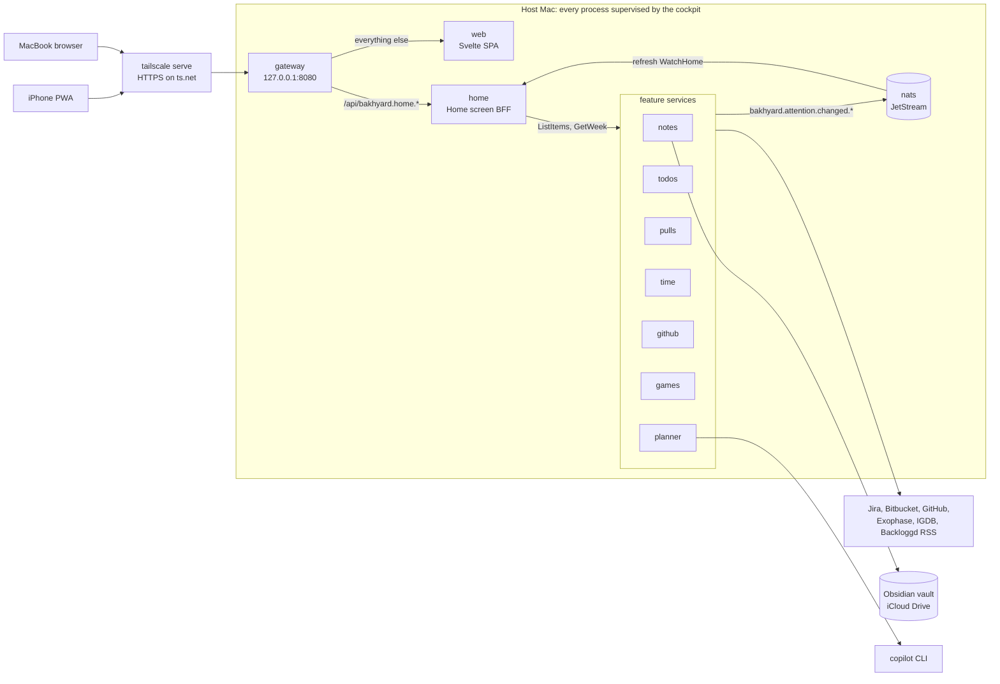

# Bakhyard work plan

Version 1.3, 2026-10-18. Replaces v1.2: the first attempt was archived and the build restarted in small, reviewed steps.

Bakhyard is a self-hosted dashboard for one person. It runs on an always-on home Mac and brings together Obsidian notes, work (Jira todos, Bitbucket pull requests, hours logged on Jira, reviewer nudges), GitHub, games and a Copilot planner, used from a MacBook and an iPhone. The name is Bakh + backyard: personal, and it lives at home.

This document is the source of truth for scope and the work breakdown. How we work (rules, pipeline, quality gates) is canonical in [AGENTS.md](../AGENTS.md). Update the status markers as work lands.

**Contents**

0. [Status](#0-status)
1. [Goal and scope](#1-goal-and-scope)
2. [Feasibility](#2-feasibility)
3. [Product architecture](#3-product-architecture)
4. [System architecture: the microservices experiment](#4-system-architecture-the-microservices-experiment)
5. [Repo layout](#5-repo-layout)
6. [Toolchain and conventions](#6-toolchain-and-conventions)
7. [Visual identity](#7-visual-identity)
8. [Work breakdown](#8-work-breakdown)
9. [Decisions](#9-decisions)
10. [Risks](#10-risks)
11. [Estimate](#11-estimate)
12. [Open questions](#12-open-questions)
13. [Sources](#13-sources)

## 0. Status

**Restarted** on 2026-10-18. The first attempt was written in large batches by background agents and failed the clean-code bar: god packages, long files mixing unrelated concerns, and infrastructure built before anything needed it. It was archived outside the repo. The build restarts in small steps, each going through the pipeline in [AGENTS.md](../AGENTS.md) and a PR the user reviews.

The v1.2 design in §4 to §6 stays as reference. A piece of it is built only when a step needs it.

| Id | Step | Status |
| --- | --- | --- |
| `agents-md` | AGENTS.md, this status, the first attempt archived | Done (#1) |
| `agents` | A dedicated custom agent for each pipeline role | Done (#3), later dropped (decision 38) |
| `ci-baseline` | CI with mise, Renovate, SonarQube Cloud, jactionlint | Done (#2) |
| `go-toolchain` | Go module, golangci-lint with the gates, coverage gate, `mise run check`, and the smallest `home` service: `GET /healthz` | Done (#4) |
| `home-service` | `home` serves the demo data (§4.13) | Done (#5) |
| `gateway` | The gateway in front of `home` | Done (#6) |
| `chi-router` | Route with chi instead of `net/http.ServeMux` (decision 42) | Done (#7) |
| `openapi` | Generate the public JSON APIs from OpenAPI specs | Dropped (#8 closed, decision 43) |
| `code-first` | Record decision 43: the public JSON APIs stay hand-written | Done (#9) |
| `web-scaffold` | The Svelte app in `apps/web`, its toolchain and the web gates (decision 44) | Done (#10) |
| `visual-identity` | Replace §7 with the new visual identity (decision 45) | Done (#11) |
| `time-worklogs` | Record how time is logged on Jira and what the Time module does (decision 46) | Done (#15) |
| `renovate-age` | Renovate waits a day for npm releases, as pnpm does (decision 47) | In progress |
| `web-service` | A Go `web` service serves the built app; the gateway sends every path outside `/api` to it | Planned |
| `home-shell` | The Home page's frame per §7: tokens for both themes, fonts, grain, top bar, header and hero | Planned |
| `home-feed` | The "Needs you today" card, from `/api/home` | Planned |
| `home-apps` | The "Your apps" grid and the weekly hours bar | Planned |
| `home-phone` | The phone and tablet frame per §7: the bottom tab bar and safe areas | Planned |

After these: the cockpit, then the product phases (§8.2), each split into steps.

**Deferred until a step needs it**: gRPC and protobuf for service-to-service calls (decision 43), NATS and events, OpenTelemetry, Prometheus metrics, streaming, unix sockets, a shared kit, per-service Go modules and `go.work`, the git hook, most mise tasks, and the cockpit daemon and control API.

**Ideas**: `sonar-issues` could page past 200 issues, or warn when it cuts them off. Longer task scripts could move into files that `check` shellchecks; today only the workflow's `run:` scripts are checked. A gate self-test could lint known-bad fixtures and expect every gate to fire, so a config typo can't switch one off silently (§10).

## 1. Goal and scope

One user. The host is an always-on home **Mac** on the LAN. Clients are a **MacBook** and an **iPhone** (browser and Home Screen PWA). Repo: `codedogapp/bakhyard` (public).

Modules:

1. **Notes**: live render and edit of the Obsidian vault. The vault stays in sync on the MacBook and the iPhone.
2. **Work**: custom todos linked to Jira tickets; Bitbucket PRs (mine and review requests); time tracking on the Jira tickets; "nudge reviewers" reminders.
3. **GitHub**: my open PRs, review requests and assigned issues, across all owners and orgs.
4. **Games**: Backloggd "currently playing" (plus extras where feasible); Exophase stats.
5. **Copilot planner**: plan-mode chat with Copilot; the result is saved as a note in the vault.

Inputs from the user:

- Devices: iPhone and MacBook; the host is a Mac.
- No paid Obsidian Sync; obsidian-git is used today. Notes must be editable and must render wikilinks, embeds, callouts and LaTeX.
- Jira Cloud and Bitbucket Cloud are reachable without a VPN. Work tokens on the personal Mac are OK. Time is logged on the Jira tickets as standard Jira worklogs; Clockwork writes them too (decision 46).
- Notifications go to the phone (push), the Mac and the browser.
- Reminder rule: a PR open for more than 24 h without the required approvals → remind at 10:00 and 15:00 on workdays, with snooze.
- Copilot Business sits on a separate work GitHub account.
- Backend in Go or Java. Remote access outside home is not required.
- Backloggd and Exophase accounts exist; Exophase links Nintendo and PSN. Usernames and player IDs live in local config, not in git.

## 2. Feasibility

Verified 2026-10-17 unless marked.

| Feature | Verdict | How / evidence | Caveats |
|---|---|---|---|
| Vault render + edit | ✅ | Server reads and writes `.md`; the frontend renders with unified/remark: `@flowershow/remark-wiki-link` 4.0.0, `rehype-callouts` 2.2.0, `remark-math` + KaTeX/MathJax, `@quartz-community/remark-obsidian` 1.1.0 | `![[note]]` embeds need our own resolver. Go's `goldmark-obsidian` lacks callouts and highlights → render in the TS frontend |
| Vault sync | ✅ trade-offs | **Chosen: iCloud Drive** (Obsidian's recommended iPhone option; vault in `iCloud Drive/Obsidian/<vault>`; host Mac on the same Apple ID, vault folder set to *Keep Downloaded*) + server-side git snapshots with `--git-dir` outside iCloud. Runner-up: keep git, swap obsidian-git on the iPhone for the GitSync app | iCloud: the same note edited offline on two devices → one silently wins (recoverable via TextEdit "Keep Both"); latency unverified. obsidian-git on iOS: the author calls it "very unstable", with open iOS bugs (Vinzent03/obsidian-git#1012, Vinzent03/obsidian-git#1166). LiveSync: iOS needs trusted HTTPS → clashes with LAN-only. Obsidian Headless Sync: paid + beta data-loss issues → excluded |
| Jira Cloud | ✅ | Basic `email:api_token`; `GET/POST /rest/api/3/search/jql` (the old `/search` is removed); request `fields` explicitly; `nextPageToken` paging | Token expiry ≤ 365 d → rotate; webhooks are admin-only → poll; an employer IP allowlist would block |
| Bitbucket Cloud | ✅ | Scoped Atlassian API token (app passwords died 2026-07-28), host `api.bitbucket.org`. Mine: `GET /2.0/workspaces/{ws}/pullrequests/{me}?state=OPEN`. Reviewing: per repo `pullrequests?q=reviewers.uuid="{uuid}" AND state="OPEN"`. Approvals: PR detail `participants[]`; `/activity` for the last reviewer action | No cross-repo "reviewing" endpoint; 1,000 req/h → cache + incremental scan; webhooks need repo admin → poll |
| Time tracking, verified 2026-10-20 | ✅ | Standard Jira worklogs over REST v3 with the Jira token, as the user's own tool does. Read: my `accountId` from `GET /rest/api/3/myself`; the issues from `search/jql` with `worklogAuthor = currentUser() AND worklogDate >= "<from>" AND worklogDate < "<to>"`; then per issue `GET /rest/api/3/issue/{key}/worklog` with `startedAfter` and `startedBefore` (UNIX ms) and `startAt` paging, keeping my own. Write: `POST /rest/api/3/issue/{key}/worklog` with `started` and `timeSpentSeconds`. None of these is deprecated. Clockwork's worklogs are standard Jira worklogs, so Bakhyard and Clockwork see the same hours | Time tracking must be enabled; writing needs the Browse projects and Work on issues permissions. `worklogAuthor` is in Atlassian's Data Center field reference but not the Cloud one, though it works on Jira Cloud today; the documented fallback, `GET /rest/api/3/worklog/updated` + `POST /rest/api/3/worklog/list`, scans every worklog the token can see. JQL searches only an issue's 1,000 most recent worklogs. By default a new worklog emails the issue's watchers (`notifyUsers`) and reduces the remaining estimate (`adjustEstimate=auto`). Tempo is not used (decision 40) |
| PR reminders | ✅ | Own scheduler + rule engine. "Required approvals" is a per-repo setting | Auto-detection via the branch restrictions API is unverified (may need admin) |
| Push (iPhone / Mac / browser) | ✅ | (a) Web Push: iOS 16.4+ Home Screen PWA + Safari/Chrome on the MacBook. Needs HTTPS → `tailscale serve` (free, valid cert, no inbound ports). (b) Pushover: $4.99 once per platform (iOS, Desktop), 10k msg/month, `priority=2` repeats until acknowledged, no HTTPS needed | The browser Notification API needs a secure context (LAN `http://192.168…` fails). `osascript`/terminal-notifier only notify the host Mac, not the MacBook. ntfy: self-hosting is Docker-only on macOS and the iPhone shows "New message" off-LAN; public ntfy.sh = topic-as-password, 250 msg/day, iOS app "a little buggy" |
| GitHub | ✅ | `GET /search/issues`: `is:pr is:open author:@me`, `is:pr is:open review-requested:@me`, `is:issue is:open assignee:@me`; 30 req/min | A fine-grained PAT covers one owner; the Notifications API needs a classic PAT |
| Sign-in (one email), verified 2026-10-18 | ✅ Google · ❌ Apple (cost) | Google redirect URIs need HTTPS and a host on the public suffix list. `ts.net` is a PSL private suffix, and there is no reachability rule (the browser delivers the callback). Testing mode with `openid email profile`: no 7-day expiry, no warning screen. Tailscale Serve identity headers (spoofed copies stripped); Tailscale login providers include Google and Apple | Google lets ANY account finish sign-in → the app pins `sub`. The authorized-domain step for `<tailnet>.ts.net` is only indirectly confirmed. Apple needs a $99/yr developer account; `ts.net` acceptance unknown; its form_post callback breaks Lax cookies. The iOS Home Screen app may hand the login off to Safari (separate cookie jar) → device test |
| Copilot planner | ✅ (spike first) | Copilot SDK **GA 2026-06-02** (v1.0.22). Go `github.com/github/copilot-sdk/go` (needs the `copilot` CLI: `brew install --cask copilot-cli`); Java is official too (`com.github:copilot-sdk-java`, Java 17+). Plan mode: `AgentMode: plan` + `OnExitPlanModeRequest` → plan markdown; custom tools; `AvailableTools`; permission handler. Per-client `GitHubToken` → identity separate from the personal GitHub token | **Work Business seat**: needs an admin Copilot CLI policy; the GitHub Customer Agreement licenses seats "only for Customer's internal business purposes"; usage draws employer credits → needs employer OK, otherwise personal Copilot Free/Pro. SSO orgs → `copilot login --device-code`; a possible `*.ghe.com` tenant → `--host`. Env precedence `COPILOT_GITHUB_TOKEN` > `GH_TOKEN` > `GITHUB_TOKEN` (keep the personal token out of the Copilot process). Billing = token-based AI credits. Plan mode + restricted tools combination unverified. GitHub Models retired 2026-07-30 |
| Backloggd | ⚠️ partial | **No public API** (request open since 2023, no developer reply; no export). ✅ Official **reviews RSS** `https://backloggd.com/u/{user}/reviews/rss/` (last 20 reviews: title, rating, link, date, cover): 200, no bot check. Playing/backlog/wishlist pages: **Anubis PoW challenge** for every server client (tested). Card markup per public code: `div.game-cover[game_id] > a[href=/games/{slug}/] … img[alt]` | ToS: "access the Website through the interface we provide" → automated Anubis solving (Playwright / PoW solvers exist) conflicts. Low-risk path: capture from my own browser (bookmarklet / iOS Shortcut) → push to the dashboard. IGDB API (free for non-commercial use, Twitch app credentials) for metadata and covers |
| Exophase | ⚠️ partial | **No documented API.** Internal JSON works without login: `api.exophase.com/public/player/{playerId}/games?page=N&environment=&sort=1&showHidden=0` (title, platform, playtime, earned/total awards, %, last played) + `/public/player/{servicePlayerId}/game/{master_id}/earned`. Player IDs: one for the account, one per linked platform (Nintendo, PSN) | **A Cloudflare challenge (403) blocks curl, Node and headless Chrome** from the home network → server polling is fragile and gets round a bot check. robots.txt only disallows `/search`; the ToS has no scraping clause. `card.exophase.com` images are not challenged (copy the exact card URL from the Exophase UI). Fallback: browser capture. ⚠️ The public profile HTML contains personal data → never fetch or store the raw page |

## 3. Product architecture

```
iPhone PWA ─┐                              ┌── Jira / Bitbucket / GitHub / Exophase / IGDB (poll)
MacBook ────┼── HTTPS (tailnet) ──▶ Bakhyard on the host Mac (services supervised by the cockpit, §4)
            │                              ├── SQLite per service (todos, caches, push subscriptions, sessions)
            │                              ├── vault dir (iCloud Drive) ◀── iCloud ──▶ Obsidian (MacBook, iPhone)
            │                              ├── copilot CLI runtime (SDK, JSON-RPC, loopback)
            └◀── Web Push ◀── APNs/FCM ◀── notify
```

- **Host Mac**:
  - Dedicated macOS user, auto-login, sleep disabled.
  - A LaunchAgent with `KeepAlive` runs the cockpit daemon, which supervises every service. A user session is needed for iCloud and the Keychain.
  - Same Apple ID as the iPhone and the MacBook; the vault folder is set to *Keep Downloaded*.
- **Network**: Tailscale on the host, the MacBook and the iPhone. `tailscale serve` publishes `https://<host>.<tailnet>.ts.net` → the gateway on `127.0.0.1:8080`. Nothing listens on the LAN.
- **Backend**: Go services (§4). Secrets live in the macOS Keychain. Each integration service owns its adapters: poll → cache a snapshot in its own SQLite → diff → publish change events and feed the notification rules.
- **Frontend**:
  - Svelte 5 + Vite + TypeScript SPA, installed as a PWA (manifest, service worker, Web Push).
  - Notes render with a unified/remark pipeline plus our own embed resolver, backed by the notes service's vault index. CodeMirror 6 editor; KaTeX.
  - Live updates over Connect server streams, with a polling fallback.
  - Look and feel per §7. Home = greeting + "Needs you today" feed (attention items from every app) + "Your apps" grid + weekly hours bar.
- **Copilot** (planner service):
  - SDK client with an explicit `GitHubToken` and `COPILOT_HOME`, isolated from the personal GitHub token.
  - One session per plan; deny-by-default permission handler; built-in shell and write tools excluded.
  - The service, not the agent, writes the plan to `Plans/YYYY-MM-DD-<slug>.md` with frontmatter.
  - Per-session credit limit.
- **Notifications** (notify service): channel abstraction → Web Push to the iPhone Home Screen PWA and the MacBook browser; a Pushover adapter is optional later; in-app notification centre.
- **Games** (games service):
  - Backloggd = a manual list in the dashboard (playing / backlog / wishlist / played). Games are added via IGDB search (title, cover, platforms) and link to `backloggd.com/games/{igdb-slug}/`. The official reviews RSS is polled automatically.
  - Exophase = hourly poll of the internal JSON (`/public/player/{accountId}/games?page=1&environment=&sort=1&showHidden=0`), daily `/earned` for recently played games. The HTTP client is picked in the spike. On a 403 or challenge: exponential backoff, keep the last good data, show a "stale" badge, fall back to the card image.
  - Never fetch or store profile HTML (it contains PII).
- **Vault writes** (notes service, conflict-safe): new notes get unique names; edit only if the mtime/hash is unchanged since the read; temp file + atomic rename; skip notes modified elsewhere in the last few minutes; never touch `.obsidian/`.
- **Auth** (enforced at the gateway; one person, two locks):
  1. **Tailscale identity**:
     - The gateway listens on `127.0.0.1` only; `tailscale serve` adds `Tailscale-User-Login` and strips spoofed copies.
     - Require the login to equal the allowed email (Tailscale account created via Google, or Apple).
     - Check that `Host` is our `ts.net` name.
     - No identity headers (tagged devices, Funnel) → reject.
  2. **Google sign-in (OIDC)**:
     - `go-oidc/v3` 3.21.0 + `x/oauth2` 0.37.0, auth-code flow with PKCE.
     - `state` and `nonce` stored on the server (go-oidc does not check the nonce → we compare it).
     - Scopes `openid email`; the consent screen app stays in "Testing" (no 7-day expiry for basic scopes).
     - Google does NOT enforce the test-user list → allow only `email_verified` + the allowed email at first login, then pin `sub` and match on `sub` afterwards.
     - Callback `https://<host>.<tailnet>.ts.net/auth/google/callback`; Google never needs to reach it.
  3. **Session**:
     - `__Host-` cookie, Secure, HttpOnly, SameSite=Lax, sliding ~30 days; sessions stored in SQLite.
     - CSRF protection via Go's `http.CrossOriginProtection`.
  4. **iPhone PWA fallback**: if the Google redirect escapes to Safari (Home Screen apps keep a separate cookie jar), use the Tailscale identity alone on that device, or enroll a passkey later.

**Polling defaults**: Jira 5 min; Bitbucket mine 5 min, review scan 15 min (repo list daily); GitHub 5 min; logged time 15 min + on demand; Backloggd reviews RSS 2 h; Exophase games hourly, `/earned` daily; IGDB on demand (cached).

**Default reminder rule**: PR `OPEN`, not a draft, age > 24 h, approvals < required (per repo) → notify at 10:00 and 15:00 Mon–Fri (local time zone). Actions: open the PR, snooze (2 h / tomorrow / until the PR is updated), mark as nudged. Skip if snoozed or already sent in this slot.

**Data**: one SQLite database per service, in the service's own data directory. No service reads another's tables.

| Service | Tables (planned) |
| --- | --- |
| todos | `todos` (+ `jira_key`) |
| time | none of its own: the worklogs stay in Jira |
| pulls | `pr_state` (PR id, first_seen, approvals, required, last_activity, snooze_until, last_reminded_slot), `reminder_rules` |
| notify | `push_subscriptions` |
| planner | `copilot_sessions` (id, title, status, note_path) |
| games | `games` (igdb_id, title, slug, cover_url, platform, status, started_at, finished_at, notes), `game_stats` (source, payload, fetched_at, stale) |
| gateway | `sessions` (sign-in) |
| every integration service | `integration_cache` (source, key, json, fetched_at), `settings` |

## 4. System architecture: the microservices experiment

> **v1.3:** the v1.2 design, kept as reference. §0 sets the build order and what is deferred; [AGENTS.md](../AGENTS.md) overrides this section where they differ (for example, one Go module instead of one per service).

### 4.1 Intent

The user's brief (2026-10-18):

- every feature is its own service, behind a proxy gateway;
- one SPA, no micro-frontends;
- a TUI "cockpit" to start, stop and kill single services, and to monitor them;
- monitoring wherever it helps;
- microservice best practices;
- shared code that is safe to share.

Choices taken (all recommended options):

- **Cockpit**: our own supervisor daemon plus a TUI client. Services keep running when the TUI closes; launchd keeps the daemon up.
- **Contracts**: Protobuf + Connect RPC via buf, with generated Go and TypeScript.
- **Events**: NATS, with JetStream enabled, running as its own service.
- **Monitoring**: built in (health, readiness and Prometheus metrics, scraped by the cockpit), plus OpenTelemetry traces, off by default.

### 4.2 Overview



### 4.3 Services

| Service | Role | Listens on | Peers | Grows into (§8.2) |
| --- | --- | --- | --- | --- |
| nats | Event bus; JetStream on for later durable flows | `tcp://127.0.0.1:4222`, monitoring `:8222` | | reminders → notify |
| gateway | The only way in: `/api` to the services, everything else to web | `tcp://127.0.0.1:8080`; ops on an admin unix socket | web, home | auth-signin |
| web | Serves the embedded Svelte build | unix socket | | frontend-shell (PWA parts) |
| home | Builds the Home screen from every app | unix socket | nats, time, notes, todos, pulls, github, games, planner | home-feed |
| notes | Obsidian vault | unix socket | nats | vault-index-watch, vault-render, vault-edit-sync |
| todos | Todos linked to Jira | unix socket | nats | todos-jira |
| pulls | Bitbucket pull requests and reviewer nudges | unix socket | nats | bitbucket-prs, pr-reminders |
| time | Time tracking on the Jira tickets | unix socket | nats | time-tracking |
| github | GitHub pull requests, reviews and issues | unix socket | nats | github-widgets |
| games | Backloggd and Exophase | unix socket | nats | games-backloggd, games-exophase |
| planner | Copilot plans saved to the vault | unix socket | nats | copilot-planner |
| notify (later) | Web Push and the notification centre | unix socket | nats | notifications |

- Internal services listen on unix sockets in `$BAKHYARD_HOME/run/svc/` (directory mode 0700). Only the gateway has a TCP port.
- Each service owns its data directory and database (§3 Data).
- In the first slice the feature services return demo data (§4.13).

### 4.4 Gateway

- Listens on `127.0.0.1:8080`, behind `tailscale serve`. Its own ops endpoints sit on the admin unix socket.
- Routing:
  - `/api/bakhyard.<svc>.v<N>.<Service>/<Method>`: strip `/api`, take `<svc>` from the proto package, and proxy only if `<svc>` is one of the gateway's peers.
  - Internal packages (`bakhyard.attention.*`) and the services' ops paths are therefore never reachable from outside (404).
  - Publishing a new API means a new proto package plus adding the service to the gateway's peers.
  - Everything else goes to `web`.
- `httputil.ReverseProxy` (Rewrite + SetXForwarded) over the kit's unix-socket transport. Streaming responses flush immediately.
- An upstream that is down gets a 503 with a Connect-style JSON error on `/api`.
- Sets or forwards `X-Request-Id`.
- Security headers, including CSP `default-src 'self'; style-src 'self' 'unsafe-inline'; img-src 'self' data: https:; connect-src 'self'; frame-ancestors 'none'; base-uri 'none'`.
- CSRF protection via `http.NewCrossOriginProtection()`.
- Later: sign-in (§3 Auth) is enforced here.

### 4.5 Contracts

> **v1.3:** for service-to-service calls and NATS payloads only (decision 43). The public APIs stay hand-written JSON.

Schema-first protobuf in `proto/`, a buf v2 module (lint STANDARD, breaking FILE).

| Package | RPCs | Exposure |
| --- | --- | --- |
| `bakhyard.attention.v1` | `AttentionService/ListItems` (NO_SIDE_EFFECTS) → `Item{id, title, detail, source, url, due}`. Event message `ItemsChanged{app, reason}` | Internal: every feature service implements it; never routed by the gateway |
| `bakhyard.home.v1` | `HomeService/GetHome` (NO_SIDE_EFFECTS, so the client uses HTTP GET) and `WatchHome` (server stream) → `Home{name, items, week, sources, generated_at}` | Public, via the gateway |
| `bakhyard.time.v1` | `TimeService/GetWeek` → `{logged_hours, target_hours}` | Internal |

`home.v1` messages:

- `Item{id "<app>/<id>", app, title, detail, source, url, due, late}`.
- `Week{logged_hours, target_hours}`, unset when the time service is down.
- `SourceStatus{app, state (OK / UNAVAILABLE), message}`.

Code generation:

- Go goes to `libs/go/contracts/gen` (protoc-gen-go + protoc-gen-connect-go v2, managed `go_package_prefix`).
- TypeScript goes to `apps/web/src/gen` (protoc-gen-es, `target=ts`).
- Both are committed and read-only. `mise run gen:check` fails on drift.

Other rules:

- NATS subject names live next to the generated code, in `libs/go/contracts/subjects`.
- A breaking change gets a new `v2` package, served side by side. `mise run proto:breaking` checks against `main`.

### 4.6 Events

- Subject `bakhyard.attention.changed.<app>`, payload `ItemsChanged` (protobuf), on core NATS.
- Feature services publish on start and again after a graceful stop. A SIGKILL publishes nothing, so the UI catches up on its next poll. Stop versus kill is a demo point.
- home subscribes to `bakhyard.attention.changed.*`, debounces for 250 ms and pushes a fresh Home to every WatchHome stream.
- JetStream is enabled for later durable flows (reminders → notify).
- Hardening later: a NATS auth token read from a 0600 config file.

### 4.7 Service runtime contract

Services never read the manifest. The cockpit renders their environment:

| Variable | Meaning |
| --- | --- |
| `BAKHYARD_SERVICE` | Service name |
| `BAKHYARD_LISTEN` | `unix:///abs/path.sock` or `tcp://host:port` |
| `BAKHYARD_ADMIN_LISTEN` | Optional separate listener for the ops endpoints |
| `BAKHYARD_DATA_DIR` | The service's own data directory |
| `BAKHYARD_PEERS` | `name=url,...` for declared peers only. A peer's url is its `url` if set, else its `listen` (nats → `nats://127.0.0.1:4222`) |
| `BAKHYARD_LOG_FORMAT`, `BAKHYARD_LOG_LEVEL` | Logging; JSON by default |
| `OTEL_SERVICE_NAME`, `OTEL_*` | Tracing; `OTEL_*` passed through from the cockpit |
| Manifest `env` | Per-service values, e.g. home's `BAKHYARD_NAME` |
| `PATH`, `HOME`, `TMPDIR`, `LANG`, `USER` | Passed through |

Ops endpoints. These are not instrumented, so the cockpit's polling doesn't skew request metrics.

- `GET /healthz` → `{"status":"ok"}`: the process is alive.
- `GET /readyz` → `{"status":"ok|degraded|fail","checks":[{"name","status","critical","error","duration_ms"}]}`.
  - 503 on `fail` and during shutdown.
  - A failing non-critical check (NATS, external APIs) gives `degraded`, not `fail`.
- `GET /metrics` (Prometheus):
  - `http_server_requests_total{route,method,code}`. The route is `r.Pattern`, which stays bounded because connect-go v2 mounts one pattern per procedure.
  - `http_server_request_duration_seconds{route,method}` (histogram).
  - `http_server_requests_in_flight`.
  - `http_client_*{peer}`: request totals and durations per peer.
  - `bakhyard_build_info{service,version,revision,go_version}`.
  - Go runtime and process collectors.

The cockpit probes `probe` if set, else `admin_listen`, else `listen`.

Shutdown on SIGTERM:

1. Readiness goes to 503.
2. `http.Server.Shutdown`, with an 8 s budget inside the cockpit's 10 s stop timeout.
3. OnShutdown hooks run.
4. The bus closes.
5. Traces are flushed.

Streaming handlers watch an app-lifetime context, so open streams end promptly.

### 4.8 Shared code

**`libs/go/kit`** holds infrastructure only. It may not import services or contracts (enforced by depguard).

- **Bootstrap**: `service.Main(name, setup)` covers env config, listeners (main plus optional admin) and an `App` with Config, Logger, Mux, Peers, readiness checks and OnShutdown hooks.
- **Logging**: slog JSON with service and version, plus `request_id` and `trace_id` taken from the context.
- **HTTP server**: ReadHeaderTimeout 5 s, IdleTimeout 2 min, no WriteTimeout (streams). HTTP/1 plus unencrypted HTTP/2 via `http.Protocols`.
- **Middleware order**:
  1. recover
  2. request ID (`X-Request-Id`, or `uuid.NewV7()` from the stdlib `uuid` package)
  3. otelhttp
  4. metrics and access log, wrapping the mux directly. A middleware that calls `r.WithContext` copies the request, and the mux sets `r.Pattern` on the copy it receives.
- **Connect**:
  - `connect.NewServer(interceptors...)` + `connecthttp.Mount(mux, srv)`.
  - Panic recovery and error mapping are interceptors; connect-go v2 has no built-in recovery.
  - Errors are `*connect.Error` with causes. Remote errors returned from a handler are scrubbed to Internal.
- **Peer client**:
  - A unix-socket dialer with base URL `http://<peer>`.
  - Timeouts. Retries on dial errors only, and only when the request has no body or has `GetBody`.
  - otelhttp transport, request-ID propagation, client metrics.
  - Connect clients come from `connect.NewClient(connecthttp.NewTransport(hc, base, connecthttp.WithHTTPGet()))`.
- **Tracing**: an OTLP/HTTP exporter only when `OTEL_EXPORTER_OTLP_ENDPOINT` is set. Otherwise a noop provider that still propagates W3C trace context.
- **Bus**: nats.go with `RetryOnFailedConnect` and unlimited reconnects; a non-critical readiness check; generic protobuf publish and subscribe with trace headers. Tests use an embedded nats-server.
- **Tests**: `connectinprocess.New(srv)`, `httptest`, `t.Context()`, `slog.DiscardHandler`.

**`libs/go/contracts`** holds the generated code and the NATS subjects. It may not import services or kit.

**Sharing policy**

- Share infrastructure (kit) and contracts only, never domain logic. A service that needs another's data calls its API or listens to its events.
- Contracts:
  - schema-first;
  - `buf lint`, and `buf breaking` against `main`;
  - a breaking change gets a new `v2` package side by side;
  - generated code is committed, with a drift check.
- Libraries:
  - their own tests;
  - doc comments with stability notes;
  - a CHANGELOG;
  - semver tags such as `libs/go/kit/vX.Y.Z`;
  - planned: an `apidiff` check (`golang.org/x/exp/cmd/apidiff`) against the last tag.
- Inside the monorepo:
  - Services pin the libraries with a `replace` to the local path.
  - The root `go.work` lists every module.
  - `GOWORK=off` builds and `go mod tidy` (which ignores go.work) still work.
- Layering, enforced by depguard:
  - kit ↛ services or contracts;
  - contracts ↛ services or kit;
  - cockpit ↛ services.

### 4.9 Cockpit

`tools/cockpit` is its own module, built to `bin/cockpit`. Later, launchd keeps `cockpit daemon` up.

| Command | Does |
| --- | --- |
| `cockpit` | Opens the TUI. Starts the daemon detached (`Setsid`, logging to `logs/cockpit.log`) if none is running. Quitting leaves the services running |
| `cockpit daemon` | Runs the supervisor in the foreground (for launchd and mise) |
| `cockpit up` / `cockpit down` | Starts the daemon and every autostart service / stops every service, then the daemon |
| `cockpit status` | Prints each service's state, health and resource use |
| `cockpit start\|stop\|kill\|restart <svc\|all>` | Controls services |
| `cockpit logs <svc> [-f]` | Prints or follows a service's log |
| `cockpit env <svc>` | Prints the environment the service receives |
| `cockpit shutdown` | Asks the daemon to exit |

**Manifest** (`services.toml`, parsed with go-toml/v2):

- `version = 1`.
- `[defaults]`: `restart` (always / on-failure / never), `stop_timeout` (10s), `health_path`, `ready_path`, `metrics_path`.
- `[[service]]` fields: `name`, `description`, `command`, `dir`, `build`, `listen`, `admin_listen`, `probe`, `url`, `peers`, `depends_on`, `env`, `autostart`.
- `listen` defaults to `unix://{{run}}/svc/<name>.sock`.
- Placeholders: `{{root}}` (the manifest's directory), `{{run}}`, `{{data}}` (the service's data directory), `{{logs}}`.
- Validation: unique names, known peers and dependencies, no cycles, socket paths within macOS's 104-byte limit.
- Start in dependency order, waiting for readiness; stop in reverse order.

**Processes**:

- Each service runs in its own process group (`Setpgid`).
- Stop = SIGTERM to the group, then SIGKILL after `stop_timeout`. Kill = SIGKILL at once.
- Restart policy: exponential backoff from 1 s to 60 s, reset after 60 s of health. About 5 crashes in 2 minutes → `failed`.
- Desired state is respected: a service stopped by hand stays stopped.
- Pidfiles live in `run/pids`. A starting daemon terminates leftovers from a previous run.
- States: stopped, starting, running, degraded, unhealthy, stopping, crashed, failed, exited.

**Logs**: `logs/<svc>.log` (rotated at 10 MiB, 3 kept), plus a 1,000-line in-memory ring with sequence numbers.

**Probes**, every 5 s:

- `/healthz` and `/readyz`.
- A `/metrics` scrape (expfmt), giving req/s, error % and p95 from histogram deltas, plus in-flight requests.
- CPU and RSS for every PID from one `ps -o pid=,rss=,%cpu=` call.

**Control API**: HTTP + JSON on `run/cockpit.sock` (mode 0600).

- `GET /v1/services`, `GET /v1/services/{name}`
- `POST /v1/services/{name}/{start|stop|kill|restart}`, `POST /v1/all/{action}`
- `GET /v1/services/{name}/logs?after=<seq>&n=`
- `POST /v1/shutdown`

**TUI** (Bubble Tea v2, Lip Gloss v2, Bubbles v2):

- The table polls the API every 1 s; the logs view every 500 ms.
- Columns: name, state dot, PID, uptime, restarts, ready, CPU, MEM, req/s, err %, p95.
- A details pane and a logs viewport.
- Keys: `s` start, `x` stop, `K` kill (with confirm), `r` restart, `a` start all, `Z` stop all, `l`/enter logs, `q` quit. Optional: `b` rebuild and restart.
- The monochrome §7 palette.

**Paths**: `BAKHYARD_HOME` defaults to `~/Library/Application Support/Bakhyard`; in dev, mise sets it to `<repo>/.bakhyard` (gitignored). It holds `run/`, `logs/` and `data/`. `BAKHYARD_MANIFEST` points at `services.toml`.

### 4.10 Monitoring

- **Golden signals**: rate, errors and duration per route and per peer, plus saturation (in-flight, CPU, RSS), shown live in the cockpit.
- **Health vs readiness**: `healthz` = alive, `readyz` = able to serve. An outage of an external API makes a service degraded, not failed.
- **Logs**: JSON with `request_id` and `trace_id`; a file per service plus the cockpit's ring buffer.
- **Traces**: W3C propagation always on; export is opt-in via `OTEL_EXPORTER_OTLP_ENDPOINT` (e.g. otel-tui or Jaeger).
- **Supervisor**: restarts, last exit, uptime, crash loops.
- **Planned integration metrics**:
  - `integration_last_success_timestamp_seconds{source}`
  - rate-limit remaining
  - `token_expiry_timestamp_seconds`
  - notifications sent
- **Optional**: an external dead-man's switch (e.g. healthchecks.io) for the host itself.

### 4.11 Home logic

- `GetHome` fans out `ListItems` to every peer except nats, concurrently (`wg.Go`), with a 1.5 s timeout each.
  - `Unimplemented` means that app has no items (OK).
  - Any other failure marks the source `UNAVAILABLE` with a message, is logged, and the rest still renders. Never a blank screen.
- Item ids are `<app>/<id>`; `late = due is set && due < now`.
- Sort order (`cmp.Or`): late first, then earliest due (no due date last), then title, then id.
- The week comes from `TimeService.GetWeek` on peer `time`, and is unset if `time` is down.
- The name comes from `BAKHYARD_NAME`, falling back to "there".
- `WatchHome` sends immediately, again after each `bakhyard.attention.changed.*` event (250 ms debounce), and every 60 s.

### 4.12 Web service and UI

**Web service**:

- `internal/site` embeds `dist` with `//go:embed all:dist`. A committed `dist/.gitkeep` keeps the embed valid before the first build.
- Vite builds into `dist/app` (gitignored).
- Caching: `/assets/*` is immutable; `index.html` is `no-cache`.
- Extensionless unknown paths fall back to the SPA. Missing files with an extension get a 404.
- Before the first build it serves a 503 "not built" page.

**UI client**:

- `createConnectTransport({ baseUrl: '/api', useHttpGet: true })`, with types from `src/gen`.
- A `WatchHome` stream, falling back to polling `GetHome` every 60 s and on window focus.
- Protojson in the browser: camelCase fields, RFC 3339 timestamps, enum names as strings.
- A small pushState router. Pages other than Home show "Coming soon" for now.

**Dev loop**: `mise run dev` runs Vite on `:5173` with `/api` proxied to the gateway on `:8080`.

### 4.13 Demo data (first slice)

| App | Item | Source | Due |
| --- | --- | --- | --- |
| pulls | Nudge reviewers on PAY-1423 | Bitbucket | 2 h ago (late) |
| todos | PAY-1398 Settlement report export, detail "Was due yesterday." | Jira | 24 h ago (late) |
| time | Log today's hours | Jira | in 3 h |
| time | Jira token expires in 5 days | Jira | in 5 days |
| github | Review requested: dotfiles#14 | GitHub | none |
| planner | Finish plan: home lab backups | Copilot | none |
| notes, games | no items | | |

Week: 31.5 of 40 h. Numbers are named constants (the mnd linter).

## 5. Repo layout

> **v1.3:** the v1.2 layout, kept as reference. The current layout rules are in [AGENTS.md](../AGENTS.md) (Architecture).

```
bakhyard/
├── apps/web/                  Svelte 5 SPA: a standalone pnpm project with its own mise.toml
│   └── src/gen/               generated TypeScript contracts (committed)
├── proto/bakhyard/<pkg>/v1/   protobuf contracts (buf module)
├── libs/go/contracts/         generated Go contracts (gen/) + NATS subjects
├── libs/go/kit/               shared service infrastructure
├── services/<name>/           one Go module per service
├── tools/cockpit/             supervisor daemon + TUI
├── scripts/go-each.sh         runs a command in every Go module
├── .githooks/pre-commit
├── docs/                      this plan, the design reference, later architecture.md
├── services.toml              service manifest (read only by the cockpit)
├── buf.yaml, buf.gen.yaml
├── .golangci.yml
├── go.work                    every Go module (to add)
├── mise.toml                  monorepo root: tools, env, tasks
└── deploy/                    launchd plist and host setup notes (later)
```

- Module paths: `github.com/Bakhomious/bakhyard/{services/<name>,libs/go/kit,libs/go/contracts,tools/cockpit}`.
- Build outputs: `bin/bakhyard-<svc>` and `bin/cockpit`. The Vite build goes to `services/web/internal/site/dist/app/`. Both are gitignored.
- Runtime state lives under `$BAKHYARD_HOME`: `run/` (sockets, pidfiles, `cockpit.sock`), `logs/` and `data/<service>/`.

## 6. Toolchain and conventions

> **v1.3:** the v1.2 toolchain, kept as reference. Each tool returns only with the step that needs it. [AGENTS.md](../AGENTS.md) holds the canonical rules and quality gates.

### 6.1 Versions

Policy: **the latest version of everything**, checked against the registries and never guessed. `mise run upgrade` moves everything forward; `mise run outdated` reports what's new.

Verified on 2026-10-18:

| Tool or package | Version |
| --- | --- |
| Go | 1.27.2 |
| golangci-lint | 2.15.0 |
| Node | 26.12.0 |
| pnpm | 12.14.0 |
| buf | 1.74.0 |
| protoc-gen-go, `google.golang.org/protobuf` | 1.36.12 |
| protoc-gen-connect-go, `connectrpc.com/connect/v2` | 2.0.1 |
| nats-server | 2.15.1 |
| TypeScript | 7.0.2 (as `@typescript/native`) + 6.0.3 (for svelte-check) |
| svelte, svelte-check | 5.57.2, 4.7.7 |
| vite, `@sveltejs/vite-plugin-svelte` | 8.3.4, 7.3.1 |
| `@biomejs/biome` | 2.5.15 |
| `@connectrpc/connect`, `@connectrpc/connect-web` | 2.2.0 |
| `@bufbuild/protobuf`, `@bufbuild/protoc-gen-es` | 2.16.0 |
| `@fontsource-variable/space-grotesk`, `@fontsource/instrument-serif`, `@fontsource-variable/jetbrains-mono` | 5.3.0 (verified on 2026-10-20) |
| `@tsconfig/svelte`, `@types/node` | 5.0.8, 26.6.5 |

Go libraries for the kit and the cockpit, added with `@latest` (latest on 2026-10-18):

- OpenTelemetry `otel`, `sdk`, `otlptracehttp` v1.47.0; `otelhttp` v0.72.0.
- Prometheus `client_golang` v1.25.0, `common` v0.72.1.
- `nats.go` v1.54.0; `nats-server/v2` v2.15.1 (tests).
- `go-toml/v2` v2.4.3.
- `charm.land/bubbletea/v2` v2.1.0, `lipgloss/v2` v2.0.6, `bubbles/v2` v2.2.1.

Later phases: `go-oidc/v3` 3.21.0, `x/oauth2` 0.37.0, Copilot SDK for Go v1.0.x, remark plugins (§2). Re-check all of these when the work starts.

### 6.2 mise

- Monorepo mode, as in the user's reference frontend project: the root `mise.toml` has `monorepo_root = true` and `config_roots = ["apps/web"]`. Web tasks are named `//apps/web:<task>`, and tools are inherited from the root.
- `[env]` sets `BAKHYARD_HOME` and `BAKHYARD_MANIFEST`. Secrets go in `mise.local.toml` (gitignored).
- A postinstall hook sets `core.hooksPath` to `.githooks`.
- Every task has a description.

Root tasks:

| Task | Does |
| --- | --- |
| `setup` | Installs tools and web dependencies, enables the git hooks |
| `gen`, `gen:go` | `buf lint` + `buf generate` for Go and TypeScript |
| `gen:check` | Regenerates, then fails on drift or uncommitted generated files |
| `proto:breaking` | `buf breaking` against `main` |
| `build` | Web build into the web service, then `bin/bakhyard-<svc>` and `bin/cockpit` |
| `up`, `down`, `status`, `cockpit` | Stack control through the cockpit |
| `dev` | `up` + the Vite dev server |
| `test` | `go test -race` in every module + web type-check |
| `lint` | golangci-lint in every module, `buf lint`, Biome |
| `fmt`, `fmt:check` | gofumpt + golines, `buf format`, Biome |
| `check` | `gen:check`, then `fmt:check`, `lint` and `test` in parallel |
| `tidy` | `go mod tidy` in every module |
| `upgrade`, `outdated` | Everything to latest (mise tools, Go modules, web) / report only, including majors (gomajor) |
| `vuln`, `sec`, `audit` | govulncheck, gosec, plus `pnpm audit` |
| `install-hooks` | Sets `core.hooksPath` |

Web tasks (`//apps/web:`), as built in `web-scaffold`: `install`, `dev`, `build`, `fmt`, `lint`, `typecheck`, `test`, `unused`, `audit`, and `check`, which runs every gate and is part of the root `check`.

### 6.3 Go

- Go 1.27, written to the `/use-modern-go` guidelines: run the tool's `list` before editing Go code, and `explain` for any guideline that may apply. Examples:
  - `encoding/json/v2`; the stdlib `uuid` package (`uuid.NewV7`);
  - `wg.Go`, `errors.AsType`, `new(expr)`, `t.Context()`, `omitzero`, `cmp.Or`;
  - `slices`/`maps` iterators, `r.PathValue` (chi sets it; decision 42);
  - `context.AfterFunc`, `context.WithTimeoutCause`, typed atomics;
  - promoted-field literals, `strings.CutLast`.
- Lint config: the labrys `.golangci.yml`, copied verbatim.
  - Linters: errorlint, nilerr, unconvert, unparam, misspell, gocyclo, modernize, gocritic, perfsprint, exhaustive, usestdlibvars, mnd, varnamelen, recvcheck, revive, wsl_v5, depguard.
  - Formatters: gofumpt, and golines at 100 columns.
  - Bakhyard changes: (1) depguard layering rules (§4.8); (2) the labrys-specific mnd `ignored-functions` removed; (3) varnamelen allows `w http.ResponseWriter` and `r *http.Request`.
- One module per service, library and tool, plus a root `go.work`.
- `scripts/go-each.sh` runs a command in every module. It's needed because `./...` does not cross modules, and it lives in a script because mise's templating breaks `{{.Dir}}` inside task strings.
- Numbers are named constants (mnd). `main` calls `run()`, which avoids gocritic's exitAfterDefer.

### 6.4 Web

- **TypeScript 7 does the type-checking.**
  - svelte-check 4.7.7 accepts only TypeScript ^5 or ^6 as a peer, and TypeScript 7 ships no classic JS API.
  - The official arrangement (sveltejs/language-tools#3063) is `typescript@~6` plus `@typescript/native@npm:typescript@7`, with `svelte-check --tsgo`. `tsc` in `node_modules/.bin` is TypeScript 7.
  - A package rule in `renovate.json` keeps `typescript` below 7; the `@typescript/native` alias still moves with each release.
  - Known `--tsgo` issues: sveltejs/language-tools#3145 (tsconfig `files` entries are not checked, so use `include`), sveltejs/language-tools#3120, sveltejs/language-tools#3142.
  - `--tsgo` writes each component's generated TypeScript to `.svelte-check/` and, without `--incremental`, never removes the output of a deleted component, or of one whose script stops being TypeScript; the stale file keeps being checked. The `typecheck` script therefore deletes `.svelte-check/` first, which costs nothing because every run regenerates all of it anyway.
- **Runes mode is forced** for our components in `vite.config.ts`, as the official `sv` template does, so Svelte's deprecated legacy syntax (`export let`, `$:`, `on:click`, `<slot>`) fails svelte-check, the build and the tests. Libraries in `node_modules` keep their own mode. Vite, Vitest and svelte-check all read the plugin's options there, so there is no `svelte.config.js`.
- **Biome**, following the reference frontend project's `biome.json`:
  - Kept:
    - VCS integration with `.gitignore`;
    - formatter: spaces, indent 2, 120 columns, LF;
    - JS style: single quotes, semicolons, ES5 trailing commas, arrow parentheses, bracket spacing;
    - the recommended preset with `noImportantStyles` and `noNonNullAssertion` off.
  - Adapted:
    - no `files.includes`: the `.gitignore` already keeps out `node_modules`, `dist` and coverage;
    - full support for `.svelte` and HTML (`html.experimentalFullSupportEnabled`, with the HTML formatter on). Biome has no Svelte linter domain;
    - import groups: svelte → packages → paths;
    - the limits from AGENTS.md: cognitive complexity, function and file length, parameters.
  - Dropped: the React domain, the MUI import restrictions, the GritQL plugin, Tailwind directives, `jsxQuoteStyle`.
- **tsconfig split**, as in the reference frontend project: `tsconfig.base.json`, `tsconfig.app.json` (extends `@tsconfig/svelte` + base), `tsconfig.node.json`, and a `tsconfig.json` with references only.
- **pnpm 12**:
  - Saves exact versions.
  - Refuses releases younger than its minimum release age (1,440 minutes, a day, by default), even in a lockfile it is asked to install. We keep that default, as with mise (decision 44): a release younger than a day waits. Renovate waits as long before it proposes an npm update (decision 47).
- **CSS**: plain CSS custom properties from §7. Tailwind is not used (the user left it optional).
- **Icons**: no icon library. The few icons are inline SVGs of our own (§7).

### 6.5 Protobuf

> **v1.3:** for service-to-service calls and NATS payloads only (decision 43).

- `buf.yaml`: v2, module `proto/`, lint STANDARD, breaking FILE.
- `buf.gen.yaml` generates Go.
- `apps/web/buf.gen.yaml` generates TypeScript (`local: node_modules/.bin/protoc-gen-es`), run from `apps/web` as `buf generate ../..`.
- Generated code is committed and read-only; `gen:check` runs inside `check`.

### 6.6 Git hook

`.githooks/pre-commit`, in the reference frontend project's style; it re-stages what it reformats:

- staged `proto/**` → `buf format -w`, `mise run gen`, then re-stage the generated code (new files included);
- staged Go outside the generated code → `golangci-lint fmt`, re-stage, then `golangci-lint run` in every module;
- staged `apps/web/src` outside `src/gen` → `biome check --write`, re-stage, then `pnpm check`.

### 6.7 House rules

- Comments only where they're needed. No heavy commenting.
- Mirror the user's own repos: labrys (Go lint, mise task style) and the reference frontend project (mise monorepo, Biome, hooks, tsconfigs).
- Nothing is committed or pushed without asking.

### 6.8 Known quirks

- mise `"latest"` resolves to the newest *installed* version. `mise upgrade --local` refreshes project tools only; plain `mise upgrade` also upgrades global tools.
- `mise -C <dir> exec -- <cmd>` runs the command in `<dir>`. Use `$(mise which go)` or `cd` instead.
- macOS caps unix socket paths at 104 bytes. Keep `BAKHYARD_HOME` short; the cockpit validates paths.

## 7. Visual identity

Chosen on 2026-10-20 (decision 45). The user picked three third-party sites as references. Their screenshots and stylesheets stay out of git; only values derived from them are recorded here. A value marked **(ref)** comes from a reference's stylesheet. Every other value is our own choice, to be tuned by eye when the Home steps build it.

**Style**: soft neo-brutalism with editorial type.

- **Neo-brutalism, toned down**: square corners, visible 1 px borders, everything in cards, flat fills, and hard offset shadows with no blur. The loud original has thick borders and bright colours ([NN/g](https://www.nngroup.com/articles/neobrutalism/)); ours keeps thin borders and greys.
- **Editorial type**: a grotesk for text, a serif for the odd accent word, and a mono for small uppercase labels.
- **Paper grain**: a faint noise texture on the page, behind the cards.
- **Monochrome**: ink on paper. Emphasis comes from size, weight, the serif and ink fills, never from colour.
- **Light and dark** themes from the start.

**Type**

All three fonts are OFL-1.1 and self-hosted from Fontsource 5.3.0 (verified on 2026-10-20).

| Role | Font | Package | CSS family |
| --- | --- | --- | --- |
| Text, headings, big numbers | Space Grotesk, weights 300–700 | `@fontsource-variable/space-grotesk` | `Space Grotesk Variable` |
| Accent words | Instrument Serif, 400 italic (`400-italic.css` only) | `@fontsource/instrument-serif` | `Instrument Serif` |
| Labels, nav, chips, buttons, times | JetBrains Mono, weights 100–800 | `@fontsource-variable/jetbrains-mono` | `JetBrains Mono Variable` |

None of the subsets Fontsource ships for these fonts has → (U+2192) or ↗ (U+2197), and only JetBrains Mono's Cyrillic subset has № (U+2116). So arrows are inline SVGs (see Icons), and numbers read "01", not "№ 01".

Scale, in px / weight / letter-spacing:

- Greeting: `clamp(38px, 4.5vw, 74px)` / 500 / −0.045em, line-height 1.04 (ref).
- Section title and big numbers (item counts, hours): 28 / 500 / −0.03em; 24 on phones.
- Card title: 19 / 500 / −0.025em; 16 on phones (ref).
- Body: 16 / 400, line-height 1.5. Summaries: 16, line-height 1.65 (ref).
- Secondary text: 14 / 400. Card descriptions: 13, line-height 1.6 (ref).
- Mono label: 11, uppercase, 0.045em, line-height 1.6 (ref). The top bar: 10 (ref). Chips: 10. Mono text is always uppercase.
- Nav: mono 11.5, uppercase, 0.035em (ref).
- Wordmark: "bakhyard" in Space Grotesk, 25 / 600 / −0.07em; 17 on phones (ref).
- Accent: Instrument Serif italic at the size of the heading around it, letter-spacing 0. At most one word per heading.

**Tokens**

```css
:root {
  color-scheme: light dark;

  --paper: #FAFAF8;          /* page, under the grain */
  --surface: #FFFFFF;        /* cards, the bottom tab bar */
  --fill: #F2F2F0;           /* bar tracks, row hover (ref #F1F1EF to #F4F4F2) */
  --ink: #111111;            /* text, ink fills, hover borders (ref) */
  --ink-muted: #5C5C5C;      /* secondary text and labels (ref #555555 to #707070) */
  --rule: #D9D9D6;           /* 1 px card borders and dividers (ref) */
  --shadow: #EBEBE8;         /* resting offset shadow (ref #F0F0F0) */
  --shadow-strong: #CCCCC9;  /* hover offset shadow (ref #CCCCCC) */

  --font-sans: "Space Grotesk Variable", system-ui, sans-serif;
  --font-serif: "Instrument Serif", Georgia, serif;
  --font-mono: "JetBrains Mono Variable", ui-monospace, monospace;

  --max: 1440px;             /* content width (ref) */
  --gutter: 40px;            /* 30px on tablets, 20px on phones (ref) */
  --offset: 6px;             /* resting shadow offset (ref) */
  --offset-hover: 8px;       /* (ref) */
}

@media (prefers-color-scheme: dark) {
  :root {
    --paper: #131312;
    --surface: #1B1B1A;
    --fill: #252523;
    --ink: #EDEDEA;
    --ink-muted: #A3A3A0;
    --rule: #343432;
    --shadow: #262624;       /* lighter than the page, so the offset shows */
    --shadow-strong: #3A3A38;
  }
}
```

- Text on an ink fill (chips, the primary button, the current tab) uses `--paper`.
- `--ink` and `--ink-muted` reach at least 5.9:1 on `--paper`, `--surface` and `--fill` in both themes; WCAG AA asks for 4.5:1.
- Corners are square everywhere, so there is no radius token.

**Grain**: a tiled SVG fractal-noise texture (`feTurbulence`) as the page's background image, under all content. Black specks at about 8% opacity in light, white specks at about 5% in dark. Cards are solid `--surface`, so they sit on the grain like paper on a desk. These values are ours: no reference's live page has a CSS grain.

**Page frame**

- Content up to `--max` wide, centred, with `--gutter` on both sides.
- Breakpoints (ref): a tablet layout at `max-width: 1100px` and a phone layout at `max-width: 700px`. At `max-width: 980px` the header nav gives way to the bottom tab bar (ref).
- Every page has the top bar and the header. Home then shows, from top to bottom: the hero, "Needs you today", "Your apps" and "This week".

**Top bar**: full width, an `--ink` background with `--paper` text in mono 10 px, padding 8 px by the gutter, and one item at each end (ref).

- Left: whether the data is current: "Online", or "Offline · as of 01:10" when `/api/home` can't be reached. Once home reports its `sources` (§4.5), it also says when some are down: "2 sources unavailable".
- Right: the time and city, "01:12 · <city>". Built with `Intl` (en-GB), with the city taken from the time zone.

**Header**: a `1fr auto 1fr` grid with padding 24 px by the gutter (ref), and a 1 px `--rule` bottom border.

- Left: the wordmark.
- Centre: the app nav in mono: Home, Notes, Todos, PRs, Time, GitHub, Games, Planner. The current page's item has a 1 px `--ink` underline; on the others it grows from the left on hover (ref).
- Right: kept free for notifications (§8.2 `notifications`).

**Hero**: two columns, 1.4fr and 1fr with a 10% gap, aligned to the bottom, with 58 px of padding above and 50 px below (ref). One column on phones (ref).

- Left: the date as a mono eyebrow in `--ink-muted` ("Monday 20 October"), then the greeting, "Good evening, *Bakh*.", with the name (`name`, §4.11) in Instrument Serif italic.
- The greeting follows the hour: before 05:00 evening, before 12:00 morning, before 18:00 afternoon, otherwise evening.
- Right: a summary in `--ink-muted`, at most 390 px wide (ref): "6 things need you today. 2 are late." With no items: "All clear today."

**Section head**: a 1 px `--ink` rule on top with 13 px of space under it (ref), then the title on the left and a mono note or a text link on the right, aligned to the bottom, with 30 px below (24 on phones) (ref).

- One word of the title is the serif accent: "Needs you *today*", "Your *apps*", "This *week*".
- **Text link**: 14 px, with a 1 px `--ink-muted` underline 5 px below the text (ref) that turns `--ink` on hover, and an arrow after it.

**Card**: `--surface`, a 1 px `--rule` border, 20 px of padding, and a hard shadow: `box-shadow: var(--offset) var(--offset) 0 var(--shadow)` (ref).

- A card that is a link, on hover: the border turns `--ink`, and the shadow grows to `--offset-hover` in `--shadow-strong` while the card lifts 2 px (ref).
- Pressed: the card moves 2 px down and to the right, and its shadow shrinks by the same, like a key going down.
- Transitions: 150 ms on transform, shadow and border colour, and none under `prefers-reduced-motion` (ref). On touch screens (`hover: none`) cards don't lift.

**"Needs you today"**: the section head's note reads "6 items · most urgent first". Below it, one card with no padding holds a row per item, split by 1 px `--rule` lines.

- A row, about 64 px tall: a mono source label ("Bitbucket") in a fixed left column; the title (16 / 500) over the detail (14, `--ink-muted`); the due time on the right, in mono, relative and built with `Intl.RelativeTimeFormat` (en-GB): "in 3 hours", "2 hours ago". A late item also gets a Late chip. On phones the source label sits above the title.
- The whole row links to the item; on hover it fills with `--fill`.
- With no items: "Nothing needs you today." in `--ink-muted`.

**Chip**: mono 10 px uppercase, padding 3 by 6 px, a 1 px `--ink` border. Late is an ink fill with `--paper` text. Colour is never used.

**"Your apps"**: a grid of 4 columns on desktop, 3 on tablets and 2 on phones (ref), with a 24 px gap (12 px on phones).

- Each app is one card, all of it a link. A mono number ("01") at the top left and an arrow at the top right. Then how many of the app's items are in "Needs you today", as a big number with a mono "items" label; a zero shows in `--ink-muted`. Then the name as a card title, and a one-line description in `--ink-muted`.

**"This week"**: a card with the logged hours as a big number ("31.5 / 40 h"), a mono "Logged on Jira" label, and a bar 8 px tall with square ends: an `--ink` fill on an `--fill` track. The section head links to Time. Without a week (the time service is down, §4.11), the card says "Hours unavailable" in `--ink-muted`.

**Button**: mono 12 px with padding 14 by 22 px (ref), at least 44 px tall, and a 1 px `--ink` border. Primary: an ink fill with `--paper` text, inverted on hover. Secondary: `--surface` with `--ink` text, `--fill` on hover.

**Focus**: every focusable element gets a 2 px `--ink` outline, 3 px outside it (ref: 2 px wide, 5 px out).

**Icons**: no icon library. The few icons (arrows, menu, close) are inline SVGs of our own, with 1.5 px strokes and square caps, in `currentColor`. Apps have no icons; their number and name identify them.

**Phone and tablet** (`max-width: 980px`):

- The header nav gives way to a bottom tab bar: Home, Notes, Todos, PRs, More. More opens a page with the other apps. It's a `--surface` bar with a 1 px `--ink` top border, five cells split by 1 px `--rule` lines, and mono 10 px labels with no icons. The current page's cell is an ink fill with `--paper` text. It's 49 px tall, plus the bottom safe area.
- Safe-area insets are respected (`viewport-fit=cover`, `env(safe-area-inset-*)`).
- The header keeps the wordmark and its right slot.

**Themes**: the OS setting picks light or dark (`prefers-color-scheme`). `color-scheme: light dark` makes the browser draw its own controls and scrollbars to match, and the PWA sets a `theme-color` for each scheme. A manual override can come with the settings page (§8.2 `frontend-shell`).

**Mapping to our modules**

"Needs you today" pulls from:

- PRs due a nudge
- review requests
- Jira tickets due or overdue
- hours not logged yet today
- assigned GitHub issues
- tokens about to expire

"Your apps", in this order:

| No. | App | Description |
| --- | --- | --- |
| 01 | Notes | The Obsidian vault, rendered and editable |
| 02 | Todos | Todos linked to Jira tickets |
| 03 | Pull requests | Bitbucket PRs and reviewer nudges |
| 04 | Time | Hours logged on the Jira tickets |
| 05 | GitHub | PRs, reviews and issues across owners |
| 06 | Games | Backloggd and Exophase |
| 07 | Planner | Copilot plans saved to the vault |

"This week" shows the time logged on Jira against the weekly target: 31.5 of 40 h in the demo data.

## 8. Work breakdown

Ids match the task tracker used in the Copilot sessions. "Needs" lists the dependencies.

### 8.1 First slice: Home on the microservices stack

Superseded by the steps in §0 (v1.3). The v1.2 first-slice tasks went to the archive with their code.

### 8.2 Product phases

Every item is pending. The service an item lands in is in brackets.

**Phase 0: spikes (prove the risky parts first)**

- `spike-copilot-sdk` [planner]:
  - Write a throwaway Go program with the Copilot SDK (`github.com/github/copilot-sdk/go` v1.0.x) and the copilot CLI.
  - Authenticate the chosen account via an explicit `GitHubToken` or a device-code login (SSO orgs; `--host` for a `*.ghe.com` tenant). Keep the personal `GH_TOKEN`/`GITHUB_TOKEN` out of the process.
  - Verify plan mode (`AgentMode: plan` + `OnExitPlanModeRequest`) with the built-in tools restricted.
  - Capture the plan markdown and write it to a test vault folder. Check the credit usage.
  - Confirm the org's Copilot CLI policy.
- `spike-vault-sync` [notes]:
  - Set up iCloud on the host Mac: vault in `iCloud Drive/Obsidian/<vault>`, same Apple ID, *Keep Downloaded*, obsidian-git removed from the devices.
  - Test that a server write reaches the iPhone and the MacBook, and the latency.
  - Test an offline double-edit conflict, dataless files and the FSEvents watcher.
  - Test a host reboot with auto-login.
- `spike-https-push` [gateway, notify]:
  - `tailscale serve` with a valid ts.net certificate, and a minimal PWA on the iPhone Home Screen.
  - Web Push (VAPID) to the iPhone and the Mac browser, also with the app closed.
  - Test the Google OIDC redirect from inside the Home Screen app: does it stay in the app or hand off to Safari, and which cookie jar gets the session?
  - Check that `Tailscale-User-Login` is present.
- `spike-games-access` [games]:
  - Find a Go HTTP approach that reliably gets Exophase JSON from the host: std `net/http` with browser headers first, then TLS-fingerprint clients such as `bogdanfinn/tls-client` or curl-impersonate (to be verified).
  - Run it hourly for a few days; if it's unreliable, fall back to the card image plus manual stats.
  - Validate IGDB auth (Twitch client credentials) and search.
  - Parse the Backloggd reviews RSS (`https://backloggd.com/u/{user}/reviews/rss/`).

**Phase 1: foundation**

- `scaffold-repo`:
  - Repo, Go modules, web app, lint and test setup, README skeleton, config example.
  - Mostly covered by the first slice. Left: README, config example, the GitHub remote.
- `backend-foundation` [kit]. Needs `scaffold-repo`.
  - Originally: config + Keychain secrets, SQLite + migrations, an HTTP router on 127.0.0.1, an SSE hub, a scheduler, and an integration cache/adapter interface.
  - In the microservices layout these become kit packages used by each service; Connect server streams replace SSE.
  - Auth is a separate item (`auth-signin`).
- `auth-signin` [gateway]. Needs `backend-foundation`, `spike-https-push`.
  - Implement §3 Auth: a Tailscale-identity middleware, Google OIDC, `sub` pinning, `__Host-` session cookie, CSRF protection.
  - A sign-in page in the §7 style.
  - Setup notes for the Google Cloud OAuth client (External, Testing).
  - The iPhone PWA fallback.
- `frontend-shell` [web]. Needs `scaffold-repo`.
  - SPA shell per §7: tokens for both themes, self-hosted fonts, the paper grain, our own inline SVG icons.
  - Components: top bar, header nav, hero, section head, card, list rows, chips, app cards, hours bar, buttons.
  - Responsive: bottom tab bar below the nav breakpoint, safe areas.
  - PWA manifest (a `theme-color` per scheme) and service worker, live-update client, settings page with a manual theme override.
  - Check against §7 in both themes. The Home steps in §0 build the first part.
- `home-feed` [home]. Needs `auth-signin`, `backend-foundation`, `frontend-shell`.
  - Attention providers (`AttentionService` in each feature service) aggregated by home and sorted by urgency, with live updates.
  - Home page per §7.
  - Each module registers its provider as it lands. Partly done in the first slice (contracts, demo data).
- `deploy-launchd`. Needs `backend-foundation`.
  - A LaunchAgent (`KeepAlive`) for the cockpit daemon, plus a build-and-deploy script.
  - Host setup notes: auto-login, no sleep, `tailscale serve`, copilot CLI install.

**Phase 2: notes**

- `vault-index-watch` [notes]. Needs `backend-foundation`, `spike-vault-sync`.
  - Vault index: titles, aliases and paths for wikilink resolution.
  - A file watcher that publishes change events.
  - A safe read API.
- `vault-render` [web, notes]. Needs `frontend-shell`, `vault-index-watch`.
  - unified/remark pipeline: wikilinks (alias/heading/block), `![[note]]` and image embeds via our own resolver, callouts, LaTeX (KaTeX), frontmatter, tasks.
  - Live refresh on change.
- `vault-edit-sync` [notes, web]. Needs `vault-render`.
  - CodeMirror 6 editor.
  - A save API with the §3 conflict rules; new notes get unique names.
  - Server-side git snapshots (`--git-dir` outside iCloud) for history and rollback.
  - A sync adapter for the chosen transport.

**Phase 3: work**

- `todos-jira` [todos]. Needs `backend-foundation`, `frontend-shell`.
  - Todo CRUD with linked Jira keys.
  - Poll `/rest/api/3/search/jql` (assigned to me, not done) with explicit fields.
  - Status badges, an inbox for newly assigned tickets, and prompts when a ticket is done.
- `bitbucket-prs` [pulls]. Needs `backend-foundation`, `frontend-shell`.
  - Scoped API token on `api.bitbucket.org`. My open PRs per workspace.
  - Review requests via the per-repo `reviewers.uuid` query, cached (1,000 req/h).
  - Approvals from the PR participants; `/activity` for the last reviewer action.
- `notifications` [notify]. Needs `backend-foundation`, `frontend-shell`, `spike-https-push`.
  - Channel abstraction:
    - Web Push (VAPID; iPhone Home Screen PWA, MacBook Safari/Chrome; HTTPS via `tailscale serve`);
    - and/or Pushover (iOS + Desktop, `priority=2` for nags).
  - In-app notification centre and deep links.
  - Never put tokens in payloads.
- `pr-reminders` [pulls → notify via JetStream]. Needs `bitbucket-prs`, `notifications`.
  - The §3 reminder rule, with snooze (2 h / tomorrow / until updated), mark as nudged, and dedupe per slot.
- `time-tracking` [time]. Needs `todos-jira`.
  - Reads and writes standard Jira worklogs (§2, decision 46). No timers: Clockwork already has them inside Jira.
  - A day report: the hours I logged on each of the last 7 days, with every weekday that has none marked as missing, plus the week's total against the target.
  - Fill a missing day: pick one of my open tickets (assigned to me, not done) and the hours. Bakhyard shows the worklog it will add, starting at 09:00 local time, and writes it only after I confirm.
  - Attention items: today's hours until they're logged, and each missing weekday.

**Phase 4: GitHub**

- `github-widgets` [github]. Needs `backend-foundation`, `frontend-shell`.
  - Search API: my open PRs, review requests and assigned issues across owners.
  - Poll every 5 min within 30 req/min. Token per decision 9.

**Phase 5: games**

- `games-backloggd` [games]. Needs `frontend-shell`, `spike-games-access`.
  - Manual list (playing / backlog / wishlist / played).
  - IGDB search to add games (title, cover, platforms; 4 req/s; covers cached). Each game links to `backloggd.com/games/{igdb-slug}/`.
  - Reviews RSS polled every 2 h → a recent reviews and ratings widget.
  - No automated fetching of bot-walled pages.
- `games-exophase` [games]. Needs `frontend-shell`, `spike-games-access`.
  - Hourly games poll with the client chosen in the spike.
  - Daily `/earned` for recently played games (the Nintendo and PSN player IDs).
  - Widgets: recently played, playtime, trophies/% per platform (Nintendo is playtime only).
  - Backoff, last-good cache, stale badge, card-image fallback.
  - Never fetch or store profile HTML.

**Phase 6: Copilot**

- `copilot-planner` [planner, web]. Needs `spike-copilot-sdk`, `vault-edit-sync`.
  - Chat UI with streaming, plan-mode sessions, resume, and plan preview.
  - "Save to Obsidian" writes `Plans/YYYY-MM-DD-<slug>.md` with frontmatter, written by the service.
  - Deny-by-default tools and spend limits.

**Phase 7: hardening**

- `hardening-docs`. Needs `auth-signin`, `copilot-planner`, `deploy-launchd`, `games-backloggd`, `games-exophase`, `github-widgets`, `home-feed`, `pr-reminders`, `time-tracking`.
  - Vault snapshots and SQLite backups.
  - Token-expiry reminders (Jira ≤ 365 d).
  - Structured logs and per-widget error states.
  - NATS auth token.
  - README and host setup docs.

## 9. Decisions

Made on 2026-10-17:

1. **Vault sync**: iCloud Drive + server-side git snapshots (`--git-dir` outside iCloud); obsidian-git removed from the devices.
2. **HTTPS and push**: Tailscale (`tailscale serve`) + a Web Push PWA.
3. **Languages**: backend in Go, frontend a TypeScript SPA.
4. **Copilot account**: decided later. The module is built last; personal Free/Pro is preferred; the work seat only with the employer's OK.
5. **Backloggd**: a manual list + IGDB metadata and covers + the official reviews RSS. No automated page fetching.
6. **Exophase**: hourly server polling of the internal JSON. The user accepts the risk: it's undocumented, it gets round Cloudflare's bot check, and it may break or be blocked at any time.
7. **Extra game sources**: IGDB only.

Made on 2026-10-18:

8. **Sign-in**: Google OIDC + Tailscale identity (§3 Auth). Apple skipped ($99/yr, and `ts.net` acceptance unknown).
9. **GitHub token** (default, change any time): a classic PAT (`repo`, `read:org`, `notifications`) in the Keychain; the alternative is per-owner fine-grained PATs.
10. **Name**: Bakhyard. Repo `Bakhomious/bakhyard`, PWA title "Bakhyard".
11. **Frontend**: Svelte 5 + Vite + TypeScript. React was considered: bigger ecosystem, but more boilerplate.
12. **Architecture experiment**: microservices behind a gateway, one SPA, no micro-frontends (§4).
13. **Cockpit**: our own supervisor daemon plus a TUI client, rather than process-compose or overmind. Services survive the TUI; launchd keeps the daemon up.
14. **Contracts**: Protobuf + Connect via buf. Generated Go and TypeScript are committed and checked with buf lint, buf breaking and a drift check.
15. **Events**: NATS (JetStream enabled) as its own service.
16. **Monitoring**: built in (health, readiness, metrics, cockpit), plus opt-in OpenTelemetry traces.
17. **Versions**: the latest of everything, verified live, including TypeScript 7.
18. **Lint and format**: Go uses the labrys golangci-lint config; the web app uses Biome as in the reference frontend project.
19. **Monorepo**: mise monorepo mode as in the reference frontend project; `apps/web` is a standalone pnpm project with its own `mise.toml`.
20. **Go style**: the `/use-modern-go` guidelines for Go 1.27.
21. **CSS**: plain CSS custom properties; no Tailwind.
22. **Comments**: minimal, only where needed.

Made on 2026-10-18 at the restart (v1.3). The rules themselves live in [AGENTS.md](../AGENTS.md):

23. **Restart**: the first attempt is archived; the build restarts in small steps.
24. **Pipeline**: every step goes lead → senior Go engineer → QA → code and architecture reviewer → user.
25. **Quality gates**: lightweight static tools locally (`mise run check`), SonarQube Cloud in CI.
26. **Lean microservices**: the gateway and one service first; the rest of §4 only when a step needs it.
27. **One Go module** for the whole repo, replacing one module per service.
28. **Repo**: `codedogapp/bakhyard`, public, replacing `Bakhomious/bakhyard` (decision 10). One PR per step, squash-merged after the user's OK.
29. **Commits**: Conventional Commits, with no AI co-author trailers.
30. **Dependencies and analysis**: the Renovate and SonarQube Cloud GitHub Apps, set up like jirascrap.
31. **Privacy**: no personal identifiers, work-project names or third-party material in tracked files. The reference screenshot stays local.
32. **Pipeline agents**: each sub-agent role has a dedicated custom agent in `.github/agents/`; the reviewer's tools are read-only.
33. **Workflow linter**: jactionlint rather than actionlint. mise deprecated actionlint in its favour; it is a young fork by the mise author that adds security and policy rules.
34. **Tool versions**: mise tools use `latest` in `mise.toml`, like the user's other repos. Latest means the newest release at least 24 h old: mise and mise-action keep their default supply-chain delay (`minimum_release_age`). CI installs mise and the tools afresh on every run. mise-action's cache is off, because a cache hit would keep old versions for up to 30 days. Tools the OS already ships (curl, jq) aren't listed and run at the OS's version. GitHub Actions stay pinned by commit SHA, and Renovate bumps them.
35. **Nothing deprecated**: no deprecated tool, API, parameter, field or flag. `sonar-issues` therefore lists issues by their Clean Code impacts, not the legacy severity, and doesn't list security hotspots.
36. **CI jobs**: `check` and SonarQube Cloud run in parallel; both must pass.
37. **First Go code**: `go test` and golangci-lint fail on a module with no Go code, so `go-toolchain` also adds the smallest `home` service, which serves only `GET /healthz`. It listens on TCP `127.0.0.1:8081` until unix sockets and the environment config arrive. `home-service` adds the demo data.
38. **No sub-agents**: running each role in its own sub-agent was slow and hid the work from the user. The main session now plays every role in turn, in the open, and `.github/agents/` is removed. QA and review run once per step; a small fix needs only a green `mise run check`. Replaces 32; the order of roles in 24 stays.
39. **Plain JSON until the contracts**: until a step needs the protobuf contracts (§4.5), services speak plain JSON over HTTP, encoded with `encoding/json/v2`. `home` serves its screen on `GET /home`, with the field names the contracts will use.
40. **Time tracking on Jira**: time is logged on the Jira tickets, probably through Clockwork, not in Tempo as §2 first assumed. The user will share a repo that shows how; until then the design of `time-tracking` stays open. The demo data names Jira as the source of the time items.
41. **Gateway routes until the contracts**: the gateway forwards `/api/<svc>` to the service as `/<svc>`, whatever the method, so `/api/home` reaches home's `GET /home`. Each service is registered by name; every other path gets a 404 until `web` exists, so the services' ops paths stay unreachable. An upstream that can't be reached gets a 503 with a Connect-style JSON error, `{"code":"unavailable","message":"<svc> is unavailable"}`, so clients keep their error handling when the contracts arrive. The client's `Forwarded` and `X-Forwarded-*` headers never reach the services. Security headers, CSRF protection, `X-Request-Id`, new `X-Forwarded-*` headers and upstream timeouts wait for the steps that need them (§4.4).
42. **Router: chi**: every service routes with `github.com/go-chi/chi/v5`, which the user knows better than `net/http.ServeMux`. The user's choice overrides AGENTS.md's preference for the standard library here. Registration functions take a `chi.Router`, and a service that serves GET adds `middleware.GetHead`, because chi answers HEAD only through it. chi matches the path as sent, so it is stricter than ServeMux: an uncleaned path (`/api//home`) gets a 404 instead of a redirect, and an escaped spelling (`/api/ho%6De`) gets a 404 instead of a match. A 405 lists only the registered methods (`Allow: GET`) and has an empty body. A method chi doesn't know, such as `PURGE`, gets a 405 at the gateway instead of reaching the service. chi still sets `r.PathValue` and `r.Pattern`.
43. **Code-first APIs**: public clients get JSON, and services will call each other with gRPC. The public JSON APIs stay hand-written in Go, encoded with `encoding/json/v2` (decision 39), with no OpenAPI spec: generating the server from a spec (#8, closed) complicated things more than it helped. Service-to-service calls will use gRPC and protobuf, and NATS payloads stay protobuf; grpc-go or connect-go is chosen with the first such call. So the contracts that decisions 39 and 41 wait for are only the service-to-service ones, and the gateway's 503 body keeps its shape. Live updates (§4.11's `WatchHome`) will need SSE or polling instead of a Connect stream, decided in the step that needs them. Replaces 14 for public APIs.
44. **Web toolchain and gates**: the Svelte app lives in `apps/web`, a standalone pnpm project in mise's monorepo mode, with node and pnpm at `latest` among the root tools and the go.mod `ignore` directive keeping the Go tools out of it. TypeScript 7 does the type-checking through svelte-check's `--tsgo`, with TypeScript 6 beside it for svelte-check itself. The gates (AGENTS.md) mirror the Go ones where a web tool can measure them: Biome (formatting, the recommended rules, and the cognitive complexity, function length, file length and parameter limits), svelte-check with warnings failing, Vitest coverage (≥ 80% total, ≥ 70% per file), knip for unused code and `pnpm audit`. Nothing measures cyclomatic complexity, nesting or duplication in `.svelte` files, and SonarQube Cloud can't read them, so logic goes into `.ts` files and components stay thin. Runes mode is forced, so Svelte's deprecated legacy syntax fails (decision 35). pnpm's 24 h minimum release age stays on, like mise's (decision 34), so a release younger than a day waits rather than being let through with `minimumReleaseAgeExclude`.

Made on 2026-10-20:

45. **Visual identity**: §7 replaces the first look, which was measured from a screenshot of a third-party dashboard. The user picked three other third-party sites as references, and the style is now soft neo-brutalism with editorial type: square cards with 1 px borders and hard offset shadows; Space Grotesk, Instrument Serif and JetBrains Mono; a paper grain; monochrome ink with no accent colour; and light and dark themes from the start, following the OS. The first look's fonts and icon library are dropped, and the few icons are our own inline SVGs. Plain CSS custom properties stay (decision 21).
46. **Time tracking with Jira worklogs**: time is logged as standard Jira worklogs, through Jira's REST API v3 (§2), as the user's own tool does. Clockwork writes standard worklogs too, so Bakhyard and Clockwork see the same hours. The Time module shows a day report and fills missing days after a preview, as the user's tool does. It has no timers, which Clockwork already provides. The `time` service keeps no table of its own, because the worklogs stay in Jira. Settles the open part of 40.
47. **Renovate waits for npm releases**: a package rule gives the npm datasource a `minimumReleaseAge` of 1 day, the same as pnpm's default of 1,440 minutes (decision 44). With Renovate's default `internalChecksFilter` of `strict`, a release younger than that gets no PR and shows as pending on the Dependency Dashboard, so CI no longer fails on an update pnpm would refuse. Go modules and GitHub Actions still update at once: their tools have no such gate.

## 10. Risks

- **Exophase polling** (accepted by the user): undocumented endpoints behind a Cloudflare bot check may break or get blocked at any time. Mitigations: hourly at most, backoff, last-good cache, "stale" badge, card-image fallback. Backloggd's manual list carries no scraping risk.
- **IGDB**: free for non-commercial use only; 4 req/s.
- **iCloud quirks** (dataless files, duplicate conflict copies) → covered by the spike and the snapshots.
- **Employer policy**: Copilot org billing, IP allowlists, token handling.
- **Token expiry**: Jira ≤ 365 d, org PAT lifetime policies → expiry tracking and reminders.
- **Rate limits**: Bitbucket 1,000 req/h; GitHub search 30 req/min.
- **Copilot SDK**: some parts are experimental (mode RPCs, `sessionLimits`); employer-managed settings can override the local config.
- **Sign-in**:
  - Google login inside the iPhone Home Screen app is unverified on iOS 18/26 (conflicting reports). The fallback is the Tailscale identity alone, or a passkey.
  - HTTPS certificates publish the machine and tailnet names in public Certificate Transparency logs.
- **Microservices overhead**: about a dozen processes for one user, plus sockets, a supervisor and contracts to maintain. The effort goes up by about 25–40% (§11). Mitigated by the cockpit, the kit and the contract checks.
- **Bleeding-edge toolchain**:
  - TypeScript 7 relies on svelte-check's `--tsgo` mode, which has open issues, and TypeScript 6 must stay installed alongside until svelte-check supports TypeScript 7 directly.
  - connect-go v2 is new; its ecosystem modules (for example OpenTelemetry or validation interceptors for v2) are not verified yet.
  - Biome's support for `.svelte` files is experimental (`html.experimentalFullSupportEnabled`), so a Biome release may change how they are formatted or linted.
- **pnpm's minimum release age**: pnpm refuses npm releases younger than a day, so Renovate waits as long before it proposes one (decision 47). Renovate's wait covers only the package it updates; any transitive dependency that pnpm adds to the lockfile is left to pnpm's own check. Renovate never re-runs a failed check: it rebases a branch only when the branch conflicts, because `main` doesn't require branches to be up to date. So a Renovate PR that fails on a release's age needs its checks re-run by hand once the release is a day old.
- **Security hotspots**: the Sonar way gate still counts `new_security_hotspots_reviewed`, but SonarQube Cloud deprecated the hotspots API on 2026-06-16 in favour of security issues. So `mise run sonar-issues` can't list hotspots; a gate that is red because of a hotspot has to be read in the SonarQube Cloud UI.
- **Floating tool versions**: mise tools use `latest` with no lockfile, so a new release (for example a new jactionlint rule) can turn CI red with no change in the repo. A local run may also use an older version than CI until `mise upgrade --local`. When CI turns red for no reason, check the tool versions first.
- **Unix socket paths** are limited to 104 bytes on macOS → keep `BAKHYARD_HOME` short; the cockpit validates.
- **Gaps in the gates**, all upstream. The user chose review over custom guards: every suppression needs the user's OK and every change to a gate's config is reviewed, so the reviewer catches these.
  - nolintlint lets `//nolint:ALL`, `//nolint:x,all` and `//nolint:x,nolintlint` through.
  - revive's `package-naming` can miss a bad package name when an external `_test` package in the same directory is analysed first.
  - go-test-coverage accepts any text after `coverage-ignore` as a reason, and checks no reason at all in a file where every statement is ignored.
  - A reason made only of invisible characters, such as a zero-width space, passes both nolintlint and revive's reason check.
  - `golangci-lint config verify` doesn't check revive rule arguments, and revive ignores unknown keys, so a typo such as `maxx` for `max` silently turns a limit off.
  - Some tools have their own ignore comments, which need no reason and which nolintlint and revive don't see. `//gocognit:ignore` and `//gocyclo:ignore` in a function's doc comment skip that function, and `//exhaustive:ignore` skips a switch; no golangci-lint option turns them off. `//NOSONAR` hides a Sonar issue, and `# shellcheck disable=` hides a finding in a workflow's `run:` script.
  - On the web side, `biome-ignore` takes any non-empty reason, and these need none: `<!-- svelte-ignore -->` for a Svelte warning, `@ts-expect-error` for a type error, `/* v8 ignore */` for coverage, and knip's `@public` tag for an unused export. Biome's file-length limit counts comments, where revive's skips them, and it measures a `.svelte` file's script and markup separately, so a component can reach about 400 lines.

## 11. Estimate

A rough estimate, made on 2026-10-18, in focused working days. It assumes an agent writes the code while the user reviews, tests on devices and supplies credentials; 1 day ≈ 6–8 h of session time.

| Phase | Effort |
| --- | --- |
| 0 Spikes (HTTPS + push, iCloud vault, Exophase, IGDB) | 1–2 d (+ a few days of passive Exophase polling) |
| 1 Foundation (repo, backend core, sign-in, design system, Home, launchd) | 3–5 d |
| 2 Notes (index/watch, render, editor + safe writes) | 3–4 d |
| 3 Work (Jira todos, Bitbucket PRs, push, reminders, time tracking) | 4–5 d |
| 4 GitHub | 0.5 d |
| 5 Games | 1–2 d |
| 6 Copilot planner | 1–2 d |
| 7 Hardening + docs | 1 d |
| **Total (single-binary design)** | **≈ 15–22 d** |
| **Microservices experiment** (gateway, kit, contracts, cockpit, per-service plumbing) | **about +25–40% → ≈ 19–31 d** |

- **Calendar time** (single-binary figures): full-time ≈ 3–4.5 weeks; at about 10 h/week, ≈ 2.5–3.5 months.
- **Without an agent**: solo by hand takes roughly 1.5–2× as long.
- **MVP**: the first useful slice is Phases 0–2 plus Jira todos, Bitbucket PRs and reminders, at ≈ 8–12 d (before the microservices overhead).
- **Main uncertainties**:
  - sign-in and push quirks in the iPhone PWA
  - how iCloud sync behaves
  - Exophase blocking the polling
  - rounds of visual polish
  - surprises in the external APIs (Bitbucket required approvals)

## 12. Open questions

- For the first service-to-service call: grpc-go or connect-go, and which connect-go v2 ecosystem modules (OpenTelemetry interceptors, validation) exist (decision 43)?
- Google's authorized-domain step for `<tailnet>.ts.net` is only indirectly confirmed (spike).
- Does the Google login stay inside the iPhone Home Screen app (spike)?
- Can Bitbucket's required approvals be detected automatically, or are they configured per repo by hand?
- iCloud sync latency between the host and the devices (spike).
- Which HTTP client gets Exophase JSON reliably (spike)?
- Does Copilot plan mode work with the built-in tools restricted (spike)?

## 13. Sources

- Obsidian:
  - Headless Sync: https://obsidian.md/help/sync/headless
  - sync options: https://obsidian.md/help/sync-notes
  - obsidian-git: https://github.com/Vinzent03/obsidian-git, with iOS issues such as https://github.com/Vinzent03/obsidian-git/issues/1012
  - LiveSync: https://github.com/vrtmrz/obsidian-livesync
  - iCloud conflict report: https://forum.obsidian.md/t/understanding-icloud-sync-issues/78186
- Copilot:
  - SDK GA: https://github.blog/changelog/2026-06-02-copilot-sdk-is-now-generally-available
  - CLI auth: https://docs.github.com/en/copilot/how-tos/copilot-cli/set-up-copilot-cli/authenticate-copilot-cli
  - billing: https://github.blog/changelog/2026-06-01-updates-to-github-copilot-billing-and-plans
  - Business terms: https://github.com/customer-terms/general-terms
  - CLI admin policy: https://docs.github.com/en/copilot/how-tos/copilot-cli/administer-copilot-cli-for-your-enterprise
- Jira search/jql: https://developer.atlassian.com/cloud/jira/platform/rest/v3/api-group-issue-search/ (CHANGE-2598)
- Jira worklogs:
  - REST API: https://developer.atlassian.com/cloud/jira/platform/rest/v3/api-group-issue-worklogs/
  - OpenAPI spec, for parameters and deprecations: https://developer.atlassian.com/cloud/jira/platform/swagger-v3.v3.json
  - JQL fields on Jira Cloud (`worklogDate`): https://support.atlassian.com/jira-software-cloud/docs/jql-fields/
  - JQL fields on Data Center (`worklogAuthor`): https://confluence.atlassian.com/jirasoftwareserver/advanced-searching-fields-reference-939938743.html
  - Clockwork writes standard Jira worklogs (its FAQ): https://www.herocoders.com/products/jira-time-tracking/clockwork-pro
- Bitbucket API tokens: https://support.atlassian.com/bitbucket-cloud/docs/using-api-tokens/ (CHANGE-3222, CHANGE-2368)
- GitHub search: https://docs.github.com/en/rest/search/search#search-issues-and-pull-requests
- Push and HTTPS:
  - Web Push on iOS: https://webkit.org/blog/13878/web-push-for-web-apps-on-ios-and-ipados/
  - Tailscale serve: https://tailscale.com/kb/1312/serve
  - ntfy on iOS: https://docs.ntfy.sh/config/#ios-instant-notifications
  - Pushover: https://pushover.net/pricing, https://pushover.net/api
- Games:
  - Backloggd reviews RSS (changelog 1.4.3): https://backloggd.com/changelog/
  - Backloggd ToS: https://backloggd.com/about/terms-of-service/
  - Backloggd API request: https://github.com/backloggd-manager/backloggd-issue-tracker/issues/33
  - IGDB: https://api-docs.igdb.com
  - Exophase internal endpoints, as used in public code: trentnbauer/QueueUp (`exophaseClient.ts`), justin-delano/PlayniteAchievements (`ExophasePublicApiClient.cs`)
- Sign-in:
  - Google redirect rules: https://developers.google.com/identity/protocols/oauth2/web-server#uri-validation
  - Testing mode with basic scopes: https://support.google.com/cloud/answer/15549945
  - Google `sub` guidance: https://developers.google.com/identity/openid-connect/openid-connect
  - Public suffix list (`ts.net`): https://publicsuffix.org/list/public_suffix_list.dat
  - Tailscale Serve identity headers: https://tailscale.com/docs/features/tailscale-serve
  - Tailscale identity providers: https://tailscale.com/docs/integrations/identity
  - Apple web setup: https://developer.apple.com/help/account/capabilities/configure-sign-in-with-apple-for-the-web
  - iOS PWA notes: https://firt.dev/notes/pwa-ios/
  - Login hand-off to Safari (open issue): https://github.com/bulwarkmail/webmail/issues/1267
- Toolchain:
  - TypeScript 7 with svelte-check: https://github.com/sveltejs/language-tools/issues/3063
  - Minimum release age: Renovate's https://docs.renovatebot.com/key-concepts/minimum-release-age/ and its options `minimumReleaseAge`, `internalChecksFilter` and `rebaseWhen` at https://docs.renovatebot.com/configuration-options/; pnpm's default at https://pnpm.io/supply-chain-security
  - Known `--tsgo` issues: https://github.com/sveltejs/language-tools/issues/3145, https://github.com/sveltejs/language-tools/issues/3120, https://github.com/sveltejs/language-tools/issues/3142
  - connect-go v2 guide: `docs/v2-guide.md` in the `connectrpc.com/connect/v2` v2.0.1 module
- Design:
  - Neobrutalism (NN/g): https://www.nngroup.com/articles/neobrutalism/
  - Font metadata, subsets and Unicode ranges (Fontsource API): `https://api.fontsource.org/v1/fonts/{id}`, with the ids `space-grotesk`, `instrument-serif` and `jetbrains-mono`
