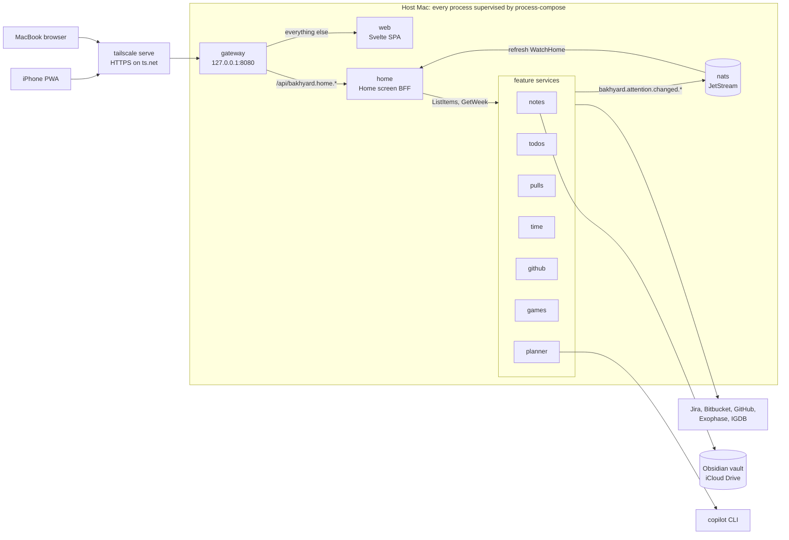

# Bakhyard work plan

Version 1.3, 2026-10-18. Replaces v1.2: the first attempt was archived and the build restarted in small, reviewed steps.

Bakhyard is a self-hosted dashboard for one person. It runs on an always-on home Mac and brings together Obsidian notes, work (Jira todos, Bitbucket pull requests, hours logged on Jira, reviewer nudges), GitHub, games and a Copilot planner, used from a MacBook and an iPhone. The name is Bakh + backyard: personal, and it lives at home.

This document is the source of truth for scope and the work breakdown. How we work (rules, pipeline, quality gates) is canonical in [AGENTS.md](../AGENTS.md). Update the status markers as work lands.

**Contents**

0. [Status](#0-status)
1. [Goal and scope](#1-goal-and-scope)
2. [Feasibility](#2-feasibility)
3. [Product architecture](#3-product-architecture)
4. [System architecture: the microservices experiment](#4-system-architecture-the-microservices-experiment)
5. [Repo layout](#5-repo-layout)
6. [Toolchain and conventions](#6-toolchain-and-conventions)
7. [Visual identity](#7-visual-identity)
8. [Work breakdown](#8-work-breakdown)
9. [Decisions](#9-decisions)
10. [Risks](#10-risks)
11. [Estimate](#11-estimate)
12. [Open questions](#12-open-questions)
13. [Sources](#13-sources)

## 0. Status

**Restarted** on 2026-10-18. The first attempt was written in large batches by background agents and failed the clean-code bar: god packages, long files mixing unrelated concerns, and infrastructure built before anything needed it. It was archived outside the repo. The build restarts in small steps, each going through the pipeline in [AGENTS.md](../AGENTS.md) and a PR the user reviews.

The v1.2 design in §4 to §6 stays as reference. A piece of it is built only when a step needs it.

| Id | Step | Status |
| --- | --- | --- |
| `agents-md` | AGENTS.md, this status, the first attempt archived | Done (#1) |
| `agents` | A dedicated custom agent for each pipeline role | Done (#3), later dropped (decision 38) |
| `ci-baseline` | CI with mise, Renovate, SonarQube Cloud, jactionlint | Done (#2) |
| `go-toolchain` | Go module, golangci-lint with the gates, coverage gate, `mise run check`, and the smallest `home` service: `GET /healthz` | Done (#4) |
| `home-service` | `home` serves the demo data (§4.13) | Done (#5) |
| `gateway` | The gateway in front of `home` | Done (#6) |
| `chi-router` | Route with chi instead of `net/http.ServeMux` (decision 42) | Done (#7) |
| `openapi` | Generate the public JSON APIs from OpenAPI specs | Dropped (#8 closed, decision 43) |
| `code-first` | Record decision 43: the public JSON APIs stay hand-written | Done (#9) |
| `web-scaffold` | The Svelte app in `apps/web`, its toolchain and the web gates (decision 44) | Done (#10) |
| `visual-identity` | Replace §7 with the new visual identity (decision 45) | Done (#11) |
| `time-worklogs` | Record how time is logged on Jira and what the Time module does (decision 46) | Done (#15) |
| `renovate-age` | Renovate waits a day for npm releases, as pnpm does (decision 47) | Done (#16) |
| `web-service` | A Go `web` service serves the built app; the gateway sends every path outside `/api` to it (decision 48) | Done (#17) |
| `home-style` | The page style per §7: the tokens for both themes, the fonts, the paper grain and the base styles | Done (#18) |
| `home-header` | The top bar's time and city, the header with the wordmark and the nav, and the focus outline | Done (#19) |
| `home-name` | `home` serves `name` from `BAKHYARD_NAME`, falling back to "there" (§4.11) | Done (#20) |
| `home-hero` | The hero (date, greeting and summary) and the top bar's Online or Offline (decision 49) | Done (#21) |
| `home-feed` | The "Needs you today" card, from `/api/home`, with rows that link to their app (decision 50) | Done (#22) |
| `home-apps` | The "Your apps" grid: a card per app that links to its page, with its count of items | Done (#23) |
| `home-week` | The "This week" card with the weekly hours bar, and the section head's text link to Time | Done (#24) |
| `home-phone` | The phone and tablet frame per §7: the bottom tab bar and safe areas (decision 52) | Done (#25) |
| `app-pages` | Each path shows its page in place, through the Navigation API: the Home, a "Coming soon" page per app, More at `/more`, and "Page not found" elsewhere (decision 53) | Done (#26) |
| `cockpit-manifest` | `services.toml` lists the services; `cockpit list` checks it and prints them in start order (decision 54) | Done (#27), later dropped (decision 61) |
| `cockpit-up` | `mise run up` builds the services and runs them in start order, each in its own process group, with each line of output marked with its service; Ctrl-C stops them in reverse order, with SIGTERM and then SIGKILL after 10 s (decision 55) | Done (#28), later dropped (decision 61) |
| `service-env` | The services take their address and peers from `BAKHYARD_LISTEN` and `BAKHYARD_PEERS` (§4.7), their shared server setup moves to the root `internal/`, and they shut down gracefully on SIGTERM (decision 56) | Done (#29) |
| `cockpit-control` | The supervisor starts, stops, kills and restarts each service on its own and reports each one's state; `cockpit up` runs on it (decision 57) | Done (#30), later dropped (decision 61) |
| `cockpit-tui` | `cockpit` opens a table of the services, with keys to start, stop, kill and restart each one; quitting stops them all (decision 58) | Done (#32), later dropped (decision 61) |
| `cockpit-usage` | The table shows each running service's CPU and memory, measured every 2 s with one `ps` call (decision 59) | Done (#33), later dropped (decision 61) |
| `cockpit-health` | Every service answers `GET /healthz`, the gateway included; the cockpit checks them every 2 s and the table shows each one's health (decision 60) | Done (#34); the cockpit part later dropped (decision 61) |
| `cockpit-wait` | The cockpit starts a service only once the services it depends on are healthy | Dropped (#35 closed, decision 61) |
| `cockpit-logs` | Each service's log in the TUI | Dropped: process-compose has it (decision 61) |
| `cockpit-restart` | A service that crashes restarts with backoff | Dropped: process-compose has it (decision 61) |
| `process-compose` | process-compose runs the services in place of the cockpit, which is removed (decision 61) | Done (#36) |
| `spike-https-push` | The Phase 0 spike (§8.2): HTTPS through `tailscale serve`, the identity headers, Web Push and Google sign-in, tested on the iPhone and the Mac; the findings are in §2, §3 and §10 (decisions 62 to 65) | Done (#38) |
| `spike-games-access` | The Phase 0 spike (§8.2): which HTTP client reads Exophase's JSON, IGDB's token, search and covers, and the Backloggd reviews RSS; the findings are in §2, §3 and §10 (decisions 66 to 68) | Done (#39) |
| `spike-vault-sync` | The Phase 0 spike (§8.2): how the host reads the vault in place from iCloud, notices changes and reads notes macOS has offloaded; the findings are in §2, §3 and §10 (decisions 69 to 71) | Done (#40) |

After these: the product phases (§8.2), each split into steps.

**Deferred until a step needs it**: gRPC and protobuf for service-to-service calls (decision 43), NATS and events, OpenTelemetry, Prometheus metrics, streaming, unix sockets, a shared kit, per-service Go modules and `go.work`, the git hook, most mise tasks, and process-compose's detached mode and API server (§4.9).

**Ideas**: `sonar-issues` could page past 200 issues, or warn when it cuts them off. Longer task scripts could move into files that `check` shellchecks; today only the workflow's `run:` scripts are checked. A gate self-test could lint known-bad fixtures and expect every gate to fire, so a config typo can't switch one off silently (§10). pnpm's `savePrefix` setting could be empty, so `pnpm add` pins exact versions without `-E`. The app has no favicon yet, so every page load logs a 404 for `/favicon.ico`; the icons could come early, before the rest of the PWA manifest (§8.2 `frontend-shell`). The Home's components each style their own big numbers and mono labels (the app counts, the week's hours, the section head's note); shared type styles could replace the copies. The header's nav marks an app's link `aria-current="page"` on the app's deeper pages too (`/notes/x`); ARIA and GOV.UK's service navigation keep "page" for the link's own page and use "true" for a section the page is in, as the tab bar's More does (decision 52). Screen readers aren't told when a page changes in place; a polite live region that reads out the new title after each navigation could tell them, as SvelteKit's route announcer does. Each service's port is written twice in `process-compose.yaml`, in its `BAKHYARD_LISTEN` and its probe, and the gateway's `BAKHYARD_PEERS` repeats home's and web's; a check could keep them in step. Nothing checks that every address is on the loopback, though nothing should listen on the LAN (§3). Pushover could join Web Push as a second notification channel, for alerts that repeat until acknowledged (§2, decision 64).

## 1. Goal and scope

One user. The host is an always-on home **Mac** on the LAN. Clients are a **MacBook** and an **iPhone** (browser and Home Screen PWA). Repo: `codedogapp/bakhyard` (public).

Modules:

1. **Notes**: the Obsidian vault, rendered read-only on the MacBook and the iPhone, with a Sync button that picks up changes. Editing comes later (decision 69).
2. **Work**: custom todos linked to Jira tickets; Bitbucket PRs (mine and review requests); time tracking on the Jira tickets; "nudge reviewers" reminders.
3. **GitHub**: my open PRs, review requests and assigned issues, across all owners and orgs.
4. **Games**: what I'm playing (the games played in the last 14 days) and their stats, from Exophase, with IGDB covers. No Backloggd (decision 66).
5. **Copilot planner**: plan-mode chat with Copilot; the result is saved as a note in the vault.

Inputs from the user:

- Devices: iPhone and MacBook; the host is a Mac.
- No paid Obsidian Sync; the vault syncs through iCloud (Desktop & Documents), and obsidian-git is used today. Notes must render wikilinks, embeds, callouts and LaTeX. Viewing them is enough for now; editing comes later (decision 69).
- Jira Cloud and Bitbucket Cloud are reachable without a VPN. Work tokens on the personal Mac are OK. Time is logged on the Jira tickets as standard Jira worklogs; Clockwork writes them too (decision 46).
- Notifications go to the phone (push), the Mac and the browser.
- Reminder rule: a PR open for more than 24 h without the required approvals → remind at 10:00 and 15:00 on workdays, with snooze.
- Copilot Business sits on a separate work GitHub account.
- Backend in Go or Java. Remote access outside home is not required.
- Backloggd and Exophase accounts exist; Exophase links Nintendo and PSN. Usernames and player IDs live in local config, not in git.

## 2. Feasibility

Verified 2026-10-17 unless marked.

| Feature | Verdict | How / evidence | Caveats |
|---|---|---|---|
| Vault render + edit | ✅ | Server reads and writes `.md`; the frontend renders with unified/remark: `@flowershow/remark-wiki-link` 4.0.0, `rehype-callouts` 2.2.0, `remark-math` + KaTeX/MathJax, `@quartz-community/remark-obsidian` 1.1.0 | `![[note]]` embeds need our own resolver. Go's `goldmark-obsidian` lacks callouts and highlights → render in the TS frontend |
| Vault sync, tested 2026-10-22 | ✅ read-only (decisions 69 to 71) | **iCloud Drive, in place**: the vault stays in `~/Documents`, which Desktop & Documents syncs, and the host Mac, on the same Apple ID, reads it there; the iPhone views notes through Bakhyard. Tested on a MacBook (macOS 26.4.1, Optimize Mac Storage on): two files uploaded on icloud.com had arrived by the time the user reported the upload, so within seconds, as placeholders (dataless), with their original birth time and mtime. *Keep Downloaded* on the folder (Finder) downloaded a placeholder within about 1 s, and a later arrival by itself about 2 s after it came. Go's `os.ReadFile` on an offloaded 20 KB note blocked 0.9–1.2 s, downloaded it and returned it whole, with no setup; `stat` and `WalkDir` don't download, and show the full size. Offloading and downloading leave size and mtime unchanged. A `WalkDir` with a stat of each file takes 3 ms for the user's vault and about 20 ms for 5,000 files. fsnotify v1.10.1 (kqueue) and `fsnotify/fsevents` v0.2.0 (FSEvents) both saw local saves within milliseconds | Obsidian's iOS app needs the vault in `iCloud Drive/Obsidian` ("If your vault is in a different location, you may experience syncing issues"), so the iPhone can't open this one. After a reboot nothing syncs until someone logs in, and FileVault turns auto-login off (§3). kqueue holds every watched file open, so iCloud can't offload it ("currently in use by an application"), and doesn't watch recursively. FSEvents needs cgo and macOS, while CI runs on Linux; its Go library is marked unstable (last release 2024), and its flags mislead: an append showed Created, Modified and Xattr at once, a file iCloud delivers shows as Renamed, and a folder rename names only the folder. iCloud touches a written file's metadata 1–1.5 s later. Reading while offline is untested. iCloud isn't a backup (Obsidian: "Syncing is not a backup"). With edits (Phase 6), the same note edited offline on two devices → one silently wins (recoverable via TextEdit "Keep Both"). The ways compared on 2026-10-17 to sync the vault to Obsidian on the iPhone (`iCloud Drive/Obsidian`, git with the GitSync app, LiveSync, Headless Sync) no longer apply |
| Jira Cloud | ✅ | Basic `email:api_token`; `GET/POST /rest/api/3/search/jql` (the old `/search` is removed); request `fields` explicitly; `nextPageToken` paging | Token expiry ≤ 365 d → rotate; webhooks are admin-only → poll; an employer IP allowlist would block |
| Bitbucket Cloud | ✅ | Scoped Atlassian API token (app passwords died 2026-07-28), host `api.bitbucket.org`. Mine: `GET /2.0/workspaces/{ws}/pullrequests/{me}?state=OPEN`. Reviewing: per repo `pullrequests?q=reviewers.uuid="{uuid}" AND state="OPEN"`. Approvals: PR detail `participants[]`; `/activity` for the last reviewer action | No cross-repo "reviewing" endpoint; 1,000 req/h → cache + incremental scan; webhooks need repo admin → poll |
| Time tracking, verified 2026-10-20 | ✅ | Standard Jira worklogs over REST v3 with the Jira token, as the user's own tool does. Read: my `accountId` from `GET /rest/api/3/myself`; the issues from `search/jql` with `worklogAuthor = currentUser() AND worklogDate >= "<from>" AND worklogDate < "<to>"`; then per issue `GET /rest/api/3/issue/{key}/worklog` with `startedAfter` and `startedBefore` (UNIX ms) and `startAt` paging, keeping my own. Write: `POST /rest/api/3/issue/{key}/worklog` with `started` and `timeSpentSeconds`. None of these is deprecated. Clockwork's worklogs are standard Jira worklogs, so Bakhyard and Clockwork see the same hours | Time tracking must be enabled; writing needs the Browse projects and Work on issues permissions. `worklogAuthor` is in Atlassian's Data Center field reference but not the Cloud one, though it works on Jira Cloud today; the documented fallback, `GET /rest/api/3/worklog/updated` + `POST /rest/api/3/worklog/list`, scans every worklog the token can see. JQL searches only an issue's 1,000 most recent worklogs. By default a new worklog emails the issue's watchers (`notifyUsers`) and reduces the remaining estimate (`adjustEstimate=auto`). Tempo is not used (decision 40) |
| PR reminders | ✅ | Own scheduler + rule engine. "Required approvals" is a per-repo setting | Auto-detection via the branch restrictions API is unverified (may need admin) |
| Push (iPhone / Mac / browser), tested on the devices 2026-10-21 | ✅ | **Web Push** (VAPID) through `tailscale serve` (free, valid cert, no inbound ports), sent by the spike's throwaway server. iPhone (iOS 27.0.1) Home Screen PWA, through `web.push.apple.com`: the push service answers 201 in 140–730 ms, usually about 170, and the notification shows 0.4–1 s after the send (three times about 2 s) with the app open, in the background or swiped away. A tap brings the app to the front, or launches it in standalone mode if it was closed. Mac Safari 26.4, also through `web.push.apple.com`, within 0.75 s, with the tab open or closed; a tap opens a window. Brave on the Mac, through Google's `fcm.googleapis.com`, within 0.3 s. FCM answers 410 "push subscription has unsubscribed or expired." once a subscription is revoked. Alternative: Pushover ($4.99 once per platform, 10k msg/month, `priority=2` repeats until acknowledged, no HTTPS needed), now an idea (decision 64) | On the iPhone only the Home Screen app can subscribe: a Safari tab has neither `PushManager` nor the Notification API. Brave needs two switches: "Use Google services for push messaging" (brave://settings/privacy), off by default, without which `subscribe()` fails with "AbortError: Registration failed - push service error"; and Brave's notification permission in macOS, without which `showNotification` succeeds and nothing shows. Chromium's push goes through Google's FCM, which sees the metadata; the payload is end-to-end encrypted. `webpush-go` v1.4.0 ignores `VapidExpiration` (its JWT always expires after 12 h), prepends `mailto:` unless the subscriber starts with `https:`, pads payloads to 4,096 bytes, and requires `golang-jwt/jwt/v5` v5.2.1 (GO-2025-3553) and `x/crypto` v0.31.0. The Notification API needs a secure context (LAN `http://192.168…` fails). `osascript`/terminal-notifier only notify the host Mac, not the MacBook. ntfy: self-hosting is Docker-only on macOS and the iPhone shows "New message" off-LAN; public ntfy.sh = topic-as-password, 250 msg/day, iOS app "a little buggy" |
| GitHub | ✅ | `GET /search/issues`: `is:pr is:open author:@me`, `is:pr is:open review-requested:@me`, `is:issue is:open assignee:@me`; 30 req/min | A fine-grained PAT covers one owner; the Notifications API needs a classic PAT |
| Sign-in (one email), verified 2026-10-18, tested on the devices 2026-10-21 | ✅ Google · ❌ Apple (cost) | Google redirect URIs need HTTPS and a host on the public suffix list. `ts.net` is a PSL private suffix, and there is no reachability rule (the browser delivers the callback). Testing mode with `openid email profile`: no 7-day expiry, no warning screen. Google accepted the `ts.net` redirect URI for an External app in Testing mode and asked for no authorized domain or verification. From the iPhone Home Screen app (iOS 27.0.1), Google's pages open inside the app and the callback lands in standalone mode, in the app's own cookie jar; a popup (`window.open`) works too. The session survives closing and reopening the app. The callback is a cross-site top-level GET, so `SameSite=Lax` cookies arrive with it. Tailscale Serve identity headers: `Tailscale-User-Login` and `Tailscale-User-Name` arrive, and copies sent by the client are replaced; Tailscale login providers include Google and Apple | Google lets ANY account finish sign-in → the app pins `sub`. Apple needs a $99/yr developer account; `ts.net` acceptance unknown; its form_post callback breaks Lax cookies. A later iOS may hand the login off to Safari, whose cookie jar is separate (§10) |
| Copilot planner | ✅ (spike first) | Copilot SDK **GA 2026-06-02** (v1.0.22). Go `github.com/github/copilot-sdk/go` (needs the `copilot` CLI: `brew install --cask copilot-cli`); Java is official too (`com.github:copilot-sdk-java`, Java 17+). Plan mode: `AgentMode: plan` + `OnExitPlanModeRequest` → plan markdown; custom tools; `AvailableTools`; permission handler. Per-client `GitHubToken` → identity separate from the personal GitHub token | **Work Business seat**: needs an admin Copilot CLI policy; the GitHub Customer Agreement licenses seats "only for Customer's internal business purposes"; usage draws employer credits → needs employer OK, otherwise personal Copilot Free/Pro. SSO orgs → `copilot login --device-code`; a possible `*.ghe.com` tenant → `--host`. Env precedence `COPILOT_GITHUB_TOKEN` > `GH_TOKEN` > `GITHUB_TOKEN` (keep the personal token out of the Copilot process). Billing = token-based AI credits. Plan mode + restricted tools combination unverified. GitHub Models retired 2026-07-30 |
| Backloggd, re-checked 2026-10-21 | ⚠️ partial, not used (decision 66) | **No public API** (request open since 2023, no developer reply; no export). ✅ Official **reviews RSS** `https://backloggd.com/u/{user}/reviews/rss/` (the last 20 reviews): 200 `application/rss+xml`, no bot check; 404 for an unknown user. Per public code that parses it, an item has the title "Name (Year) - ★★★★½", the review's link, `pubDate`, the review text, `backloggd:user_rating` (0–10) and the IGDB cover, but no game slug; the cover's id leads back to the IGDB game through `/v4/covers`. Game pages use IGDB's slugs (9 of 10 checked) | Playing, backlog and wishlist pages: an **Anubis proof-of-work challenge** for every client tried (Go's default, a browser's and an honest user agent). ToS: "You agree to access the Website through the interface we provide" → solving the challenge (Playwright, PoW solvers) conflicts. The RSS carries reviews only, and the user writes none |
| Exophase, tested 2026-10-21 | ✅ undocumented | **No documented API.** Internal JSON, no login: `api.exophase.com/public/player/{playerProfileId}/games?page=N&environment=&sort=1&showHidden=0`, 50 games a page, last played first; past the last page `{"success":false}`. Per game: `meta.title`, `meta.environment_slug` (`psn`, `nintendo`), `meta.platforms`, `playtime`, `earned_awards`, `total_awards`, `percent`, `lastplayed_utc` (Unix seconds), and banners on `m.exophase.com` (127×70 and smaller). `/public/player/{master_playerid}/game/{master_id}/earned?last=0`, from each game's per-platform ids, lists a PSN game's trophies with icons and unlock times, but no names. Go's `net/http` with a browser's or an honest user agent (`bakhyard/0.1 (+https://github.com/codedogapp/bakhyard)`) gets the JSON in 200–900 ms, and so does `bogdanfinn/tls-client` v1.16.0 (Chrome 152, Safari iOS 26) | **Cloudflare challenges** (403, `cf-mitigated: challenge`) Go's default user agent, a bare `Mozilla/5.0` and curl (on macOS, with any headers). The rule may change at any time, and how long the honest user agent keeps working is unmeasured (decision 67). Nintendo games carry playtime only: no trophies, and `/earned` answers `{"success":false}`. robots.txt only disallows `/search`; the ToS has no scraping clause. Images on `m.exophase.com` and `card.exophase.com` aren't challenged, but the card's URL isn't built from the profile id (`card.exophase.com/2/0/{playerProfileId}.png` is a 1×1 GIF). ⚠️ The public profile HTML contains personal data → never fetch or store the raw page |
| IGDB, tested 2026-10-21 | ✅ | Twitch client credentials: `POST https://id.twitch.tv/oauth2/token` with a form body → an app token that lasts about 58 days. Search: `POST https://api.igdb.com/v4/games` with `Client-ID` and `Authorization: Bearer`, and an Apicalypse body; results by relevance, in 200–800 ms. `where game_type = (0,2,4,8,9,10,11) & version_parent = null` keeps main games, expansions, remakes, remasters, expanded games and ports, and drops editions, DLC and packs (`game_type` replaces the deprecated `category`). Of 15 recent Exophase titles, whose case, subtitles and numerals often differ from IGDB's, the filtered search's top result was right for 14; an unfiltered exact-name search found the 15th, a game typed Update (14). Covers: `https://images.igdb.com/igdb/image/upload/t_cover_big/{image_id}.jpg`, a 264×374 JPEG of about 24 KB; IGDB prefers apps to store and serve its data | Free for non-commercial use, under the Twitch Developer Service Agreement; 4 req/s and 8 open requests. A re-release can match its original. Slugs carry collision suffixes (`hades--1`), and a record merged into another leaves its old slug and cover dead. Twitch asks apps that keep an OAuth session to validate their token at start and hourly; whether that covers app tokens is unclear |

## 3. Product architecture

```
iPhone PWA ─┐                              ┌── Jira / Bitbucket / GitHub (poll); Exophase / IGDB (on request)
MacBook ────┼── HTTPS (tailnet) ──▶ Bakhyard on the host Mac (services supervised by process-compose, §4)
            │                              ├── SQLite per service (todos, caches, push subscriptions, sessions)
            │                              ├── vault dir (iCloud Drive), read only ◀── iCloud ──▶ Obsidian (MacBook)
            │                              ├── copilot CLI runtime (SDK, JSON-RPC, loopback)
            └◀── Web Push ◀── APNs/FCM ◀── notify
```

- **Host Mac**:
  - Dedicated macOS user, auto-login, sleep disabled.
  - A LaunchAgent with `KeepAlive` runs process-compose, which supervises every service. A user session is needed for iCloud and the Keychain.
  - LaunchAgents and iCloud's File Provider agent load only after a login at the GUI, so after a reboot nothing runs or syncs until someone logs in. Auto-login does that, but macOS turns it off while FileVault is on. The MacBook that stood in for the host in the spikes has FileVault on, so it needs a login by hand after each reboot; whether a dedicated host keeps FileVault is decided with the host (§12).
  - Same Apple ID as the MacBook, so iCloud brings the vault (decision 70). The vault folder is set to *Keep Downloaded*, or Optimize Mac Storage is off, so notes are on disk when read.
- **Network**: Tailscale on the host, the MacBook and the iPhone. `tailscale serve` publishes `https://<host>.<tailnet>.ts.net` → the gateway on `127.0.0.1:8080`. Nothing listens on the LAN.
  - On the host, Tailscale is the Homebrew formula: the open-source `tailscaled` as a root LaunchDaemon, up at boot before any login, with no GUI and no auto-update (decision 62).
  - Funnel works on the formula (not on the two apps), so `tailscale serve status` must show the tailnet only.
  - Serve's certificate comes from Let's Encrypt and lasts 90 days. Tailscale's docs say a certificate that isn't installed as files, as with Serve, renews by itself; no renewal has been watched yet.
  - On the formula, MagicDNS answers through `/etc/resolver/` files: check a name with `dscacheutil -q host -a name …`, not `dig`, which skips them.
- **Backend**: Go services (§4). Secrets live in the macOS Keychain. Each integration service owns its adapters: poll → cache a snapshot in its own SQLite → diff → publish change events and feed the notification rules.
- **Frontend**:
  - Svelte 5 + Vite + TypeScript SPA, installed as a PWA (manifest, service worker, Web Push).
  - Notes render with a unified/remark pipeline plus our own embed resolver, backed by the notes service's vault index; KaTeX. A Sync button rescans the vault (decision 71). The CodeMirror 6 editor comes with `vault-edit-sync` (decision 69).
  - Live updates by polling `/api/home` (decision 49); SSE when a step needs faster ones.
  - Look and feel per §7. Home = greeting + "Needs you today" feed (attention items from every app) + "Your apps" grid + weekly hours bar.
- **Copilot** (planner service):
  - SDK client with an explicit `GitHubToken` and `COPILOT_HOME`, isolated from the personal GitHub token.
  - One session per plan; deny-by-default permission handler; built-in shell and write tools excluded.
  - The service, not the agent, writes the plan to `Plans/YYYY-MM-DD-<slug>.md` with frontmatter.
  - Per-session credit limit.
- **Notifications** (notify service): Web Push only (decision 64), to the iPhone Home Screen PWA and to Safari on the MacBook, or Brave with Google's push service switched on (§2). A device is forgotten when its push service answers 404 or 410. In-app notification centre.
- **Games** (games service), from Exophase alone (decision 66):
  - "Playing" is the games last played in the last 14 days, from Exophase's games list, which also gives each game's playtime, trophies and percentage (Nintendo: playtime only). `/earned` isn't used.
  - Fetched on request, not polled (decision 67): the service answers from its cache, and refetches the list in the background once the cache is more than an hour old (stale-while-revalidate).
  - The HTTP client is Go's `net/http` with an honest user agent that names Bakhyard and links its repo; Cloudflare challenges Go's default one (§2). If challenges start, `bogdanfinn/tls-client` is the plan B. On a 403, a challenge or a 429: exponential backoff, keep the last good data, show a "stale" badge.
  - Covers come from IGDB (decision 68): each title is matched once, with a filtered search and an exact-name fallback, and the match is cached.
  - Never fetch or store profile HTML (it contains PII).
- **Vault reads** (notes service, decision 71): the vault is read in place. There's no file watcher and no polling: the service scans the vault when it starts and when the user presses Sync. A scan is a `WalkDir` with a stat of each file, skipping dot folders such as `.git/` and `.obsidian/`, and re-reads only the notes whose size or mtime differs from the index. It compares for equality, never "newer than": a note iCloud delivers keeps its original mtime.
- **Vault writes** (notes service, from `vault-edit-sync` in Phase 6, conflict-safe): new notes get unique names; edit only if the mtime/hash is unchanged since the read; temp file + atomic rename; skip notes modified elsewhere in the last few minutes; never touch `.obsidian/`.
- **Auth** (enforced at the gateway; one person, two locks):
  1. **Tailscale identity**:
     - The gateway listens on `127.0.0.1` only; `tailscale serve` adds `Tailscale-User-Login` and replaces copies sent by the client (tested 2026-10-21). It also sets `X-Forwarded-For` (the client's tailnet IP), `X-Forwarded-Host` and `X-Forwarded-Proto: https`.
     - Require the login to equal the allowed email (Tailscale account created via Google, or Apple).
     - Check that `Host` is our `ts.net` name.
     - No identity headers (tagged devices, Funnel) → reject.
  2. **Google sign-in (OIDC)**:
     - `go-oidc/v3` 3.21.0 + `x/oauth2` 0.37.0, auth-code flow with PKCE.
     - `state` and `nonce` stored on the server (go-oidc does not check the nonce → we compare it).
     - Scopes `openid email`; the consent screen app stays in "Testing" (no 7-day expiry for basic scopes).
     - Google does NOT enforce the test-user list → allow only `email_verified` + the allowed email at first login, then pin `sub` and match on `sub` afterwards.
     - Callback `https://<host>.<tailnet>.ts.net/auth/google/callback`; Google never needs to reach it.
     - The callback is a cross-site top-level GET: the `SameSite=Lax` cookies arrive with it, and `CrossOriginProtection` always allows GET. It creates a session, so `state`, PKCE and the nonce are what protect it.
  3. **Session**:
     - `__Host-` cookie, Secure, HttpOnly, SameSite=Lax, sliding ~30 days; sessions stored in SQLite.
     - CSRF protection via Go's `http.CrossOriginProtection`.

**Polling defaults**: Jira 5 min; Bitbucket mine 5 min, review scan 15 min (repo list daily); GitHub 5 min; logged time 15 min + on demand. Not polled: Exophase (on request, cached for an hour) and IGDB (on demand, cached).

**Default reminder rule**: PR `OPEN`, not a draft, age > 24 h, approvals < required (per repo) → notify at 10:00 and 15:00 Mon–Fri (local time zone). Actions: open the PR, snooze (2 h / tomorrow / until the PR is updated), mark as nudged. Skip if snoozed or already sent in this slot.

**Data**: one SQLite database per service, in the service's own data directory. No service reads another's tables.

| Service | Tables (planned) |
| --- | --- |
| todos | `todos` (+ `jira_key`) |
| time | none of its own: the worklogs stay in Jira |
| pulls | `pr_state` (PR id, first_seen, approvals, required, last_activity, snooze_until, last_reminded_slot), `reminder_rules` |
| notify | `push_subscriptions` |
| planner | `copilot_sessions` (id, title, status, note_path) |
| games | `covers` (title, igdb_id, image_id, matched_at); the last good games list in `integration_cache` |
| gateway | `sessions` (sign-in) |
| every integration service | `integration_cache` (source, key, json, fetched_at), `settings` |

## 4. System architecture: the microservices experiment

> **v1.3:** the v1.2 design, kept as reference. §0 sets the build order and what is deferred; [AGENTS.md](../AGENTS.md) overrides this section where they differ (for example, one Go module instead of one per service).

### 4.1 Intent

The user's brief (2026-10-18):

- every feature is its own service, behind a proxy gateway;
- one SPA, no micro-frontends;
- a TUI "cockpit" to start, stop and kill single services, and to monitor them;
- monitoring wherever it helps;
- microservice best practices;
- shared code that is safe to share.

Choices taken (all recommended options):

- **Cockpit**: process-compose, which supervises the services and has a TUI (decision 61). The v1.2 choice was our own supervisor daemon plus a TUI client.
- **Contracts**: Protobuf + Connect RPC via buf, with generated Go and TypeScript.
- **Events**: NATS, with JetStream enabled, running as its own service.
- **Monitoring**: built in (health, readiness and Prometheus metrics), plus OpenTelemetry traces, off by default.

### 4.2 Overview



### 4.3 Services

| Service | Role | Listens on | Peers | Grows into (§8.2) |
| --- | --- | --- | --- | --- |
| nats | Event bus; JetStream on for later durable flows | `tcp://127.0.0.1:4222`, monitoring `:8222` | | reminders → notify |
| gateway | The only way in: `/api` to the services, everything else to web | `tcp://127.0.0.1:8080`; ops on an admin unix socket | web, home | auth-signin |
| web | Serves the embedded Svelte build | unix socket | | frontend-shell (PWA parts) |
| home | Builds the Home screen from every app | unix socket | nats, time, notes, todos, pulls, github, games, planner | home-feed |
| notes | Obsidian vault | unix socket | nats | vault-index, vault-render, vault-edit-sync |
| todos | Todos linked to Jira | unix socket | nats | todos-jira |
| pulls | Bitbucket pull requests and reviewer nudges | unix socket | nats | bitbucket-prs, pr-reminders |
| time | Time tracking on the Jira tickets | unix socket | nats | time-tracking |
| github | GitHub pull requests, reviews and issues | unix socket | nats | github-widgets |
| games | Recent games and stats from Exophase, with IGDB covers | unix socket | nats | games-exophase |
| planner | Copilot plans saved to the vault | unix socket | nats | copilot-planner |
| notify (later) | Web Push and the notification centre | unix socket | nats | notifications |

- Internal services listen on unix sockets in `$BAKHYARD_HOME/run/svc/` (directory mode 0700). Only the gateway has a TCP port.
- Each service owns its data directory and database (§3 Data).
- In the first slice the feature services return demo data (§4.13).

### 4.4 Gateway

- Listens on `127.0.0.1:8080`, behind `tailscale serve`. Its own ops endpoints sit on the admin unix socket.
- Routing:
  - `/api/bakhyard.<svc>.v<N>.<Service>/<Method>`: strip `/api`, take `<svc>` from the proto package, and proxy only if `<svc>` is one of the gateway's peers.
  - Internal packages (`bakhyard.attention.*`) and the services' ops paths are therefore never reachable from outside (404).
  - Publishing a new API means a new proto package plus adding the service to the gateway's peers.
  - Everything else goes to `web`.
- `httputil.ReverseProxy` (Rewrite + SetXForwarded) over the kit's unix-socket transport. Streaming responses flush immediately.
- An upstream that is down gets a 503 with a Connect-style JSON error on `/api`.
- Sets or forwards `X-Request-Id`.
- Security headers, including CSP `default-src 'self'; style-src 'self' 'unsafe-inline'; img-src 'self' data: https:; font-src 'self' data:; connect-src 'self'; frame-ancestors 'none'; base-uri 'none'`. `data:` covers the images and fonts Vite inlines (§4.12).
- CSRF protection via `http.NewCrossOriginProtection()`.
- Later: sign-in (§3 Auth) is enforced here.

### 4.5 Contracts

> **v1.3:** for service-to-service calls and NATS payloads only (decision 43). The public APIs stay hand-written JSON.

Schema-first protobuf in `proto/`, a buf v2 module (lint STANDARD, breaking FILE).

| Package | RPCs | Exposure |
| --- | --- | --- |
| `bakhyard.attention.v1` | `AttentionService/ListItems` (NO_SIDE_EFFECTS) → `Item{id, title, detail, source, url, due}`. Event message `ItemsChanged{app, reason}` | Internal: every feature service implements it; never routed by the gateway |
| `bakhyard.home.v1` | `HomeService/GetHome` (NO_SIDE_EFFECTS, so the client uses HTTP GET) and `WatchHome` (server stream) → `Home{name, items, week, sources, generated_at}` | Public, via the gateway |
| `bakhyard.time.v1` | `TimeService/GetWeek` → `{logged_hours, target_hours}` | Internal |

`home.v1` messages:

- `Item{id "<app>/<id>", app, title, detail, source, url, due, late}`.
- `Week{logged_hours, target_hours}`, unset when the time service is down.
- `SourceStatus{app, state (OK / UNAVAILABLE), message}`.

Code generation:

- Go goes to `libs/go/contracts/gen` (protoc-gen-go + protoc-gen-connect-go v2, managed `go_package_prefix`).
- TypeScript goes to `apps/web/src/gen` (protoc-gen-es, `target=ts`).
- Both are committed and read-only. `mise run gen:check` fails on drift.

Other rules:

- NATS subject names live next to the generated code, in `libs/go/contracts/subjects`.
- A breaking change gets a new `v2` package, served side by side. `mise run proto:breaking` checks against `main`.

### 4.6 Events

- Subject `bakhyard.attention.changed.<app>`, payload `ItemsChanged` (protobuf), on core NATS.
- Feature services publish on start and again after a graceful stop. A SIGKILL publishes nothing, so the UI catches up on its next poll. Stop versus kill is a demo point.
- home subscribes to `bakhyard.attention.changed.*`, debounces for 250 ms and pushes a fresh Home to every WatchHome stream.
- JetStream is enabled for later durable flows (reminders → notify).
- Hardening later: a NATS auth token read from a 0600 config file.

### 4.7 Service runtime contract

> **v1.3:** as built in `service-env` (decision 56):
>
> - Each service inherits process-compose's whole environment, with two variables from `process-compose.yaml` on top (§4.9): `BAKHYARD_LISTEN`, the address it listens on, and `BAKHYARD_PEERS`, `name=tcp://host:port,…` for the services it calls, which only the gateway has. So home's `BAKHYARD_NAME` comes from the shell or `mise.local.toml`, not from `process-compose.yaml` (decision 56).
> - Addresses are `tcp://host:port` only, with a host and a port from 1 to 65535. The root `internal/env` reads both variables. A service that lacks one it needs, or can't read it, exits 1 and says which, such as `BAKHYARD_PEERS has no peer "home"`.
> - Every service starts through the root `internal/service`: it reads the address, builds the service's routes, and serves them with the root `internal/server`, with a 5 s `ReadHeaderTimeout`. On SIGTERM or Ctrl-C the server stops accepting connections and gives the requests in flight 8 s to finish; the service then exits 0 if they all did, and 1 if not. A service's `main.go` holds only its routes, and logs the error that ends it.
> - Every service answers its health check, `GET /healthz`, on its `listen`, through the root `internal/health`: 200 with `{"status":"ok"}` as `application/json`. HEAD gets the same headers, and any other method a 405 with `Allow: GET`. The gateway answers its own rather than pass it to web, so no service's `/healthz` is reachable from outside (decision 60).
> - The other variables, unix sockets, the other ops endpoints (`/readyz`, `/metrics`), and every shutdown step below other than `http.Server.Shutdown`, wait for the steps that need them.

Services never read `process-compose.yaml`; it sets their environment:

| Variable | Meaning |
| --- | --- |
| `BAKHYARD_SERVICE` | Service name |
| `BAKHYARD_LISTEN` | `unix:///abs/path.sock` or `tcp://host:port` |
| `BAKHYARD_ADMIN_LISTEN` | Optional separate listener for the ops endpoints |
| `BAKHYARD_DATA_DIR` | The service's own data directory |
| `BAKHYARD_PEERS` | `name=url,...` for declared peers only. A peer's url is its `url` if set, else its `listen` (nats → `nats://127.0.0.1:4222`) |
| `BAKHYARD_LOG_FORMAT`, `BAKHYARD_LOG_LEVEL` | Logging; JSON by default |
| `OTEL_SERVICE_NAME`, `OTEL_*` | Tracing; `OTEL_*` inherited |
| A process's `environment` | Per-service values; personal ones, such as home's `BAKHYARD_NAME`, come from `mise.local.toml` (decision 56) |
| `PATH`, `HOME`, `TMPDIR`, `LANG`, `USER` | Passed through |

Ops endpoints. These are not instrumented, so process-compose's probes don't skew request metrics.

- `GET /healthz` → `{"status":"ok"}`: the process is alive.
- `GET /readyz` → `{"status":"ok|degraded|fail","checks":[{"name","status","critical","error","duration_ms"}]}`.
  - 503 on `fail` and during shutdown.
  - A failing non-critical check (NATS, external APIs) gives `degraded`, not `fail`.
- `GET /metrics` (Prometheus):
  - `http_server_requests_total{route,method,code}`. The route is `r.Pattern`, which stays bounded because connect-go v2 mounts one pattern per procedure.
  - `http_server_request_duration_seconds{route,method}` (histogram).
  - `http_server_requests_in_flight`.
  - `http_client_*{peer}`: request totals and durations per peer.
  - `bakhyard_build_info{service,version,revision,go_version}`.
  - Go runtime and process collectors.

process-compose's readiness probes (§4.9) go to each service's `listen`; once a service has an `admin_listen`, they move there.

Shutdown on SIGTERM:

1. Readiness goes to 503.
2. `http.Server.Shutdown`, with an 8 s budget inside the 10 s process-compose waits before SIGKILL (§4.9).
3. OnShutdown hooks run.
4. The bus closes.
5. Traces are flushed.

Streaming handlers watch an app-lifetime context, so open streams end promptly.

### 4.8 Shared code

**`libs/go/kit`** holds infrastructure only. It may not import services or contracts (enforced by depguard).

- **Bootstrap**: `service.Main(name, setup)` covers env config, listeners (main plus optional admin) and an `App` with Config, Logger, Mux, Peers, readiness checks and OnShutdown hooks.
- **Logging**: slog JSON with service and version, plus `request_id` and `trace_id` taken from the context.
- **HTTP server**: ReadHeaderTimeout 5 s, IdleTimeout 2 min, no WriteTimeout (streams). HTTP/1 plus unencrypted HTTP/2 via `http.Protocols`.
- **Middleware order**:
  1. recover
  2. request ID (`X-Request-Id`, or `uuid.NewV7()` from the stdlib `uuid` package)
  3. otelhttp
  4. metrics and access log, wrapping the mux directly. A middleware that calls `r.WithContext` copies the request, and the mux sets `r.Pattern` on the copy it receives.
- **Connect**:
  - `connect.NewServer(interceptors...)` + `connecthttp.Mount(mux, srv)`.
  - Panic recovery and error mapping are interceptors; connect-go v2 has no built-in recovery.
  - Errors are `*connect.Error` with causes. Remote errors returned from a handler are scrubbed to Internal.
- **Peer client**:
  - A unix-socket dialer with base URL `http://<peer>`.
  - Timeouts. Retries on dial errors only, and only when the request has no body or has `GetBody`.
  - otelhttp transport, request-ID propagation, client metrics.
  - Connect clients come from `connect.NewClient(connecthttp.NewTransport(hc, base, connecthttp.WithHTTPGet()))`.
- **Tracing**: an OTLP/HTTP exporter only when `OTEL_EXPORTER_OTLP_ENDPOINT` is set. Otherwise a noop provider that still propagates W3C trace context.
- **Bus**: nats.go with `RetryOnFailedConnect` and unlimited reconnects; a non-critical readiness check; generic protobuf publish and subscribe with trace headers. Tests use an embedded nats-server.
- **Tests**: `connectinprocess.New(srv)`, `httptest`, `t.Context()`, `slog.DiscardHandler`.

**`libs/go/contracts`** holds the generated code and the NATS subjects. It may not import services or kit.

**Sharing policy**

- Share infrastructure (kit) and contracts only, never domain logic. A service that needs another's data calls its API or listens to its events.
- Contracts:
  - schema-first;
  - `buf lint`, and `buf breaking` against `main`;
  - a breaking change gets a new `v2` package side by side;
  - generated code is committed, with a drift check.
- Libraries:
  - their own tests;
  - doc comments with stability notes;
  - a CHANGELOG;
  - semver tags such as `libs/go/kit/vX.Y.Z`;
  - planned: an `apidiff` check (`golang.org/x/exp/cmd/apidiff`) against the last tag.
- Inside the monorepo:
  - Services pin the libraries with a `replace` to the local path.
  - The root `go.work` lists every module.
  - `GOWORK=off` builds and `go mod tidy` (which ignores go.work) still work.
- Layering, enforced by depguard:
  - kit ↛ services or contracts;
  - contracts ↛ services or kit.

### 4.9 process-compose

[process-compose](https://github.com/F1bonacc1/process-compose) runs the services, in place of the cockpit we had built (decision 61). It's a mise tool at `latest`, and `process-compose.yaml` at the repo root lists the services:

- Each service has a `description`, a `command` (`bin/<name>`, run with `bash -c` from the repo root) and an `environment` with its `BAKHYARD_LISTEN` and, for the gateway, `BAKHYARD_PEERS` (§4.7).
- A readiness probe checks each service's `GET /healthz` (§4.7), first 1 s after the start, then every 2 s. A check gets 1 s to answer, and 3 failures in a row fail the probe.
- The gateway `depends_on` home and web with `condition: process_healthy`, so it starts once their probes pass.
- What every service shares sits in an `x-service` YAML anchor, merged into each with `<<: *service`:
  - `availability.restart: always`: a service that exits, or fails its probe, restarts after 1 s, however often it needs to. A service stopped by hand stays stopped.
  - `shutdown.timeout_seconds: 10`: a stop sends SIGTERM to the service's process group, then SIGKILL if it's still running 10 s later. Without the timeout, process-compose never sends SIGKILL, and a hung service never stops.
- `ordered_shutdown: true` stops the services in reverse dependency order, the gateway first.
- `is_strict: true` makes an unknown key an error at the top level and in a process, except for keys that start with `x-`, such as the anchor's. `mise run lint:compose` checks the file with `process-compose up --dry-run`, and is part of `check`.
- process-compose's API server would listen on `localhost:8080`, the gateway's address, so `PC_NO_SERVER` in mise's `[env]` turns it off; nothing uses it yet. `process-compose` run in a shell where mise isn't active would start it.

`mise run up` builds, then runs `process-compose up`, which opens its TUI: a table of the services, with each one's status, age, health, memory, CPU, restarts and exit code, over the selected service's output. F7 starts the selected service, F9 stops it and Ctrl-R restarts it. F10 and Ctrl-C ask before quitting, and quitting stops every service, as SIGINT, SIGTERM and SIGHUP do.

Later, for `deploy-launchd` (§8.2): process-compose can run detached (`up -D`), with its API server on a unix socket (`-U`), and `process-compose attach` opens the TUI on it. `BAKHYARD_HOME`, the services' data directories, unix sockets and log files wait for the steps that need them.

### 4.10 Monitoring

- **Golden signals**: rate, errors and duration per route and per peer, plus saturation (in-flight, CPU, RSS). process-compose's TUI shows each service's CPU and memory.
- **Health vs readiness**: `healthz` = alive, `readyz` = able to serve. An outage of an external API makes a service degraded, not failed.
- **Logs**: JSON with `request_id` and `trace_id`; a file per service, plus process-compose's TUI.
- **Traces**: W3C propagation always on; export is opt-in via `OTEL_EXPORTER_OTLP_ENDPOINT` (e.g. otel-tui or Jaeger).
- **Supervisor**: restarts, last exit, uptime, crash loops.
- **Planned integration metrics**:
  - `integration_last_success_timestamp_seconds{source}`
  - rate-limit remaining
  - `token_expiry_timestamp_seconds`
  - notifications sent
- **Optional**: an external dead-man's switch (e.g. healthchecks.io) for the host itself.

### 4.11 Home logic

- `GetHome` fans out `ListItems` to every peer except nats, concurrently (`wg.Go`), with a 1.5 s timeout each.
  - `Unimplemented` means that app has no items (OK).
  - Any other failure marks the source `UNAVAILABLE` with a message, is logged, and the rest still renders. Never a blank screen.
- Item ids are `<app>/<id>`; `late = due is set && due < now`.
- Sort order (`cmp.Or`): late first, then earliest due (no due date last), then title, then id.
- The week comes from `TimeService.GetWeek` on peer `time`, and is unset if `time` is down.
- The name comes from `BAKHYARD_NAME`, without surrounding whitespace and with invalid UTF-8 replaced by U+FFFD; unset or blank, it falls back to "there". A name is personal, so it's set in the shell or in the gitignored `mise.local.toml` (`[env]`), never in git.
- `WatchHome` sends immediately, again after each `bakhyard.attention.changed.*` event (250 ms debounce), and every 60 s.

### 4.12 Web service and UI

**Web service** (built in `web-service`, decision 48):

- Listens on its `BAKHYARD_LISTEN` from `process-compose.yaml` (§4.7), `127.0.0.1:8082`. It answers `GET /healthz` (§4.7) even before the app is built, but the gateway answers its own `/healthz`, so only process-compose's probe uses web's.
- `main.go` embeds `dist` with `//go:embed all:dist`; `all:` keeps the files whose names start with `.` or `_`. A committed `dist/.gitkeep` keeps the embed valid before the first build, so a fresh clone (CI) builds.
- Vite builds into `services/web/dist/app` (gitignored), with `emptyOutDir` because the directory lies outside the app's root.
- Vite inlines every asset under 4 KiB as a `data:` URI (its default `assetsInlineLimit`): today the grain tile and JetBrains Mono's Cyrillic Extended subset, both in the CSS.
- `internal/spa` serves the app for GET and HEAD. Paths are cleaned first, as a browser cleans them, so `..` can't leave the app.
  - A path that names a file gets it, through `http.FileServerFS`. Directories are never listed, and `/index.html` redirects to `/`.
  - Caching: Vite fingerprints the names in `assets/`, so those files are `public, max-age=31536000, immutable`; every other file, `index.html` included, is `no-cache`. Embedded files have no modification time, so there is no `Last-Modified`, and no ETag either.
  - Any other path without an extension gets `index.html`, so the app routes its own pages. A missing file with an extension gets a 404, so a page path has no dot in its last segment (`/notes/2026.10` is a 404).
- Before the first build every request gets a 503 that says how to build the app.

**UI client** (built in `home-hero`, decision 49):

- `fetch('/api/home')`, with hand-written types (decision 43) that declare only the fields the app reads.
- It loads the Home at once, then every 60 s while the page is visible and again whenever it becomes visible, as TanStack Query does by default. Only the latest request's answer applies, so a slow answer never overwrites a newer one.
- A failed load (the gateway's 503, or no network) keeps the last Home on screen, and the top bar says "Offline · as of 01:10" (§7). The client sets no timeout of its own: a hung upstream is for the gateway's timeouts (decision 41).
- **Pages** (built in `app-pages`, decision 53): the app shows each page in place, through the Navigation API. It intercepts the browser's own navigations (the `navigate` event) and shows the page at the new path: the Home at `/`, an app's page at its path and under it (`/notes/x`), More at `/more`, and "Page not found" anywhere else. The document's title follows the page: "Bakhyard" on the Home, "Time · Bakhyard" on an app's page.
  - The browser handles the rest itself: navigations the API can't intercept (to another origin, or through the history to another document), jumps to an anchor, downloads, form submissions and reloads. A modified click still opens a new tab.
  - The browser updates the URL and the history. Once the new page is in the DOM, it resets focus, so the next Tab starts at the top of the page, and it scrolls to the top, or back to where the page was left on back and forward: the API's defaults.
  - The top bar, the header and the tab bar stay, and so do the poll and the clock: the Home shows its data at once when you come back to it, and More's counts come from the same poll.
  - Without the Navigation API, each link loads its page in full, which works too.

**Dev loop**: `mise run dev` runs Vite on `:5173` with `/api` proxied to the gateway on `:8080`.

### 4.13 Demo data (first slice)

| App | Item | Source | Due |
| --- | --- | --- | --- |
| pulls | Nudge reviewers on PAY-1423 | Bitbucket | 2 h ago (late) |
| todos | PAY-1398 Settlement report export, detail "Was due yesterday." | Jira | 24 h ago (late) |
| time | Log today's hours | Jira | in 3 h |
| time | Jira token expires in 5 days | Jira | in 5 days |
| github | Review requested: dotfiles#14 | GitHub | none |
| planner | Finish plan: home lab backups | Copilot | none |
| notes, games | no items | | |

Week: 31.5 of 40 h. Numbers are named constants (the mnd linter).

## 5. Repo layout

> **v1.3:** the v1.2 layout, kept as reference. The current layout rules are in [AGENTS.md](../AGENTS.md) (Architecture).

```
bakhyard/
├── apps/web/                  Svelte 5 SPA: a standalone pnpm project with its own mise.toml
│   └── src/gen/               generated TypeScript contracts (committed)
├── proto/bakhyard/<pkg>/v1/   protobuf contracts (buf module)
├── libs/go/contracts/         generated Go contracts (gen/) + NATS subjects
├── libs/go/kit/               shared service infrastructure
├── services/<name>/           one Go module per service
├── scripts/go-each.sh         runs a command in every Go module
├── .githooks/pre-commit
├── docs/                      this plan, the design reference, later architecture.md
├── process-compose.yaml       the services, as process-compose runs them
├── buf.yaml, buf.gen.yaml
├── .golangci.yml
├── go.work                    every Go module (to add)
├── mise.toml                  monorepo root: tools, env, tasks
└── deploy/                    launchd plist and host setup notes (later)
```

- Module paths: `github.com/Bakhomious/bakhyard/{services/<name>,libs/go/kit,libs/go/contracts}`.
- Build outputs: `bin/<svc>`. The Vite build goes to `services/web/dist/app/`. Both are gitignored.
- Runtime state lives under `$BAKHYARD_HOME`: `run/` (sockets), `logs/` and `data/<service>/`.

## 6. Toolchain and conventions

> **v1.3:** the v1.2 toolchain, kept as reference. Each tool returns only with the step that needs it. [AGENTS.md](../AGENTS.md) holds the canonical rules and quality gates.

### 6.1 Versions

Policy: **the latest version of everything**, checked against the registries and never guessed. `mise run upgrade` moves everything forward; `mise run outdated` reports what's new.

Verified on 2026-10-18:

| Tool or package | Version |
| --- | --- |
| Go | 1.27.2 |
| golangci-lint | 2.15.0 |
| Node | 26.12.0 |
| pnpm | 12.14.0 |
| buf | 1.74.0 |
| protoc-gen-go, `google.golang.org/protobuf` | 1.36.12 |
| protoc-gen-connect-go, `connectrpc.com/connect/v2` | 2.0.1 |
| nats-server | 2.15.1 |
| TypeScript | 7.0.2 (as `@typescript/native`) + 6.0.3 (for svelte-check) |
| svelte, svelte-check | 5.57.2, 4.7.7 |
| vite, `@sveltejs/vite-plugin-svelte` | 8.3.4, 7.3.1 |
| `@biomejs/biome` | 2.5.15 |
| `@connectrpc/connect`, `@connectrpc/connect-web` | 2.2.0 |
| `@bufbuild/protobuf`, `@bufbuild/protoc-gen-es` | 2.16.0 |
| `@fontsource-variable/space-grotesk`, `@fontsource/instrument-serif`, `@fontsource-variable/jetbrains-mono` | 5.3.0 (verified on 2026-10-20) |
| `@tsconfig/svelte`, `@types/node` | 5.0.8, 26.6.5 |
| process-compose | 1.122.0 (verified on 2026-10-21) |

Go libraries for the kit, added with `@latest` (latest on 2026-10-18):

- OpenTelemetry `otel`, `sdk`, `otlptracehttp` v1.47.0; `otelhttp` v0.72.0.
- Prometheus `client_golang` v1.25.0, `common` v0.72.1.
- `nats.go` v1.54.0; `nats-server/v2` v2.15.1 (tests).

Later phases: `go-oidc/v3` 3.21.0, `x/oauth2` 0.37.0, Copilot SDK for Go v1.0.x, remark plugins (§2). Re-check all of these when the work starts.

### 6.2 mise

- Monorepo mode, as in the user's reference frontend project: the root `mise.toml` has `monorepo_root = true` and `config_roots = ["apps/web"]`. Web tasks are named `//apps/web:<task>`, and tools are inherited from the root.
- `[env]` sets `PC_NO_SERVER` (§4.9), and later `BAKHYARD_HOME`. Secrets go in `mise.local.toml` (gitignored).
- A postinstall hook sets `core.hooksPath` to `.githooks`.
- Every task has a description.

Root tasks:

| Task | Does |
| --- | --- |
| `setup` | Installs tools and web dependencies, enables the git hooks |
| `gen`, `gen:go` | `buf lint` + `buf generate` for Go and TypeScript |
| `gen:check` | Regenerates, then fails on drift or uncommitted generated files |
| `proto:breaking` | `buf breaking` against `main` |
| `build` | Web build into the web service, then `bin/<svc>` |
| `up` | Builds, then runs every service with process-compose (§4.9) |
| `lint:compose` | Checks `process-compose.yaml` with `process-compose up --dry-run` |
| `dev` | `up` + the Vite dev server |
| `test` | `go test -race` in every module + web type-check |
| `lint` | golangci-lint in every module, `buf lint`, Biome |
| `fmt`, `fmt:check` | gofumpt + golines, `buf format`, Biome |
| `check` | `gen:check`, then `fmt:check`, `lint` and `test` in parallel |
| `tidy` | `go mod tidy` in every module |
| `upgrade`, `outdated` | Everything to latest (mise tools, Go modules, web) / report only, including majors (gomajor) |
| `vuln`, `sec`, `audit` | govulncheck, gosec, plus `pnpm audit` |
| `install-hooks` | Sets `core.hooksPath` |

Web tasks (`//apps/web:`), as built in `web-scaffold`: `install`, `dev`, `build`, `fmt`, `lint`, `typecheck`, `test`, `unused`, `audit`, and `check`, which runs every gate and is part of the root `check`.

### 6.3 Go

- Go 1.27, written to the `/use-modern-go` guidelines: run the tool's `list` before editing Go code, and `explain` for any guideline that may apply. Examples:
  - `encoding/json/v2`; the stdlib `uuid` package (`uuid.NewV7`);
  - `wg.Go`, `errors.AsType`, `new(expr)`, `t.Context()`, `omitzero`, `cmp.Or`;
  - `slices`/`maps` iterators, `r.PathValue` (chi sets it; decision 42);
  - `context.AfterFunc`, `context.WithTimeoutCause`, typed atomics;
  - promoted-field literals, `strings.CutLast`.
- Lint config: the labrys `.golangci.yml`, copied verbatim.
  - Linters: errorlint, nilerr, unconvert, unparam, misspell, gocyclo, modernize, gocritic, perfsprint, exhaustive, usestdlibvars, mnd, varnamelen, recvcheck, revive, wsl_v5, depguard.
  - Formatters: gofumpt, and golines at 100 columns.
  - Bakhyard changes: (1) depguard layering rules (§4.8); (2) the labrys-specific mnd `ignored-functions` removed; (3) varnamelen allows `w http.ResponseWriter` and `r *http.Request`.
- One module per service, library and tool, plus a root `go.work`.
- `scripts/go-each.sh` runs a command in every module. It's needed because `./...` does not cross modules, and it lives in a script because mise's templating breaks `{{.Dir}}` inside task strings.
- Numbers are named constants (mnd). `main` calls `run()`, which avoids gocritic's exitAfterDefer.

### 6.4 Web

- **TypeScript 7 does the type-checking.**
  - svelte-check 4.7.7 accepts only TypeScript ^5 or ^6 as a peer, and TypeScript 7 ships no classic JS API.
  - The official arrangement (sveltejs/language-tools#3063) is `typescript@~6` plus `@typescript/native@npm:typescript@7`, with `svelte-check --tsgo`. `tsc` in `node_modules/.bin` is TypeScript 7.
  - A package rule in `renovate.json` keeps `typescript` below 7; the `@typescript/native` alias still moves with each release.
  - Known `--tsgo` issues: sveltejs/language-tools#3145 (tsconfig `files` entries are not checked, so use `include`), sveltejs/language-tools#3120, sveltejs/language-tools#3142.
  - `--tsgo` writes each component's generated TypeScript to `.svelte-check/` and, without `--incremental`, never removes the output of a deleted component, or of one whose script stops being TypeScript; the stale file keeps being checked. The `typecheck` script therefore deletes `.svelte-check/` first, which costs nothing because every run regenerates all of it anyway.
- **Runes mode is forced** for our components in `vite.config.ts`, as the official `sv` template does, so Svelte's deprecated legacy syntax (`export let`, `$:`, `on:click`, `<slot>`) fails svelte-check, the build and the tests. Libraries in `node_modules` keep their own mode. Vite, Vitest and svelte-check all read the plugin's options there, so there is no `svelte.config.js`.
- **Biome**, following the reference frontend project's `biome.json`:
  - Kept:
    - VCS integration with `.gitignore`;
    - formatter: spaces, indent 2, 120 columns, LF;
    - JS style: single quotes, semicolons, ES5 trailing commas, arrow parentheses, bracket spacing;
    - the recommended preset with `noImportantStyles` and `noNonNullAssertion` off.
  - Adapted:
    - no `files.includes`: the `.gitignore` already keeps out `node_modules`, coverage and `.svelte-check`, and the build goes into the web service (§4.12);
    - full support for `.svelte` and HTML (`html.experimentalFullSupportEnabled`, with the HTML formatter on). Biome has no Svelte linter domain;
    - import groups: svelte → packages → paths;
    - the limits from AGENTS.md: cognitive complexity, function and file length, parameters.
  - Dropped: the React domain, the MUI import restrictions, the GritQL plugin, Tailwind directives, `jsxQuoteStyle`.
- **tsconfig split**, as in the reference frontend project: `tsconfig.base.json`, `tsconfig.app.json` (extends `@tsconfig/svelte` + base), `tsconfig.node.json`, and a `tsconfig.json` with references only. The base targets ES2025, whose library declares `Intl.DurationFormat` (§7 "This week"); browsers have had it since Safari 16.4, Chrome 129 and Firefox 136.
- **pnpm 12**:
  - Pins exact versions. pnpm's default prefix is `^`, so dependencies are added with `pnpm add -E` (`--save-exact`).
  - Refuses releases younger than its minimum release age (1,440 minutes, a day, by default), even in a lockfile it is asked to install. We keep that default, as with mise (decision 44): a release younger than a day waits. Renovate waits as long before it proposes an npm update (decision 47).
- **CSS**: plain CSS custom properties from §7. Tailwind is not used (the user left it optional).
- **Tests run in the `Asia/Tokyo` time zone** (`test.env` in `vite.config.ts`): a fixed zone that isn't UTC and has no daylight saving, so a test that mixes up local and UTC time fails on every machine, CI's UTC runners included.
- **Icons**: no icon library. The few icons are inline SVGs of our own (§7).

### 6.5 Protobuf

> **v1.3:** for service-to-service calls and NATS payloads only (decision 43).

- `buf.yaml`: v2, module `proto/`, lint STANDARD, breaking FILE.
- `buf.gen.yaml` generates Go.
- `apps/web/buf.gen.yaml` generates TypeScript (`local: node_modules/.bin/protoc-gen-es`), run from `apps/web` as `buf generate ../..`.
- Generated code is committed and read-only; `gen:check` runs inside `check`.

### 6.6 Git hook

`.githooks/pre-commit`, in the reference frontend project's style; it re-stages what it reformats:

- staged `proto/**` → `buf format -w`, `mise run gen`, then re-stage the generated code (new files included);
- staged Go outside the generated code → `golangci-lint fmt`, re-stage, then `golangci-lint run` in every module;
- staged `apps/web/src` outside `src/gen` → `biome check --write`, re-stage, then `pnpm check`.

### 6.7 House rules

- Comments only where they're needed. No heavy commenting.
- Mirror the user's own repos: labrys (Go lint, mise task style) and the reference frontend project (mise monorepo, Biome, hooks, tsconfigs).
- Nothing is committed or pushed without asking.

### 6.8 Known quirks

- mise `"latest"` resolves to the newest *installed* version. `mise upgrade --local` refreshes project tools only; plain `mise upgrade` also upgrades global tools.
- `mise -C <dir> exec -- <cmd>` runs the command in `<dir>`. Use `$(mise which go)` or `cd` instead.
- macOS caps unix socket paths at 104 bytes. Keep `BAKHYARD_HOME` short.
- Signals and mise tasks (mise 2026.10.13): mise passes SIGINT, SIGTERM and SIGHUP on to a plain task and waits for it to exit, and a terminal's Ctrl-C reaches the task directly, because it runs in mise's process group. A `raw` or `interactive` task gets neither: SIGINT sent to mise alone doesn't reach it, and on SIGTERM mise exits at once and leaves the task running. So `up` is a plain task. In process-compose's TUI, though, the terminal's Ctrl-C is a key rather than a signal, and asks before quitting, as F10 does. After SIGINT mise exits 130, even when the task exits 0.
- A task's terminal (mise 2026.10.13): mise interleaves the tasks' output by default when they run one at a time, and the task then gets the terminal. Once tasks run in parallel, it prefixes each line with the task's name and runs the tasks without a controlling terminal, so process-compose's TUI fails with `open /dev/tty: device not configured`. `up` sets `output = "interleave"`, which keeps the terminal for it even then. A prefix style set for the whole run, with `--output prefix` or `task.output`, still wins over the task's own.
- `process-compose up --dry-run` (1.122.0) writes two JSON debug lines, `Path not found for process compose config home`, to stderr when process-compose's config directory doesn't exist, as on CI. They're harmless; the TUI creates the directory on its first run.
- On macOS, a SIGTERM sent to a Go service that SIGSTOP has paused is lost: once SIGCONT resumes it, the service keeps running. So SIGSTOP can't stand in for a hung service when testing the SIGKILL after 10 s (§4.9).

## 7. Visual identity

Chosen on 2026-10-20 (decision 45). The user picked three third-party sites as references. Their screenshots and stylesheets stay out of git; only values derived from them are recorded here. A value marked **(ref)** comes from a reference's stylesheet. Every other value is our own choice, to be tuned by eye when the Home steps build it.

**Style**: soft neo-brutalism with editorial type.

- **Neo-brutalism, toned down**: square corners, visible 1 px borders, everything in cards, flat fills, and hard offset shadows with no blur. The loud original has thick borders and bright colours ([NN/g](https://www.nngroup.com/articles/neobrutalism/)); ours keeps thin borders and greys.
- **Editorial type**: a grotesk for text, a serif for the odd accent word, and a mono for small uppercase labels.
- **Paper grain**: a faint noise texture on the page, behind the cards.
- **Monochrome**: ink on paper. Emphasis comes from size, weight, the serif and ink fills, never from colour.
- **Light and dark** themes from the start.

**Type**

All three fonts are OFL-1.1 and self-hosted from Fontsource 5.3.0 (verified on 2026-10-20).

| Role | Font | Package | CSS family |
| --- | --- | --- | --- |
| Text, headings, big numbers | Space Grotesk, weights 300–700 | `@fontsource-variable/space-grotesk` | `Space Grotesk Variable` |
| Accent words | Instrument Serif, 400 italic (`400-italic.css` only) | `@fontsource/instrument-serif` | `Instrument Serif` |
| Labels, nav, chips, buttons, times | JetBrains Mono, weights 100–800 | `@fontsource-variable/jetbrains-mono` | `JetBrains Mono Variable` |

None of the subsets Fontsource ships for these fonts has → (U+2192) or ↗ (U+2197), and only JetBrains Mono's Cyrillic subset has № (U+2116). So arrows are inline SVGs (see Icons), and numbers read "01", not "№ 01".

Scale, in px / weight / letter-spacing:

- Greeting: `clamp(38px, 4.5vw, 74px)` / 500 / −0.045em, line-height 1.04 (ref).
- Section title and big numbers (item counts, hours): 28 / 500 / −0.03em; 24 on phones.
- Card title: 19 / 500 / −0.025em; 16 on phones (ref).
- Body: 16 / 400, line-height 1.5. Summaries: 16, line-height 1.65 (ref).
- Secondary text: 14 / 400. Card descriptions: 13, line-height 1.6 (ref).
- Mono label: 11, uppercase, 0.045em, line-height 1.6 (ref). The top bar: 10 (ref). Chips: 10. Mono text is always uppercase.
- Nav: mono 11.5, uppercase, 0.035em (ref).
- Wordmark: "bakhyard" in Space Grotesk, 25 / 600 / −0.07em; 17 on phones (ref).
- Accent: Instrument Serif italic at the size of the heading around it, letter-spacing 0. At most one word per heading.

**Tokens**

```css
:root {
  color-scheme: light dark;

  --paper: #FAFAF8;          /* page, under the grain */
  --surface: #FFFFFF;        /* cards, the bottom tab bar */
  --fill: #F2F2F0;           /* bar tracks, row hover (ref #F1F1EF to #F4F4F2) */
  --ink: #111111;            /* text, ink fills, hover borders (ref) */
  --ink-muted: #5C5C5C;      /* secondary text and labels (ref #555555 to #707070) */
  --rule: #D9D9D6;           /* 1 px card borders and dividers (ref) */
  --shadow: #EBEBE8;         /* resting offset shadow (ref #F0F0F0) */
  --shadow-strong: #CCCCC9;  /* hover offset shadow (ref #CCCCCC) */

  --font-sans: "Space Grotesk Variable", system-ui, sans-serif;
  --font-serif: "Instrument Serif", Georgia, serif;
  --font-mono: "JetBrains Mono Variable", ui-monospace, monospace;

  --max: 1440px;             /* content width (ref) */
  --gutter: 40px;            /* 30px on tablets, 20px on phones (ref) */
  --offset: 6px;             /* resting shadow offset (ref) */
  --offset-hover: 8px;       /* (ref) */
}

@media (prefers-color-scheme: dark) {
  :root {
    --paper: #131312;
    --surface: #1B1B1A;
    --fill: #252523;
    --ink: #EDEDEA;
    --ink-muted: #A3A3A0;
    --rule: #343432;
    --shadow: #262624;       /* lighter than the page, so the offset shows */
    --shadow-strong: #3A3A38;
  }
}
```

- Text on an ink fill (chips, the primary button, the current tab) uses `--paper`.
- `--ink` and `--ink-muted` reach at least 5.9:1 on `--paper`, `--surface` and `--fill` in both themes; WCAG AA asks for 4.5:1.
- Corners are square everywhere, so there is no radius token.

**Grain**: one 200 px SVG tile of fractal noise (`feTurbulence`), repeated as the page's background image under all content. Its specks are a single mid-grey, so the same tile darkens light paper and lightens dark paper.

- About a sixth of the page has a speck.
- Light: the specks read as black at under 7% opacity on 99% of the page, and 13% at the darkest.
- Dark: they read as white at under 4.5%, and 8% at the brightest.
- `--ink-muted` keeps at least 4.7:1 on the darkest speck in light and 5.9:1 in dark (WCAG AA asks for 4.5:1).

Cards are solid `--surface`, so they sit on the grain like paper on a desk. These values are ours: no reference's live page has a CSS grain.

**Page frame**

- Content up to `--max` wide, centred, with `--gutter` on both sides. Full-width bands (the top bar, the header, the hero) pad their sides with `--page-padding`, `max(var(--gutter) + var(--inset-x), (100% - var(--max)) / 2)`, so their background spans the page while their content lines up within `--max`. `--inset-x` is the larger of the side safe areas (see Phone and tablet), so content clears a notch and stays centred.
- Breakpoints (ref): a tablet layout at `max-width: 1100px` and a phone layout at `max-width: 700px`. At `max-width: 980px` the header nav gives way to the bottom tab bar (ref).
- Every page has the top bar, the header and, on phones and tablets, the tab bar. Below the header comes the page's head, then its content. The Home's head is the hero, followed by "Needs you today", "Your apps" and "This week".

**Top bar**: full width, an `--ink` background with `--paper` text in mono 10 px, padding 8 px by the gutter, and one item at each end (ref).

- Left: whether the data is current. It stays blank until the first load of `/api/home` ends, then reads "Online", or "Offline · as of 01:10" when the last load failed, with the time of the last good one ("Offline" if none has worked yet). It is a polite live region (`role="status"`), so screen readers announce each change once. Once home reports its `sources` (§4.5), it also says when some are down: "2 sources unavailable".
- Right: the local time, 24-hour, and the time zone's city: "01:12 · Tokyo". Built with `Intl` (en-GB); the city is the last part of the IANA time zone, with spaces for underscores ("America/Argentina/Buenos_Aires" gives "Buenos Aires"). It changes at the start of each minute, without a live region, so screen readers don't announce every minute.

**Header**: a `1fr auto 1fr` grid with padding 24 px by the gutter (ref), and a 1 px `--rule` bottom border. The padding is 18 px top and bottom at `max-width: 980px`, and 16 px on phones (ref).

- Left: the wordmark, a link to Home.
- Centre: the app nav in mono: Home, Notes, Todos, PRs, Time, GitHub, Games, Planner. Each app's path is its service's name: `/`, `/notes`, `/todos`, `/pulls`, `/time`, `/github`, `/games` and `/planner`, with the app's own pages under it. The current page's item (`aria-current="page"`) has a 1 px `--ink` underline, 2 px below the link's 4 px padding (ref); on the others it grows from the left on hover, over 250 ms (ref), and at once under `prefers-reduced-motion`.
- Right: kept free for notifications (§8.2 `notifications`).

**Page head**: every page starts with one. Two columns, 1.4fr and 1fr with a 10% gap, aligned to the bottom, with 58 px of padding above and 50 px below (ref); one column on phones (ref).

- Left: an optional mono eyebrow in `--ink-muted`, 16 px above the page's `h1`, which has the greeting's size.
- Right: an optional summary in `--ink-muted`, at most 390 px wide (ref). On phones it sits 20 px under the `h1`.

**Hero**: the Home's page head.

- Left: the date as the eyebrow ("Monday 20 October"), then the greeting, "Good evening, *Bakh*.", with the name (`name`, §4.11) in Instrument Serif italic. The name starts 0.06em further right, because the italic capital leans into the comma.
- The greeting follows the hour on the device's clock, checked each minute: before 05:00 evening, before 12:00 morning, before 18:00 afternoon, otherwise evening.
- Right: the summary: "6 things need you today. 2 are late." With no items: "All clear today."
- Until the first load succeeds, the greeting has no name ("Good evening.") and there is no summary.

**Other pages**, built in `app-pages` (decision 53), each under its page head:

- An app's page, until the app is built: the eyebrow "Coming soon", the app's name, and its description as the summary.
- More: "More", with the summary "The apps without a tab of their own.", then the cards of Time, GitHub, Games and Planner as in "Your apps", with their numbers (04 to 07) and counts. The cards' names are `h2`s, under the page's `h1`. The grid ends 64 px above the page's end (48 on phones), as a section does.
- Any other path: "Page not found", with "There's no page at /elsewhere." as the summary.

**Section head**: a 1 px `--ink` rule on top with 13 px of space under it (ref), then the title on the left and a mono note or a text link on the right, aligned to the bottom, with 30 px below (24 on phones) (ref). A note that doesn't fit beside the title wraps under it. Each section has 64 px of space below it (48 on phones).

- One word of the title is the serif accent: "Needs you *today*", "Your *apps*", "This *week*".
- **Text link**: 14 px with a line height of 1.5, kept on one line (ref). A 1 px `--ink-muted` underline sits 5 px below the text (ref) and turns `--ink` on hover, with no transition, like the nav. A → arrow, the same as the app cards', follows 22 px after the text (ref), and the underline runs under it too.

**Card**: `--surface`, a 1 px `--rule` border, 20 px of padding, and a hard shadow: `box-shadow: var(--offset) var(--offset) 0 var(--shadow)` (ref).

- A card that is a link, on hover: the border turns `--ink`, and the shadow grows to `--offset-hover` in `--shadow-strong` while the card lifts 2 px (ref).
- Pressed: the card moves 2 px down and to the right, and its shadow, in `--shadow-strong`, shrinks by as much, to 4 px, like a key going down.
- Transitions: 150 ms on transform, shadow and border colour, and none under `prefers-reduced-motion` (ref). On touch screens (`hover: none`) cards don't lift.

**"Needs you today"**: the section head's note reads "6 items · most urgent first" ("1 item" for one), and there is no note without items. Below it, one card with no padding holds a row per item, in the server's order (§4.11), split by 1 px `--rule` lines.

- A row is at least 64 px tall, with padding of 10 by 20 px: a mono source label ("Bitbucket") in a 120 px left column; the title (16 / 500) over the detail (14, `--ink-muted`); on the right, a late item's Late chip, then the due time in mono. On phones the source label shares the first line with the chip and the due time, and the title and detail sit under them. A long word in the title or detail breaks rather than widen the page.
- The due time is relative, built with `Intl.RelativeTimeFormat` (en-GB, `numeric: 'always'`, so a day ago reads "1 day ago", never a "yesterday" that may not match the calendar): "now" within half a minute, then minutes under an hour, hours under a day and days beyond, each rounded to the nearest with halves away from zero: "in 3 hours", "2 hours ago", "in 5 days". It moves on at each minute with the page's one clock, which the top bar and the greeting share. Whether an item is late comes only from the server's `late`, refreshed by each poll (decision 49).
- The whole row links to its app's page, such as `/pulls` (decision 50); on hover it fills with `--fill`.
- With no items: "Nothing needs you today." in `--ink-muted`.
- Until the first load succeeds there is no feed; offline, the last items stay.

**Chip**: mono 10 px uppercase, padding 3 by 6 px, a 1 px `--ink` border. Late is an ink fill with `--paper` text. Colour is never used.

**"Your apps"**: a grid of 4 columns on desktop, 3 on tablets and 2 on phones (ref), with a 24 px gap (12 px on phones). The cards in a row share its height.

- Each app is one card, all of it a link to the app's page, the same path as in the nav. A mono number ("01") at the top left in `--ink-muted` and a → arrow at the top right, both hidden from screen readers. Then, 32 px down, how many of the app's items are in "Needs you today": a big number with a mono label, "item" for one and "items" otherwise; a zero shows in `--ink-muted`. Then the name as a card title (an `h3`, under the section's `h2`), and a one-line description in `--ink-muted`, which wraps on phones.
- The grid is how you reach the apps, so it shows before the first load succeeds too, without counts; the counts appear with the first load.

**"This week"**: the section head's text link, "Day report", goes to the Time page. Below it, a card holds the hours logged against the target as a big number, "31h 30m / 40h" (decision 51), with a mono "Logged on Jira" label beside it, which wraps under it when it doesn't fit. 16 px below them is a bar 8 px tall with square ends: an `--ink` fill on an `--fill` track, filled to the share of the target logged, full once the target is met and empty without a target. The bar is hidden from screen readers, since the hours say the same.

- Until the first load succeeds there is no week; offline, the last week stays.
- Without a week (the time service is down, §4.11), the card will say "Hours unavailable" in `--ink-muted`. home sends a week every time until the time service exists, so that state comes with it.

**Button**: mono 12 px with padding 14 by 22 px (ref), at least 44 px tall, and a 1 px `--ink` border. Primary: an ink fill with `--paper` text, inverted on hover. Secondary: `--surface` with `--ink` text, `--fill` on hover.

**Focus**: every focusable element gets a 2 px `--ink` outline, 3 px outside it (ref: 2 px wide, 5 px out). It uses `:focus-visible`, so keyboard focus always shows it and a click on a link doesn't. The tab bar's cells draw it inside instead (Phone and tablet).

**Icons**: no icon library. The few icons (arrows, menu, close) are inline SVGs of our own, with 1.5 px strokes and square caps, in `currentColor`. Apps have no icons; their number and name identify them.

**Phone and tablet** (`max-width: 980px`), built in `home-phone`:

- The header nav gives way to a bottom tab bar: Home, Notes, Todos, PRs, More. It's a `--surface` bar fixed to the bottom, with a 1 px `--ink` top border, five equal cells split by 1 px `--rule` lines, and mono 10 px labels with no icons.
  - The cells are 48 px tall, so the bar is 49 px with its border, plus the bottom safe area below the cells. The page gets the same as bottom padding, so the bar never covers its end.
  - The current tab's cell is an ink fill with `--paper` text; the others fill with `--fill` on hover.
  - More links to `/more`, the page that lists the other apps (see Other pages). It's current there, and also on the pages of the apps it lists, as iOS marks its More tab (decision 52).
  - Focus: the bar touches the screen's edges, so the ring sits 3 px inside the cell, in the cell's text colour, rather than outside it.
- Safe-area insets are respected, for phones with a notch or a home indicator. The viewport has `viewport-fit=cover`, so the page reaches the screen's edges and each band handles its insets (`env(safe-area-inset-*)`):
  - The top bar's ink fills the top inset, and its text sits below it.
  - Full-width bands add the larger side inset to the gutter (`--page-padding`).
  - The tab bar's background reaches every edge, while its cells sit above the bottom inset and inside the side insets.
- The header keeps the wordmark and its right slot.

**Themes**: the OS setting picks light or dark (`prefers-color-scheme`). `color-scheme: light dark` makes the browser draw its own controls and scrollbars to match, and the PWA sets a `theme-color` for each scheme. A manual override can come with the settings page (§8.2 `frontend-shell`).

**Mapping to our modules**

"Needs you today" pulls from:

- PRs due a nudge
- review requests
- Jira tickets due or overdue
- hours not logged yet today
- assigned GitHub issues
- tokens about to expire

"Your apps", in this order:

| No. | App | Description |
| --- | --- | --- |
| 01 | Notes | The Obsidian vault, rendered |
| 02 | Todos | Todos linked to Jira tickets |
| 03 | Pull requests | Bitbucket PRs and reviewer nudges |
| 04 | Time | Hours logged on the Jira tickets |
| 05 | GitHub | PRs, reviews and issues across owners |
| 06 | Games | Recent games and stats from Exophase |
| 07 | Planner | Copilot plans saved to the vault |

"This week" shows the time logged on Jira against the weekly target: 31h 30m of 40h in the demo data.

## 8. Work breakdown

Ids match the task tracker used in the Copilot sessions. "Needs" lists the dependencies.

### 8.1 First slice: Home on the microservices stack

Superseded by the steps in §0 (v1.3). The v1.2 first-slice tasks went to the archive with their code.

### 8.2 Product phases

Every item is pending unless it says done. The service an item lands in is in brackets.

**Phase 0: spikes (prove the risky parts first)**

- `spike-copilot-sdk` [planner]:
  - Write a throwaway Go program with the Copilot SDK (`github.com/github/copilot-sdk/go` v1.0.x) and the copilot CLI.
  - Authenticate the chosen account via an explicit `GitHubToken` or a device-code login (SSO orgs; `--host` for a `*.ghe.com` tenant). Keep the personal `GH_TOKEN`/`GITHUB_TOKEN` out of the process.
  - Verify plan mode (`AgentMode: plan` + `OnExitPlanModeRequest`) with the built-in tools restricted.
  - Capture the plan markdown and write it to a test vault folder. Check the credit usage.
  - Confirm the org's Copilot CLI policy.
- `spike-vault-sync` [notes]: done (#40). The findings are in §2 (Vault sync), §3 (Host Mac, Vault reads) and §10; decisions 69 to 71.
  - Set up iCloud on the host Mac: vault in `iCloud Drive/Obsidian/<vault>`, same Apple ID, *Keep Downloaded*, obsidian-git removed from the devices. Changed: the vault stays in `~/Documents` with obsidian-git, and the iPhone views notes through Bakhyard only (decisions 69 and 70). The same Apple ID and *Keep Downloaded* still apply.
  - Test that a server write reaches the iPhone and the MacBook, and the latency. Writes wait for edits (decision 69); files uploaded on icloud.com reached the host within seconds.
  - Test an offline double-edit conflict, dataless files and the FSEvents watcher. The conflict test waits for edits. Offloaded notes read fine, about 1 s late. FSEvents and kqueue both see local saves at once, but neither is used: a Sync button rescans the vault (decision 71).
  - Test a host reboot with auto-login. Not run: auto-login is off while FileVault is on, as on the MacBook that stood in for the host, and iCloud and the LaunchAgent wait for a login (§3).
- `spike-https-push` [gateway, notify]: done (#38). The findings are in §2 (Push, Sign-in), §3 (Network, Notifications, Auth) and §10; decisions 62 to 65.
  - `tailscale serve` with a valid ts.net certificate, and a minimal PWA on the iPhone Home Screen.
  - Web Push (VAPID) to the iPhone and the Mac browser, also with the app closed.
  - Test the Google OIDC redirect from inside the Home Screen app: does it stay in the app or hand off to Safari, and which cookie jar gets the session? It stays in the app, and the app's own jar gets the session.
  - Check that `Tailscale-User-Login` is present.
- `spike-games-access` [games]: done (#39). The findings are in §2 (Backloggd, Exophase, IGDB), §3 (Games) and §10; decisions 66 to 68.
  - Find a Go HTTP approach that reliably gets Exophase JSON from the host: std `net/http` with browser headers first, then TLS-fingerprint clients such as `bogdanfinn/tls-client` or curl-impersonate. Std `net/http` gets it with any browser's or an honest user agent; only Go's default one is challenged. `tls-client` gets it too.
  - Run it hourly for a few days; if it's unreliable, fall back to the card image plus manual stats. Skipped by the user's choice: Exophase is fetched on request instead, with `tls-client` as the plan B, and the card image is dropped (decision 67).
  - Validate IGDB auth (Twitch client credentials) and search. Both work, and a title search finds the cover (decision 68).
  - Parse the Backloggd reviews RSS (`https://backloggd.com/u/{user}/reviews/rss/`). It parses, but Backloggd is dropped (decision 66).

**Phase 1: foundation**

- `scaffold-repo`:
  - Repo, Go modules, web app, lint and test setup, README skeleton, config example.
  - Mostly covered by the first slice. Left: README, config example, the GitHub remote.
- `backend-foundation` [kit]. Needs `scaffold-repo`.
  - Originally: config + Keychain secrets, SQLite + migrations, an HTTP router on 127.0.0.1, an SSE hub, a scheduler, and an integration cache/adapter interface.
  - In the microservices layout these become kit packages used by each service; Connect server streams replace SSE.
  - Auth is a separate item (`auth-signin`).
- `auth-signin` [gateway]. Needs `backend-foundation`, `spike-https-push`.
  - Implement §3 Auth: a Tailscale-identity middleware, Google OIDC, `sub` pinning, `__Host-` session cookie, CSRF protection.
  - A sign-in page in the §7 style.
  - Setup notes for the Google Cloud OAuth client (External, Testing).
- `frontend-shell` [web]. Needs `scaffold-repo`.
  - SPA shell per §7: tokens for both themes, self-hosted fonts, the paper grain, our own inline SVG icons.
  - Components: top bar, header nav, hero, section head, card, list rows, chips, app cards, hours bar, buttons.
  - Responsive: bottom tab bar below the nav breakpoint, safe areas.
  - PWA manifest (a `theme-color` per scheme) and service worker, live-update client, settings page with a manual theme override.
  - Check against §7 in both themes. The Home steps in §0 build the first part.
- `home-feed` [home]. Needs `auth-signin`, `backend-foundation`, `frontend-shell`.
  - Attention providers (`AttentionService` in each feature service) aggregated by home and sorted by urgency, with live updates.
  - Home page per §7.
  - Each module registers its provider as it lands. Partly done in the first slice (contracts, demo data).
- `deploy-launchd`. Needs `backend-foundation`.
  - A LaunchAgent (`KeepAlive`) that runs process-compose (§4.9), plus a build-and-deploy script.
  - Host setup notes: auto-login (FileVault off, §3), no sleep, *Keep Downloaded* on the vault folder (decision 70), the Tailscale formula and `tailscale serve` (decision 62), copilot CLI install.

**Phase 2: notes, read-only (decision 69)**

- `vault-index` [notes]. Needs `backend-foundation`, `spike-vault-sync`.
  - Vault index: titles, aliases and paths for wikilink resolution.
  - A scan when the service starts and on request, which re-reads only the notes whose size or mtime changed (§3, decision 71).
  - A safe read API.
- `vault-render` [web, notes]. Needs `frontend-shell`, `vault-index`.
  - unified/remark pipeline: wikilinks (alias/heading/block), `![[note]]` and image embeds via our own resolver, callouts, LaTeX (KaTeX), frontmatter, tasks.
  - A Sync button, on every device, that rescans the vault.
  - The Notes card's description in the app becomes §7's.

**Phase 3: work**

- `todos-jira` [todos]. Needs `backend-foundation`, `frontend-shell`.
  - Todo CRUD with linked Jira keys.
  - Poll `/rest/api/3/search/jql` (assigned to me, not done) with explicit fields.
  - Status badges, an inbox for newly assigned tickets, and prompts when a ticket is done.
- `bitbucket-prs` [pulls]. Needs `backend-foundation`, `frontend-shell`.
  - Scoped API token on `api.bitbucket.org`. My open PRs per workspace.
  - Review requests via the per-repo `reviewers.uuid` query, cached (1,000 req/h).
  - Approvals from the PR participants; `/activity` for the last reviewer action.
- `notifications` [notify]. Needs `backend-foundation`, `frontend-shell`, `spike-https-push`.
  - Web Push only (VAPID; decision 64): to the iPhone Home Screen PWA and to Safari on the MacBook, or Brave with Google's push service on (§2); HTTPS via `tailscale serve`.
  - Forget a device when its push service answers 404 or 410.
  - The Go sender is still to pick: the spike's `webpush-go` v1.4.0 works, with the caveats in §2.
  - In-app notification centre and deep links.
  - Never put tokens in payloads.
- `pr-reminders` [pulls → notify via JetStream]. Needs `bitbucket-prs`, `notifications`.
  - The §3 reminder rule, with snooze (2 h / tomorrow / until updated), mark as nudged, and dedupe per slot.
- `time-tracking` [time]. Needs `todos-jira`.
  - Reads and writes standard Jira worklogs (§2, decision 46). No timers: Clockwork already has them inside Jira.
  - A day report: the hours I logged on each of the last 7 days, with every weekday that has none marked as missing, plus the week's total against the target.
  - Fill a missing day: pick one of my open tickets (assigned to me, not done) and the hours. Bakhyard shows the worklog it will add, starting at 09:00 local time, and writes it only after I confirm.
  - Attention items: today's hours until they're logged, and each missing weekday.

**Phase 4: GitHub**

- `github-widgets` [github]. Needs `backend-foundation`, `frontend-shell`.
  - Search API: my open PRs, review requests and assigned issues across owners.
  - Poll every 5 min within 30 req/min. Token per decision 9.

**Phase 5: games**

- `games-exophase` [games]. Needs `frontend-shell`, `spike-games-access`.
  - Exophase's games list on request, cached for an hour, refetched in the background once older (decision 67).
  - Widgets: the games played in the last 14 days, with playtime and trophies and % per game (Nintendo is playtime only).
  - IGDB covers matched by title and cached (decision 68); the Twitch app token is cached and renewed before it expires.
  - An honest user agent; `tls-client` if challenges start. Backoff, last-good cache, stale badge.
  - The Games card's description in the app becomes §7's.
  - Never fetch or store profile HTML.

**Phase 6: vault edits and Copilot**

- `vault-edit-sync` [notes, web]. Needs `vault-render`. Moved from Phase 2 (decision 69).
  - CodeMirror 6 editor.
  - A save API with the §3 conflict rules; new notes get unique names.
  - Server-side git snapshots (`--git-dir` outside iCloud) for history and rollback.
- `copilot-planner` [planner, web]. Needs `spike-copilot-sdk`, `vault-edit-sync`.
  - Chat UI with streaming, plan-mode sessions, resume, and plan preview.
  - "Save to Obsidian" writes `Plans/YYYY-MM-DD-<slug>.md` with frontmatter, written by the service.
  - Deny-by-default tools and spend limits.

**Phase 7: hardening**

- `hardening-docs`. Needs `auth-signin`, `copilot-planner`, `deploy-launchd`, `games-exophase`, `github-widgets`, `home-feed`, `pr-reminders`, `time-tracking`.
  - Vault snapshots and SQLite backups.
  - Token-expiry reminders (Jira ≤ 365 d).
  - Structured logs and per-widget error states.
  - NATS auth token.
  - README and host setup docs.

## 9. Decisions

Made on 2026-10-17:

1. **Vault sync**: iCloud Drive + server-side git snapshots (`--git-dir` outside iCloud); obsidian-git removed from the devices.
2. **HTTPS and push**: Tailscale (`tailscale serve`) + a Web Push PWA.
3. **Languages**: backend in Go, frontend a TypeScript SPA.
4. **Copilot account**: decided later. The module is built last; personal Free/Pro is preferred; the work seat only with the employer's OK.
5. **Backloggd**: a manual list + IGDB metadata and covers + the official reviews RSS. No automated page fetching.
6. **Exophase**: hourly server polling of the internal JSON. The user accepts the risk: it's undocumented, it gets round Cloudflare's bot check, and it may break or be blocked at any time.
7. **Extra game sources**: IGDB only.

Made on 2026-10-18:

8. **Sign-in**: Google OIDC + Tailscale identity (§3 Auth). Apple skipped ($99/yr, and `ts.net` acceptance unknown).
9. **GitHub token** (default, change any time): a classic PAT (`repo`, `read:org`, `notifications`) in the Keychain; the alternative is per-owner fine-grained PATs.
10. **Name**: Bakhyard. Repo `Bakhomious/bakhyard`, PWA title "Bakhyard".
11. **Frontend**: Svelte 5 + Vite + TypeScript. React was considered: bigger ecosystem, but more boilerplate.
12. **Architecture experiment**: microservices behind a gateway, one SPA, no micro-frontends (§4).
13. **Cockpit**: our own supervisor daemon plus a TUI client, rather than process-compose or overmind. Services survive the TUI; launchd keeps the daemon up.
14. **Contracts**: Protobuf + Connect via buf. Generated Go and TypeScript are committed and checked with buf lint, buf breaking and a drift check.
15. **Events**: NATS (JetStream enabled) as its own service.
16. **Monitoring**: built in (health, readiness, metrics, cockpit), plus opt-in OpenTelemetry traces.
17. **Versions**: the latest of everything, verified live, including TypeScript 7.
18. **Lint and format**: Go uses the labrys golangci-lint config; the web app uses Biome as in the reference frontend project.
19. **Monorepo**: mise monorepo mode as in the reference frontend project; `apps/web` is a standalone pnpm project with its own `mise.toml`.
20. **Go style**: the `/use-modern-go` guidelines for Go 1.27.
21. **CSS**: plain CSS custom properties; no Tailwind.
22. **Comments**: minimal, only where needed.

Made on 2026-10-18 at the restart (v1.3). The rules themselves live in [AGENTS.md](../AGENTS.md):

23. **Restart**: the first attempt is archived; the build restarts in small steps.
24. **Pipeline**: every step goes lead → senior Go engineer → QA → code and architecture reviewer → user.
25. **Quality gates**: lightweight static tools locally (`mise run check`), SonarQube Cloud in CI.
26. **Lean microservices**: the gateway and one service first; the rest of §4 only when a step needs it.
27. **One Go module** for the whole repo, replacing one module per service.
28. **Repo**: `codedogapp/bakhyard`, public, replacing `Bakhomious/bakhyard` (decision 10). One PR per step, squash-merged after the user's OK.
29. **Commits**: Conventional Commits, with no AI co-author trailers.
30. **Dependencies and analysis**: the Renovate and SonarQube Cloud GitHub Apps, set up like jirascrap.
31. **Privacy**: no personal identifiers, work-project names or third-party material in tracked files. The reference screenshot stays local.
32. **Pipeline agents**: each sub-agent role has a dedicated custom agent in `.github/agents/`; the reviewer's tools are read-only.
33. **Workflow linter**: jactionlint rather than actionlint. mise deprecated actionlint in its favour; it is a young fork by the mise author that adds security and policy rules.
34. **Tool versions**: mise tools use `latest` in `mise.toml`, like the user's other repos. Latest means the newest release at least 24 h old: mise and mise-action keep their default supply-chain delay (`minimum_release_age`). CI installs mise and the tools afresh on every run. mise-action's cache is off, because a cache hit would keep old versions for up to 30 days. Tools the OS already ships (curl, jq) aren't listed and run at the OS's version. GitHub Actions stay pinned by commit SHA, and Renovate bumps them.
35. **Nothing deprecated**: no deprecated tool, API, parameter, field or flag. `sonar-issues` therefore lists issues by their Clean Code impacts, not the legacy severity, and doesn't list security hotspots.
36. **CI jobs**: `check` and SonarQube Cloud run in parallel; both must pass.
37. **First Go code**: `go test` and golangci-lint fail on a module with no Go code, so `go-toolchain` also adds the smallest `home` service, which serves only `GET /healthz`. It listens on TCP `127.0.0.1:8081` until unix sockets and the environment config arrive. `home-service` adds the demo data.
38. **No sub-agents**: running each role in its own sub-agent was slow and hid the work from the user. The main session now plays every role in turn, in the open, and `.github/agents/` is removed. QA and review run once per step; a small fix needs only a green `mise run check`. Replaces 32; the order of roles in 24 stays.
39. **Plain JSON until the contracts**: until a step needs the protobuf contracts (§4.5), services speak plain JSON over HTTP, encoded with `encoding/json/v2`. `home` serves its screen on `GET /home`, with the field names the contracts will use.
40. **Time tracking on Jira**: time is logged on the Jira tickets, probably through Clockwork, not in Tempo as §2 first assumed. The user will share a repo that shows how; until then the design of `time-tracking` stays open. The demo data names Jira as the source of the time items.
41. **Gateway routes until the contracts**: the gateway forwards `/api/<svc>` to the service as `/<svc>`, whatever the method, so `/api/home` reaches home's `GET /home`. Each service is registered by name; every other path gets a 404 until `web` exists, so the services' ops paths stay unreachable. An upstream that can't be reached gets a 503 with a Connect-style JSON error, `{"code":"unavailable","message":"<svc> is unavailable"}`, so clients keep their error handling when the contracts arrive. The client's `Forwarded` and `X-Forwarded-*` headers never reach the services. Security headers, CSRF protection, `X-Request-Id`, new `X-Forwarded-*` headers and upstream timeouts wait for the steps that need them (§4.4).
42. **Router: chi**: every service routes with `github.com/go-chi/chi/v5`, which the user knows better than `net/http.ServeMux`. The user's choice overrides AGENTS.md's preference for the standard library here. Registration functions take a `chi.Router`, and a service that serves GET adds `middleware.GetHead`, because chi answers HEAD only through it. chi matches the path as sent, so it is stricter than ServeMux: an uncleaned path (`/api//home`) gets a 404 instead of a redirect, and an escaped spelling (`/api/ho%6De`) gets a 404 instead of a match. A 405 lists only the registered methods (`Allow: GET`) and has an empty body. A method chi doesn't know, such as `PURGE`, gets a 405 at the gateway instead of reaching the service. chi still sets `r.PathValue` and `r.Pattern`.
43. **Code-first APIs**: public clients get JSON, and services will call each other with gRPC. The public JSON APIs stay hand-written in Go, encoded with `encoding/json/v2` (decision 39), with no OpenAPI spec: generating the server from a spec (#8, closed) complicated things more than it helped. Service-to-service calls will use gRPC and protobuf, and NATS payloads stay protobuf; grpc-go or connect-go is chosen with the first such call. So the contracts that decisions 39 and 41 wait for are only the service-to-service ones, and the gateway's 503 body keeps its shape. Live updates (§4.11's `WatchHome`) will need SSE or polling instead of a Connect stream, decided in the step that needs them. Replaces 14 for public APIs.
44. **Web toolchain and gates**: the Svelte app lives in `apps/web`, a standalone pnpm project in mise's monorepo mode, with node and pnpm at `latest` among the root tools and the go.mod `ignore` directive keeping the Go tools out of it. TypeScript 7 does the type-checking through svelte-check's `--tsgo`, with TypeScript 6 beside it for svelte-check itself. The gates (AGENTS.md) mirror the Go ones where a web tool can measure them: Biome (formatting, the recommended rules, and the cognitive complexity, function length, file length and parameter limits), svelte-check with warnings failing, Vitest coverage (≥ 80% total, ≥ 70% per file), knip for unused code and `pnpm audit`. Nothing measures cyclomatic complexity, nesting or duplication in `.svelte` files, and SonarQube Cloud can't read them, so logic goes into `.ts` files and components stay thin. Runes mode is forced, so Svelte's deprecated legacy syntax fails (decision 35). pnpm's 24 h minimum release age stays on, like mise's (decision 34), so a release younger than a day waits rather than being let through with `minimumReleaseAgeExclude`.

Made on 2026-10-20:

45. **Visual identity**: §7 replaces the first look, which was measured from a screenshot of a third-party dashboard. The user picked three other third-party sites as references, and the style is now soft neo-brutalism with editorial type: square cards with 1 px borders and hard offset shadows; Space Grotesk, Instrument Serif and JetBrains Mono; a paper grain; monochrome ink with no accent colour; and light and dark themes from the start, following the OS. The first look's fonts and icon library are dropped, and the few icons are our own inline SVGs. Plain CSS custom properties stay (decision 21).
46. **Time tracking with Jira worklogs**: time is logged as standard Jira worklogs, through Jira's REST API v3 (§2), as the user's own tool does. Clockwork writes standard worklogs too, so Bakhyard and Clockwork see the same hours. The Time module shows a day report and fills missing days after a preview, as the user's tool does. It has no timers, which Clockwork already provides. The `time` service keeps no table of its own, because the worklogs stay in Jira. Settles the open part of 40.
47. **Renovate waits for npm releases**: a package rule gives the npm datasource a `minimumReleaseAge` of 1 day, the same as pnpm's default of 1,440 minutes (decision 44). With Renovate's default `internalChecksFilter` of `strict`, a release younger than that gets no PR and shows as pending on the Dependency Dashboard, so CI no longer fails on an update pnpm would refuse. Go modules and GitHub Actions still update at once: their tools have no such gate.
48. **Web service**: a Go `web` service on `127.0.0.1:8082` serves the Vite build, embedded in its binary (§4.12). The gateway forwards every path outside `/api` to it unchanged, whatever the method, and an unreachable web gets the same 503 JSON error as home. `/api`, `/api/` and every `/api` path that no service claims keep their 404 and reach no service, so a mistyped API path never gets the app's page. Web has no ops endpoints yet, so no service's ops paths are reachable from outside. A page path has no dot in its last segment: web reads one as a file extension and answers a missing file with a 404. Replaces the 404 that 41 gives every path outside `/api`.
49. **Polling for live updates**: the app polls `GET /api/home` every 60 s while the page is visible, and again when it becomes visible (§4.12), as TanStack Query does by default. SSE waits for a step that needs faster updates, which settles 43's open "SSE or polling" for now. A failed poll keeps the last Home and marks it offline, and the client sets no timeout of its own: a hung upstream is the gateway's to time out (41).
50. **Feed rows link to their app**: until items carry their own url (§4.5's `url`), a row in "Needs you today" links to its app's page, such as `/pulls` or `/todos`, the same paths as the nav. The user's choice. When the urls arrive, only where a row links changes.
51. **Durations in hours and minutes**: the app shows a duration in hours and minutes, the way Jira and Clockwork write them ("31h 30m", "40h", "0h 30m"), not in decimal hours ("31.5 h"). It rounds to the nearest minute and formats with `Intl.DurationFormat` (en-GB, narrow, with the hours always shown, so zero reads "0h" rather than nothing). The user's choice.
52. **The More tab**: the user's choices. On phones and tablets the bottom tab bar's More links to `/more`, a page that lists the apps without a tab of their own (Time, GitHub, Games and Planner); the page comes with `app-pages`. More is the current tab on `/more` and also on those apps' pages, as iOS marks its More tab. Its link has `aria-current="page"` on `/more` only; on the apps' pages it has `aria-current="true"`, because the link isn't the page itself, as in GOV.UK's service navigation.
53. **Pages through the Navigation API**: the user's choices. Each path shows its page without loading a new document, through the Navigation API rather than the pushState router §4.12 planned. The browser then keeps the URL, the history, the scroll position and focus, which a pushState router has to manage by hand. The API is Baseline since 13 January 2026 (Chrome 102, Safari 26.2, Firefox 147); without it, each link loads its page in full, which still works. A path that matches no page shows "Page not found", and `/more` shows the apps without a tab of their own as the same cards as "Your apps", with their counts.
54. **The cockpit before the product phases**: the user's choice, once the Home steps were done. The cockpit is built lean, in seven steps (§0): the manifest; `mise run up`, which runs every service in the foreground and stops them all on Ctrl-C; the services' environment (§4.7); a TUI to start, stop, kill and restart each service; health, readiness, CPU and memory; logs; and restarts with backoff. The daemon and its control API (§4.9) wait until a step needs them, such as `deploy-launchd`. The manifest's `command` is an array run without a shell, so no quoting or shell expansion can surprise, and an unknown key is an error.
55. **A service that exits stops `up`**: the user's choice. When a service exits on its own while `cockpit up` runs, whatever its status, the cockpit stops the others in reverse order and exits 1, naming the service and how it exited, as foreman does. A service that can't start stops the ones already started the same way. Restarts come with `cockpit-restart`.
56. **The services' environment**: the user's choices. A service inherits the cockpit's whole environment, with `BAKHYARD_LISTEN` and `BAKHYARD_PEERS` on top, rather than the few variables §4.7 passes through. A personal value such as home's `BAKHYARD_NAME` then comes from the shell or `mise.local.toml` and stays out of the tracked `services.toml`. `BAKHYARD_PEERS` lists the services in the service's `depends_on`; a separate `peers` field (§4.9) waits until a service's peers and the services it waits for differ.
57. **The TUI in two steps**: the user's choices. `cockpit-control` first gives the supervisor its per-service control and states (§4.9), with no UI; `cockpit-tui` then puts the Bubble Tea table on top. Until the daemon (decision 54), `cockpit` runs the services itself: it starts them all when it opens, and quitting stops them all. In the TUI, a service that exits on its own is marked exited and the others keep running, unlike `up` (decision 55), which stays as it is. The TUI discards the services' output until `cockpit-logs`.
58. **The TUI as built**: `cockpit` with no arguments opens the table (§4.9), and `list` and `up` stay. Each action runs in the background, so the table keeps refreshing through a stop that takes up to 10 s, and the action's error shows under the table until the next action ends. `K` asks first, and any answer but `y` drops the kill. Quitting, with `q`, Ctrl-C, SIGTERM or SIGHUP, stops every service before the TUI exits. Once that stop has begun the supervisor starts nothing, so a start still in flight can't leave a service running after the cockpit has gone. The cockpit turns the signals into a quit itself, with Bubble Tea's signal handling off. `mise run cockpit` is a plain task, so mise passes the signals on, and it sets `output = "interleave"`, so the TUI keeps the terminal when tasks run in parallel (§6.8).
59. **Health in three steps**: the user's choices. Decision 54's step for health, readiness, CPU and memory becomes three: `cockpit-usage` (CPU and memory), `cockpit-health` (`/healthz` on every service) and `cockpit-wait` (start a service only once its dependencies are healthy). Readiness (`/readyz`) and a READY column wait until a service has something to check. The gateway will answer `/healthz` itself, on its main listener, rather than pass it to `web`; that is revisited with `auth-signin`. Home's health handler then moves to the root `internal/`, as every service needs one. The cockpit measures every 2 s, not every 5 s as §4.9 planned. CPU and memory come from one `ps -p <pids>` call, which costs about a ninth of the CPU time of listing every process with `ps -A`; the PIDs in its arguments trip gosec's G204, which is suppressed with a reason. ps is called by its absolute path, `/bin/ps`, so that no directory on `PATH` can stand in for it, as SonarQube Cloud's rule S4036 asks; on CI's Ubuntu, `/bin` links to `/usr/bin`. ps runs under the C locale, because macOS's ps writes `0,5` for `0.5` in locales such as `de_DE`. The table may grow past 80 columns: the test that it fits a terminal allows 120, and a narrower terminal cuts the columns on the right.
60. **Health checks**: the user's choices. The table's HEALTH column says `up` or `down`, and why the selected service is down shows under the table. A service is up when its `GET /healthz` answers 200 OK within 1 s. The body isn't read and no redirect is followed, so any other answer, or none, is down; a check that times out says `no answer within 1s`. Each check goes straight to the service, with no proxy, on a new connection, so a service that stops taking connections fails its next check. The checks run all at once, and the next round starts 2 s after the last one is back, as the measuring does (decision 59). The cockpit checks a service's `listen`, as there is no `admin_listen` or `probe` yet (§4.9). The gateway now answers HEAD through `middleware.GetHead`, as web does, and sends the paths it has no route for to web from chi's NotFound handler rather than a `/*` route. chi would pick a `/*` route for a method that one of the gateway's own routes doesn't serve, so `POST /healthz` would reach web instead of getting a 405. Every other path outside `/api` still reaches web unchanged, whatever the method (decision 48).

Made on 2026-10-21:

61. **process-compose instead of the cockpit**: the user's choice, to keep things simple. [process-compose](https://github.com/F1bonacc1/process-compose) runs the services from `process-compose.yaml` (§4.9), and `tools/cockpit` and `services.toml` are removed, with the Go modules only the cockpit used (Bubble Tea, Lip Gloss, Bubbles and go-toml). It already has what the cockpit's last three steps were to build: the gateway starts once home's and web's health checks pass, the TUI shows each service's output, and a service that exits or fails its checks restarts. Its TUI starts, stops and restarts each service and shows its status, health, CPU and memory, as the cockpit's did. Every service restarts after 1 s with no limit: process-compose counts a service's restarts from its own start, with no time window, until a restart by hand resets the count, so any limit would one day leave a long-running service down. A service stopped by hand stays stopped, and a service that exits no longer stops the others, which replaces 55. A stop is SIGTERM, then SIGKILL after 10 s; that needs `shutdown.timeout_seconds`, since without it process-compose never sends SIGKILL. Its API server stays off, because its default address is the gateway's. The services' environment is unchanged (56), now written in `process-compose.yaml`, and `internal/env` only reads it. Replaces 13, and the cockpit parts of 54 to 60.

62. **Tailscale on the host: the Homebrew formula**: the user's choice. The host runs the open-source `tailscaled` from the `tailscale` formula, as a root LaunchDaemon (`sudo brew services start tailscale`), so it is up at boot before any login, which neither Tailscale app can be. It has no GUI and doesn't update itself: updates are `brew upgrade tailscale`, then `sudo brew services restart tailscale`, by hand, as Renovate can't see them. Unlike the apps it can run Funnel, so `tailscale serve status` must show the tailnet only; Funnel's requests carry no identity headers, so the gateway would reject them anyway (§3). The spike ran on it.
63. **No sign-in fallback on the iPhone**: the user's choice. On iOS 27 Google's sign-in stays inside the Home Screen app, and the session lands in the app's own cookie jar (§2), so the fallback to the Tailscale identity alone is dropped from §3 and `auth-signin`. §10 keeps the risk that a later iOS changes this.
64. **Web Push only**: the user's choice. The notify service sends Web Push alone, with no channel abstraction and no Pushover adapter: Web Push reached the iPhone and the Mac in every state the spike tried (§2). Pushover, whose alerts can repeat until acknowledged, is now an idea (§0).
65. **Spikes live outside the repo**: the user's choice, an exception to AGENTS.md's "Stay in the repo". A spike's code is throwaway: it lives in `../bakhyard-spikes/<name>/`, next to the repo, and is never committed. Its findings reach the repo through a docs PR on the spike's `step/<id>` branch. AGENTS.md has the rule.
66. **Games from Exophase alone**: the user's choices. Bakhyard doesn't integrate Backloggd: no list kept in the dashboard, no reviews RSS (the user writes no reviews) and no capture from the browser. Its playing page sits behind a bot check for every client the spike tried, and its terms ask for access "through the interface we provide" (§2). "Playing" now means the games last played in the last 14 days, from Exophase's games list, which also gives each game's playtime, trophies and percentage. So `/earned`, whose trophies have icons but no names, isn't used. The Games card's description becomes "Recent games and stats from Exophase" (§7), in the app with `games-exophase`. Replaces 5.
67. **Exophase on request**: the user's choices. No timer polls Exophase: the games service answers from its cache, and refetches the games list in the background once the cache is more than an hour old (stale-while-revalidate). It uses Go's `net/http` with an honest user agent, which Cloudflare let through where it challenged Go's default one (§2). The spike's three days of hourly polling were skipped, so how long that holds is unknown; if challenges start, `bogdanfinn/tls-client`, which also got through, is the plan B. On a block the page keeps the last good data with a "stale" badge. The card-image fallback is dropped, as the card's URL couldn't be found. Replaces 6, whose risk the user still accepts.
68. **IGDB covers**: the user's choice. The games show IGDB's covers (264×374) rather than Exophase's banners (127×70). The service matches each title once, with a search filtered to main games, expansions, remakes, remasters, expanded games and ports, and an unfiltered exact-name search as the fallback, and caches the match. In the spike, the filtered search's top result was right for 14 of 15 recent titles, and the fallback found the 15th (§2).

Made on 2026-10-22:

69. **Notes are read-only for now**: the user's choice. Bakhyard renders the vault and doesn't edit it; edits come later. The iPhone views notes through Bakhyard only, never in Obsidian, so the vault no longer has to live where Obsidian's iOS app needs it (§2). `vault-edit-sync`, with the editor, the write rules (§3) and the server-side git snapshots, moves from Phase 2 to Phase 6, before `copilot-planner`, whose "Save to Obsidian" writes to the vault and so needs it. The Notes card's description becomes "The Obsidian vault, rendered" (§7), in the app with `vault-render`.
70. **The vault stays where it is**: the user's choice. The vault stays in iCloud, in `~/Documents`, which Desktop & Documents syncs, and the notes service reads it in place. It doesn't move into `iCloud Drive/Obsidian`, and obsidian-git, which the user runs on it, is no longer Bakhyard's concern. The host is on the same Apple ID, and its vault folder is set to *Keep Downloaded*, or Optimize Mac Storage is off, so notes are on disk when read; an offloaded note still reads, about 1 s late (§2). iCloud does the syncing, so `vault-edit-sync` needs no sync adapter; its git snapshots keep their `--git-dir` outside iCloud. Replaces 1.
71. **A Sync button, no file watcher**: the user's choice. The notes service neither watches nor polls the vault: it scans it when it starts and when the user presses Sync, on any device, and re-reads only the notes whose size or mtime differs from its index (§3). A scan took 3 ms for the user's vault and about 20 ms for 5,000 files. Neither watcher the spike tried fits (§2): fsnotify's kqueue backend holds every watched file open, which stops iCloud from offloading it, and doesn't watch recursively; FSEvents needs cgo and macOS, while CI runs on Linux, its Go library is marked unstable, and its flags can't be trusted, so it would need a scan as well. `vault-index-watch` becomes `vault-index`.

## 10. Risks

- **Exophase** (accepted by the user): undocumented endpoints behind a Cloudflare bot check may break or get blocked at any time. Today Cloudflare challenges Go's default user agent and lets an honest one through; that rule may change, and nobody has measured how long it holds (decision 67). Mitigations: fetched only on request and at most hourly, backoff, last-good cache, "stale" badge, `tls-client` as the plan B.
- **IGDB**: free for non-commercial use only; 4 req/s. A title can match the wrong release, such as the original of a re-release, and a record merged into another leaves its old slug and cover dead, so a cached match can go stale.
- **iCloud**: a note that changed on another device shows up only after the next Sync (decision 71), and one that macOS has offloaded reads about 1 s late. After a reboot nothing syncs until someone logs in, by hand while FileVault is on (§3). Reading while offline is untested. iCloud isn't a backup, so the vault needs one of its own; Bakhyard's git snapshots come only with edits (decision 69). Edits bring back duplicate conflict copies and the case where one of two offline edits silently wins, covered then by the write rules and the snapshots.
- **Employer policy**: Copilot org billing, IP allowlists, token handling.
- **Token expiry**: Jira ≤ 365 d, org PAT lifetime policies → expiry tracking and reminders.
- **Rate limits**: Bitbucket 1,000 req/h; GitHub search 30 req/min.
- **Copilot SDK**: some parts are experimental (mode RPCs, `sessionLimits`); employer-managed settings can override the local config.
- **Sign-in**:
  - Google's login stays inside the iPhone Home Screen app on iOS 27 (§2). A later iOS may hand it to Safari again, whose cookie jar is separate; then the iPhone would rely on the Tailscale identity alone, or a passkey (decision 63).
  - HTTPS certificates publish the machine and tailnet names in public Certificate Transparency logs.
- **Push in Brave**: Brave sends Web Push through Google's FCM only when "Use Google services for push messaging" is on, which it isn't by default, and shows nothing until macOS allows its notifications (§2). Safari needs neither.
- **Tailscale updates by hand**: the formula on the host doesn't update itself and Renovate can't see it (decision 62), so a security fix waits for a `brew upgrade`. It can run Funnel, unlike the apps; the gateway's identity check rejects Funnel's requests (§3). No renewal of Serve's 90-day certificate has been watched yet.
- **Microservices overhead**: about a dozen processes for one user, plus sockets, a supervisor and contracts to maintain. The effort goes up by about 25–40% (§11). Mitigated by process-compose, the kit and the contract checks.
- **Bleeding-edge toolchain**:
  - TypeScript 7 relies on svelte-check's `--tsgo` mode, which has open issues, and TypeScript 6 must stay installed alongside until svelte-check supports TypeScript 7 directly.
  - connect-go v2 is new; its ecosystem modules (for example OpenTelemetry or validation interceptors for v2) are not verified yet.
  - Biome's support for `.svelte` files is experimental (`html.experimentalFullSupportEnabled`), so a Biome release may change how they are formatted or linted.
- **pnpm's minimum release age**: pnpm refuses npm releases younger than a day, so Renovate waits as long before it proposes one (decision 47). Renovate's wait covers only the package it updates; any transitive dependency that pnpm adds to the lockfile is left to pnpm's own check. Renovate never re-runs a failed check: it rebases a branch only when the branch conflicts, because `main` doesn't require branches to be up to date. So a Renovate PR that fails on a release's age needs its checks re-run by hand once the release is a day old.
- **Security hotspots**: the Sonar way gate still counts `new_security_hotspots_reviewed`, but SonarQube Cloud deprecated the hotspots API on 2026-06-16 in favour of security issues. So `mise run sonar-issues` can't list hotspots; a gate that is red because of a hotspot has to be read in the SonarQube Cloud UI.
- **Floating tool versions**: mise tools use `latest` with no lockfile, so a new release (for example a new jactionlint rule) can turn CI red with no change in the repo. A local run may also use an older version than CI until `mise upgrade --local`. When CI turns red for no reason, check the tool versions first.
- **Unix socket paths** are limited to 104 bytes on macOS → keep `BAKHYARD_HOME` short.
- **Gaps in the gates**, all upstream. The user chose review over custom guards: every suppression needs the user's OK and every change to a gate's config is reviewed, so the reviewer catches these.
  - nolintlint lets `//nolint:ALL`, `//nolint:x,all` and `//nolint:x,nolintlint` through.
  - revive's `package-naming` can miss a bad package name when an external `_test` package in the same directory is analysed first.
  - go-test-coverage accepts any text after `coverage-ignore` as a reason, and checks no reason at all in a file where every statement is ignored.
  - A reason made only of invisible characters, such as a zero-width space, passes both nolintlint and revive's reason check.
  - `golangci-lint config verify` doesn't check revive rule arguments, and revive ignores unknown keys, so a typo such as `maxx` for `max` silently turns a limit off.
  - process-compose's `is_strict` rejects an unknown key at the top level or in a process, but not inside a nested setting such as a probe, `availability` or `shutdown`, and its JSON schema allows unknown keys everywhere. So a typo such as `timeout_second` silently drops a setting, and `lint:compose` passes.
  - Some tools have their own ignore comments, which need no reason and which nolintlint and revive don't see. `//gocognit:ignore` and `//gocyclo:ignore` in a function's doc comment skip that function, and `//exhaustive:ignore` skips a switch; no golangci-lint option turns them off. `//NOSONAR` hides a Sonar issue, and `# shellcheck disable=` hides a finding in a workflow's `run:` script.
  - On the web side, `biome-ignore` takes any non-empty reason, and these need none: `<!-- svelte-ignore -->` for a Svelte warning, `@ts-expect-error` for a type error, `/* v8 ignore */` for coverage, and knip's `@public` tag for an unused export. Biome's file-length limit counts comments, where revive's skips them, and it measures a `.svelte` file's script and markup separately, so a component can reach about 400 lines.

## 11. Estimate

A rough estimate, made on 2026-10-18, in focused working days. It assumes an agent writes the code while the user reviews, tests on devices and supplies credentials; 1 day ≈ 6–8 h of session time. On 2026-10-22 the notes editor moved from Phase 2 to Phase 6 (decision 69), and its day moved with it.

| Phase | Effort |
| --- | --- |
| 0 Spikes (HTTPS + push, iCloud vault, Exophase, IGDB) | 1–2 d (+ a few days of passive Exophase polling) |
| 1 Foundation (repo, backend core, sign-in, design system, Home, launchd) | 3–5 d |
| 2 Notes (index, render, Sync button) | 2–3 d |
| 3 Work (Jira todos, Bitbucket PRs, push, reminders, time tracking) | 4–5 d |
| 4 GitHub | 0.5 d |
| 5 Games | 1–2 d |
| 6 Vault edits (editor + safe writes) and Copilot planner | 2–3 d |
| 7 Hardening + docs | 1 d |
| **Total (single-binary design)** | **≈ 15–22 d** |
| **Microservices experiment** (gateway, kit, contracts, process supervision, per-service plumbing) | **about +25–40% → ≈ 19–31 d** |

- **Calendar time** (single-binary figures): full-time ≈ 3–4.5 weeks; at about 10 h/week, ≈ 2.5–3.5 months.
- **Without an agent**: solo by hand takes roughly 1.5–2× as long.
- **MVP**: the first useful slice is Phases 0–2 plus Jira todos, Bitbucket PRs and reminders, at ≈ 7–11 d (before the microservices overhead).
- **Main uncertainties**:
  - Exophase blocking the polling
  - rounds of visual polish
  - surprises in the external APIs (Bitbucket required approvals)

## 12. Open questions

- For the first service-to-service call: grpc-go or connect-go, and which connect-go v2 ecosystem modules (OpenTelemetry interceptors, validation) exist (decision 43)?
- Which Mac is the host? The spikes ran on the MacBook, standing in for it. It has FileVault on, so it can't log in by itself after a reboot (§3); a dedicated host could turn FileVault off for auto-login.
- Can Bitbucket's required approvals be detected automatically, or are they configured per repo by hand?
- Does Copilot plan mode work with the built-in tools restricted (spike)?

## 13. Sources

- Obsidian:
  - Headless Sync: https://obsidian.md/help/sync/headless
  - sync options, with where an iCloud vault must live for the iOS app: https://obsidian.md/help/sync-notes
  - "Syncing is not a backup": https://obsidian.md/help/backup
  - obsidian-git: https://github.com/Vinzent03/obsidian-git, with iOS issues such as https://github.com/Vinzent03/obsidian-git/issues/1012
  - LiveSync: https://github.com/vrtmrz/obsidian-livesync
  - iCloud conflict report: https://forum.obsidian.md/t/understanding-icloud-sync-issues/78186
- Vault on the host:
  - FileVault turns automatic login off: https://support.apple.com/guide/mac-help/change-users-groups-settings-mtusr001/mac
  - Keep Downloaded: https://support.apple.com/guide/mac-help/work-with-folders-and-files-in-icloud-drive-mchl1a02d711/mac
  - Aqua agents load only after a login at the GUI: `man launchctl`; iCloud's File Provider agent is one (`LimitLoadToSessionType` in `/System/Library/LaunchAgents/com.apple.FileProvider.plist`)
  - fsnotify, whose kqueue backend opens a file descriptor for every watched file and has no recursive watch: https://github.com/fsnotify/fsnotify
  - fsevents, marked unstable: https://github.com/fsnotify/fsevents
- Copilot:
  - SDK GA: https://github.blog/changelog/2026-06-02-copilot-sdk-is-now-generally-available
  - CLI auth: https://docs.github.com/en/copilot/how-tos/copilot-cli/set-up-copilot-cli/authenticate-copilot-cli
  - billing: https://github.blog/changelog/2026-06-01-updates-to-github-copilot-billing-and-plans
  - Business terms: https://github.com/customer-terms/general-terms
  - CLI admin policy: https://docs.github.com/en/copilot/how-tos/copilot-cli/administer-copilot-cli-for-your-enterprise
- Jira search/jql: https://developer.atlassian.com/cloud/jira/platform/rest/v3/api-group-issue-search/ (CHANGE-2598)
- Jira worklogs:
  - REST API: https://developer.atlassian.com/cloud/jira/platform/rest/v3/api-group-issue-worklogs/
  - OpenAPI spec, for parameters and deprecations: https://developer.atlassian.com/cloud/jira/platform/swagger-v3.v3.json
  - JQL fields on Jira Cloud (`worklogDate`): https://support.atlassian.com/jira-software-cloud/docs/jql-fields/
  - JQL fields on Data Center (`worklogAuthor`): https://confluence.atlassian.com/jirasoftwareserver/advanced-searching-fields-reference-939938743.html
  - Clockwork writes standard Jira worklogs (its FAQ): https://www.herocoders.com/products/jira-time-tracking/clockwork-pro
- Bitbucket API tokens: https://support.atlassian.com/bitbucket-cloud/docs/using-api-tokens/ (CHANGE-3222, CHANGE-2368)
- GitHub search: https://docs.github.com/en/rest/search/search#search-issues-and-pull-requests
- Push and HTTPS:
  - Web Push on iOS: https://webkit.org/blog/13878/web-push-for-web-apps-on-ios-and-ipados/
  - Tailscale serve: https://tailscale.com/kb/1312/serve
  - Tailscale's three macOS variants: https://tailscale.com/docs/concepts/macos-variants
  - Tailscale HTTPS certificates and their renewal: https://tailscale.com/docs/how-to/set-up-https-certificates
  - Brave's push default: `browser/gcm_driver/brave_gcm_utils.cc` in brave/brave-core, and brave/brave-browser#41930
  - Website notifications on the Mac: https://support.apple.com/guide/safari/customize-website-notifications-sfri40734/mac
  - ntfy on iOS: https://docs.ntfy.sh/config/#ios-instant-notifications
  - Pushover: https://pushover.net/pricing, https://pushover.net/api
- Games:
  - Backloggd reviews RSS (changelog 1.4.3): https://backloggd.com/changelog/
  - Backloggd ToS: https://backloggd.com/about/terms-of-service/
  - Backloggd API request: https://github.com/backloggd-manager/backloggd-issue-tracker/issues/33
  - Backloggd reviews RSS items, as parsed in public code: minipps/aggregato (`tests/fixtures/backloggd/reviews.rss`), saultyevil/slashbot
  - IGDB: https://api-docs.igdb.com, with its game types (https://api-docs.igdb.com/#game-type), rate limits (https://api-docs.igdb.com/#rate-limits) and FAQ on caching (https://api-docs.igdb.com/#business-related-faq)
  - Twitch app tokens: https://dev.twitch.tv/docs/authentication/getting-tokens-oauth/#client-credentials-grant-flow, and their validation: https://dev.twitch.tv/docs/authentication/validate-tokens/
  - tls-client: https://github.com/bogdanfinn/tls-client
  - Exophase internal endpoints, as used in public code: trentnbauer/QueueUp (`exophaseClient.ts`), justin-delano/PlayniteAchievements (`ExophasePublicApiClient.cs`)
- Sign-in:
  - Google redirect rules: https://developers.google.com/identity/protocols/oauth2/web-server#uri-validation
  - Testing mode with basic scopes: https://support.google.com/cloud/answer/15549945
  - Google `sub` guidance: https://developers.google.com/identity/openid-connect/openid-connect
  - Public suffix list (`ts.net`): https://publicsuffix.org/list/public_suffix_list.dat
  - Tailscale Serve identity headers: https://tailscale.com/docs/features/tailscale-serve
  - Tailscale identity providers: https://tailscale.com/docs/integrations/identity
  - Apple web setup: https://developer.apple.com/help/account/capabilities/configure-sign-in-with-apple-for-the-web
  - iOS PWA notes: https://firt.dev/notes/pwa-ios/
  - Login hand-off to Safari (open issue): https://github.com/bulwarkmail/webmail/issues/1267
- Toolchain:
  - TypeScript 7 with svelte-check: https://github.com/sveltejs/language-tools/issues/3063
  - Minimum release age: Renovate's https://docs.renovatebot.com/key-concepts/minimum-release-age/ and its options `minimumReleaseAge`, `internalChecksFilter` and `rebaseWhen` at https://docs.renovatebot.com/configuration-options/; pnpm's default at https://pnpm.io/supply-chain-security
  - Known `--tsgo` issues: https://github.com/sveltejs/language-tools/issues/3145, https://github.com/sveltejs/language-tools/issues/3120, https://github.com/sveltejs/language-tools/issues/3142
  - connect-go v2 guide: `docs/v2-guide.md` in the `connectrpc.com/connect/v2` v2.0.1 module
- Design:
  - Neobrutalism (NN/g): https://www.nngroup.com/articles/neobrutalism/
  - Font metadata, subsets and Unicode ranges (Fontsource API): `https://api.fontsource.org/v1/fonts/{id}`, with the ids `space-grotesk`, `instrument-serif` and `jetbrains-mono`
